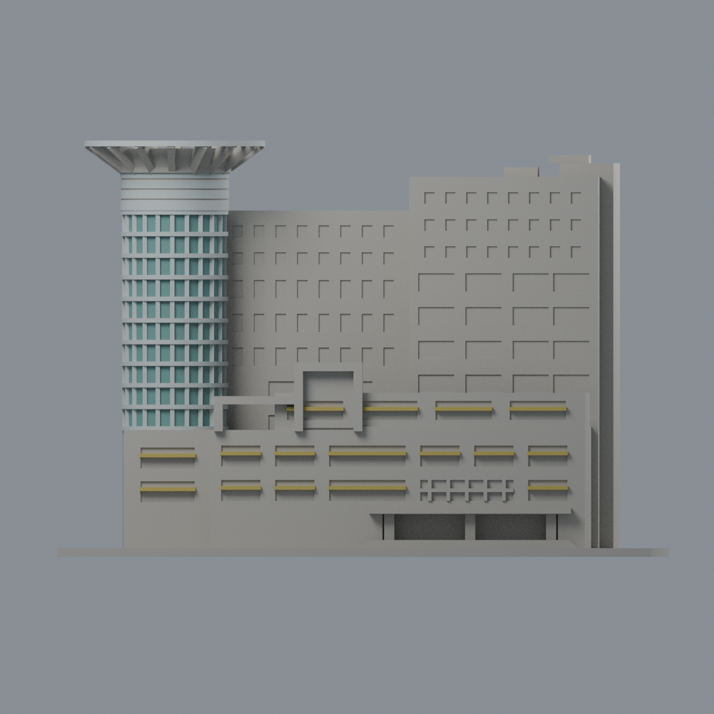
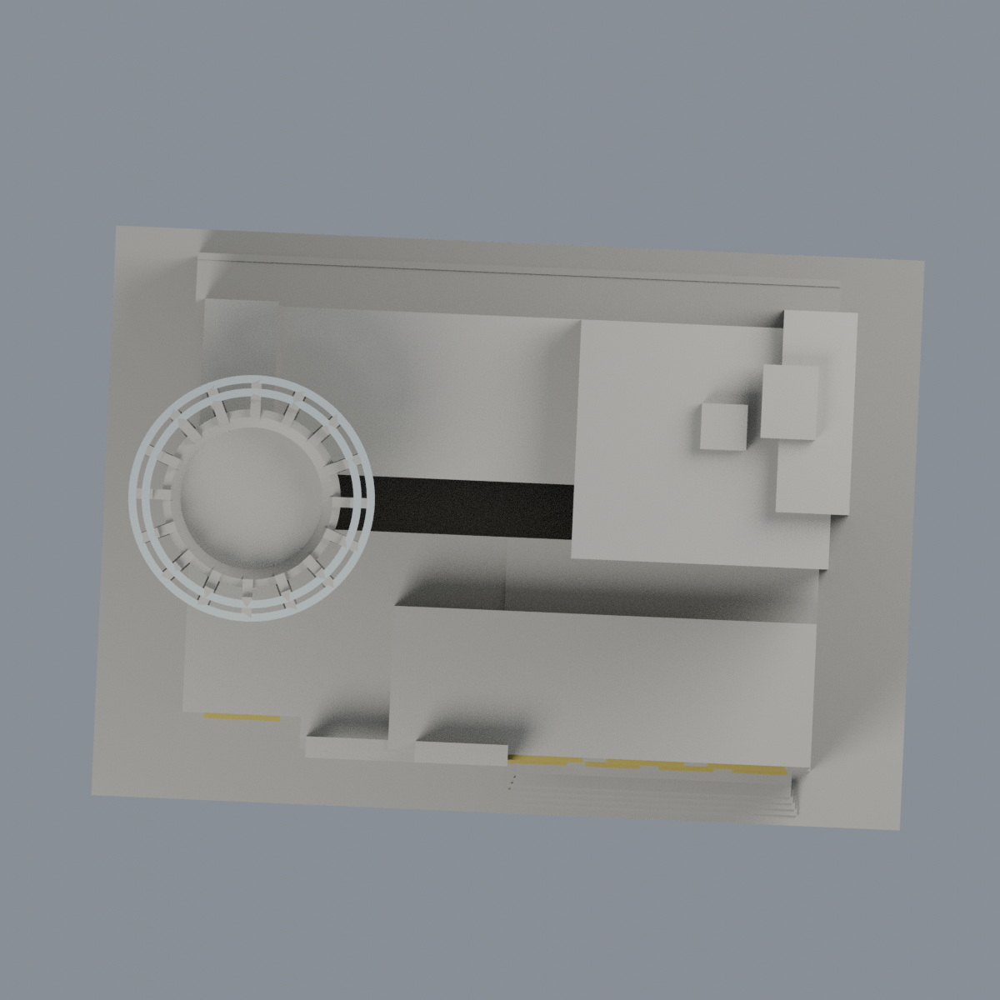

# 僑光圖資大樓圓筒與遮陽限定配色：四材質外觀版

沿用原 **24,716 三角面／12,288 頂點**，不改原 STL 位元、座標、面序或幾何；這是既有模型外觀改版，不增加模型包數。

| 模型預覽 | 模型預覽 | 模型預覽 |
| :---: | :---: | :---: |
| 正面  | 來源支持構件／未註冊牆面中性  |  |
|  |  |  |

[表面色 3MF](oculib-appearance.3mf) · [可編輯 Blender](scene.blend) · [材質色表](palette.json) · [逐面指派與依據](face-materials.json) · [原 STL](../model.stl)

## 來源與配色邊界

親看僑光科技大學[官方歷史館圖資大樓](https://cc3.ocu.edu.tw/history/index.php?a=2&m=6&n=2_%E5%9C%96%E8%B3%87%E5%A4%A7%E6%A8%93&z=%E5%9C%96%E8%B3%87%E5%A4%A7%E6%A8%93)五張完整照片，並核對原單色網格、預覽與生成器。[精確 URL、SHA、完整解碼與日期](qa/source-review.json)。日間「氣勢宏偉」與「領航前進」為主要配色證據，nested Original 分別 2007-08-28、2010-12-28；五照 root Modified 均 2014-01-20，不能當攝影日期。其餘夜景、倒影、暮光只輔助辨形，不將照明／反射／天空染色烘焙成塗料。年代混合且 EXIF 未獨立鑑定；不宣稱 2026 現況。來源原圖私用、不入包。

- 18 個南面與前露台獨立遮陽盒，共 328 個原面採低飽和金黃色；完整盒外表面作同構材質有界延伸，不聲稱每一背面皆拍到。北側遮陽盒中性。
- 圓筒 1,520 個原凹背面採克制青綠玻璃代理；逐一核對原 96 段 arcband 的平面與線段全頂點包含，不用近似半徑或面心閾值，不染框邊／側揭面。
- 8,806 個原獨立銀灰構件面：上 cap 的 791 個外圈面、水平環、原直框及雙冠環。環頂底要求完整三角形被原多邊形環覆蓋，避免三頂點在環內但三角形穿過中孔。原 Boolean 重分面不變，未補造照片的更多細格。
- 原冠部打印用 backing webs 不等於實景金屬構件，保留中性；尚未精確定位的斜撐、flare skirt、cap 刻線、頂面與窗側揭面也中性，不用高度門檻把整冠染銀。部分灰縫為保守未賦色原面，非新增分割或實景色縫主張。
- 大牆、一般窗帶、低裙樓深色大面、入口與北側構件、屋頂設備及未註冊面全中性，不把中性色稱實景灰色還原；這是圓筒與遮陽局部外觀研究，非完整立面材料復原。銀構件延伸只限已識別原構件。
- 精確反轉原比例與 -2.5° 平面旋轉後核對整個原三角形；STL 位元、座標、面序、原建模腳本及歷史 QA 不變。不新增標字、設備、樹或牆面紋理，未做實體列印測試。

[原幾何與歷史來源限制](../README.md)

## 重建與核驗

安裝 [依賴](source/requirements.txt)，Blender 使用 4.3.2。由本資料夾上層提供原 model.stl：

1. `python appearance/source/build_appearance.py`
2. `python appearance/source/verify_exchange.py`
3. `blender -b -t 3 --python-exit-code 1 -P appearance/source/render_appearance.py`
4. `blender -b -t 3 --python-exit-code 1 -P appearance/source/verify_scene.py`

[獨立重建 ZIP](rebuild-source.zip)含原 STL、四支程式及依賴，不含第三方照片；不取代原建模腳本。[逐檔 SHA256](SHA256SUMS)

[交換／拓撲 QA](qa/exchange-validation.json)核對原座標與面序、全部面材質、單連通、有向水密邊、頂點 link 單環、正體積與零退化／重複面；lib3mf 嚴格讀取零警告，實際編輯單材質再存讀，其他材質及面指派不變。SDK 六位小數量化誤差另列。

[Blender 存讀與編輯](qa/scene-validation.json) · [渲染記錄](qa/render-manifest.json) · [獨立重建](qa/rebuild-validation.json)

## 製造限制照舊

尺寸仍為 150 × 108.88164 × 102.04628 mm；原 STL、建模程式、場景及歷史 QA 保留。原層檢與薄特徵檢查本次未重跑，不能由材質 QA 代替。

3MF 是同一網格的表面色，不是各材質各自封閉的分色實體、切片專案、噴頭映射或 G-code。切片 GUI、多材料路徑與實體列印未測；柱頭、屋簷、窗框及薄邊仍須評估材料、支撐及拆除風險，沒有保證可印或免支撐。
