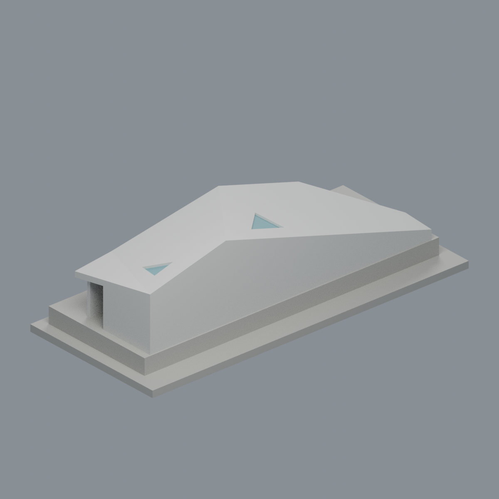
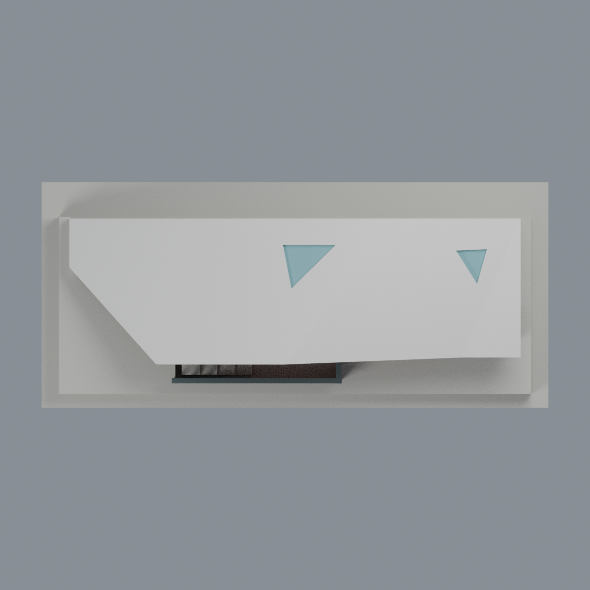
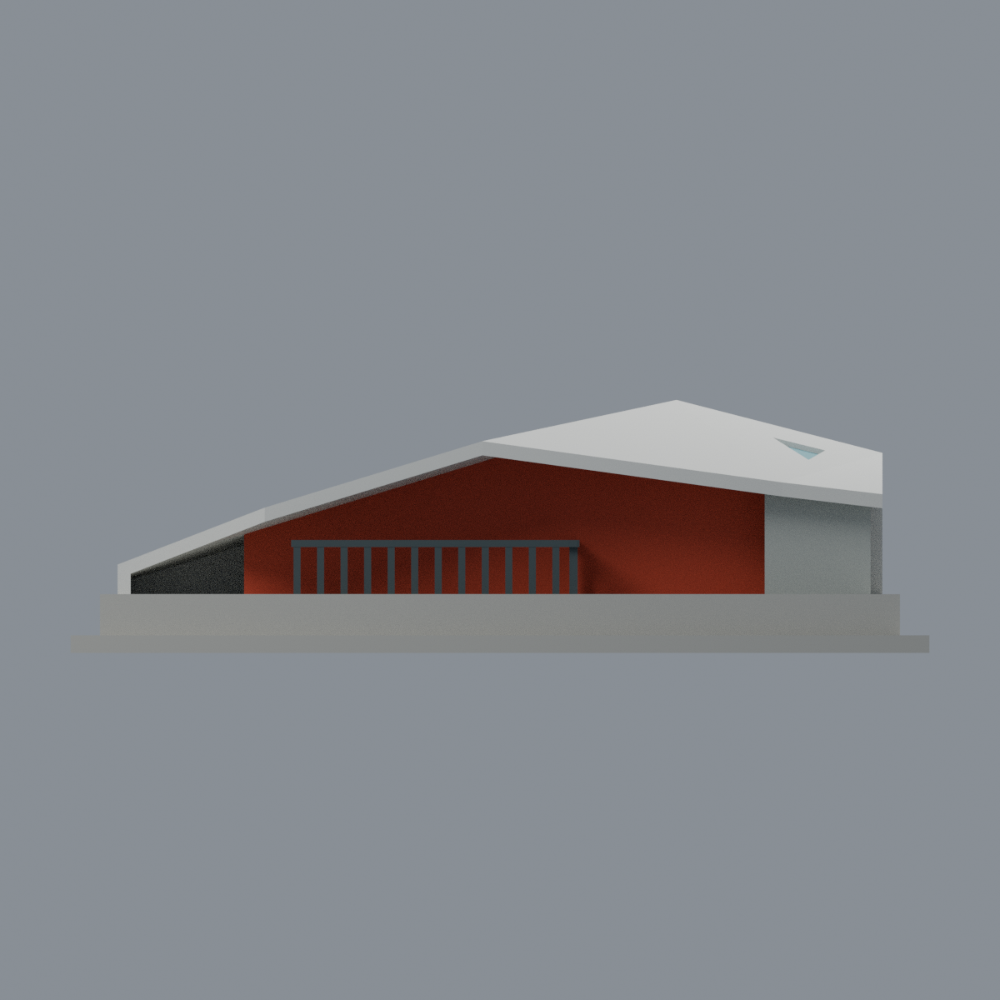
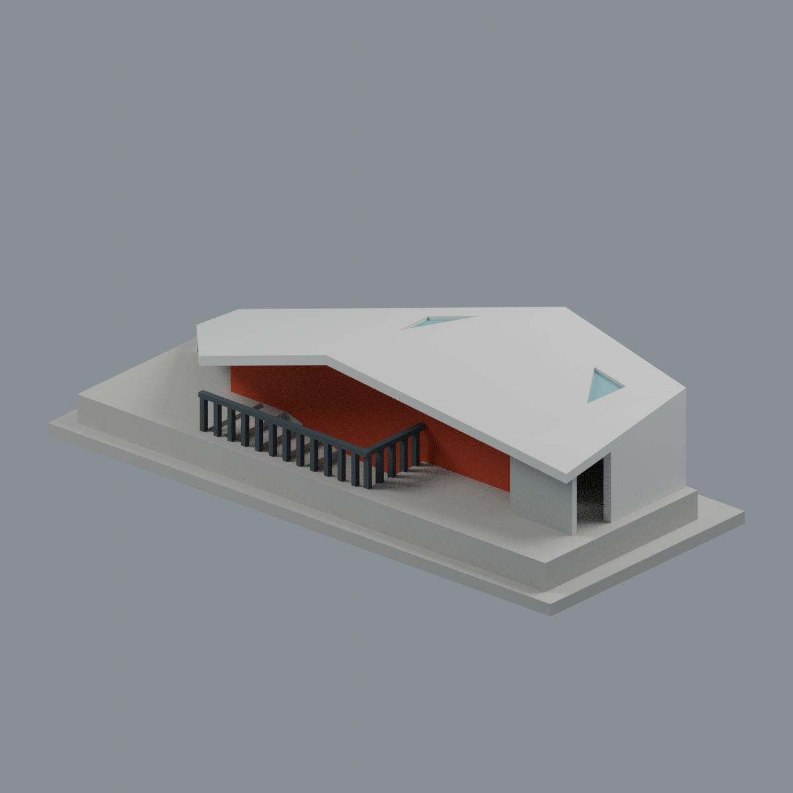

# 僑光科技大學多功能休閒運動中心折板入口棚

## 模型預覽

| 模型預覽 | 模型預覽 | 模型預覽 |
| :---: | :---: | :---: |
| 步道側  | 跑道側  |  |

**2012 年完工建築群中的單座地上入口棚**：依建築師兩張相反方向的竣工照片，取總覽照前景、同一座折板棚，另附明確裁切的地下入口鄰接示意。不包含整座運動中心、實習旅館、另一座棚或地下網路，亦不代表全校完成。

[頂視](previews/top.png) · [步道立面](previews/elevation.png) · [另一端](previews/path_end.png)

| 模型預覽 | 模型預覽 | 模型預覽 |
| :---: | :---: | :---: |
| 頂視  | 步道立面  | 另一端  |

## 檔案
- [彩色可編輯 3MF](model.3mf)：6 種逐面顯示材質；不是多材料擠出機設定。
- [Blender 場景](scene.blend)：實際交付網格，可改材質；沒有外連照片、貼圖或內嵌腳本。
- [單實體 STL](model.stl)：與 3MF/Blend 同一三角面幾何，STL 本身無顏色。
- [生成腳本](build_model.py)、[渲染腳本](render_model.py)、[來源](SOURCES.md)、[檢查與限制](QA.md)。

## 尺度、範圍與近似
含底座 **146 × 65 × 43 mm**，任意照片展示比例，**沒有實測長寬高、角度、殼厚、天窗尺寸或比例尺**。不可用建築群的總高、總面積推定此棚的尺寸。+Y 為跑道側、−Y 為步道側；X 只是模型長軸，不宣稱精確方位。

保留不對稱多面折板、大／小三角天窗、長向跑道側實牆、步道側凹入紅橘牆與開口、扶欄及上部入口。三角天窗是 **0.9 mm 真凹槽＋不透明背板**，不是透明玻璃，也不是穿洞。步道側與樓梯井是真空間，並非黑色貼圖假洞。

殼厚 2.4 mm、扶欄加粗為 1.2–1.5 mm，為展示與列印化參數，不是真實量測。地下室只顯示裁切盆地與 **4 階符號化上部階梯**，不是查證的階數、深度或完整動線。照片未充分揭露的短端／下側閉合採保守簡化；遠端陰影無法判定為玻璃，故以中性灰未確認閉合表意，不推定玻璃。紅橘核心長度、深度與平板化外觀均為近似，不能當完整原室格、室內或立面調查。

## 列印警告
拓樸完整、單連通並不等於免支撐或已試印。折板大跨距與懸挑、天窗背板、扶欄需自行切片檢查支撐與拆除順序。**嚴格 0.8 mm 分層截面測試有 2 個失敗層**（遠端斜薄尖及最高頂點），原始 false 與局部損失均保留在 QA 中；沒有宣稱全細節可印。勿任意縮小，尚未實體試印。
