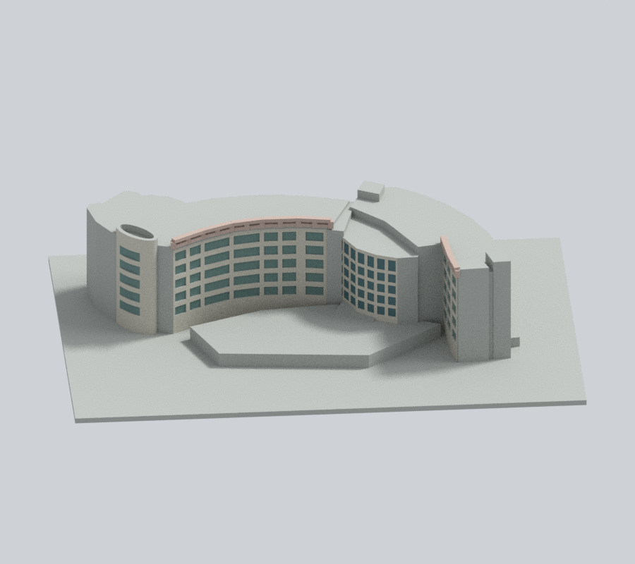
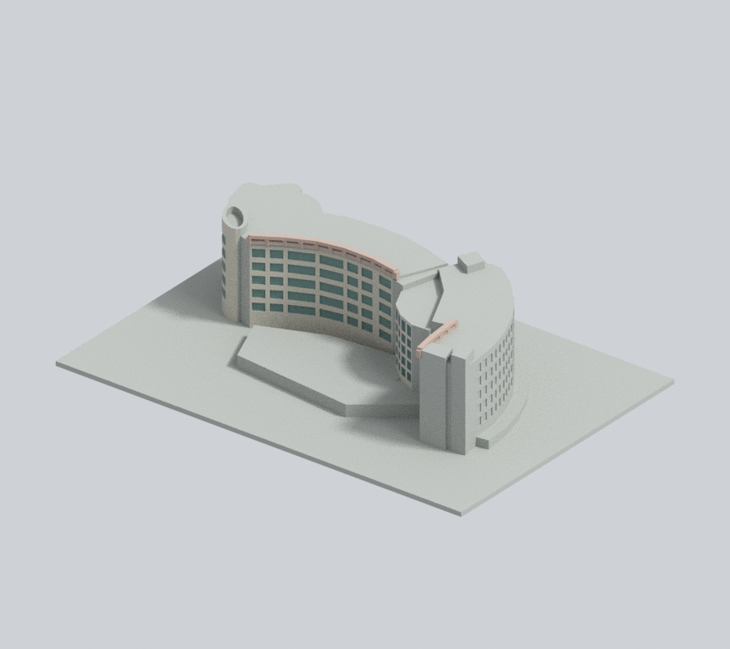
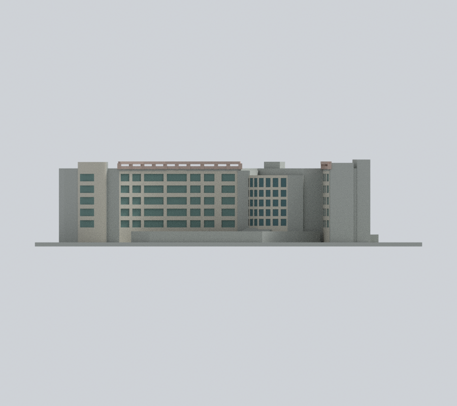
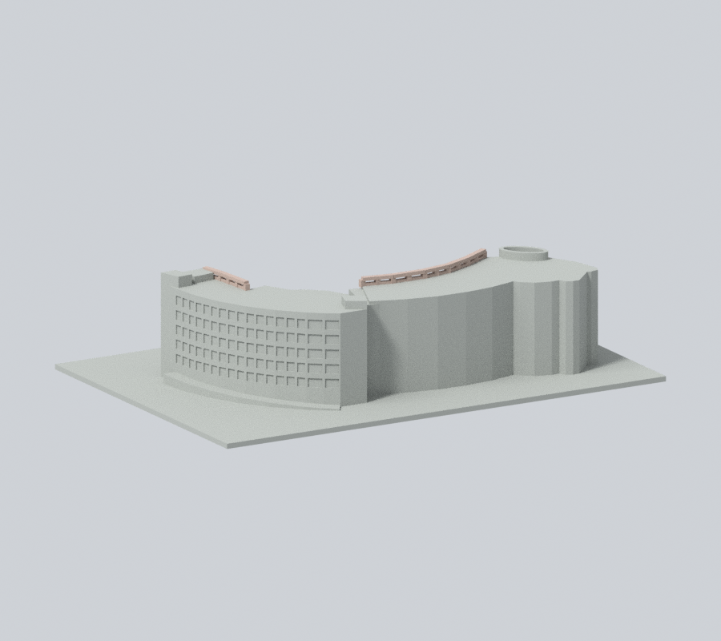
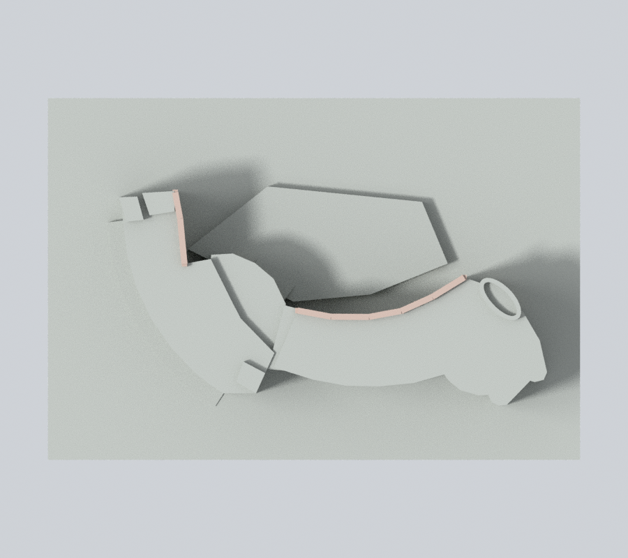

# 光瀚圖書資訊大樓／光寰樓連體

## 模型預覽

| 新彩色內院 | 新彩色斜視 | 新彩色立面 |
| :---: | :---: | :---: |
|  |  |  |
| 新彩色背向 | 新彩色上視 | 彩色下載 |
|  |  | [彩色3MF](appearance.3mf) · [彩色Blender](appearance.blend) |

### 新增有限實照彩色（原圖不變）

依校方2022永續報告兩張不同時期照片，只補已辨內院牆米灰、原窗背灰綠／入口凸弧深藍綠、既有頂格架低飽和粉褐。未知外弧、背面、屋頂／人工坡地保中性，不新增光電或細構件。

原五圖及選圖、原幾何／尺寸／STL／scene不變。詳[來源與重建限制](APPEARANCE.md)。

依官方平面、跨年正射、校方正面與斜空照片自建的有界外觀近似。不是精準測繪或特定年份完整復原。

## 檔案與比例

- `model.stl`：毫米，含底座150×102×33.7mm，底座朝下。
- `scene.blend`：實際STL匯入的可編修網格；`build_model.py`與`plan-registration.json`為原創參數來源。
- 比例1.07mm/m僅用於本件近似；主屋面26m為照片比例試配值，工作範圍23–29m，高核30m亦非官方測高。
- 內院+4m、外弧灰基座與上升坡地為示意。LB1/B2存在有官方資料，但各段露出多少及地腳高差沒有精確量測。

## 來源與取捨

光瀚L1–4F及光寰H1/2/5F平面與正射分別作共座標診斷。H東雙弧、L西雙核、中央單核與入口凸弧均保留。平面配準原殘差保留，未以OSM邊線或視差位移強行裁切牆身。

2016、2024為影像內標記，PHOTO2018服務圖實際標2016；2022永續報告及2014刊物不是相片精確拍攝日。不同斜照的屋頂設備年代不一，本模型省略光電和細部設備，不宣稱同年屋頂現況。

可見五排窗依分區處理，入口玻璃以淺刻槽和加粗格間表達。H未知外弧及雙弧端細窗省略；已辨H前端寬橫窗與窄直窗保留。橢圓頂環有厚底，並非通透整棟孔。頂格架、柱根、梁與窄框為列印加厚簡化，不宜任意再縮小。來源原圖和PDF只供私人核對，不附公開包；見[sources.json](sources.json)。

## 列印與數位檢查

尚未實體試印。數位水密、截面和射線檢查不等於切片工具路徑或成品承載能力；頂格架、挑出部和局部根接需要另核支撐、方向與機台解析度，不保證無支撐可印。

作者數位檢查與64筆損失、763筆短弦及局部支承限制見[QA.md](QA.md)。已完成獨立核驗並獲主審接受本頁下列特定有限例外；遠端發布另查發布紀錄。舊拓撲失敗或薄唇候選均非可發布版本。

## 獨立數位審核與限定例外（2026-10-15）
[獨立摘要](independent-audit-summary.json)與[原WKT警告](independent-original-warning-evidence.json)保留原開運算，未以理想矩形替換。主審接受以下特定有限證據；這不等同實體試印、製造公差穩健或全域壁厚保證。原作者結果未覆寫。
- 169層280原Polygon全部侵蝕／opening存活且單核心；整層4層>1%，最大1.2947342328829632%。64是跨層截面樣本，不是64實物：H下帶4、H頂柱44（11×4）、L頂柱16（4×4）。
- H下帶最大損1.1922555934121286%、保留98.80774440658787%，真角0.41mm外5.688371813215142e−15mm²為數值殘差。H柱最大6.299505764280765%、保留93.70049423571923%，真角外0.0014502068757382166mm²／0.06462585229246004%；L柱最大6.186316997133069%、保留93.81368300286694%，真角外0.0001582327684632001mm²／0.007051371799336963%。角外餘量均在原邊0.005mm帶內，不能稱全純角零損。
- 指定原面法向下帶最小1.176965mm、柱1.4979972mm。柱底僅28.0031–76.1251%平面托接；H整梁11支承、L含西塔5支承，上梁跨空，不是全底支承。原physical_post_inventory的merged_west_tower全false與原FINAL記1不一致：獨驗L_post01實際與塔支承重疊2.243885mm²，原flag留作來源記錄不作拓撲結論。
- 全5028原三角×10點＝50280，1001法向短首段保留，最短0.0393813188145mm。有限局部鏈分類751純凸、250真凹凸混鏈；25筆按所有鏈真面法向求共同內向max-margin，不以長根選方向。第一連續根最小3.4437597256816823mm，24024條途中／出口後控制一致。原短段不可拿後牆或根長替換。
- 作者35196／763是子集。其原179仍1凸＋178混；較近的0.8mm局部鏈規則把其餘584中的12筆改採真混鏈，並不否定作者較寬1.5mm另有凸路。新增238中178凸／60混。共同內向dot最小僅5.505290975711844e−7，不能據此保證公差穩健。
- [原兩parity旗標](independent-parity-contact-evidence.json)保留：face486/488精確重心碰原邊界但前後solid angle均在實體內，並非出口。真正首段22.33203067392422／19.59489135920948mm；原0.367475042605／0.366463337347mm「air」其實仍在實體，不可沿用作真空隙。
- [4筆共面−X根](independent-coplanar-axis-evidence.json)原樣保留：面2350/2351/2356/2358的原長根在z32.4160003662塔頂沿表面，±z擾動後不同，不能當穩健內部連續根，更不能只取下移長值。
- [另驗實柱連接](independent-four-post-evidence.json)：同一L上梁指定垂厚1.0699996948mm、原側面橫寬1.711939–1.711968mm；預先按實際L_post02支承重心選目標，四首根5.800117／6.138205／6.466072／9.390374mm，抵柱距4.510003／4.772890／5.027830／7.301683mm均在首次出口前，z±0.01mm仍先抵柱，柱點下射到z0。柱頂實重疊2.243951mm²、柱腳partial1.096856mm²。梁塔局部footprint僅1.103046mm²且0.4mm侵蝕為空，不能拿整塔51.2mm²冒充梁局部頸寬；其他實柱支承需保留。上述皆指定位置的模型毫米，不是建物實測。
- [可攜證據索引](qa-dense/portable-evidence-index.json)新增嚴格JSON副本，null air明確為無第三入射，raw gz與9份根JSON位元不變。原兩旗標、原共面長值不洗綠。
- 原始STL／重建／saved Blend一致，5PNG逐bytes重渲一致，正背同列及metadata核過。仍應試切片、規劃棚梁／外簷支撐及小心拆支撐；不可任意縮小。未知背窗、PV省略、坡地與高度有界推估、跨年來源限制全部保留。
