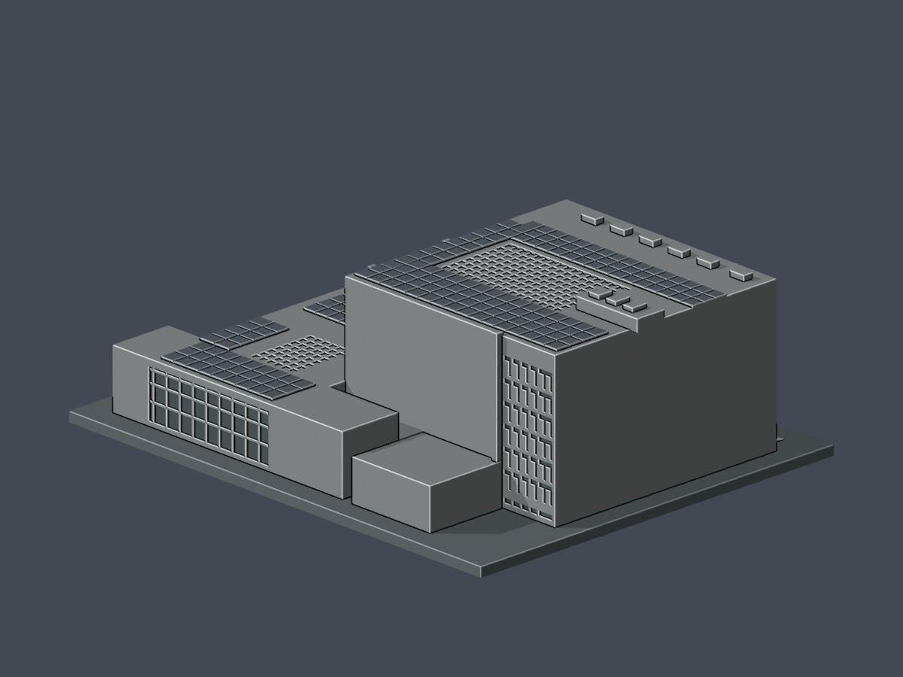
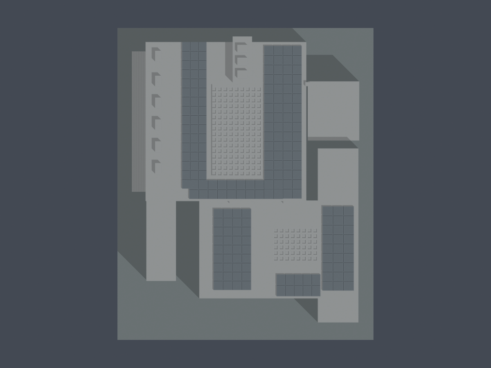
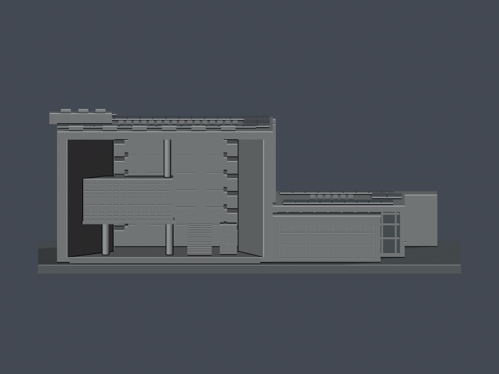

# 元智大學五館暨圖書館擴建翼｜來源限定外觀近似

本件涵蓋五館（圖書資訊大樓）與相接的2006圖書館擴建，合為同一建築模型。不含鄰接六館，也不代表全校完成。校史五館1998年8月啟用／7F及B1，圖書館沿革另記1997遷入，兩種口徑並存；2006擴建完成、啟用及剪綵月份不同，未混寫同一天。

| 模型預覽 | 模型預覽 | 模型預覽 |
| :---: | :---: | :---: |
| 西南主要面：西框口及南低翼  | 同件東北背面  |  |

[STL](model.stl) · [可編輯Blend](scene.blend) · [原創Python源](build_model.py) · [頂圖](previews/top.png) · [西立面](previews/west.png) · [來源](sources.json) · [尺寸與限制](dimensional-evidence.json) · [QA摘要](qa-summary.json)

| 模型預覽 | 模型預覽 | 模型預覽 |
| :---: | :---: | :---: |
| 頂圖  | 西立面  |  |

## 來源約束與未測繪部分
2024正射逐片配合官方B1／1F／2F服務平面、2018西／東後／南實景和建築師照片建模。另以水印2016正射核低屋面；其服務層名PHOTO2018不等於2018拍攝。官方平面以西斜收大口、擴建庭院和東道路梯間共同對向；灰色非本層服務區沒有挖空。擴建官方B1+3F，服務平面缺3F不等於實體缺層。

高主屋面約51×51公尺，整體屋面約69×90公尺是影像投影起點，含屋頂視差，不是牆基測量。主高屋面名義31m、試配範圍27–35m；南擴建12.2m、試配10–14m；西南窄玻璃翼10.3m及東棕低屋面8.5m均為影像有界近似，沒有官方分翼標高。東北停車坪保留地面，不升為屋面。樹遮低翼牆基、B1地腳與精確層高未知，地形沒有測繪。正北立面無可核窗排，保守省略；東高窄窗僅用於照片可辨北段，不鏡射全樓。

西大框為斜收實牆及真開口，懸盒、兩下圓柱／上吊柱、階梯與內院廊台可辨。主中庭和南擴建中庭均有玻璃蓋，以有背板的凹格實體表示；不是露天空洞。南擴建室內以實體承托，不是室內剖面模型。西南獨立窄翼及其與擴建間空隙保留。2024光電大片配置用淺刻簡化格，不把暗色挖成洞。來源跨年，不聲稱同年現況測繪；原照片／PDF未隨包散布。

## 列印尺度與幾何QA
含底座123×150×54.3mm，底座3mm，1推估公尺換算1.5mm。原STL共19,122面，精確同座標合併後單一表面殼、每邊兩面、vertex-link單環、原法向與繞序、正體積均通；沒有repair、補洞或吞掉封閉內殼。Python獨立重建STL相同，Blend原面及7張實際STL PNG逐byte重現。

0.2mm層距／z偏移0.071mm，共272層、829個原Polygon逐一作0.4mm erosion/opening，零消失、零分裂。保留原逐構件loss，沒有以整層平均取代局部。1.0mm canonical薄件掃描另列，並不替代0.2mm測試。

剩6筆具體矩形角損跨層樣本，來自2個實際部位，並非6支柱：
- 最上入口踏階2層：原面X/Y為1.275×8.7mm，最大損失1.2454563%，保留98.7545437%。
- 東突出竪牆頂4層：原面X/Y為2.25×1.95mm，最大損失3.1487690%，保留96.8512310%。
- 6筆損失全在原頂點0.41mm鄰域內；原STL雙向ray下連底z0，上表面分別14.64／50.400002mm。這項具體例外已由獨立原STL重算並獲主審接受，不宣稱零警告。

[逐Polygon與構件loss](feature-loss-locations.json) · [0.2mm逐構件](layer-component-check.json) · [整層](layer-opening-check.json) · [canonical薄件](thin-feature-check.json) · [原面法向／根／開口](architectural-ray-check.json) · [重建驗證](validation.json)

三圓柱實際法向及上下根、西口兩高度淨空、12段欄板至後牆及下樓板根接、兩玻璃蓋背厚已由原STL面ray驗證。欄板最終1.275mm、玻璃蓋凹槽底最薄1.02mm、廊台1.05mm。0.675mm高窗槽寬、0.18mm小入口盒刻深是背接裝飾，屬最終模型毫米，可能被切片弱化；不是來源建築尺寸。PV分格及根部有可列印簡化，未宣稱原比例細部測量。

## 使用限制與重建
未實體試印，未提供全域最小壁厚或完整自交證書。西大跨口、懸盒、廊台和玻璃頂跨距需自行評估支撐／方向及切片；數位通過不等於無支撐可印。不要只依渲染凹面色彩判斷厚度。

使用Python及requirements.txt所列套件執行build_model.py，再以Blender執行render_preview.py。validate_model.py會獨立重建、讀Blend原面並重出7PNG比對。check_feature_losses.py保留每個原Polygon的loss定位，check_architectural_rays.py驗指定薄根及開口；不會修復輸入STL。

## 獨立原面補充
272層829原Polygon侵蝕／opening後皆單核心，零消失或分裂。最上入口梯踏z14.271、14.471mm兩筆損失最大1.245456312938%、保留98.754543687062%；東突出竪牆頂z49.671、49.871、50.071、50.271mm四筆最大3.148769037325%、保留96.851230962675%。六筆為兩個指定部位的跨層樣本，不能說六個實體構件或六支柱。真轉角0.41mm區外損失為0，12筆原三角面雙方向法線最小1.2749996mm，六點向下連到z0；整層最大0.799491916302%不取代上述局部警告。
西口真空間、兩下圓柱2.55mm至底座及懸盒、上吊柱2.4mm至盒頂與上板、12段欄根皆重現。主玻璃蓋指定凹槽背厚1.019996mm；增建玻璃蓋另兩指定點向下連續實體21.299999mm，兩者為不同位置口徑，不能當全域最小壁厚。原未知背窗省略、分翼高度與東低屋面估值、跨年來源限制維持；懸盒、跨口、玻璃蓋及欄台仍需切片／支撐評估，不得任意縮小，未實體試印。
