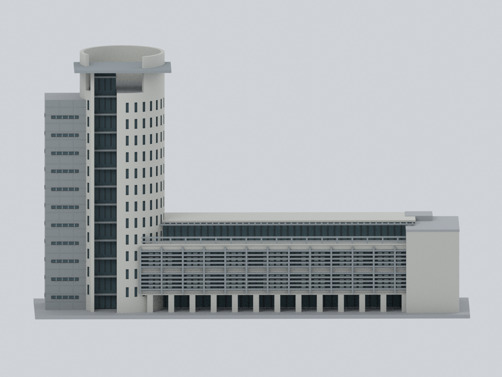
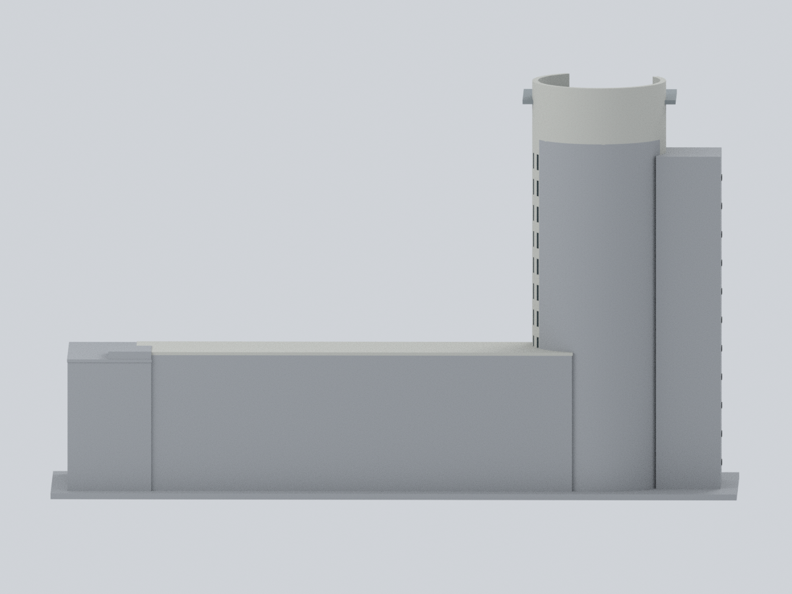
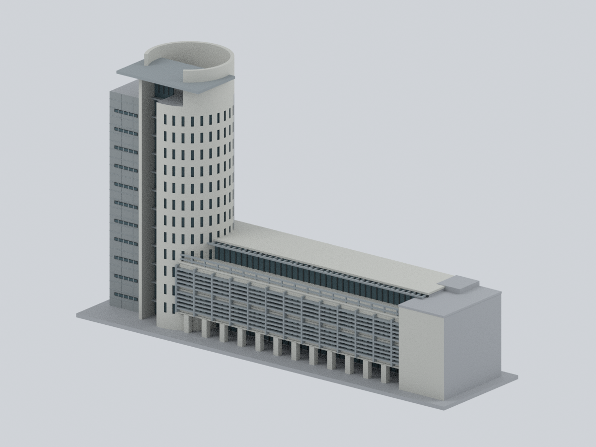
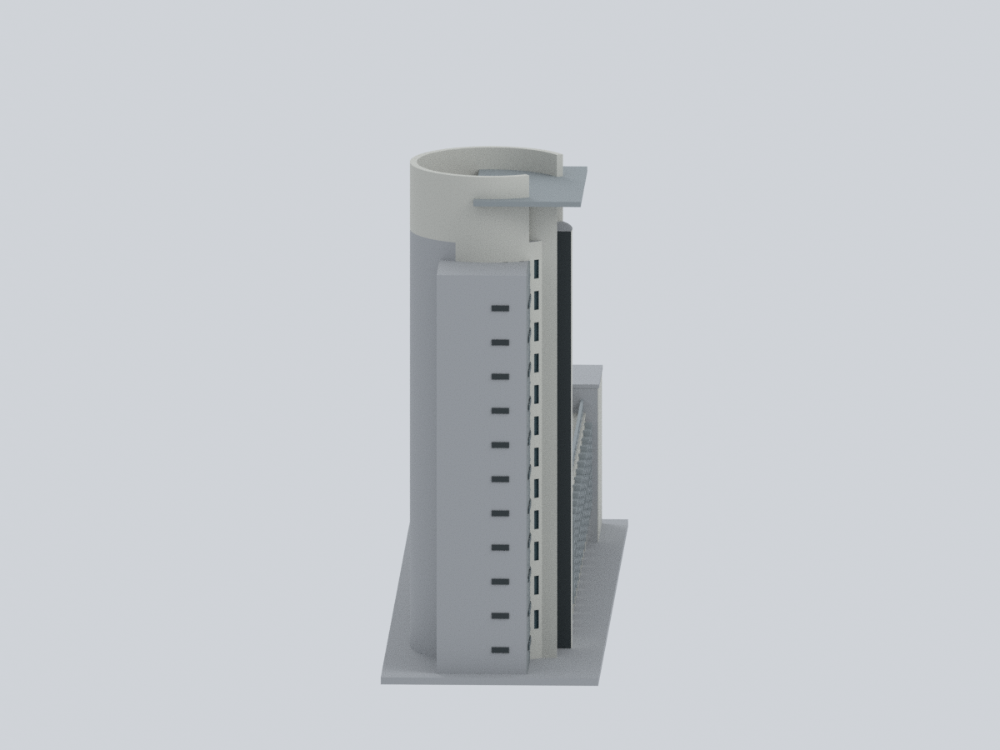
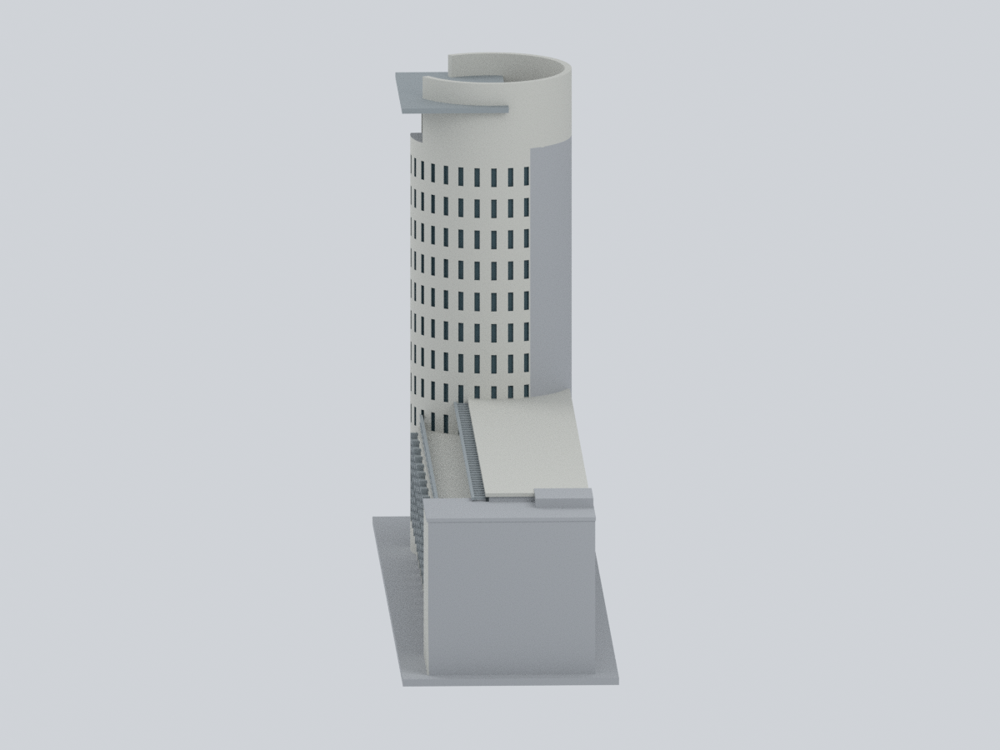
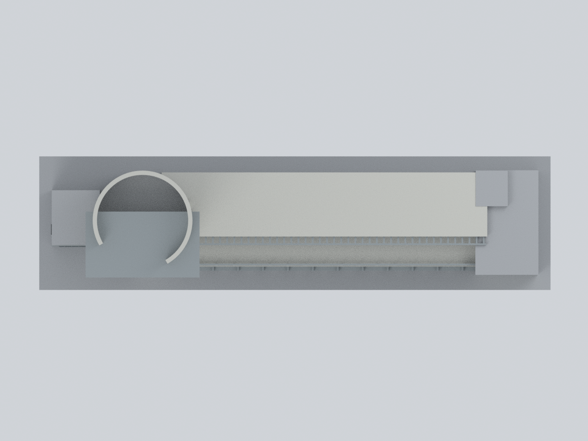
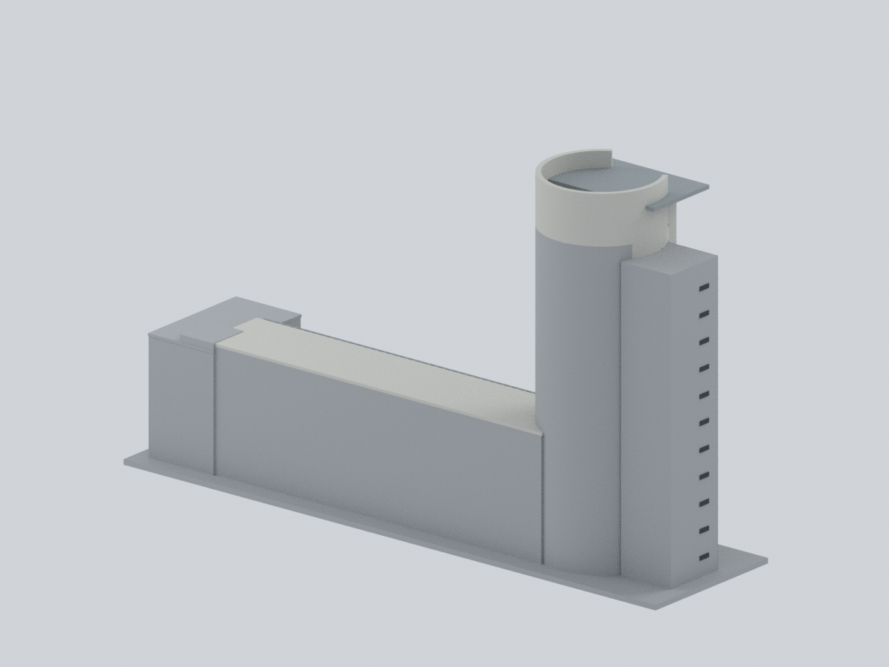
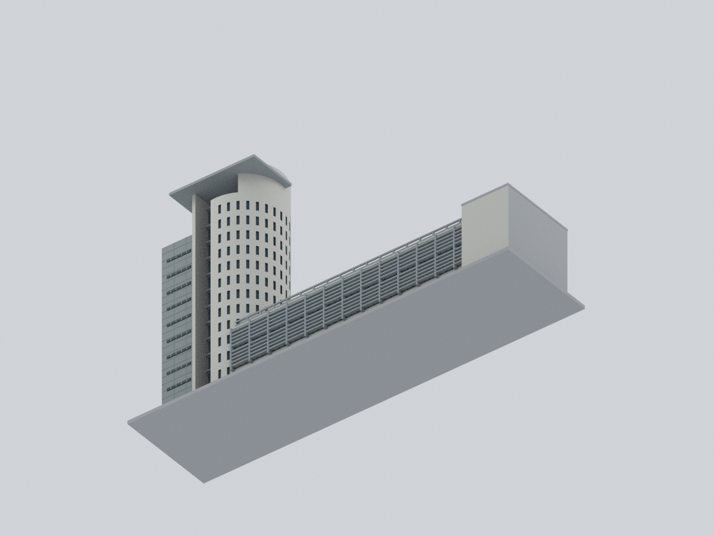
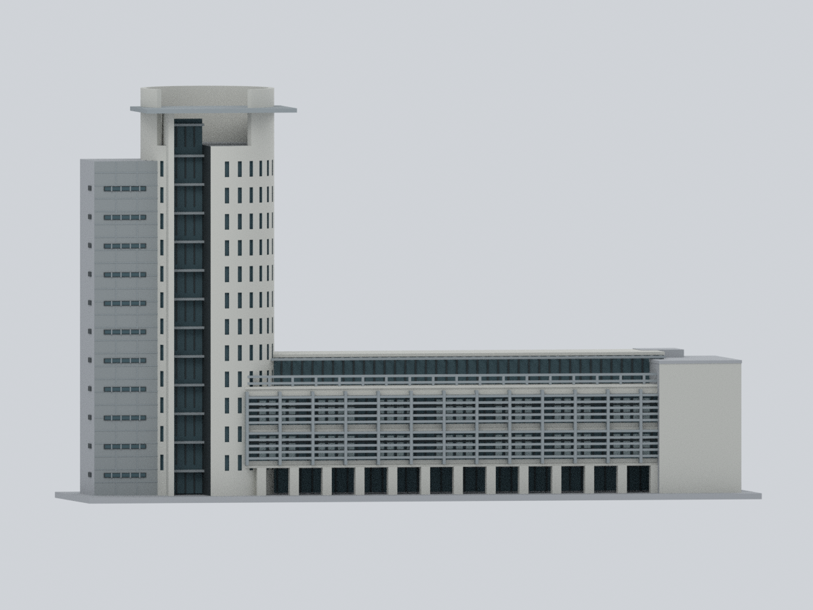

# 元智大學｜六館行政教學大樓

## 模型預覽

| 正面／校園側 | 背面／北側未知開口 | 前方斜視 |
|---|---|---|
|  |  |  |
| 西側／服務脊 | 東側／有庠廳 | 俯視／冠部開口與退台 |
|  |  |  |
| 後方斜視 | 底面／製造底座 | 低角度柱廊 |
|  |  |  |

**完整相連主體的彩色歷史外觀近似**：曲面行政塔、開口曲冠與突出頂板、深玻璃槽、高矩形服務脊、完整教學長翼／退台、東端有庠廳及底層柱廊。不是只做圓柱；不包含相鄰一館、五館巨大門框或七館。

依 **2016 水印航照及 2018 外觀照片**建立。後來的路線圖、校園圖、防災表僅交叉查證身份與穩定量體關係。不是 2026 現況、測繪或竣工模型。

## 同一實際網格的九個視角

全部由本包實際 STL／Blend／3MF 共用網格直接渲染，沒有照片貼圖或 AI 示意圖。前方概略為南／校園側，右為東端；方位不代表測得方位角。北面未記錄開口中性省略，沒有鏡射南面。


## 可編輯及彩色檔案

- [STL](model.stl)：單一連通封閉網格，含原創展示底座，**287 × 75 × 172.5 mm**。STL 本身無色。
- [Blend](yzu-building6.blend)：真實可編輯網格，7 個逐面材質及逐面證據規則；沒有隱藏補件或貼圖。
- [彩色 3MF](yzu-building6.3mf)：實際 base-material 及逐三角面色彩指派，不是改名的 STL。
- [參數](parameters.json)、[色盤](palette.json)、[來源與權利](sources.json)、[觀測／推定規則](mapping-rules.json)、[逐面對照](face-materials.csv)、[重建程式](source/rebuild.py)。

### 尺度與比例：只有「約 68 m」是公開高度錨點

[校史第六章](https://www.yzu.edu.tw/admin/so/files/History/chapter%206.pdf)印刷頁 159 記錄行政圓筒約 68 m、地上 14 層、地下 1 層。本模型塔高不含底座為 170 mm，僅因此採 **名義高度比例 1:400**；不是整棟已校準的精確縮尺。

塔徑、長翼長寬、服務脊高度、冠牆角度、層高、柱距和窗數都是照片／航照比例近似及製造選擇。模型服務脊與教學長翼的高度視覺量級分別約為塔高的 0.82、0.34；照片 2018-68 的約 0.79、0.33 只是未校正透視的輪廓像素比，不是實測標高比。這些值不能相互當成量測證明。

防災表的 4F／3F 面積比約 0.661、14F／5–7F 表列面積比約 0.507，只說明樓層不等面積；**不反算底盤、塔徑或屋頂缺口**。航照高塔有明顯視差，屋頂邊緣不是地面牆基座標。無比例尺樓層路線圖只用於拓樸，不拿房間格硬量公尺。

## 來源、身份與年代

| 來源 | 實際支持 | 限制 |
|---|---|---|
| [原建築師 ARTECH 混合五／六館頁](https://krisyaoartech.com/en/projects/education/yuan-ze-university-library-and-administration-academy)，圖 02／08 | 曲塔、深槽、曲冠缺口及突出帽、高矩形服務脊、露台及遮陽 | 頁面 1995／1998 日期不可給後建六館；圖 01／03／04 是五館，排除 |
| [校方六館大原圖](https://www.yzu.edu.tw/aboutyzu/images/main/%E6%A0%A1%E6%99%AF/%E5%85%AD%E9%A4%A8%20Building%206.JPG) | 淺灰混凝土、細長塔窗、水平金屬遮陽、柱廊 | EXIF 為 2003-02-20；縮圖與此圖是同一照片，不算獨立佐證 |
| [2018 第一手校園記錄](https://mnya.tw/yo/word/683.html)，圖 25／68／73 | 曲冠／帽、近塔高的服務脊、完整可見長翼和退台 | 2018-07-01 原文與影像，HTTP 修改日不是攝影日；獨立低樓是一館 |
| [官方 1F／3F／4F 路線示意](https://cmebba.yzu.edu.tw/storage/qqPTz5JOdUvz2UiRvMEbHO86cgGeR1yJ4Ti7K9zT.png) | 塔端、西側服務脊、東向長翼、東端有庠廳、4F 退縮拓樸 | 無比例尺，2025 科室配置不當成 2018 室內配置 |
| [官方校園圖](https://www.yzu.edu.tw/admin/ga/files/%E5%85%83%E6%99%BA%E6%A0%A1%E5%9C%92%E5%B9%B3%E9%9D%A2%E5%9C%96-11504.pdf) | 六館及 6A 身份、與一／五／七館的相鄰關係 | 圖上北方朝左，不是頁面上方；不是施工平面 |
| [NLSC 地圖服務](https://maps.nlsc.gov.tw/)兩期航照；逐 tile URL 見 sources.json | 塔、長翼、加寬端部相接及屋頂高低 | PHOTO2018 圖層此區水印是 2016；較新 PHOTO2 可見 2024 水印；有高塔視差 |

校史記載 2002-07-19 使用執照、2003-03-08 揭幕；防災表記 2002／14F／RC。建築師混合頁的圖書館年份不拿來替六館定年。

**沒有加入較新大片 PV 陣列，但不是「從未有太陽能／完全 pre-PV」模型。** 校史已提早期太陽能設備；其位置及造形未知而省略，不臆造或宣稱不存在。官方 360 部署時間也不等於攝影時間；back-door 景只支持架空通廊，不能補全北面。

## 保留與有意簡化

- 保留曲面塔與不同窗紋的高服務脊，塔前玻璃槽有真實深度；冠牆高於帽板，缺口及板後頂部空隙實際保持開放，沒有封成整圓實心帽。
- 保留教學長翼的兩個主要下層玻璃帶、外置水平遮陽及豎構架；頂層退縮和長露台；地面柱廊實際可穿空，不把全底層填成厚盒。
- 有庠廳是東端相連加寬端塊，保留完整體積及頂部收邊。東／北開口未知，用 N00 中性收束；沒有杜撰五館的大方洞。
- 北立面、精確接縫、各層標高、冠內全部機具、早期小型太陽能、地下室及地形仍未知。未知面中性省略不是現場無窗的宣稱，也沒有因此刪掉整翼。
- 灰混凝土、銀灰金屬、暗框與深／淺反射玻璃按材料分類；RGB 是展示選色，不是校準取樣色號。青灰反光不代表藍漆。
- 內部實心、玻璃不透明，窗為淺凹／幾何色塊；重複窗數、柱距、遮陽片距為慣例。細部厚化、原創底座、上蓋支撐和簡化端部不代表真實構造。省略室內、精細板縫、校徽文字、人物、植栽、道路、設備及鄰棟。

## 驗證與列印限制

[網格／0.2 mm 切層](qa/geometry-validation.json) · [實際開口測試](qa/feature-validation.json) · [3MF strict／改色重開](qa/3mf-validation.json) · [Blend 真實編輯重開](qa/blend-validation.json) · [全新重建比較](qa/rebuild-validation.json) · [路徑殘留檢查](qa/path-buffer-audit.json) · [九圖檢視](qa/visual-review.json)

重新讀取 STL 檢查邊與頂點流形、朝向、單一連通、退化／重複面及 0.2 mm 情境逐層封閉交線；不是切片器擠出工具路徑。3MF strict 讀取、round-trip、實際改材質重存重開；Blend 實際改頂點及材質、另存重開，原檔保持不變。全新空輸出目錄只由公開腳本＋參數＋色盤重建，重比網格與九圖像素。

**未實體試印。** 現尺寸已長 287 mm，請先確認機台可用成型區；不要直接縮小而期待細部不變。遮陽片／欄杆約 1.0 mm，柱約 3.8 mm，冠牆約 2.4 mm；玻璃框淺浮凸含更細細節，不能把 1 mm 誤當全模型的最小彩色可印寬度。塔帽、柱廊頂、遮陽懸挑與欄杆需要支撐及拆除評估；0.4 mm 噴嘴無保證保留所有色帶。可先放大或做局部試印。3MF 顯色依軟體支援而異；不得用於結構、抗震、消防、疏散、施工或安全評估。

## 只用公開包重建

版本見 [requirements-model.txt](source/requirements-model.txt)，安裝對應依賴後：

```sh
python source/rebuild.py --out NEW_OUTPUT --geometry-python GEOMETRY_PYTHON --three-mf-python LIB3MF_PYTHON --blender blender --threads 4
```

輸入只需 `source/*.py`、`parameters.json`、`palette.json`；不需來源照片、既有 STL／NPZ／Blend／3MF／預覽、登入、私人封存或網路。高階驅動欄位列於參數 `parameter_contract`；詳細幾何仍可在 Python 編輯。[比對器](source/compare_rebuild.py)核對權威陣列、STL 位元組及九圖像素；Blend／ZIP 包裝時間差不誤判成幾何差。

原始照片、PDF、頁面及像素貼圖不隨公開包散布；權利仍屬各來源權利人。這份原創程序模型不授予原照片或建築設計的額外權利。未以任何來源頁面的名稱或授權替全部資料重新授權。
