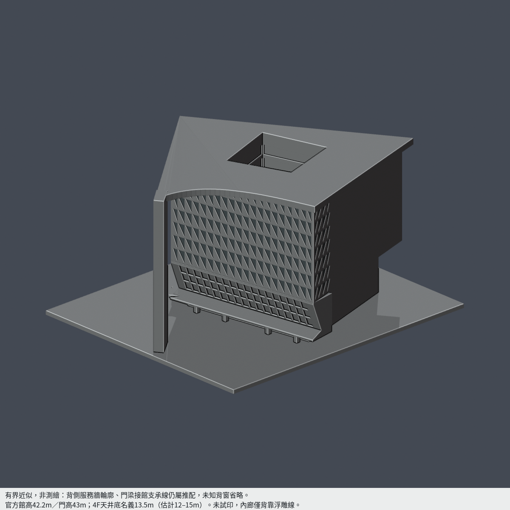

# 南臺科技大學｜校本部

目前2件有明示範圍模型；並非全校／校區完成。

既有來源限定、有界近似：**生活機能館暨一體校門（2016，現稱W磅礡館）**。館與一體校門合計一件，非全校完成；西鄰T棟不包含。

| 模型 | 模型 | 模型 |
|---|---|---|
|  **[生活機能館暨一體校門（2016）](buildings/stust-living-services-gate-2016/README.md)** |  **[新風雨球場（2020）](buildings/stust-covered-sports-court/README.md)** | |

[模型、原創參數、來源與完整QA](buildings/stust-living-services-gate-2016/README.md)

官方館高42.2m、門高43m；背側服務牆輪廓和門梁接館線仍推配，未知背窗省略。4F中庭保留實底，名義13.5m（估計12–15m）；內廊只作背靠線。完整形狀不代表全尺寸測繪。最長150mm，未試印，6柱150跨層特定角損已獨立重驗並獲主審接受。v2鼻端內退0.728mm、V框寬0.910mm為列印化簡，非真實建物尺寸。

## 新風雨球場（2020）範圍

新風雨球場完整新增綠色單跨棚（2020早期屋蓋）外觀近似：9榀18主柱8縱跨、淺雙坡薄屋面與下方折肩梁分開、東折腳豎柵／西開放斷續看台、南北真敞口；北於舊黃棚接界截止，不補假牆，不含後加PV、鄰棟或地下池。130×250×42.85mm、9材質Blend/3MF/STL與5實mesh圖；34504三角單閉殼，I柱修後獨立截面／外觀覆審通過，格式實編回讀及乾淨九檔byte一致。215有效切層中90層含0.8mm侵蝕失敗、局部薄格柵／線條如實披露；大跨與籃架需支撐或分件，未實印。2020公會圖與10月校方完成原照相互核對；作者頁2016／10層錯誤欄不採。高度、斷面、144格柵片數與設備皆估值，不是測繪或2026現況。 [模型與來源](buildings/stust-covered-sports-court/README.md) · [QA限制](buildings/stust-covered-sports-court/QA.md)。既有生活機能館暨一體校門（2016）模型與限制保持。
