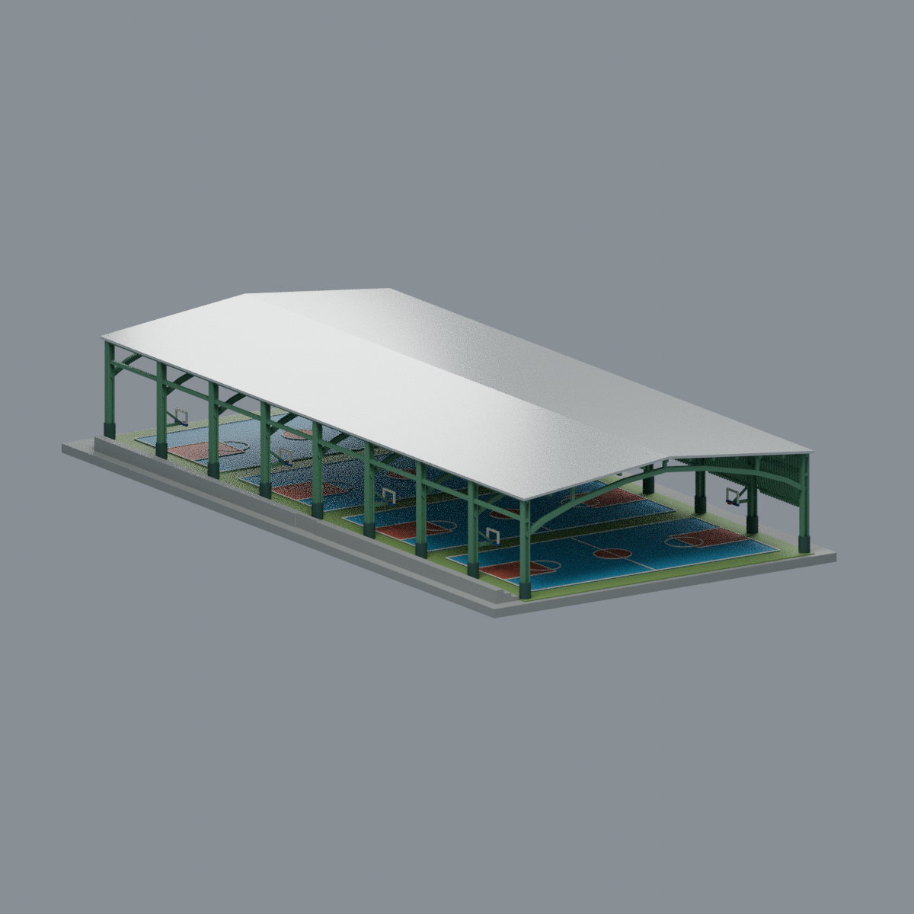
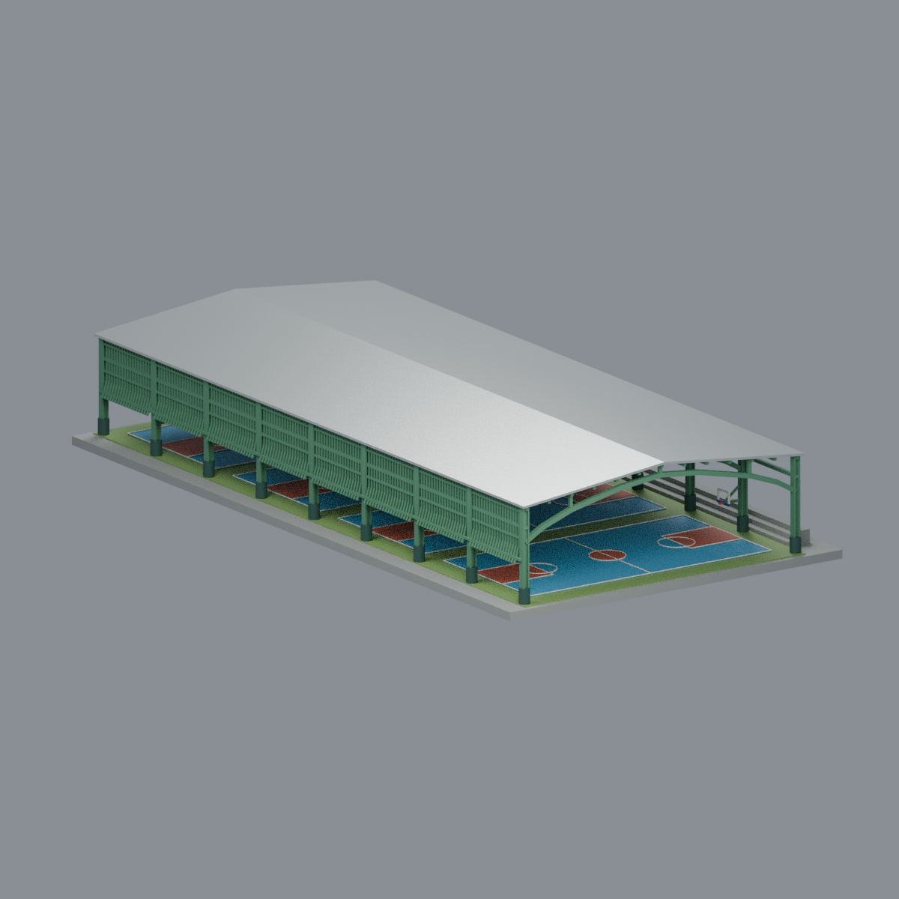
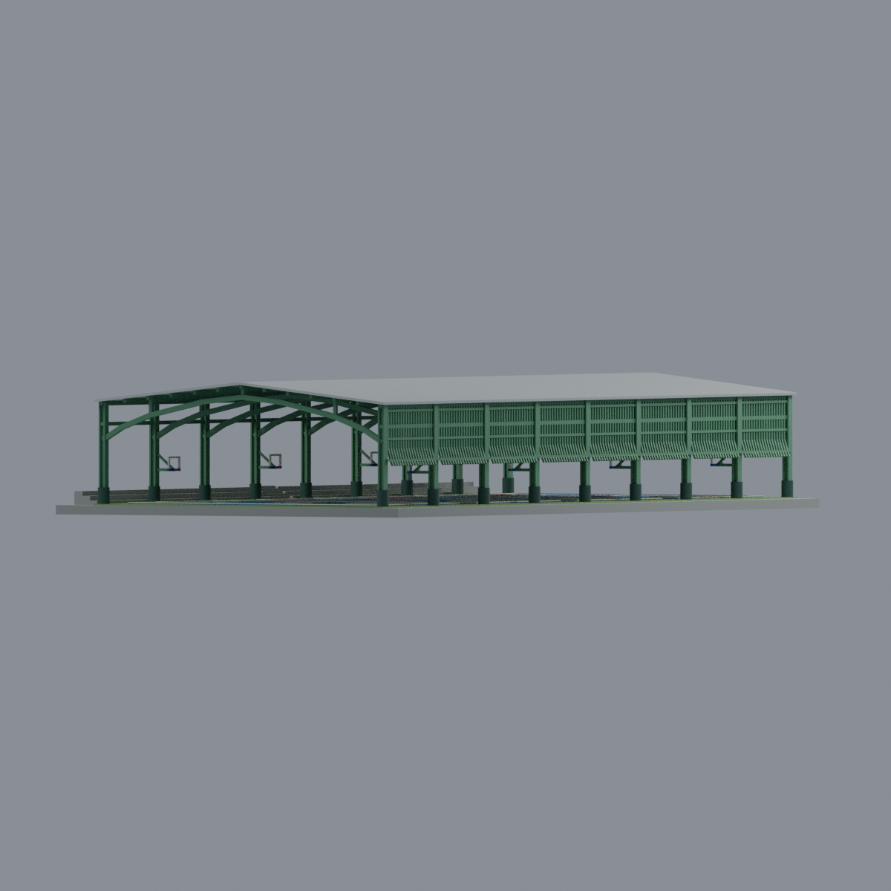
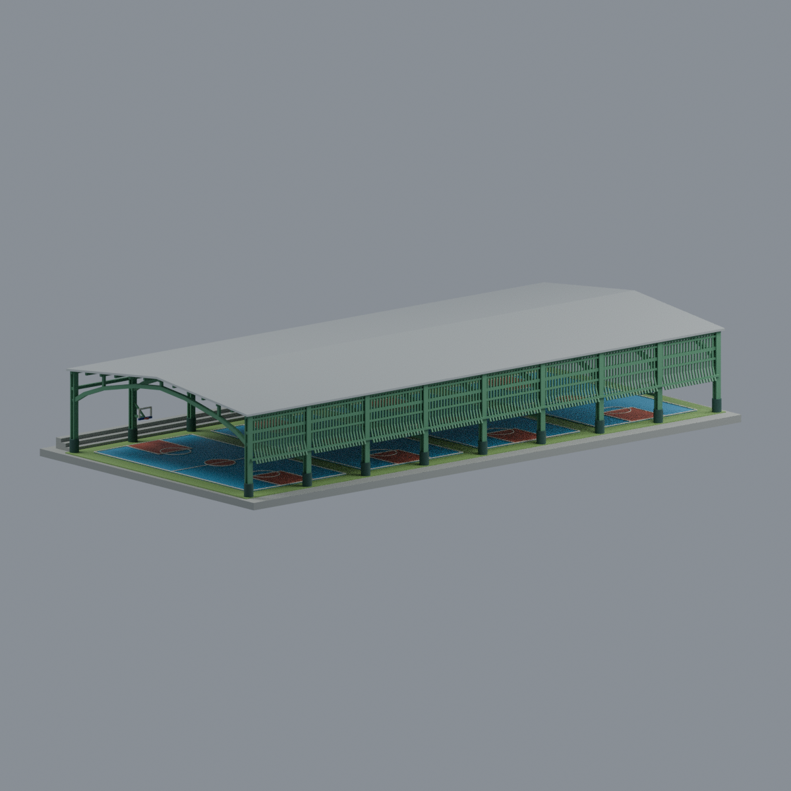

# 南臺科技大學新風雨球場｜2020 早期屋蓋外觀近似

完整新綠色單跨球棚及其場地、直接相關西側看台；不是整座運動園區，也不是2026現況。依2020正式平面、校方完成原照與作者實照建立，不是測繪或施工模型。

- 9榀、18主柱、8縱跨；中間無建築支柱，南北兩端保留真敞口。
- 淺雙坡薄屋面；下方折肩主梁另建，非拱殼。東側折腳豎柵，西側開放斷續看台，不鏡像。
- 北端於新舊棚接界截止，不含舊黃色棚、不補假牆。不含鄰棟、壁畫牆、地下池、後加太陽能板。
- 場地4座籃球場及8組側掛籃架；未建臨時網杆、球網、燈具/電纜、微細接頭、板縫。籃板為開框簡化。

## 模型預覽

| 模型預覽 | 模型預覽 | 模型預覽 |
| :---: | :---: | :---: |
| 正面<br> | 背面<br> | 正立面<br> |
| 左斜視<br> | 俯視<br> |  |

## 檔案
`scene.blend`：可編輯頂點、9材質；`model.3mf`：每三角面材質指派；`model.stl`：同一幾何，格式本身不帶色。
`build_model.py` / `render_model.py` / `rebuild.py` 可在乾淨目錄重建；`previews/`五張皆由最終mesh渲染，不是概念合成圖。

## 尺度與限制
展示底板130×250 mm，高約42.85 mm；屋面245×110 mm。用圖面73.5×32.2 m註記協助比例，非精密1:300測量品。高度、坡角、主梁曲率/斷面、看台階數/高程、格柵144片及間距、籃架細節均估值或微型化。主柱保持I形語彙，低段圓形深綠是保護包覆，不宣稱地下基礎。

**需要支撐，尚未實印，不是免支撐或即印保證。** 約103.6 mm中央跨度、棚下梁/籃架懸挑需支撐或另設分件。格柵0.65 mm、標線0.35 mm、屋面垂直厚0.85 mm；全局及局部0.8 mm侵蝕檢查真實記錄薄處失敗，不以拓樸PASS冒充可製造。小尺寸FFF可能遺失格柵/標線，宜放大或按設備重新設計。

## 重建與檢查
```sh
python build_model.py
blender -b -t 4 --python-exit-code 1 --python render_model.py
python qa_model.py
python check_features.py
python verify_exchange.py
blender -b -t 4 --python-exit-code 1 --python verify_scene.py
blender -b -t 4 --python-exit-code 1 --python verify_render.py
python rebuild.py --output /new/empty/path --blender blender
```
需要requirements.txt依賴，Blender另裝。verify_exchange重建時可設BUILD_PYTHON為具備manifold3d/trimesh的Python。讀QA.md及各JSON，不只看命令退出碼。

本包為本地審核交付，發布與Library備份由統一發布者另處理；沒有把本地完成寫成上線。原始照片/PDF僅私研究，不包含於本包。模型與程式授權及第三方權利限制見LICENSE。
