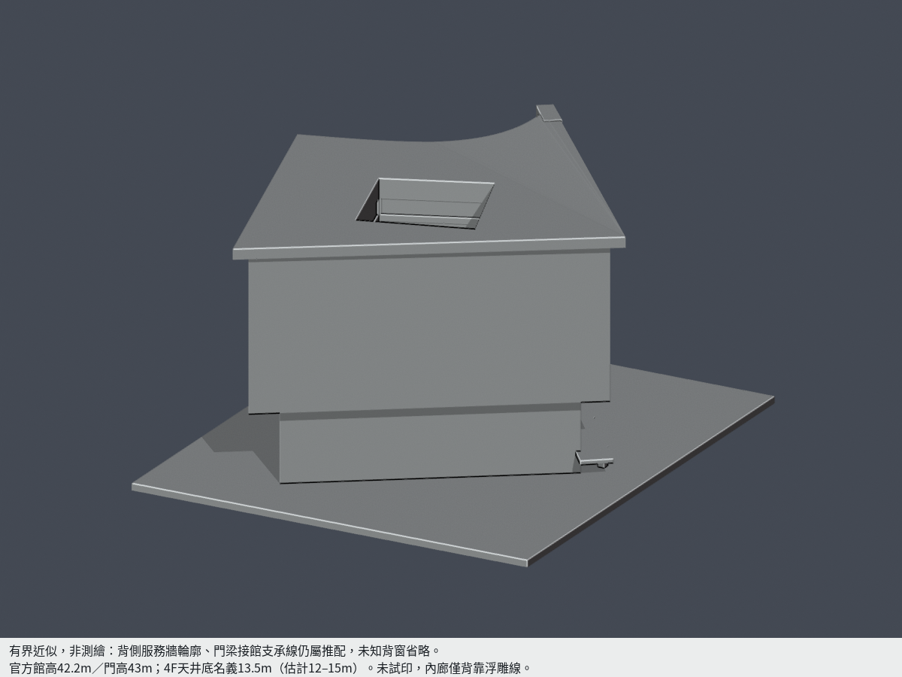
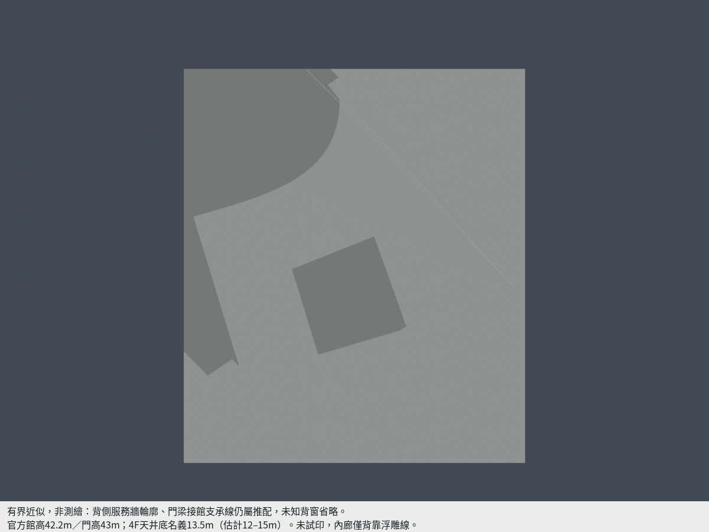
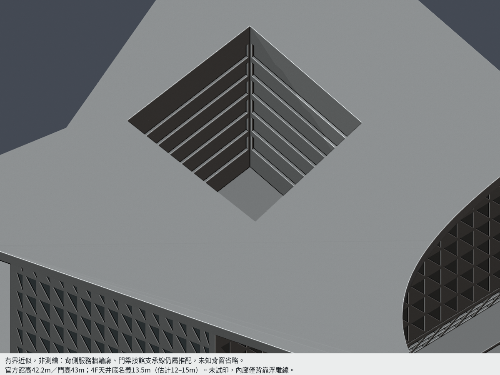
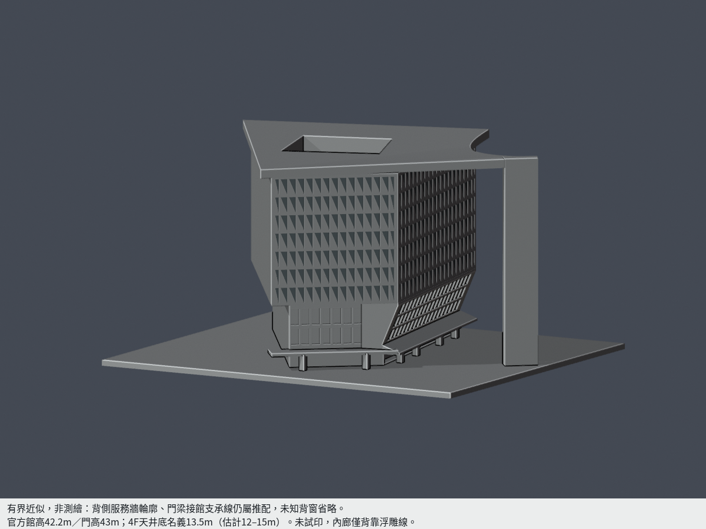
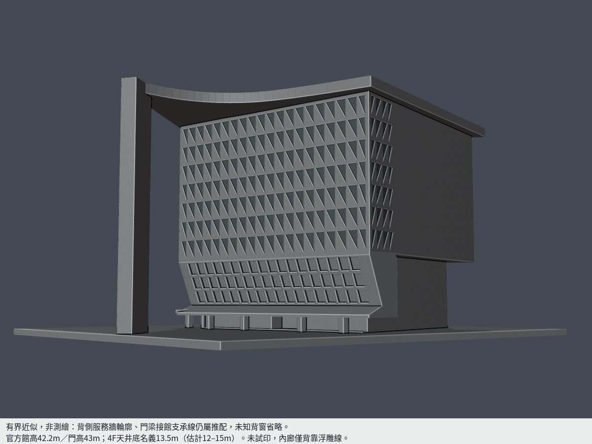
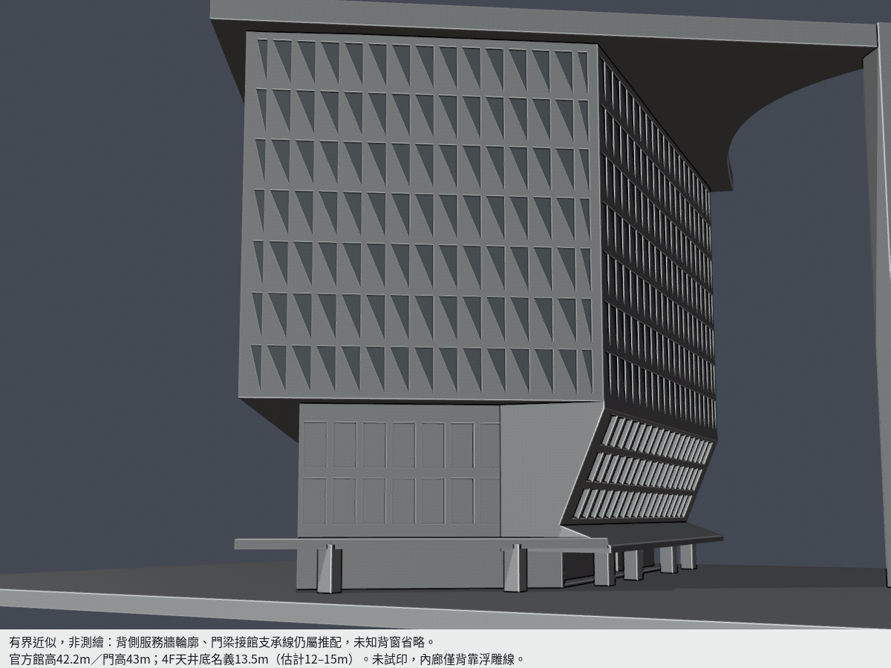

# 南臺科技大學生活機能館暨一體校門（2016）

現稱 W 棟「磅礡館」。本件是單一館舍與其一體校門的**來源限定、有界外觀近似**，不含西鄰 T 棟，不代表全校建築已完成。

| 模型預覽 | 模型預覽 | 模型預覽 |
| :---: | :---: | :---: |
| 校園側完整全景  | 背側完整全景（未知窗省略）  |  |

## 範圍與仍未知之處

- 校方完工資料給館高 **42.2m**、門高 **43m**。一體門頂是**平面內凹曲邊**；微高差的過渡形狀是近似建模，沒有聲稱取得剖面測繪。
- 2023 正射控制屋頂輪廓及孔洞。影像含高差視差、簷口懸挑；**背側服務牆、門梁接館支承線仍屬推配**，不能把完整模型視作全尺寸實測。未知背窗省略。
- 設計者文字、現況中庭照片及原拍4F標示共同支持**四樓實體中庭底板**；名義高度 **13.5m，估計界12–15m**。不是從一樓挖穿。六道廊帶採背靠淺浮雕，未復原可走廊與所有錯層凸平台。
- 校方與現場牌支持10F/B2；高松舊頁B3有衝突，未據此增加地下外露。1F平面只協助拓撲判讀，未整張擠成全高。
- 來源照片跨年份，非同年現況測繪。官方校圖現名與2016歷史工程名合併作同一建物，沒有重複計數。

## 列印尺寸與簡化

- 原始交付 STL：**129.969654 × 150 × 80.485580 mm**（含底座），底座朝下。每館獨立縮尺。
- 源參數使用名義米；最終 **1m → 1.820940819mm**。三角帷幕是約 **0.218513mm** 的背靠淺刻，保留細長分格，沒有獨立脆弱尖片。
- 三角首末格端退0.8m、柱端向外加根0.15m（最終0.273141mm），V折玻璃後向內補實，避免薄皮與封閉內腔。這些是列印調整，不當作原建築尺寸。
- **未實體試印，未跑Cura/Prusa工具路徑。** 高門柱、跨門頂梁、挑簷與中庭內緣需評估支撐；數位QA不保證免支撐或適合所有列印機。

## 原網格 QA 與已接受特定柱角損

- 原 STL 僅精確相同座標去重後驗每邊雙面、vertex-link單環、原法向與繞序、單一表面殼、零退化面；不使用repair修補。
- 0.2mm採樣 **403層／927個原Polygon**。每個原Polygon的0.4mm erosion及接續opening都保留單一Polygon，零消失、零分裂。另保留每構件WKT與損失位置。
- **6根方柱合計150個跨層樣本**（不是150支柱）：最大角損 **2.893369991%**，至少保留 **97.106630009%**；損失全在原真角0.41mm鄰域內，角外損失0。原面X/Y寬至少 **2.185127mm**，均下接底座、上接簷部。此具體例外交獨立審核，不由作者自行批准。
- 原三角面/近尖端、門柱、門梁、V折及下簷都做原面法向與首段交點檢查。主要三角面樣本最小1.083159mm，門頂樣本最小1.292870mm，V區原面密點首段最小0.910467mm；**這些都只是指定區域與方向，不是全域最小壁厚**。
- NW原實角短法向與朝館內根仍分列，沒有冒稱全域最薄。**v2不再沿用v1的V框帶／下簷短法向例外**：V區包含槽底、槽頂、竪側框、下簷鼻端與下表面，917個原面、6419個原面密點的第一段實體弦均≥**0.9104671mm**；每原面最短樣本與真正出口面在 [v2稠密檢查](v2-dense-region-check.json)。整網原面centroid及1%內縮邊／頂點資料保留於 [全網稠密首段](dense-first-chords.json)，該檔短角不等於已獲全域壁厚認證。

## v2修訂：替代未准v1

- v1下簷原尖楔沿全立面存在約1.76mm寬的<0.8mm法向區；獨審測到近鼻端首段0.0062069mm後即空氣。作者先前朝內長根不足以放行，因此v1保持HOLD，沒有覆寫。
- v2只把鼻端向內退0.4個名義米（最終**0.728376mm**），沿原上坡切到z3.152381m，再加底z2.65m的有限端面。垂直幾何厚約0.9148mm與實際原面法向分開看，不把垂直厚直接當法向。
- V窗槽底改沿原V面法向切入，槽頂保留水平截止以避免上緣反向薄唇；三排窗外面高度為5.05–7.30、7.80–10.00、10.50–12.75m（建模單位，非現場測繪）。可見竪框間隙總0.5m，最終約0.910470mm。
- 上述均是列印簡化；保留已核V折、深入口、曲門梁與中庭實底。全網格、逐Polygon、原面法向／出口、獨立重建、Blend與9PNG全部針對v2重跑。詳 [修訂記錄](revisions.json)。

- [完整原面／根射線](architectural-ray-check.json)、[逐構件損失](feature-loss-locations.json)、[重建／Blend／PNG逐bytes](validation.json)、[尺寸界線](dimensional-evidence.json)、[來源](sources.json)。仍須獨立發布審核。

## 檔案與重建

- [model.stl](model.stl)、[scene.blend](scene.blend)、[原創參數](build_model.py)、[依賴](requirements.txt)
- [頂圖](previews/top.png)、[洞底近圖](previews/atrium.png)、[道路全景](previews/road.png)、[校園近圖](previews/campus-detail.png)、[道路近圖](previews/road-detail.png)。近圖可局部取景，前兩主圖保留完整館與門頂。
- Python安裝requirements後執行build_model.py；Blender4.3+執行render_preview.py。繁中圖說使用系統NotoSansCJK-Regular.ttc第3字型、16px；沒有可用字型時應安裝同字型再重建，不能把缺字圖當通過。
- 依序執行validate_model.py、check_thin_features.py、check_all_layers.py、check_layer_components.py、check_feature_losses.py、check_architectural_rays.py、check_dense_first_chords.py、check_v2_dense_region.py、check_dense_parity.py。原照片/PDF沒有放入公開包。

| 模型預覽 | 模型預覽 | 模型預覽 |
| :---: | :---: | :---: |
| 頂圖  | 洞底近圖  | 道路全景  |
| 校園近圖  | 道路近圖  |  |

### v2 原首段內外控制

[獨立包含性控制](dense-parity-check.json)逐一核對36458密點的原面內外、首段實體中點及首出口後空氣，共145832點，零失配。重現腳本為 [check_dense_parity.py](check_dense_parity.py)。此為有限密點證據，未宣稱全域最小壁厚。

v2 有限鼻端使北側4柱在較低層接入立面；重新逐原Polygon計為北4柱各24樣本（z2.271–6.871mm），東2柱各27樣本（z2.271–7.471mm），合計150樣本。沒有沿用v1的158樣本。

## 獨立重驗與限定結論
本次只准v2 STL，v1保持HOLD且不發布。403層927原Polygon侵蝕與opening全部存活且單核；150警告為北側4柱各24層、東側2柱各27層，不是150支柱。原WKT最大損失2.8933699911595454%、保留97.10663000884045%，去共線真角0.41mm區外損失為0。300筆原三角面法向最小2.1851273mm，150代表點均下根z0；整層最大0.22753447522193226%不取代逐柱警告。
原網格、重建STL同SHA、saved Blend與9PNG逐位元一致；全部36458密點首實體及145832表面內／外、首段中點／出口後空氣控制重新核對。V區按位置選取917原面6419點，最小首弦0.9104671mm，包含槽底／側面／有限鼻端全部法向。舊v1下簷薄刃點在v2已為空氣；原法向探點與首段後空隙均保留，未用厚根替代短弦。
全網仍有1163個外角／背靠淺刻邊的短法向弦，不能把V區數值泛化成全網均大於0.8mm。最短0.0068209mm位於NW完整主體凸角，該方向只有一段實體後離開外部，無第二內腔；32個此類角點朝主體內連續根最小37.469751mm。另57個道路窗側緣／門柱角樣點，按局部幾何方向側根連續最小5.3547935mm，沿該實根內移0.8mm後原法向雙向首段跨度最小12.6522474mm。例face4744側根9.2287941mm，內移0.1mm即接入主體；face4807內根8.7936502mm，內移0.4mm接入主體。這是指定短投影側緣的支承證據，不是全域最薄值，也不能忽略其原方向先出實體再有空氣。其他短弦亦按原位置及連續根核對，不把所有短弦當成相同構造。
館42.2m／門43m官方口徑、背服務牆與門梁支承線推配、4F實底名義13.5m（12–15m有界）、未知背窗省略與列印截端／加寬限制維持。需切片與支撐評估、謹慎拆支撐、不得任意縮小，未實體試印，不保證免支撐或全向最小壁厚。
