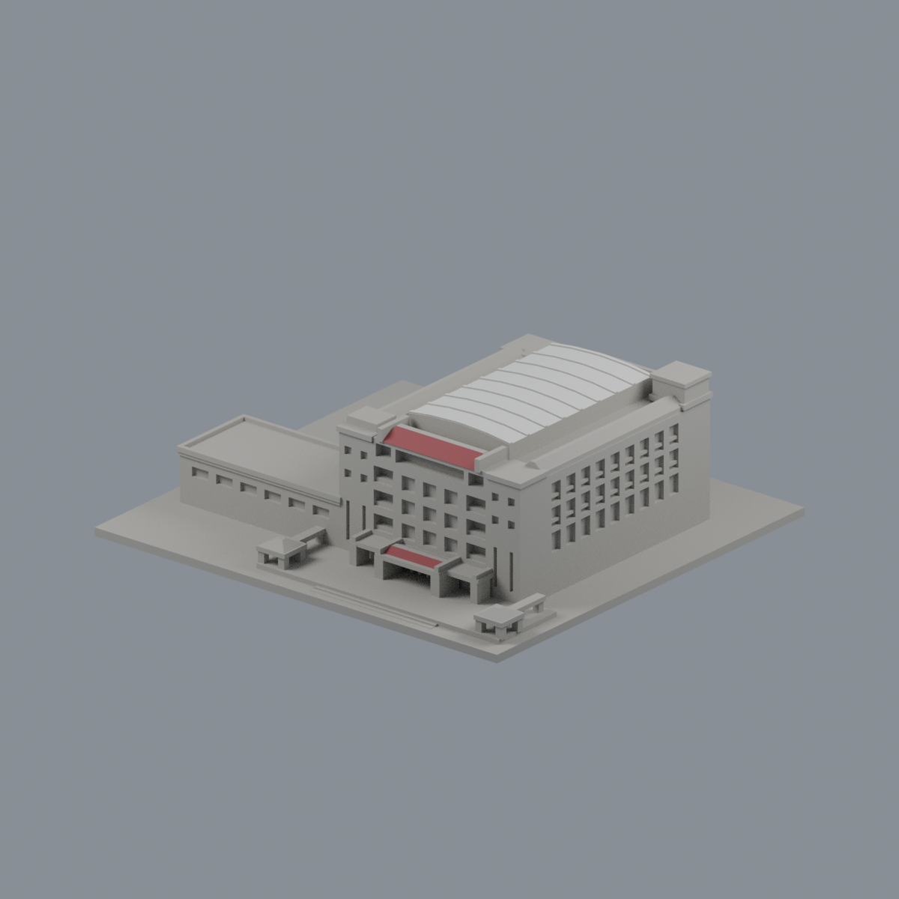
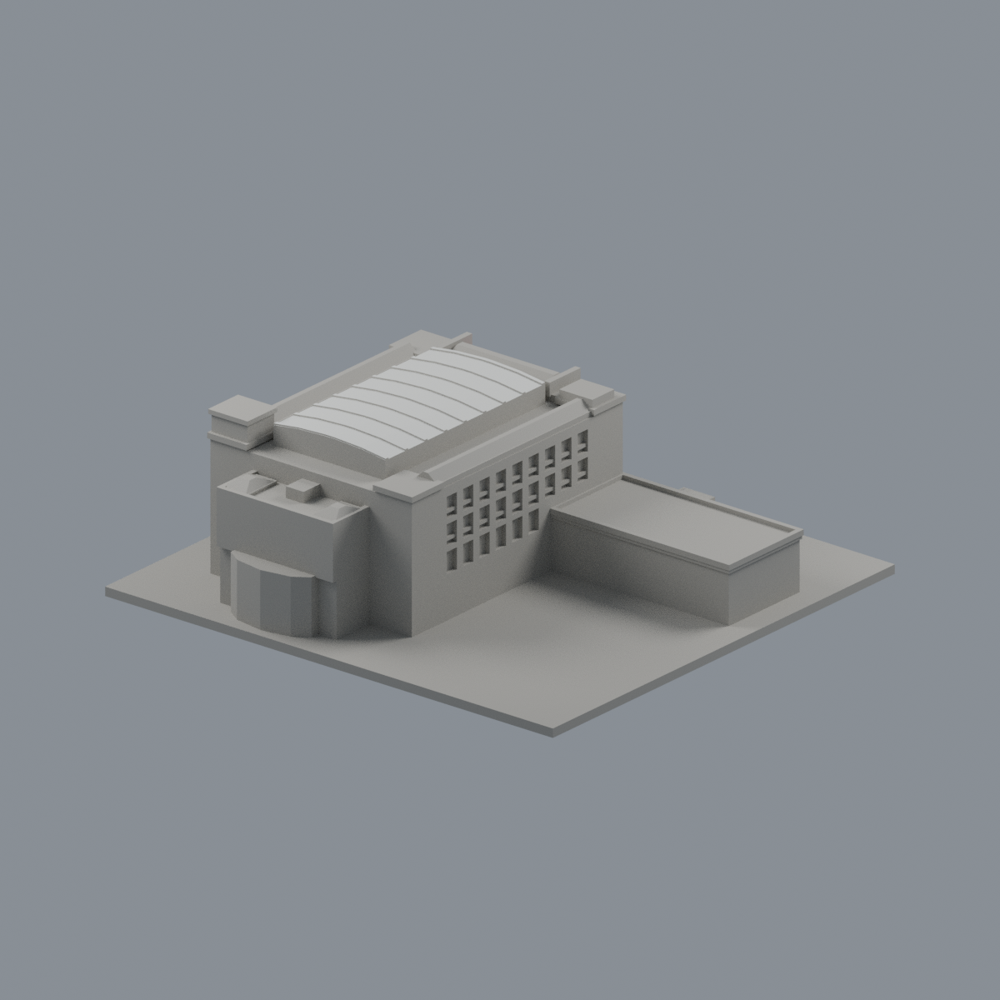
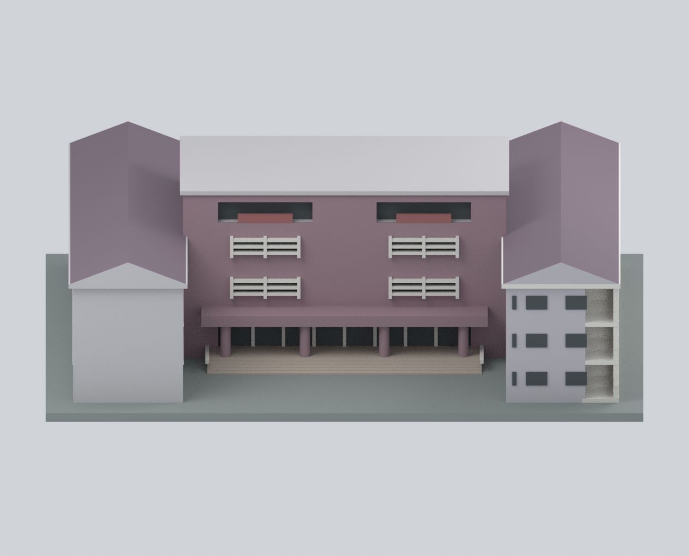

# 南華大學｜大林校本部

目前2套來源比例近似外觀模型：無盡藏圖書館與成均館；不是全校建築清冊或現況測繪。成均館照片年代未定，隱藏面與屋頂簡化、列印支撐限制見模型說明。

[無盡藏圖書館](buildings/nhu-wujinzang-library/README.md)

| 無盡藏圖書館正面 | 無盡藏圖書館背面 | 成均館 |
|---|---|---|
|  |   |  **[成均館（校方照片與調查圖參考外觀近似版；照片年代未定）](buildings/nhu-chengjun-hall/README.md)** |

白覆蓋與前紅坡為官方實景支持的限域配色；其餘未確認面保持中性，攝影年月限制見模型配色說明。
