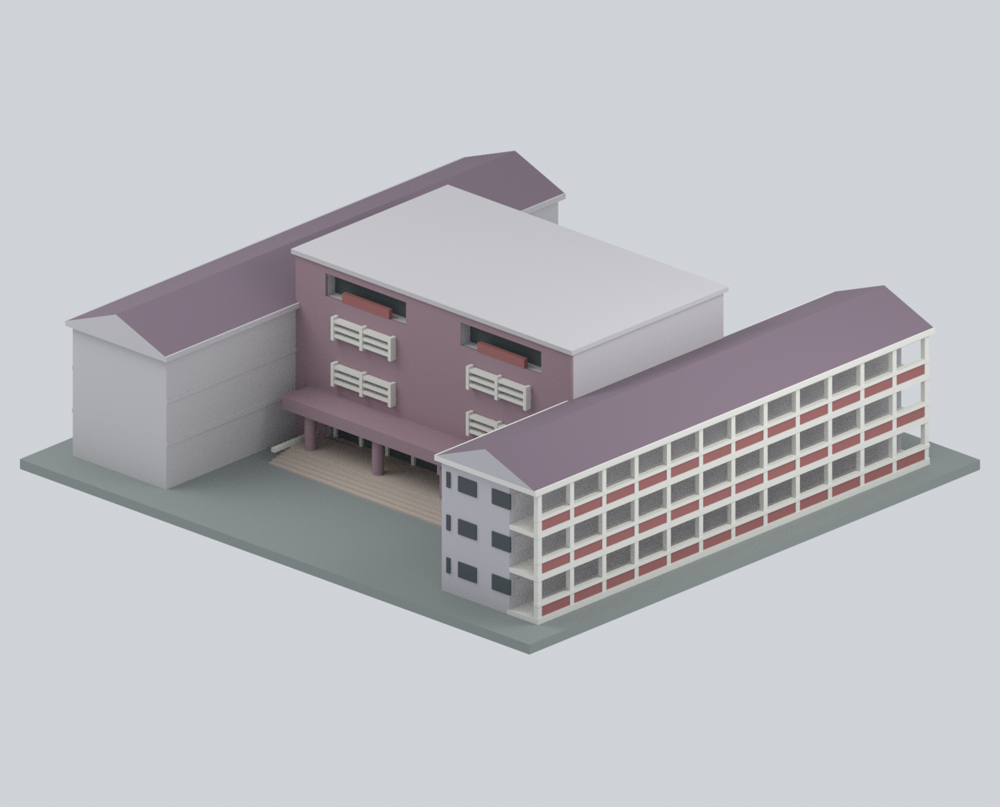
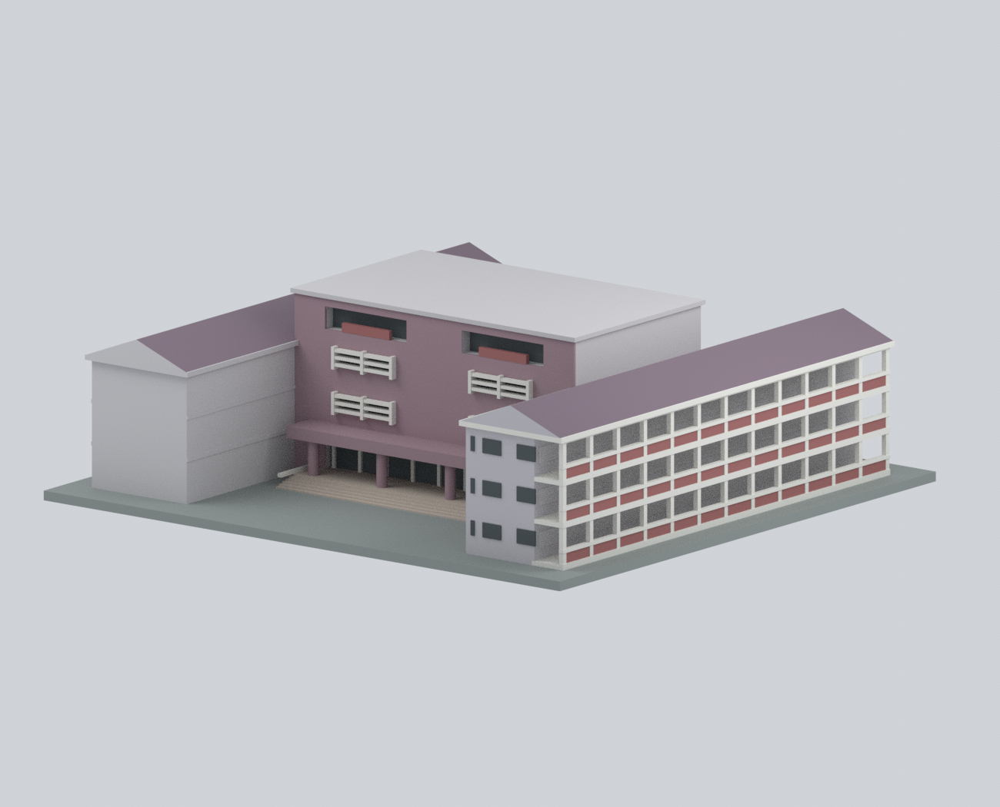
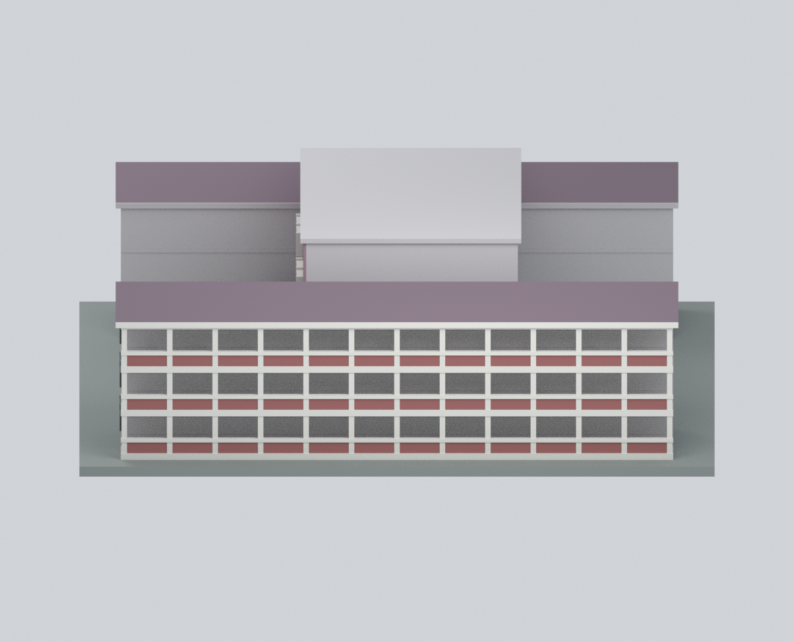
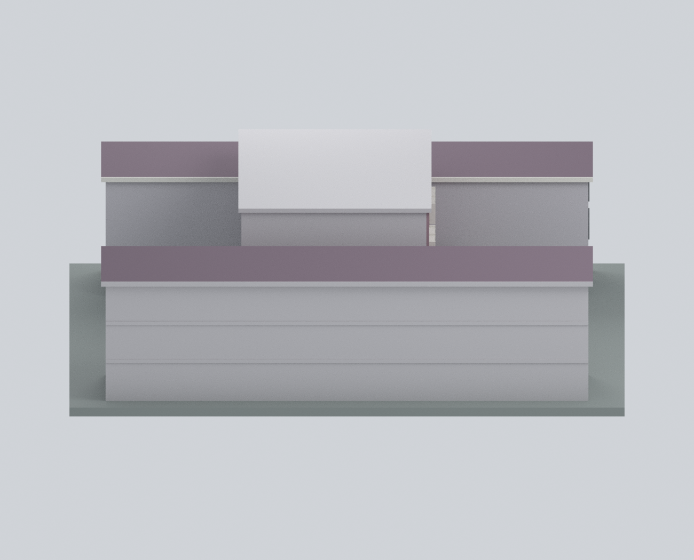
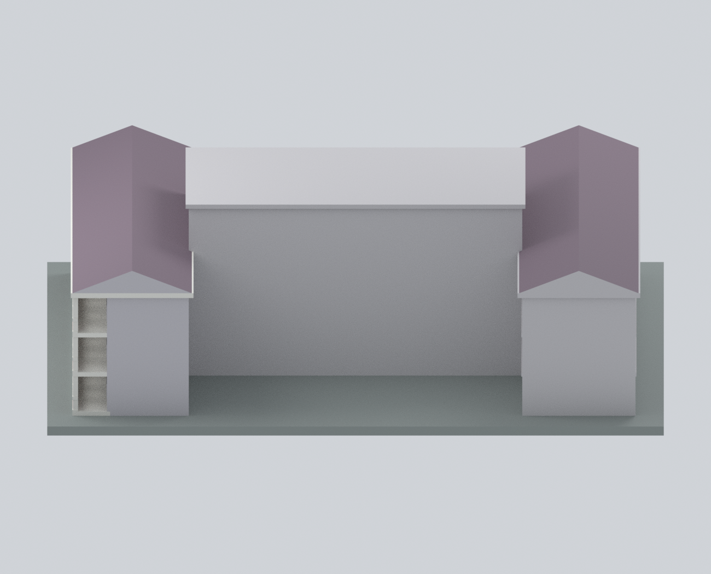
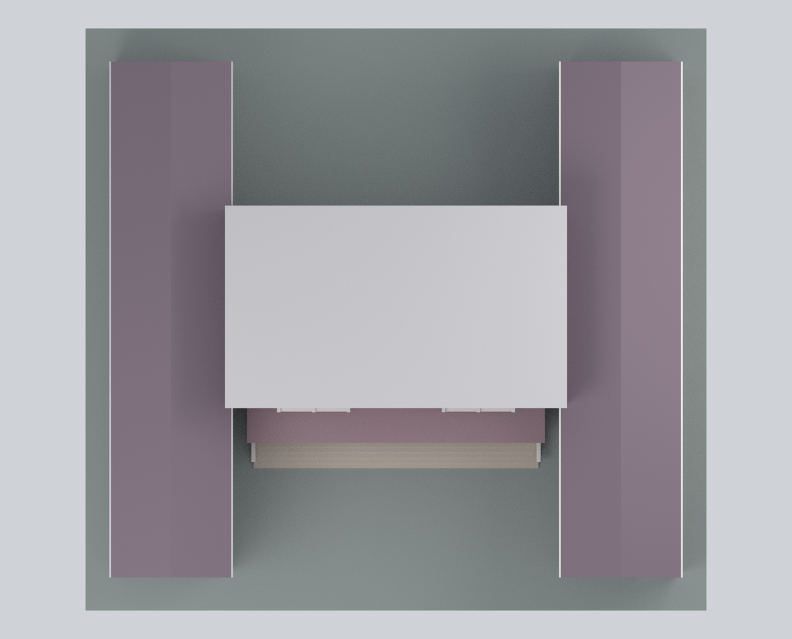
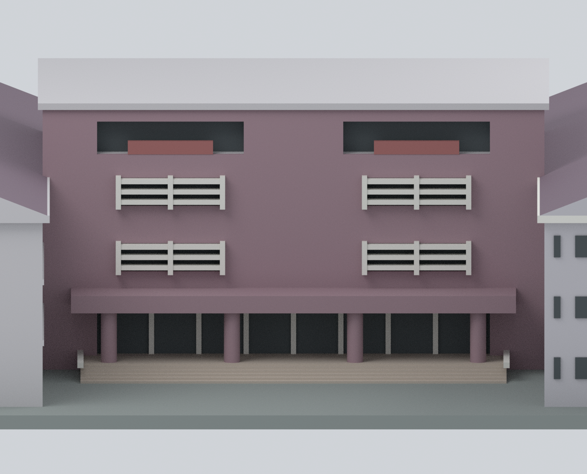
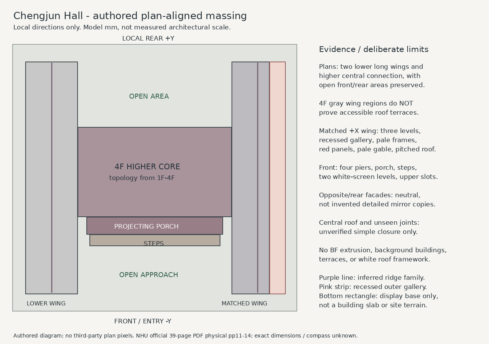

# 南華大學 成均館

**校方照片與調查圖參考外觀近似版；照片年代未定。**

這是獨立製作的、來源限域的外觀量體模型，不是測繪、竣工 BIM、結構判定或 2026 現況保證。官方 BF–4F 示意圖支持兩長翼＋較高中央核心的 H-like 組織；可見側翼為三層帶狀立面，核心為四層。未把地下室平面外推到上層，也未把 4F 灰區當成露台。**196 × 184 × 60 mm 是模型的列印尺寸，不是建物比例尺或實測尺寸。**

## 模型預覽

| 正面 | 前右斜視 | 來源照片對照方向（斜視） |
|---|---|---|
|  |  |  |

| 右側（有來源支持的翼廊） | 左側（未見面中性簡化） | 背面（未見面中性簡化） |
|---|---|---|
|  |  |  |

| 俯視（屋頂接點仍屬推論） | 入口細部 | 自繪平面關係圖（非測繪） |
|---|---|---|
|  |  |  |

## 檔案

- `nhu-chengjun-hall.blend`：Blender 4.3.2；可列印的單體材質網格，以及隱藏的可編輯獨立構件集合。編輯集合的構件在布林聯集前相互重疊，**不可直接將全部構件當作列印體匯出**。
- `nhu-chengjun-hall.stl`：單一封閉連通體；STL **不含材質顏色**。
- `nhu-chengjun-hall.3mf`：9 種實際 base-material 定義及逐三角面指派；不是只有彩色縮圖。未設定特定印表機的耗材／噴頭對應。
- `build_model.py`、`export_3mf.py`、`render_model.py`、`validate_model.py`：可重建幾何、材質、預覽與 QA。
- `mesh-data.npz`、`construction-parts.json`、`editable-parts.json`：幾何／材質／構件證據與不確定性資料。
- `footprint.svg`、`previews/footprint.png`：自繪的平面關係圖，不包含來源圖像；PNG 可用 `draw_footprint.py`（Pillow）重建。
- `sources.json`、`evidence-map.json`、`manifest.json`、`qa/`：來源、推論邊界與驗證。

## 看得見與不知道的部分

| 範圍 | 採用方式 |
|---|---|
| 中央正面 | 照片支持灰玫瑰／紫灰外牆、四根圓柱的突出門廊、大階梯、凹入入口、兩層白色外遮欄及頂層暗開口／紅色欄板；細尺寸和窗格數簡化。 |
| 本地右翼外側與前端 | 照片支持三層、凹廊、淺色框、紅欄板、淺灰紫翼端和人字坡頂；13 柱／12 格是簡化模型節奏，**非實測柱窗數**。 |
| 兩翼／高核心和開口空地 | 源於 1F–4F 圖的拓撲；左右長翼相接核心，前後空間保持未被建築量體填滿。下方薄底板只是展示底座，不是建築樓板或地形。 |
| 另一翼、後側、內院面 | 中性封閉量體；不以鏡像複製詳細窗列，並不聲稱真實建築是無窗牆。 |
| 屋頂 | 可見翼採簡單人字坡頂家族；坡度、另一翼延續與未見接點均是推論。中央屋頂以中性簡單蓋面封閉，**不代表真實屋頂形制**。灰色蓋面不是已確認露台。 |
| 列印簡化 | 紅色花格欄板改為實心板；細遮欄加厚；窗深、步數、框距、護欄均簡化。未模擬室內或地下室。 |

省略：用途未明白色屋頂骨架、鄰近背景建築、樹木、人車、廣告布條、電子字幕、細小未確認字樣、設備、隱藏樓梯／機房，以及來源照片／平面像素。沒有使用照片紋理。照片的 2026 上傳網址不等於拍攝年代；調查表日期 2023-04-25 也不等於照片年代。

## 數位 QA 與列印限制

最終匯出的 STL 重新載入、合併頂點後：**1 個封閉 shell；2302 vertices；7326 edges；4884 triangles；非流形邊／頂點 0；退化／重複三角形 0；方向一致**。檢查以實際匯出的 STL 重載結果為準，而非僅依建模器內部數字。

3MF 經 lib3mf 2.5.0 strict 讀取和重新寫入／讀取：零警告；全部逐面材質與 palette 一致；三角索引相同，坐標最大差約 0.000003815 mm（格式小數序列化）。另以新 Python process 重建，頂點、三角面、面材質陣列一致，STL 位元組一致。

**沒有實際 FFF 試印，也沒有產出 G-code。** 300 個 0.2 mm 間距水平截面有效；厚度檢查只是幾何篩選，不是全域最小壁厚保證。約 1.0–1.1 mm 的細欄／板、0.5 mm 階高、約 10 mm 深凹廊、門廊、遮欄和簷下需要用自己的切片器檢查支撐、橋接、噴嘴與材料設定。不要直接縮小後沿用此檢查。模型不是「免支撐」保證；底板 196 × 184 mm 亦須預留機台邊界。

## 來源與權利

依南華大學總務處成均館介紹、校園景點官方照片及官方校園安全 PDF 進行人工比例近似。原 PDF 39 頁中的 physical pp.11–14 / printed pp.5–8 為成均館，建築編號 12-01。精確 URL、雜湊和用途見 `sources.json`。

來源照片、調查圖未找到允許再散布的開放授權；只作私人研究封存，不納入此模型套件，也不將模型授權延伸至第三方來源。套件僅有自製網格、無外部紋理的自製渲染與自製註記。模型授權依專案發布者的適用授權；此說明不是第三方影像的法律授權意見。

## 重建

Python 建模環境需 `numpy`、`trimesh 5.1.1`、`manifold3d`、`shapely`；3MF 匯出用裝有 `lib3mf 2.5.0` 的 Python；渲染用 Blender 4.3.2。

```sh
python build_model.py
python validate_model.py
python export_3mf.py
blender --background --threads 4 --python render_model.py
```

上述四支建模／驗證／3MF／渲染腳本都支援 `--out DIRECTORY`（Blender 參數放在 `--` 後）。`build_model.py` 不需要下載任何第三方圖像、使用網路或存取私人來源封存。軟體版本或布林核心改變可能影響三角剖分；請重跑全部 QA。
