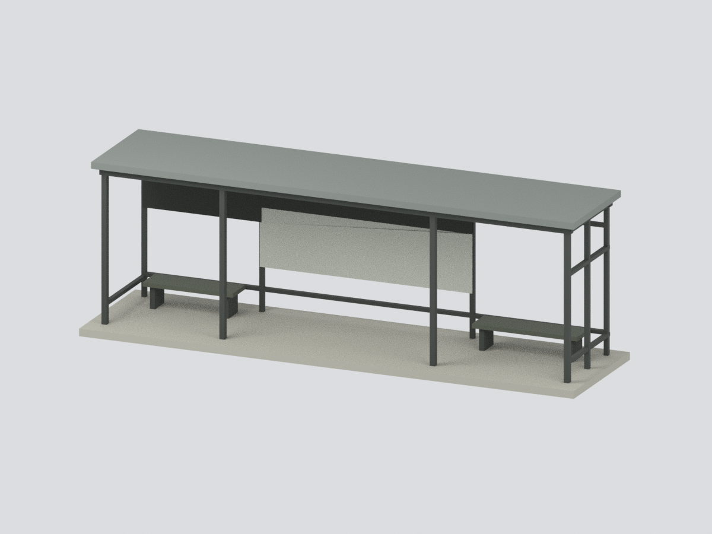

# 南華大學綠能候車亭｜來源約束研究模型

**大林校本部候車亭完整主要框架的照片比例近似。玻璃省略、保留通透開框，不是實牆替代，也不是施工圖復原。**

依南華大學官方校園VR node11實像，保留薄平頂、四根主要前柱、右側回折框架、後方資訊板與左右長凳。旁邊獨立公告欄、道路、植栽、行人、文字、路線圖及 LED 內容均不納入。

## 比例與限制
- 約 **192.6 × 51.3 × 64.08 mm**，六色，名義尺寸而非實測比例尺。
- 玻璃面板未建模；開框視覺是已聲明簡化，不代表現場沒有玻璃。
- 屋面採名義薄平板；未見頂面設備不猜造，**不因「綠能」名稱就加光電板**。
- 後框依照片可辨部分簡化，不猜背向告示；板面皆為無字色塊。
- 長凳支架、細柱截面、屋面厚度與色彩均近似，未校色。
- 下方底板為模型連通支撐，非現場整片地坪。
- 網格封閉不等於直接可列印；細柱、水平跨度、支撐需求與多色設定須另行切片及試印。

## 檔案與驗證
- `model.stl`：不含色彩的單一連通封閉網格。
- `model.3mf`：同幾何與六材質標記，毫米。
- `scene.blend`：實際統一網格與可編輯分件；無原照、人物或圖片貼圖。
- `build_model.py` / `render_model.py`：重建及六視角渲染程序。
- `QA.json` / `REBUILD-QA.json` / `BLEND-QA.json` / `FRAMING-QA.json` / `RENDER-BINDING-QA.json`：幾何、格式、可重建性及渲染一致性驗證。
- `SOURCE-EVIDENCE.json` / `SOURCES.md`：來源與簡化界線。

## 官方來源
[南華大學官方VR](https://vr360.nhu.edu.tw/VR360/index.html)的node13標示「往公車亭」並連至node11；node11 face2實像牌面可辨「綠能候車亭」。[官方pano.xml](https://vr360.nhu.edu.tw/VR360/pano.xml)提供節點關聯與影像tile模板；精確tile網址及雜湊見來源紀錄。

查閱：2026-10-31。VR中node11記載2023/10/3下午02:10，僅為系統影像中繼資料，未獨立核實拍攝時間，不保證現況完全一致。原始照片不隨模型包再散布。
