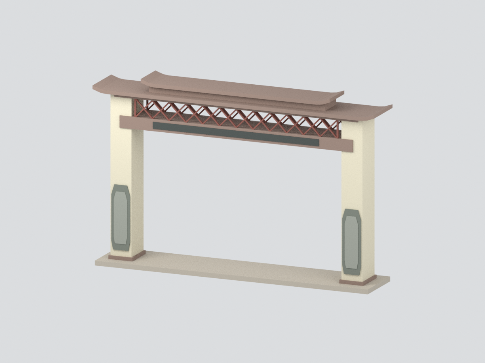

# 南華大學校門｜主門樓來源約束研究模型

**範圍：大林校本部完整主門樓本體的照片比例近似模型，不是校門周邊全場景或施工復原。**

依校方正式介紹照片及官方 VR 的門外斜視、校內背視，保留雙立柱、跨路樑、紅色鏤空格柵、長短雙檐、正面灰色八角柱飾與無字深色顯示面板。側邊警衛亭、圍牆、道路、植栽、臨時紅色布條與 LED 內容均不納入。

## 比例與限制
- 外接尺寸約 **160.8 × 30 × 102.66 mm**，七色，名義比例；無實測尺寸。
- 屋面上表面、坡度、翹角與厚度為照片約束的薄實體簡化，**不是屋頂施工結構復原**。
- 格柵數量與細節、柱飾凹槽以淺浮雕簡化；背面未辨明裝飾不猜造。
- 下方連接底板為模型支撐設計，不是實景路面。
- 色彩依照片近似，未校色；3MF 色材不等同指定列印機的耗材配置。
- 通過封閉幾何檢查不等同可直接列印：細格柵與水平跨距仍需切片、支撐與試印評估。

## 檔案
- `model.stl`：單一連通、封閉網格（STL不含色彩）。
- `model.3mf`：同幾何與七種材質標記，毫米。
- `scene.blend`：實際統一網格與隱藏可編輯分件；不含原照片、人物或圖片貼圖。
- `build_model.py`、`render_model.py`：可重建程序與六視角渲染。
- `QA.json`、`REBUILD-QA.json`、`BLEND-QA.json`、`FRAMING-QA.json`、`RENDER-BINDING-QA.json`：各階段驗證。
- `SOURCE-EVIDENCE.json`：官方網址、參考影像雜湊、逐一tile來源與限制。

## 官方參考
- [南華簡介與校門照片](https://www3.nhu.edu.tw/Web/Pages?mid=2595&n=%E5%8D%97%E8%8F%AF%E7%B0%A1%E4%BB%8B&v=1)
- [校方原圖](https://nhuwebfile.nhu.edu.tw/UploadedFiles/2025/6/8086c1fa-e512-468f-8efd-ecf38c634c02.png)
- [官方校園VR校門口](https://vr360.nhu.edu.tw/VR360/index.html#nhu)，node50門外、node44校內。
- [官方VR設定](https://vr360.nhu.edu.tw/VR360/pano.xml)提供上述節點與tile路徑。

資料查閱：2026-10-31。VR所載日期與照片上傳路徑日期不視為已獨立核實的拍攝時間，也不宣稱完整代表目前現況。參考照片僅用於建模研究，未再散布於本模型包。
