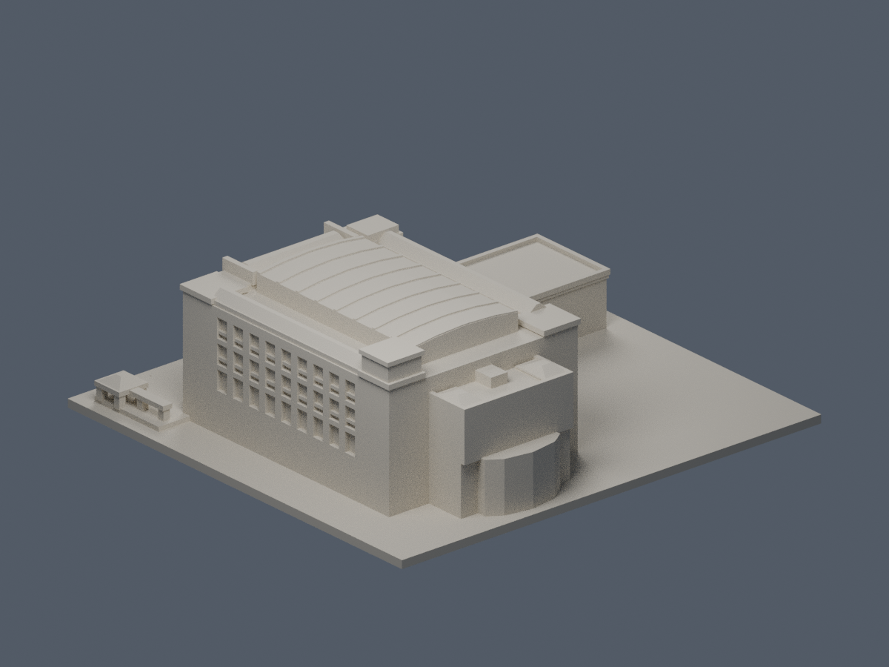

# 南華大學無盡藏圖書館

跨來源當代外觀比例近似；2026-10-14二次外觀核准，完成作者QA後封存，是否正式發布以統一發布清單為準。
本件屬大林校本部，包含主館、相連北側低翼、東端突出及貼身入口平台／兩座玻璃錐亭。兩亭不是另計建物；不含遠端九品蓮華大道，不代表全校完成。

| 西向正面（actual STL） | 東端背面（actual STL） |
|---|---|
|  |  |

[左／北側](previews/left.png) · [右／南側](previews/right.png) · [頂視](previews/top.png) · [正立面](previews/elevation.png) · [正面近景](previews/front-detail.png) · [北側近景](previews/left-detail.png)

## 依據與外形
- 2023校安官方B1–5F平面、正側照與2023-09-18官方VR正面，核五層主體與地下一層。B1未虛構成完整外露第六層，模型不呈現內部樓板。
- 北長翼只做低層實牆與三樓平台，四／五樓不拉滿。東端一／二樓有弧凸，上層方體退縮，五樓後平台與兩端小屋面依平面保留。
- 整體屋面採「拍攝年未標官方航拍」可見版本，2023 VR及校安正側照僅校正仍一致的立面；不聲稱各圖同年或白頂在2023已存在。中央白色金屬覆蓋完整封頂，含九道概略橫向肋；保留兩側窄紅斜屋面、內側平頂走道及前端紅坡頂。不把已覆蓋中庭挖成露天洞。
- 西向立面中央三排各三窗，左右凹廊三排，上端為中央長開口與兩側短開口。兩邊實牆保留兩排小窗與下部高窄槽；入口為較低的紅坡頂、白色側翼門廊和玻璃門廳。
- 北長側官方斜照實數9跨×3排高窗，模型依此，不以5層套5排。凹內橫欄退於主牆面，不是外挑陽台；低翼遮擋的下緣不補隱藏窗洞。南長側以航拍可辨的同類垂直分組近似，細數不宣稱實測。東後完整立面未核，不鏡射正面窗陣。

## 年代與推定限制
[來源表](sources.json)中官方航拍的1970-01-01為XML無效預設值，不能當拍攝日；只稱2024/2025發布系統中的拍攝年未標航照。2026/03入口圖片是上傳年月，並非攝影年月。模型不是2026實測，也不宣稱四面細節均核驗。

OSM為社群足跡，只控制概略水平比例。75.40×85.81m是軸對齊bbox，不是主牆長寬；主體工作比例約45:58，另附北翼與東凸。[比例紀錄](proportions.json)保存旋轉座標基底及照片比例互核，不做未完成的正射套合聲明。水平至少±10%、高度±15%為不確定性參考。

高度沒有建照或剖面數字。使用主立面寬／簷口高、前屋脊、較低入口門罩及低翼平台的相對比例交叉核對；不按各層3m套算。後端屋頂機房、北翼平台精確標高、金屬覆蓋改建年代仍未核實。工作參數不等於實測公尺。

## 檔案與使用
- [model.stl](model.stl)：毫米；含底座150×141×約49.05mm，底座Z=0朝下。西正面為-Y，北為-X。
- [scene.blend](scene.blend)：實際交付STL匯入的可編輯網格，毫米場景。
- [build_model.py](build_model.py)、[requirements.txt](requirements.txt)：原創參數重建；源座標在最後統一縮放為微縮毫米。
- [render_preview.py](render_preview.py)：只從實際STL產生八張PNG與Blend；PNG僅移除變動的時間文字metadata，未改像素。
- [run_all_checks.py](run_all_checks.py)：全部驗證；每項失敗即非零退出，不用repair吞錯。
- [validation.json](validation.json)、[layer-component-check.json](layer-component-check.json)、[recess-root-check.json](recess-root-check.json)、[preview-rebuild-check.json](preview-rebuild-check.json)：幾何、逐原Polygon、原面射線及圖片重建紀錄。

重建：python build_model.py；blender -b -t 5 -P render_preview.py；python run_all_checks.py。

## 列印與QA界線
細窗框是後牆根接浮雕，不是自由細柱。入口側廊、亭柱、薄屋肋均以實際厚度與連接處理；柱截面約2.25×2.25mm，亭頂截平約1.89×1.89mm。凹廊橫欄在源幾何退入外牆線、加深根部，避免僅貼邊的小頸。

0.2mm逐層檢查每個原Polygon，erosion與opening均不可消失或分裂；另保存逐構件損失、邊界與面積，不只報整層最大值。小矩形柱／有限截平亭頂的開角損失逐一判別，不能用低整層百分比遮掩。原STL射線另核凹廊、平台開口、細框與亭柱根部。

數位QA不是全方向最小壁厚保證，也未做Cura／Prusa工具路徑或實體試印。入口挑簷、跨柱亭頂及凹廊可能需要支撐；不保證免支撐或保證可印。原照片與PDF不隨此資料夾公開散布。

逐構件損失分類：244個超過1%的截面紀錄分屬8亭柱（144）、5個獨立廊柱（85）、兩亭截平頂（4）、後露臺小坡頂（2）、九道金屬肋頂（9）。各筆保存原矩形尺寸及角外面積，並與理論矩形opening圓整角損失數值核對。最高2.728933%來自2.25×2.25mm柱；肋頂單筆約4.96×1.20mm。指定根部／凹深共41項原STL射線另見報告。

獨立原始STL補充核對：244是跨層原Polygon截面樣本，並非244個實體構件；各高損樣本為完整矩形，損失皆在原頂點0.41mm鄰域內，侵蝕與opening均零消失／分裂。單構件最大損失2.7289331657%、最差保留97.2710668343%，來自2.25×2.25mm柱。整層最大損失0.63980850%，沒有整層超過1%。逐244個警告截面的指定原三角面法線射線最小厚度1.199997mm（屋肋頂），另41項原STL凹深／根連接射線重跑通過。這是指定位置的矩形角損例外，不能視為全模型或全方向最小壁厚保證；薄肋及亭頂需要在切片器檢查支撐與拆除風險，不得任意縮小，仍未實體試印。
