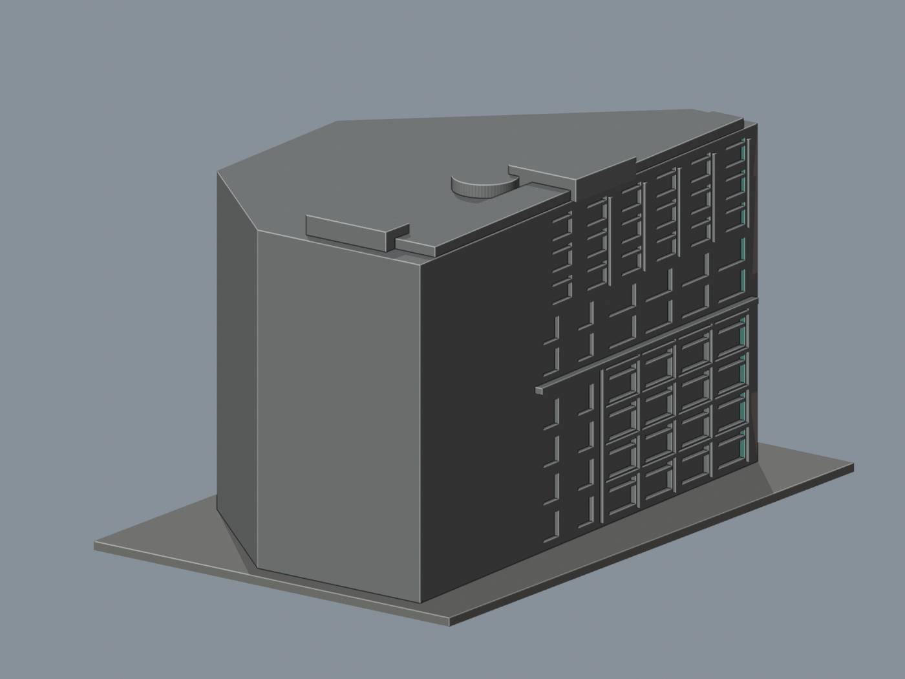
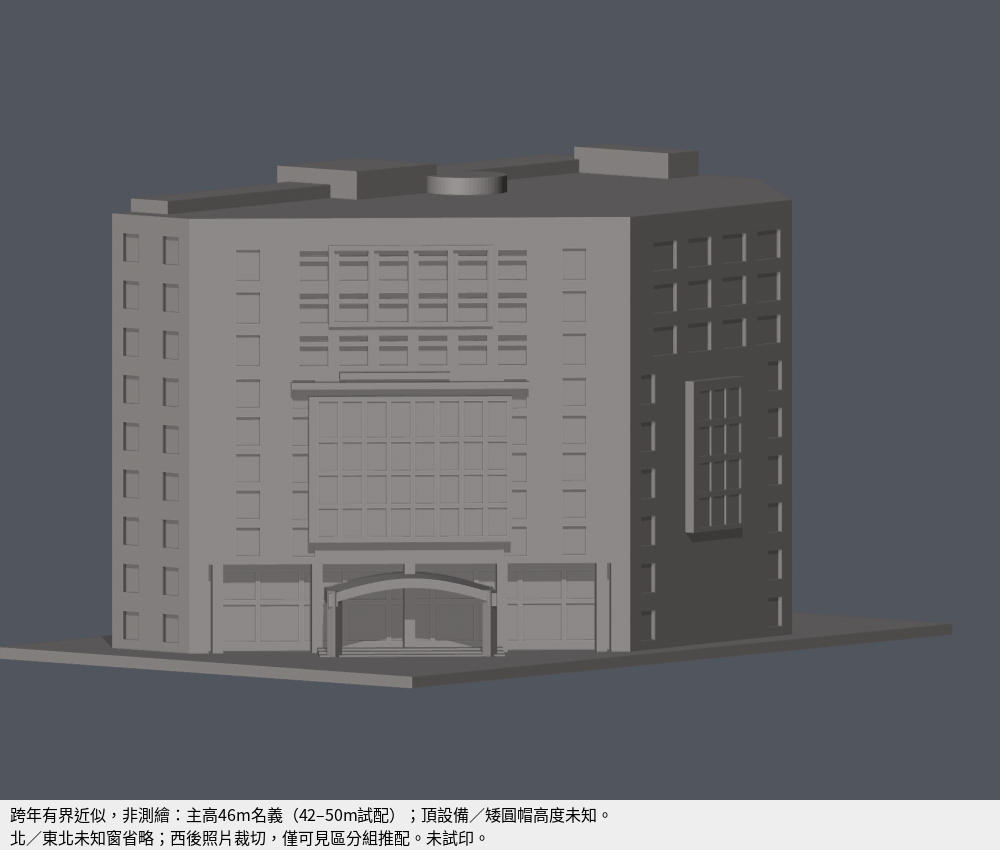
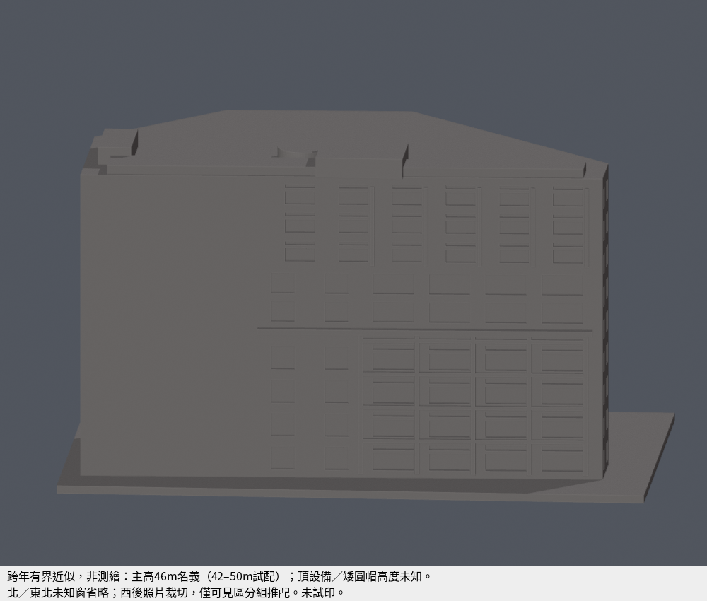

# 台南應用科技大學｜圖書資訊大樓（跨年有界近似）

## 2026-10-20 原貌配色重建

[可編輯8材質Blender](appearance.blend) · [標準彩色3MF](appearance.3mf) · [最小獨立重建源包](appearance-rebuild-source.zip)

| 正面配色 | 未確認背面保持中性 |
|---|---|
|  |  |

[完整俯斜](previews/appearance-aerial.png) · [北上頂圖](previews/appearance-top.png)

2002-12-08 Flickr照片已實際開圖並核對SHA256。可見正面與兩側的粉紅磚、綠藍玻璃、淺色帶／既有框、灰色彎曲雨棚據圖近似配色。色值未經色卡校正，帶寬與位置非測繪；未知北背面及屋頂保持中性，不把陰影當黑漆，不猜遮蔽立面。原幾何仍由2002／2018／2022／2025跨年來源組合，不能稱整棟2002原狀或2026現況。原照片不放公開包。

原STL與正式source／歷史QA原封保留。本次只對表面共面細分，原6,058面對應新25,150面、12,569頂點；8材質不受4色限制。原包圍盒完全相同，signed-volume差0 mm³，最大共面誤差1.84e−14 mm，最大單原面面積差9.10e−13 mm²。全域水平切線防止T接，未使用網格repair。

實際Blender float32與lib3mf 2.5.0嚴格讀回，均零退化、零重合頂點。兩者均實際編輯單一材質、存檔、重開驗證。lib3mf使用預設6位小數，0警告；重存後最大座標變動7.63e−6 mm，面索引與拓撲不變，因此不宣稱其座標bitwise相同。小三角面仍存在，最小面積2.507e−6 mm²；數位測試不是最小可印特徵或實體試印證據。

[幾何QA](appearance-geometry-qa.json) · [格式讀回](appearance-roundtrip-qa.json) · [實際材質編輯QA](appearance-edit-roundtrip-qa.json) · [逐面mapping](appearance-mesh.json) · [材質與照片證據](material-evidence.json) · [本輪說明](APPEARANCE-QA.md)

以下保留原模型說明與歷史QA，與上方新配色QA分開。全庫件數維持502／高教470／110校。

來源限定有界近似，非測繪、未試印。單棟，不含藝術中心85坪附展場、乃建堂及鄰樓。圖書館1–5F用途不等於整棟，官方另有7/8F電腦教室平面及9F其他教室用途。

| 同件東南正面完整灰模 | 同件西後完整灰模 |
|---|---|
|  |  |

[北上頂圖](previews/top.png)｜[完整俯斜](previews/aerial.png)｜[入口實體曲棚](previews/entry.png)｜[上層窗組](previews/front-upper.png)｜[西後局部](previews/west-detail.png)

## 三層來源界線
- **官方可證**：2002-10啟用、圖書館使用1–5F、7/8F室內單位示意及9F用途。7F大X區沒有露天依據，模型不挖成中庭；地下不無據外露。
- **跨年影像配合**：2002正面、2018前庭、2022北上正射、2025西後；六邊屋頂約48×78m、OSM約47×76m粗核。高樓頂相對地界西北15–17m偏移視差不做成懸挑。
- **仍未知**：主高名義46m，42–50m僅照片試配起界，沒有官方標高；設備名義1.4–3m／估計1–4m，圓形頂保守矮帽，未確證原高度。北、東北未知窗省略；西照兩端出框，只表達可見局部窗帶與梯核，定位推配，不宣稱整西牆實數。跨年非單一現況測繪。

## 幾何與列印化簡
最長含底150mm，尺寸 [98.88937377929688, 150.0, 85.66873931884766] mm。底座朝下；曲棚、深門廊可能需支撐。1名義m對1.70654859最終mm。所有QA數字均最終mm；照片名義m不是測繪值。

入口棚為實體弧頂，非前弧線；後方嵌入真正實牆，兩側有限端梁避免曲面春點細刃。背接淺框為實際STL凹刻，公用所有預覽採單一灰材質，不靠色塊造窗。局部加框／嵌根是列印化簡，不作建築原尺寸證據。

## 原STL驗證與具體已核例外
- 原網單殼、水密、每邊2面、vertex-link單環、原法向、無退化三角、獨立源重建SHA、Blend幾何及8張實際PNG bytes均通過。未以repair修網。
- 0.2mm共428層、527原Polygon，逐原Polygon erosion／opening均單一保留，零消失分裂。全WKT／真角mask見[構件損失](feature-loss-locations.json)。
- **2根入口柱88跨層樣本**，不是88根柱：最大角損3.920441644679209%，保留至少96.0795583553208%，均在原真角0.41mm內。原面X/Y與上下根見[特徵原面檢查](feature-ray-check.json)。此2柱88跨層特定角損已由獨立審核重算並經root核准；不是通用放寬，也不是保證可印。
- [全原面密採](dense-first-chords.json)共40600樣本，首段實體弦最低0.8532713mm；保留原面法向及首段後交點，沒有以第二段深根代替第一段。另[內外與首出口後空氣控制](dense-parity-check.json)共162400點零失配。有限取樣不是全域最薄證明。
- 弧棚尖／前柱肩、圓帽、西凸框交槽、前上框密採分區見[feature-ray-check.json](feature-ray-check.json)，原法向與根方向分列。

## 重建與附件
[來源URL](sources.json)、[參數及未知](draft-parameters.json)、[最終毫米與名義公尺分列](dimensional-evidence.json)、[QA摘要](qa-summary.json)、[完整驗證](validation.json)。原照片／PDF不在公開包。

安裝requirements.txt，執行build_model.py；Blender執行render_preview.py；再依序validate_model.py、check_thin_features.py、check_all_layers.py、check_layer_components.py、check_feature_losses.py、check_dense_first_chords.py、check_feature_rays.py、check_dense_parity.py。原STL、Blend、PNG與所有結果必須同版。不等於切片器路徑或實體試印。

## 獨立審核與metadata修訂

[獨立摘要](independent-release-summary.json)及[88樣本原WKT證據](independent-corner-evidence.json)：兩柱原面最小1.877203mm、向下根落z=0，真角0.41mm外損失0。獨驗全6058面各7點（包括底座）共42406點、169624個內外／首段中點／首出口後空氣控制均通；最小首段0.853271291207mm。作者40600點（底座僅centroid）的原始報告原封保留，不混為同一取樣數，不稱全域最薄。

scene.blend僅將渲染輸出改為相對路徑//previews/west-detail.png；網格與8PNG bytes不變。原源／渲染腳本與strict QA報告保留，重建後可用[metadata相對化](normalize_blend_metadata.py)整理可攜路徑，再執行[metadata與幾何核對](check_metadata_overlay.py)。
