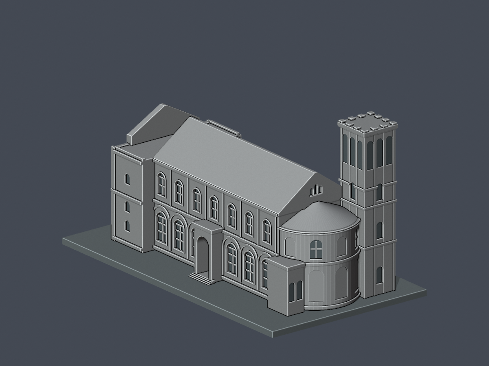

# 台灣基督長老教會南神神學院

本批只完成禮拜堂1957建物／修復前外觀的來源限定近似，不稱全校完成。正式學校於2017年6月22日經教育部准予設立，與歷史台南神學院同址承接，不另計第二校。校方edu校圖直接列本禮拜堂；此處不推定校舍為獨占產權。

| 西正面與南長面 | 同件東後面 |
|---|---|
|  |  |

[禮拜堂模型與完整說明](校本部/buildings/ttcs-chapel-1957/README.md) · [STL](校本部/buildings/ttcs-chapel-1957/model.stl) · [Blend](校本部/buildings/ttcs-chapel-1957/scene.blend) · [來源限制](校本部/buildings/ttcs-chapel-1957/sources.json) · [完整QA](校本部/buildings/ttcs-chapel-1957/qa-summary.json)

含底最長150毫米。西RC前廳、高玫瑰山牆與後段雙坡依跨年影像及修復圖作有界解讀，27m整體／22m後坡／5m前廳不是實測尺寸。特定52個矩形角損樣本包括12頂柱的48樣本和山牆4樣本，並非52柱，詳見建物README。尚無實體試印，不保證免支撐。原照片／PDF不隨包散布。

## 待續範圍

未完成本館、西校舍、宿舍、圖書館及其他校園設施。這是本批未建模範圍，不表示不存在或全部缺乏來源。歷史共用／承接校舍不重複計校。
