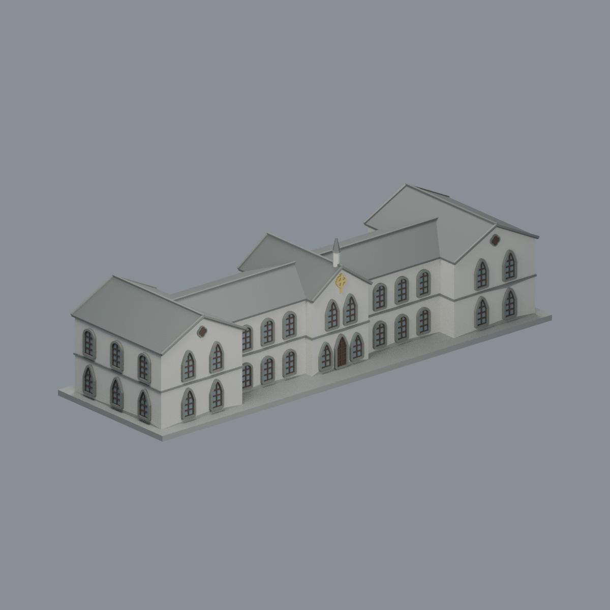

# 校本部｜東門路一段117號

目前2件有明示範圍模型：禮拜堂1957建物／修復前外觀與本館2024修復後外觀近似；不稱全校完成。正式學校於2017年6月22日經教育部准予設立，與歷史台南神學院同址承接，不另計第二校。校方edu校圖直接列本禮拜堂；此處不推定校舍為獨占產權。

本館採2024修復後完整單棟外觀近似：兩層H形、五交接雙坡與四組成對谷線，西南接口保留真開口並截斷外接穿廊；不含西校舍或禮拜堂。彩色Blend/3MF/STL與5實mesh圖、來源及QA均見模型詳頁；尺寸微型化非測繪，未實印，不保證免支撐。

| 模型 | 模型 | 模型 |
|---|---|---|
|  **[禮拜堂1957](buildings/ttcs-chapel-1957/README.md)** |  **[本館（巴克禮紀念館）](buildings/ttcs-barclay-main-hall/README.md)** | |

[禮拜堂模型與完整說明](buildings/ttcs-chapel-1957/README.md) · [STL](buildings/ttcs-chapel-1957/model.stl) · [Blend](buildings/ttcs-chapel-1957/scene.blend) · [來源限制](buildings/ttcs-chapel-1957/sources.json) · [完整QA](buildings/ttcs-chapel-1957/qa-summary.json)

含底最長150毫米。西RC前廳、高玫瑰山牆與後段雙坡依跨年影像及修復圖作有界解讀，27m整體／22m後坡／5m前廳不是實測尺寸。特定52個矩形角損樣本包括12頂柱的48樣本和山牆4樣本，並非52柱，詳見建物README。尚無實體試印，不保證免支撐。原照片／PDF不隨包散布。

## 待續範圍

未完成西校舍、宿舍、圖書館及其他校園設施。這是本批未建模範圍，不表示不存在或全部缺乏來源。歷史共用／承接校舍不重複計校。
