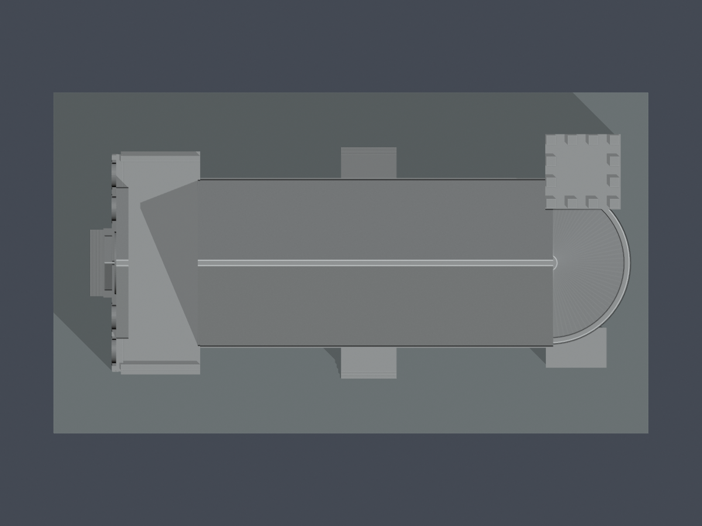

# 台灣基督長老教會南神神學院｜禮拜堂

1957建物、修復前外觀的來源限定近似。僅禮拜堂自身西前廳、長堂、東半圓聖壇、北側鐘塔及附房，不含本館、西校舍或整個校園。現法定學校與歷史台南神學院同址承接關係，不另計第二校；亦不推定本件校舍為獨占產權。

| 西正面與南長面 | 東聖壇與鐘塔 |
|---|---|
|  |  |

[STL](model.stl) · [可編輯Blend網格](scene.blend) · [參數源碼](build_model.py) · [來源](sources.json) · [尺度證據](dimensional-evidence.json) · [QA](qa-summary.json) · [原面ray](architectural-ray-check.json) · [每構件loss](feature-loss-locations.json)

## 來源與尺度界限

官方簡介記2017年6月22日教育部准予設立「台灣基督長老教會南神神學院」，現址東門路一段117號。官方edu校圖及校園生活頁直接介紹禮拜堂，不能將宗教團體歷史名稱另算另一所學校。

2015、2018非施工正射，校方2021修復分解圖、2024通訊第6頁南立面，以及修復前多面照片交叉支持：西端RC平頂前部及較高玫瑰山牆、後段較窄雙坡長堂、東半圓聖壇與矩形高塔。**西前廳中央平頂範圍是跨年影像和修復圖的有界解讀，不僅憑明暗宣稱完全確證，更非測繪平面。** 原圖屋頂受高物視差、樹蔭及鄰翼投影影響。

工作比例約1:250，即最終模型4毫米代表估算1公尺。採主高體整長27公尺、西前廳5公尺、後堂22公尺；前廳寬13.5公尺、長堂牆寬10.125公尺、屋面寬10.5公尺。以上不是官方尺寸，不能解讀為牆基實測。採納界限：整體24–28公尺、西段3.5–5.5公尺、主坡21–24公尺、前寬12–14公尺、長堂牆寬9–10.5公尺；不同區間不能把各自上限直接相加。屋脊約14.45公尺、鐘塔約19.7公尺由無尺南立面比例推算，非官方標高。

- 2018坡面四角約原圖(812,936)、(975,941)、(974,1001)、(811,1006)，選點±5–8像素；影像約0.1374公尺／像素，只有屋面投影尺度。
- PHOTO2020服務實際水印2018；PHOTO2015影像水印2015。PHOTO2／PHOTO2025傳回的2023綠棚是修復保護設施，未當永久平頂。
- OSM矩形東移，未使用其四角或26.8×11.8公尺定案。西白塊不直接加總為實測前廳深度。
- 拆解軸測的抬高層板不是高度尺。2024圖與較早照片不保證同年測繪；模型不宣稱2024完工現況。

## 形體與可列印簡化

含底座150 × 86 × 約81.8毫米，底厚3毫米，底座朝下。中央三格高山牆與兩側較低肩部、西RC前廳、後長堂雙坡分開處理；屋頂未套單一全長大三角。

西玫瑰窗、三連拱通風孔、南北七上窗／六下窗加中門廊、聖壇盲拱與可見兩上窗皆保留。玫瑰窗和窗梃融合背板，不是獨立細線。小百葉、簷口齒飾、排水管、欄杆及內部隔間簡化；室內填實，不是室內測繪模型。

下列均是**最終模型毫米**：
- 西山牆向內加1.3毫米背板，外立面輪廓保留；三拱實際凹口後背法向至少1.7毫米，間壁法向3.1毫米。三拱開口寬簡化為1.5毫米、相鄰表面分隔0.9毫米，避免開口間的薄前條。
- 西山牆尖端局部截0.4毫米至z60.8，實際頂平面寬1.44762毫米、厚3.1毫米；未整面降高，這是列印調整而非建築原貌尺寸。原STL向下實根通至底座。
- 鐘塔高窗改為約0.35毫米淺凹厚背刻痕；12個頂柱僅頂端加寬至2.4 × 2.4毫米並嵌入塔帽。不是保留不可解析薄角再改篩檢門檻。
- 西RC平台實際z46.3，後堂脊z60.8；原STL向下ray驗證為兩個不同屋頂區。東半圓屋面為淺半錐，不做半球。

## 數位QA與特定角損

[原網格驗證](validation.json)、[0.2毫米逐層](layer-opening-check.json)、[逐原Polygon](layer-component-check.json)、[逐構件loss定位](feature-loss-locations.json)、[原面法向與根接](architectural-ray-check.json)完整保留。

原STL只合併完全相同座標作拓撲分析，不repair、不吞invalid；單殼、水密、每邊兩面、vertex-link單環。0.2毫米層距、z偏移0.071，每個原Polygon在0.4毫米erosion及opening後零消失、零分裂。獨立源碼重建STL SHA、保存Blend實際網格、7張actual-STL PNG bytes一致。

**需明示的特定角損：共52個跨層樣本，不是52根柱。** 西山牆頂4個矩形截面樣本，另鐘塔12個2.4毫米頂柱共48個截面樣本；最大opening損失2.3984834%，保留97.6015166%，全部落在原矩形四角0.41毫米鄰域內。其他原Polygon loss均不超過1%。

原STL逐樣本ray：西山牆厚至少3.1毫米、採樣處寬至少1.91447毫米，向下實根到底、向上接60.8毫米短平頂；塔頂柱X/Y至少2.39999毫米，向下有連續實根／塔帽、向上81.8毫米。此特定角損已獨立重現並獲主審接受；不是其他薄皮、全域壁厚或篩檢閾值的例外。

門廊、窗框、聖壇簷口可能需要支撐。數位QA不是全域最小壁厚證明，不是Cura/Prusa工具路徑或實體試印，不能保證免支撐或任意縮小可印。

## 重建與補充視角

使用 [requirements.txt](requirements.txt) 與Blender4.3.2，依序執行 `python build_model.py`、`blender -b -t 4 -P render_preview.py`、`python run_all_checks.py`。任何invalid或非零exit都須修源重新全檢，不能repair後沿用舊報告。

| 正西低角度 | 屋頂分段 |
|---|---|
|  |  |

[北面](previews/elevation.png) · [東面](previews/east.png) · [東正視](previews/rear-elevation.png)

原照片／PDF只作核對，未隨本包重新散布。未建模本館、西校舍、宿舍、圖書館與其他校園設施，本件不代表全校完成。

獨立原STL補充：409層585個原Polygon侵蝕與opening後皆保留單核心，零分裂或消失。52個跨層警告樣本分為西山牆4個與12個塔帽頂柱48個，並非52根柱；最大構件損失2.398483410724%、保留97.601516589276%，共有4個整層超過1%，整層最大2.398478080761%。原矩形四角0.41mm鄰域外最高9.4042e−16mm²，移除共線細分點後同0.41mm真轉角區外最高1.012525e−15mm²；兩者在1e−12mm²比較容差內屬數值殘差，不冒稱絕對零。52指定樣本原三角面法向最小2.3999996mm，原STL上下射線證實底根連到z0及對應頂面。
三拱背板67個原面探點最小1.7mm、兩間壁3.1mm；局部截0.4mm後的實際頂平面寬1.44761908mm、厚3.1mm，頂下指定點向下連續到底座。這些都是指定位置模型尺度，不能當全域最小壁厚或建築實測。跨年來源與西RC前廳範圍仍屬有界推估；門廊、窗框、簷口及細頂柱須評估支撐和拆除，不得任意縮小，未實體試印。
