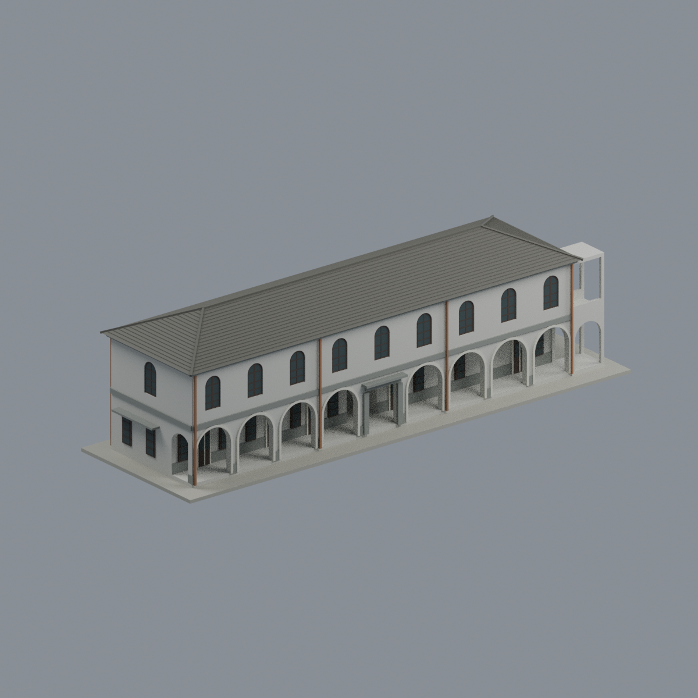
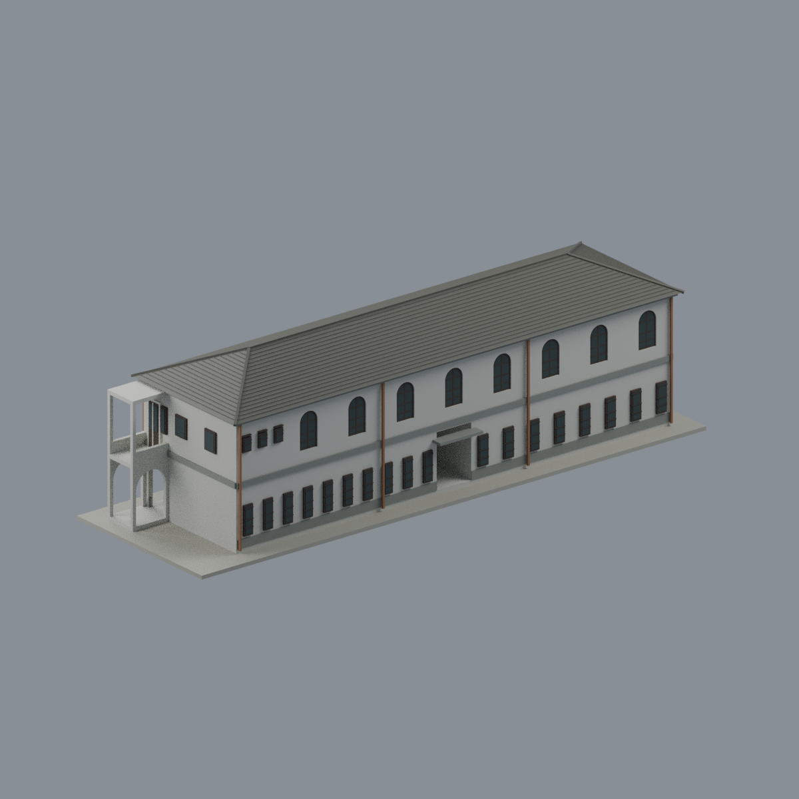
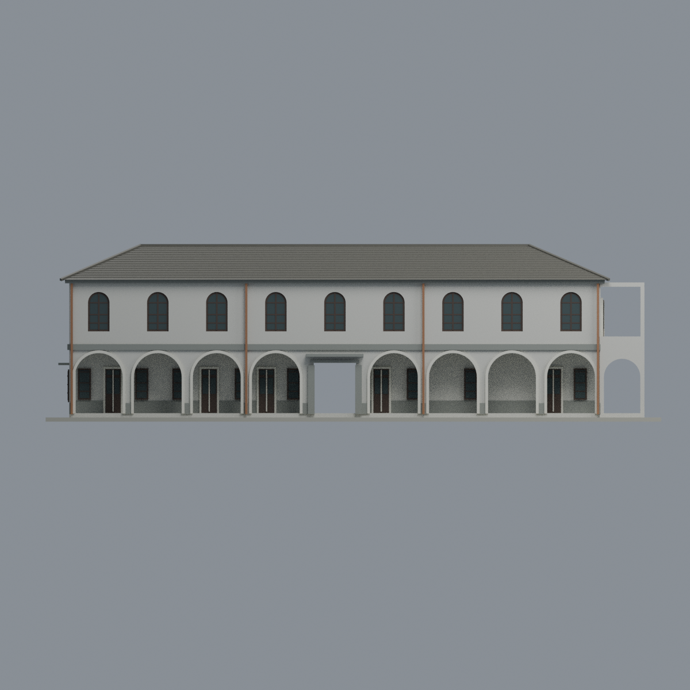
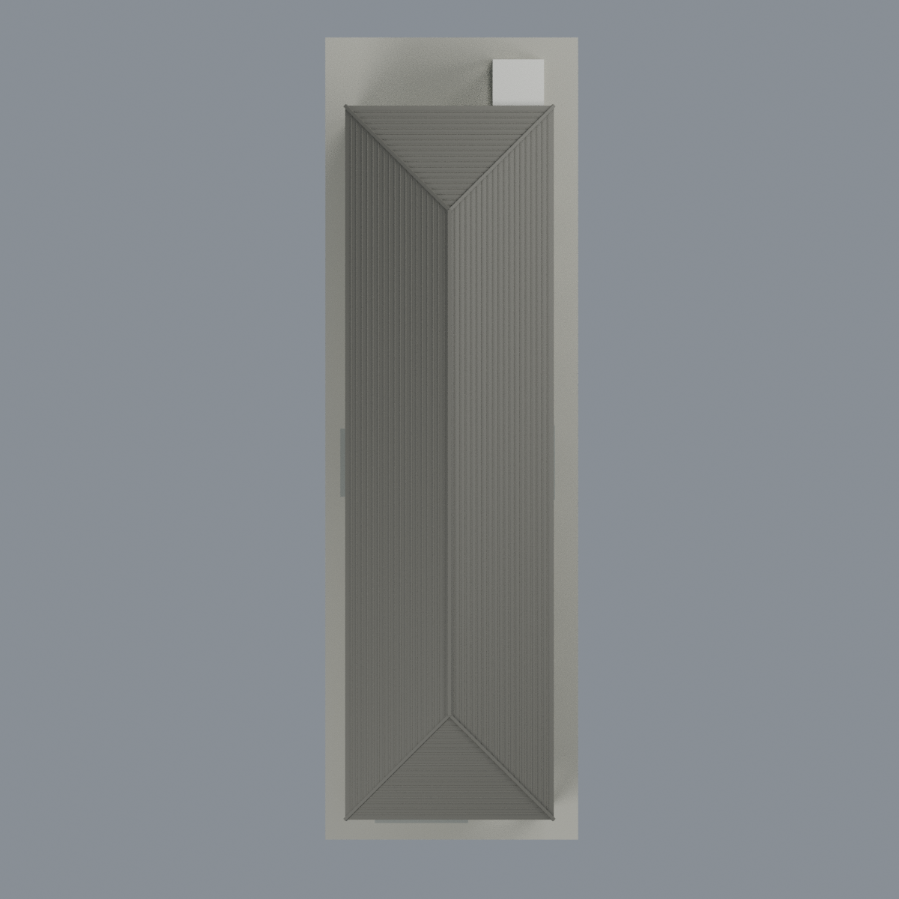
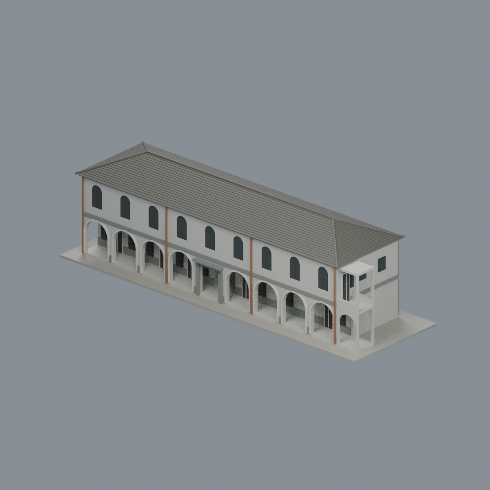
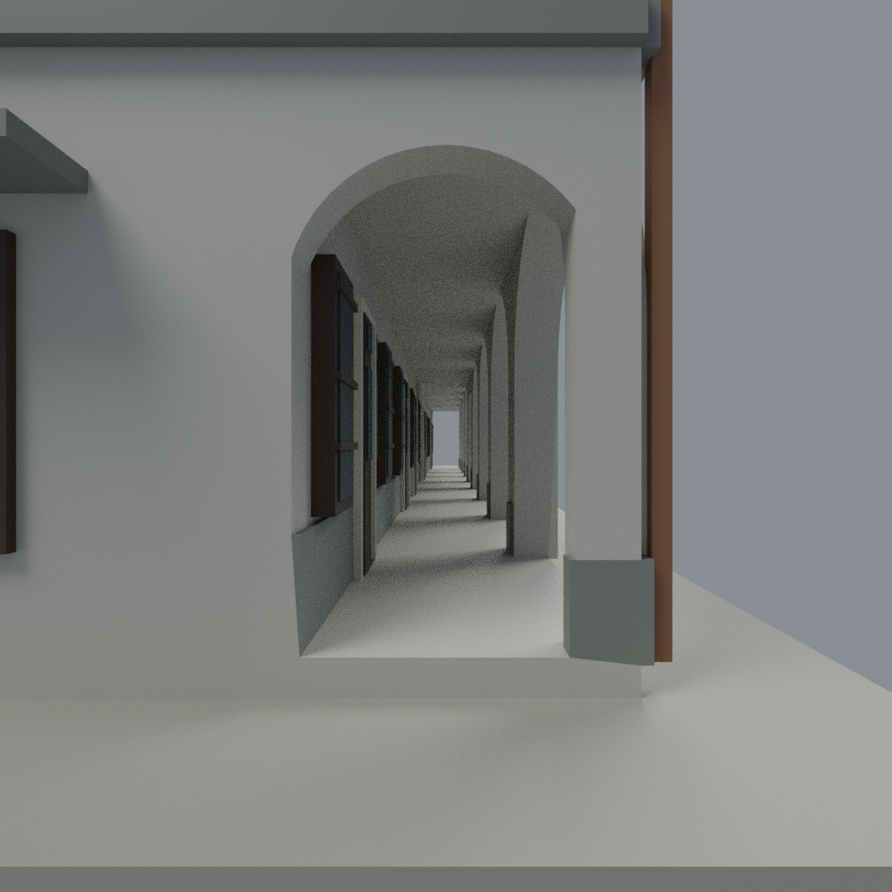
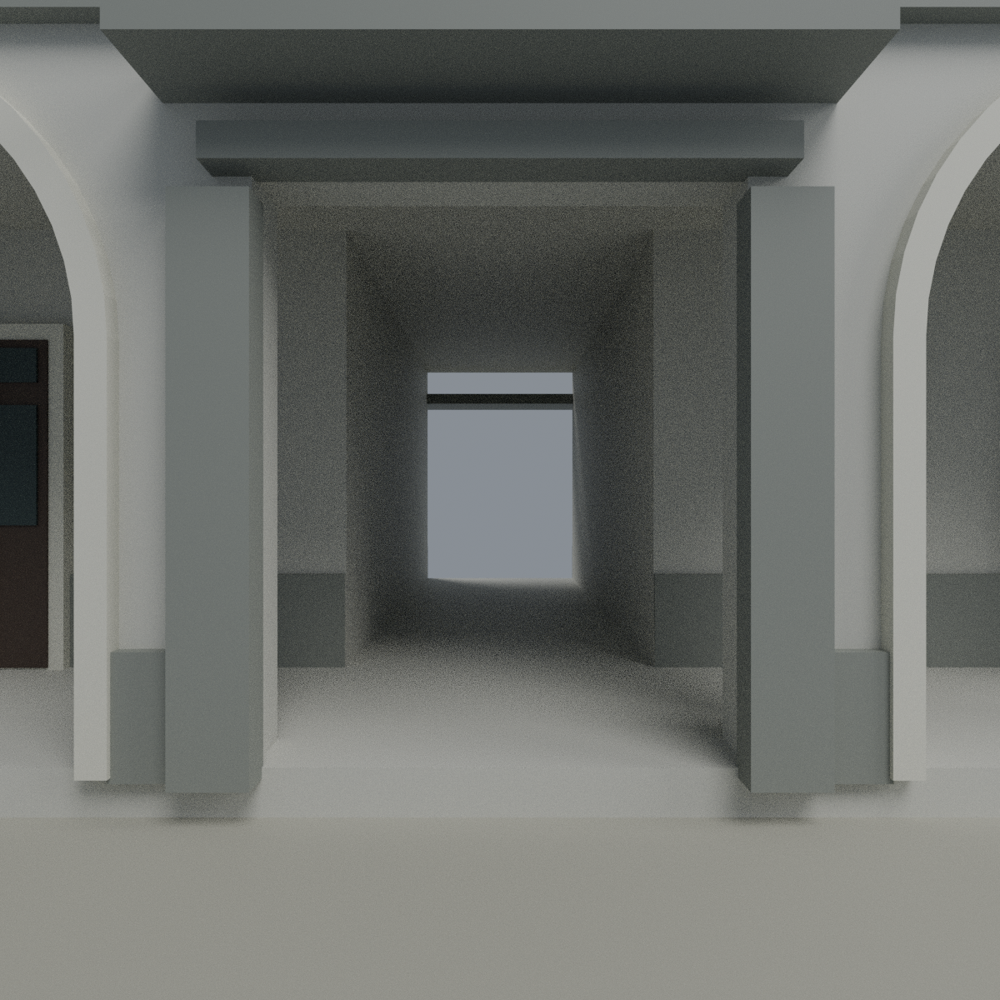

# 西校舍（1957，2025修復後外觀近似）

台灣基督長老教會南神神學院／校本部。完整兩層長條西校舍：單長脊四坡灰水泥瓦頂、東一樓4拱＋中央平頂門廊＋4拱、中央東西真貫通、南廊端真拱口；北一跨短穿廊止於本館接縫，末端為**開放展示截斷，不是假外牆**。東上9大拱窗，西上8大拱窗＋北端3小矩窗，西下一排矩窗與中央出口，非鏡像正面。廊後牆依來源為南3門5窗／北2門3窗，深灰底帶分段不堵中央；北2F接本體有D2門與旁窗代理，室內省略。

採2024–2025完成修復影像與正式圖紙；2026原拍僅補接口，不稱2026全棟現況或竣工測繪。**不含本館、禮拜堂、噴泉、花園、雕塑、高樓或車棚**；連接段不另計一棟。

| 正面斜視 | 背面斜視 | 正立面 |
|---|---|---|
|  |  |  |

| 頂視 | 左斜視 |
|---|---|
|  |  |

[彩色可編輯Blend](scene.blend) · [八材質3MF](model.3mf) · [無色STL](model.stl) · [來源](SOURCES.md) · [驗證](QA.md) · [授權](LICENSE.txt)

含薄展示底約63.25×200.75×57.982毫米，16462三角，單一封閉表面。玻璃在全部格式均為深色不透明微型實體；可改材質，但STL本身沒有顏色/透明度。室內簡化實體不影響東廊、中央通道、南廊口或北接段的真空間。尺寸/窗格/瓦數/設備細節非測繪；展示基底不是真地形。

**尚未實體試印，非免支撐。**拱廊、接口梁板、小雨庇與簷下需要按機器與方向規劃支撐。窗格約0.33mm、落水管約0.715mm、瓦紋約0.303mm；205個水平截層含0.8mm侵蝕檢查不存活小島，如實保留，不代表整體最小壁厚認證。

重建：Python依賴見qa/toolchain.json；`python build_model.py`，`blender -b -t 4 --python-exit-code 1 --python render_model.py`。乾淨重建：`python rebuild.py --output /新的空目錄`。所有五圖均真mesh渲染，不是來源照片貼圖。

## 無切網格的通道補充視圖

補充圖只改相機，不切網格、不隱藏牆或改材質。

## 導航

[校本部模型](../../README.md) · [南神神學院模型](../../../README.md) · [儲存庫首頁](../../../../README.md)
