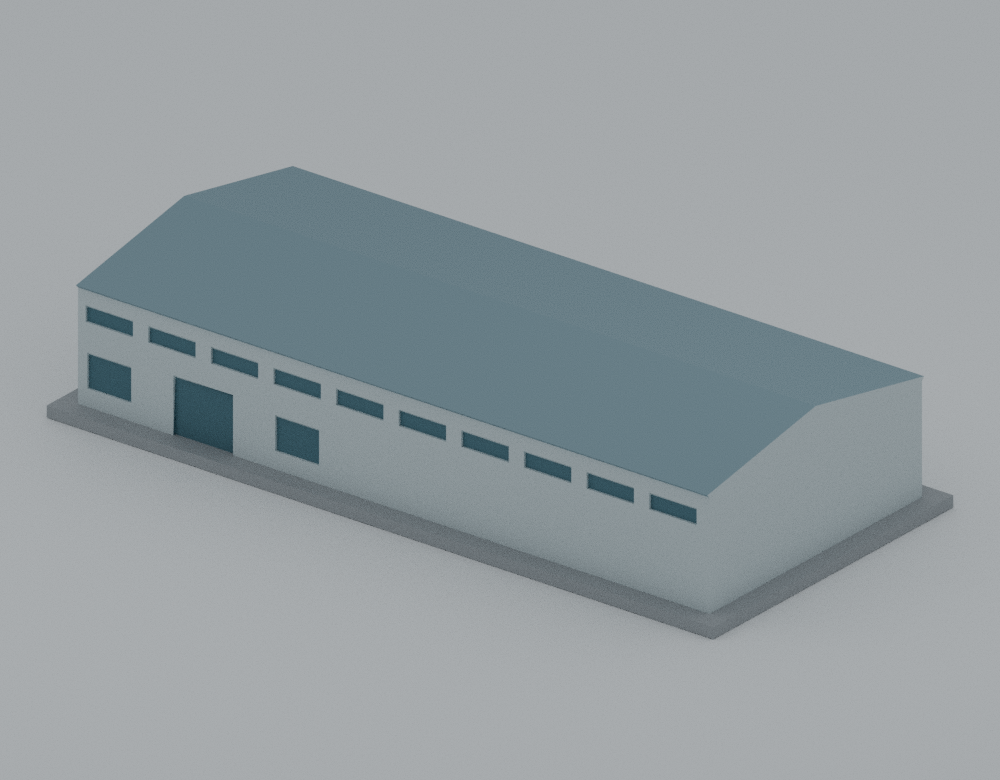

# 吳鳳科技大學｜校本部建築模型圖鑑

目前2套：生有樓及APOLLO航太車輛館主館外觀代表。教育部115學年度代碼1065；前身吳鳳技術學院、吳鳳工專不另計校。手冊校區名稱「吳鳳科技大學」、嘉義縣民雄鄉建國路二段117號地址保留；repo「校本部」只是展示簡稱。其他建物及全校逐棟清單尚未完成，非全校完成。

## 建築圖鑑

| 建築模型 | 建築模型 | 建築模型 |
| :---: | :---: | :---: |
|  **[生有樓｜2014標稱空拍外觀代表](buildings/wfu-shengyou/README.md)** 三角中庭、分層深廊與分段露空屋頂 220 × 186 × 114.5 mm |  **[APOLLO航太車輛館｜主館外觀代表](buildings/wfu-apollo/README.md)** 長向屋脊、連續長簷；高度與門窗估算 190 × 88 × 40.19 mm |  |

## 生有樓說明

[完整模型、正反並排預覽與下載](buildings/wfu-shengyou/README.md) · [來源摘要](../inventory/sources/wfu-shengyou-source-summary.md) · [QA摘要](../inventory/qa/wfu-shengyou-review.md)

模型220 × 186 × 114.5 mm，含3 mm整合底座；全部為相對估計或列印尺度，沒有可靠建築實長實高、沒有1:N比例。主要外觀採校方標稱2014空拍；2025年10月配置資料只交叉核對平面與跨層關係，不代表2001竣工精準復原或2026現況。

低翼、較小三角高體、三層入口挑空、分層中庭深廊、分段斜屋頂與大型露空均保留。未知兩斜背面採中性低細節封殼，不代表真實無窗；中央屋面板下封殼、局部圓整接頭、梁柱厚度、窗群及庭院高差屬製造簡化。九／十樓講堂配置不代表另一個完整標準層；不含鄰棟與完整跨棟天橋。玻璃與採光面以原創不透明材質表示。

入口、內廊、平台及屋頂有懸空或較長跨距，須評估支撐、橋接與移除路徑；尚未實體試印，未驗證特定機器、材料或切片方案。220 mm長邊未計brim、skirt或支撐安全邊界，名義220 mm印床未必容納。縮小後不能沿用原尺寸QA。有限截層／法線射線不證明任意位置及方向的全域最薄壁。原normal／-O各33 flags、strict=false與exit1保留；同次actualhex精確補證另列，沒有移樣本、替換理想線或降低0.8 mm門檻。

公開僅原創幾何、原碼、原創渲染、來源連結及明列數位證據；原影片、照片、抽幀、PDF與私有比較裁圖不公開。視圖鍵名只作固定驗證介面，不證明真北；front/north是入口斜視／入口正向，rear/south是後側斜視／後側正向。

## APOLLO航太車輛館說明

[模型、STL、Blender與五張預覽](buildings/wfu-apollo/README.md) · [來源及簡化](buildings/wfu-apollo/SOURCE-CREDITS.md) · [獨立覆核摘要](../inventory/qa/wfu-apollo-review.md)

本件為2021年10月啟用的主館，依2023／2024簡介照片及2025年平面交叉約束。主館平面180 × 77.92 mm、含3 mm底座總外包190 × 88 × 40.19 mm；外部簷高10 m與脊高12.5 m為照片比例建模假設，官方11 m僅室內挑高。未確認背面保持中性，略去後側小附屬物及雨棚。模型與生有樓採獨立展示尺度。

固定候選通過獨立來源、精確座標網格、2,043個截層及場景／預覽檢查；屋脊與簷尖收斂薄化、縮放與切片風險保留。未實體試印、未驗證機器G-code；兩件仍非全校完成。
