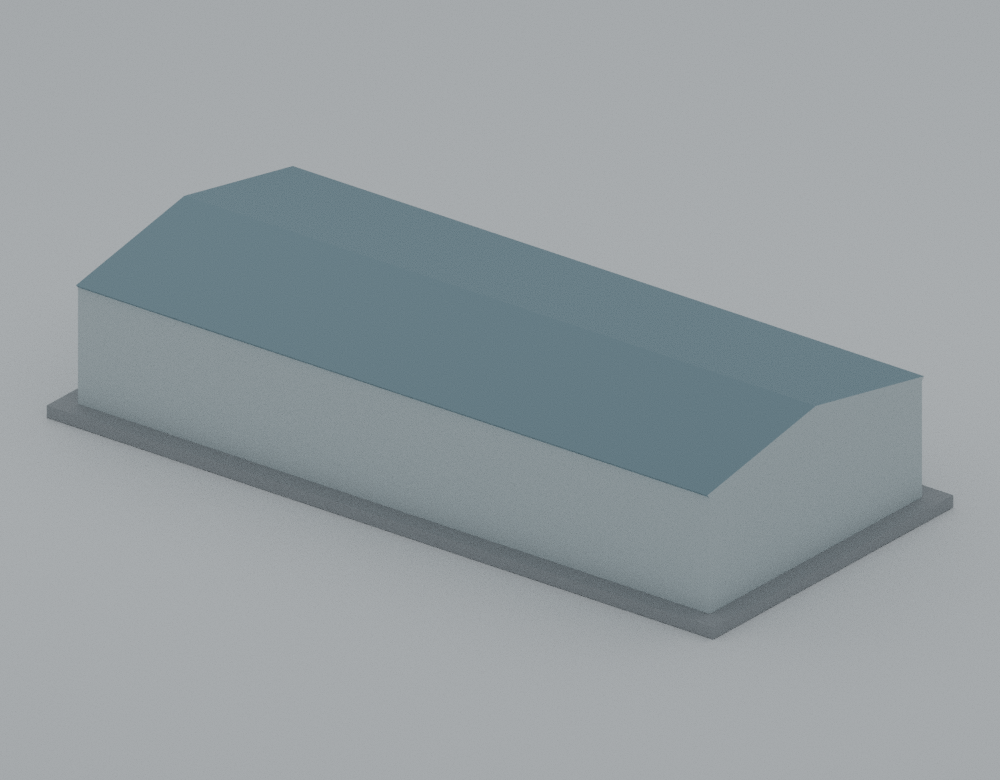
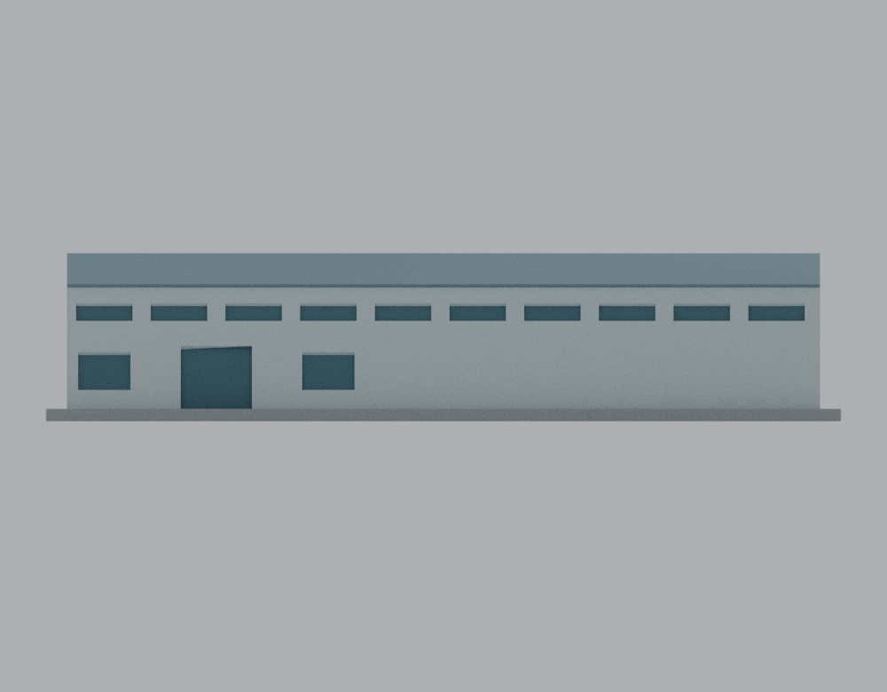
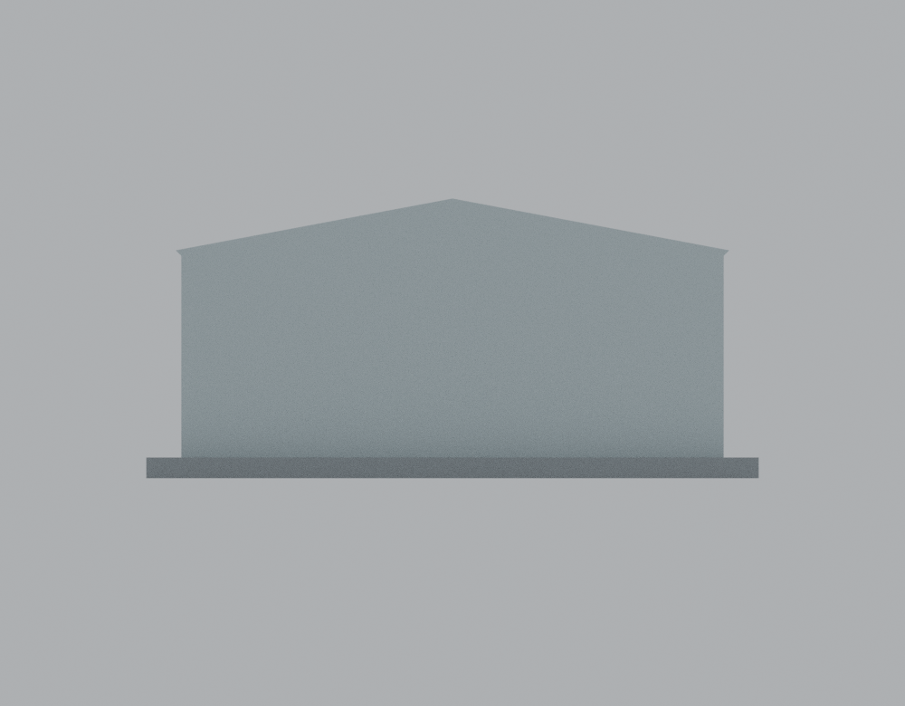
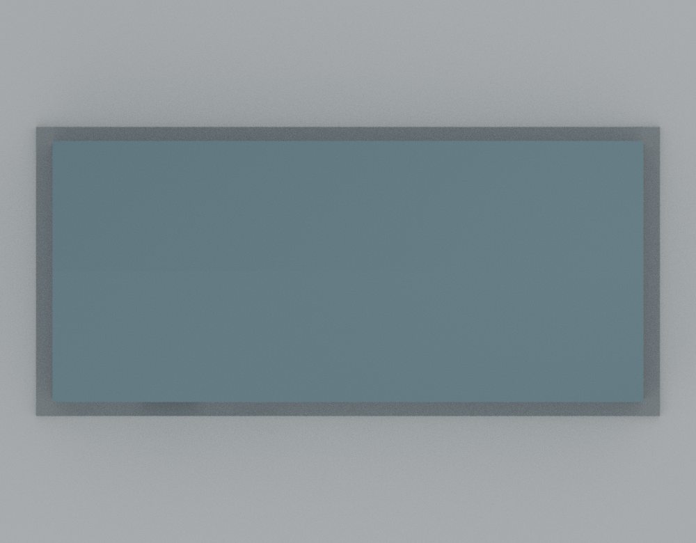

# 吳鳳科技大學｜APOLLO 航太車輛館

2021 年 10 月啟用主館的低細節外觀代表模型。以 2023／2024 年官方簡介照片為外觀時期，2025 年 10 月平面圖核對主館平面與跨距；不宣稱為 2026 年即時現況。本件固定候選已完成來源與獨立數位覆核，詳見[覆核摘要](../../../inventory/qa/wfu-apollo-review.md)；吳鳳原已收錄生有樓，本件也不代表全校完成。

| 已見長立面一側 | 另一側與短端 |
| :---: | :---: |
|  |  |

[STL](models/v1/model.stl) · [Blender 原始場景](models/v1/scene.blend) · [生成器](source/build_model.py) · [參數](parameters.json) · [來源與限制](SOURCE-CREDITS.md) · [驗證說明](qa/README.md)

總外包 **190 × 88 × 40.19 mm**，含 **3 mm** 一體底座；主館牆體平面 **180 × 77.92 mm**。長寬依官方圖面約 **60.50 × 26.19 m** 換算為獨立展示尺寸，約 1:336 的平面縮放。外部簷高 **10 m**、脊高 **12.5 m** 均為照片比例估算／建模假設，並非測繪值；不能因此將本件視為整體精確 1:N 模型。官方 **11 m 是室內挑高**，未用作精確外部屋脊高度。

保留長向屋脊、低坡雙坡屋頂、封閉短端山牆與連續長簷。主館採實心量體，窗與門為淺凹表示，沒有室內大跨空腔。已見長立面的十組上窗以約 6 m 跨距作節奏估計，兩組低窗與一處門的尺寸、位置也經簡化；不是逐窗實測。其餘立面採中性封閉處理，不代表實際無窗。沒有把已見窗列鏡射到未確認背面。略去未確認小型後側附屬物、雨棚、設備、招牌、波紋板、車輛與周邊建築。

長簷外挑 0.8 mm、下緣升高 0.8 mm；窗凹 0.65 mm、門凹 0.8 mm，頂部均以 45 度斜面簡化，以降低水平懸挑。預覽的配色只供辨識，STL 不含色彩。底座與實心內部是製造簡化。

## 其他視圖

| 已見長立面正視 | 短端正視 | 俯視 |
| :---: | :---: | :---: |
|  |  |  |

視圖的 front／rear 為模型工作方向，不表示地理方位。

## 重現與列印

Python 3.13 下安裝 [requirements.txt](requirements.txt)，在本套件目錄執行：

```text
python source/build_model.py --output-dir /a/new/output/directory
python source/render_preview.py
python qa/verify_reproducibility.py
python qa/independent_geometry_qa.py models/v1/model.stl --json /a/new/qa-report.json --negative-controls
```

生成器不需要參考照片或 PDF；原創幾何、參數與材質均在套件中。預覽程式也可由 Blender 5.2.2 執行 `blender -b --python source/render_preview.py`，會更新本套件的場景與五張預覽，請在工作副本操作。實測環境見 [toolchain.json](toolchain.json)。

以底座平面貼床、Z 軸向上列印。190 × 88 mm 未計 brim、skirt 與印床邊界。幾何及逐層支撐分析見 QA；**尚未以實體機器試印，沒有機器設定的實際切片 G-code 驗證**。0.4 mm 噴嘴、0.2 mm 層高僅為數位評估基準，仍須自行檢查首層、支撐、材料、冷卻及縮放後的細節。淺凹與脊線可因切片線寬消失；模型沒有宣稱任意縮放都可印。不要將截層抽查或網格通過當作試印成功。
