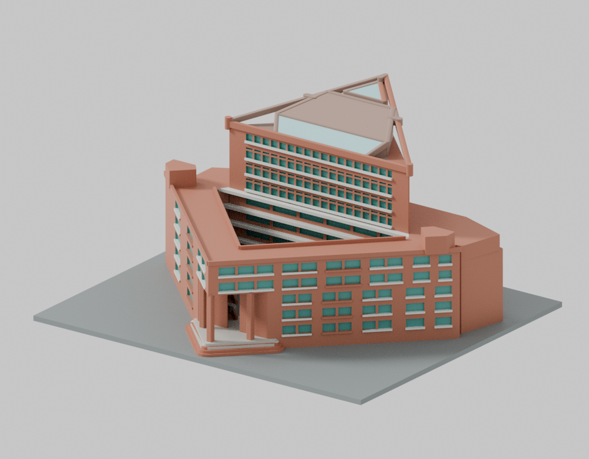
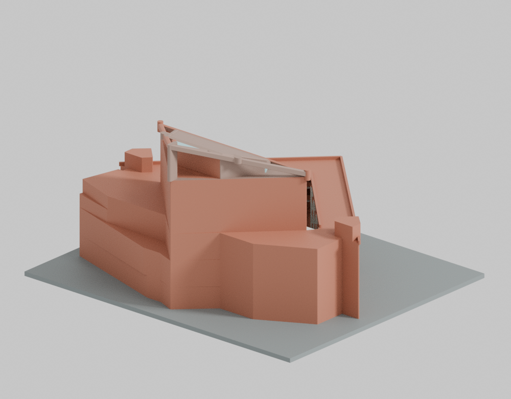
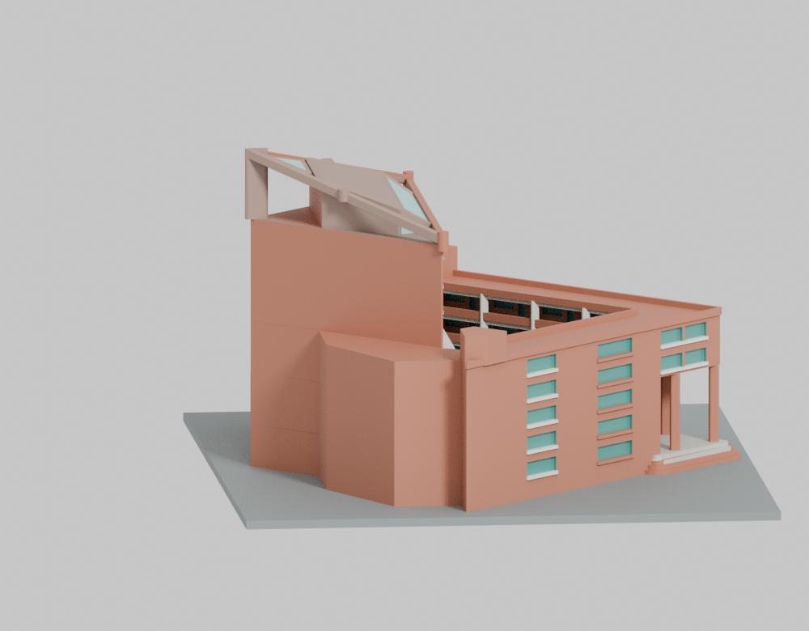
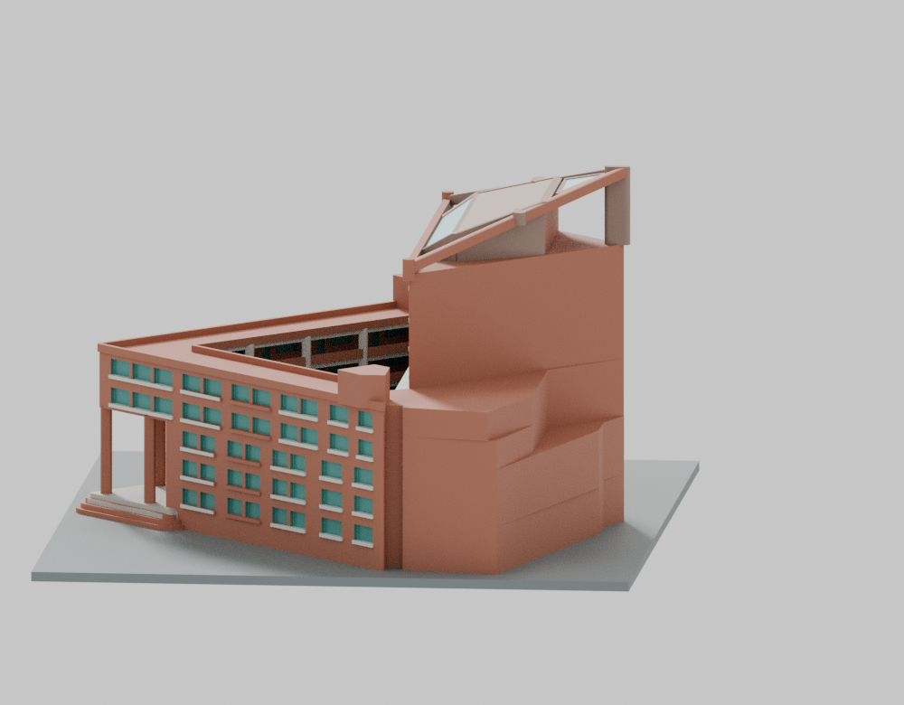
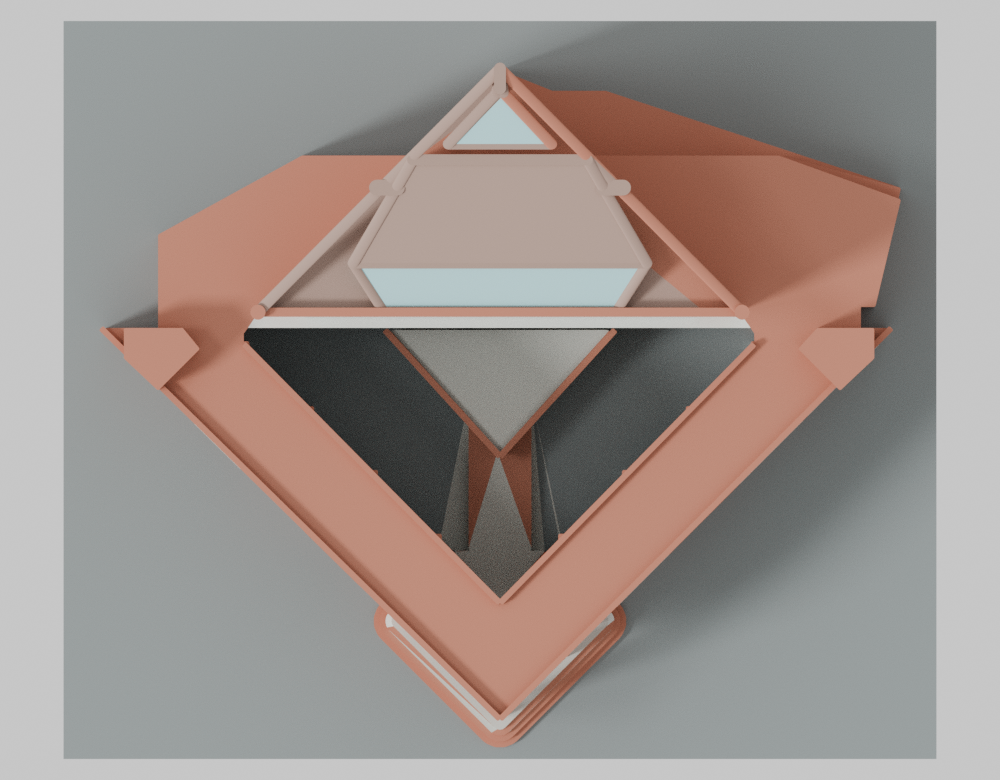
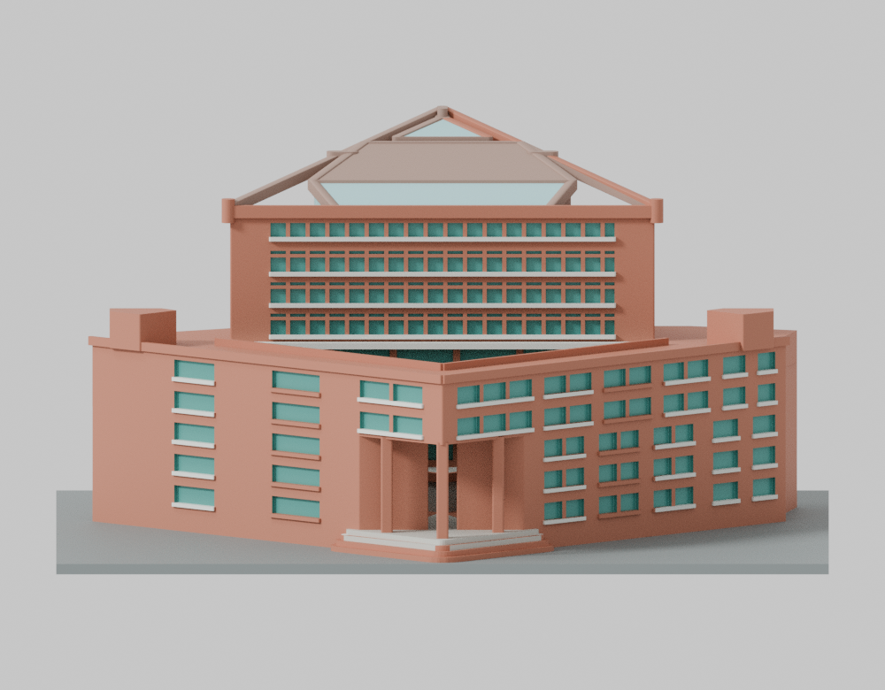
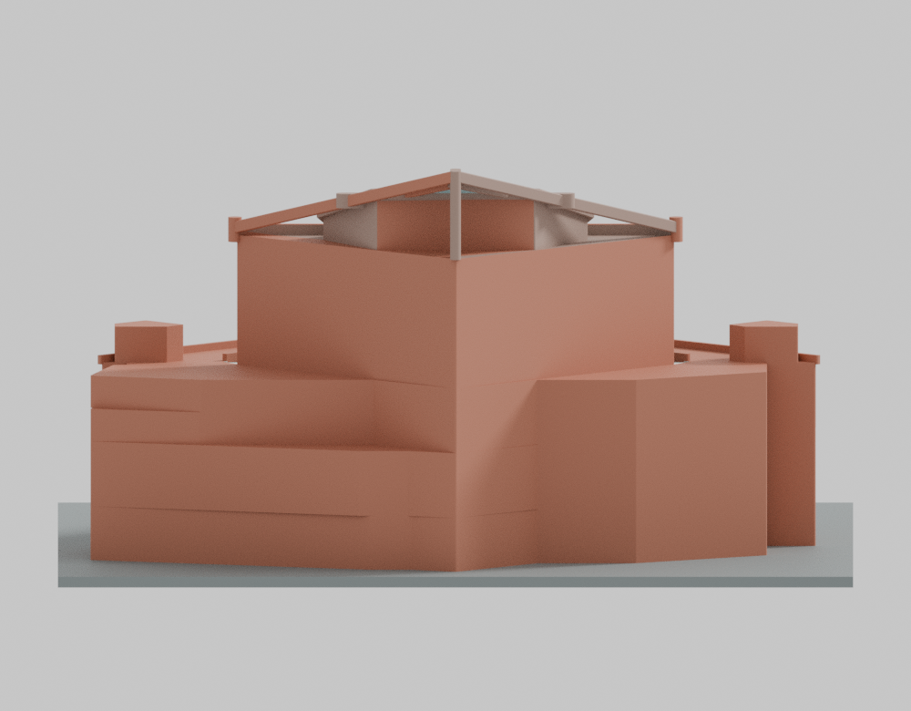
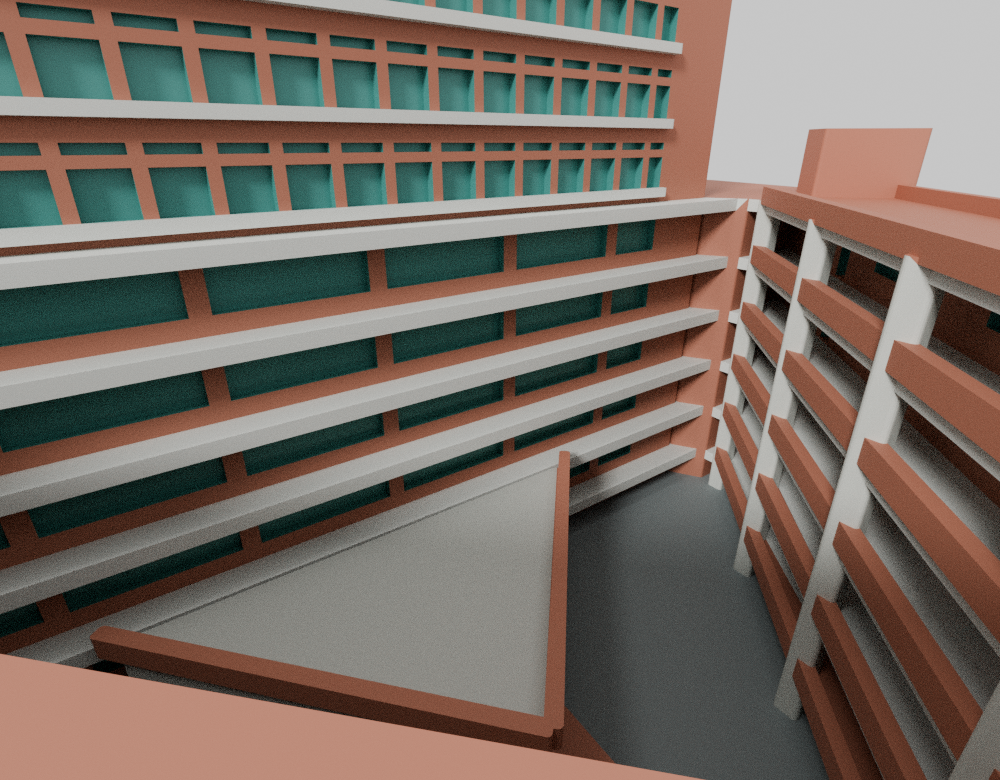
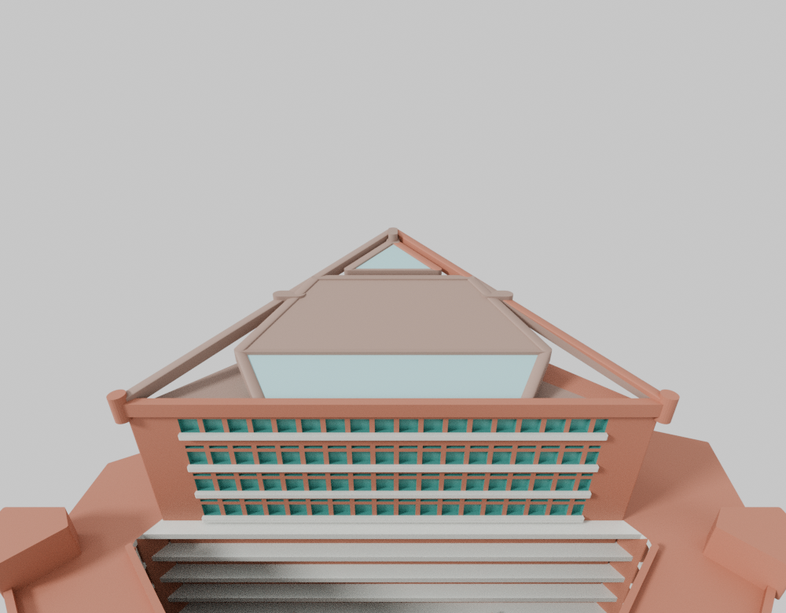

# 吳鳳科技大學｜生有樓

## 模型預覽

| 模型預覽 | 模型預覽 | 模型預覽 |
| :---: | :---: | :---: |
| 入口斜視  | 後側斜視  |  |

以校方標稱2014空拍外觀、2025年10月配置圖的相對平面關係交叉約束，保留三層入口挑空、開放三角中庭、低翼與較小高體、分層深廊及分段露空屋頂。

[下載 STL](models/v13/model.stl) · [下載 Blender 場景](models/v13/scene.blend) · [列印限制](PRINTING-LIMITS.md) · [估計與簡化](ESTIMATES-AND-SIMPLIFICATIONS.md) · [完整QA與還原](qa/README.md)

模型220 × 186 × 114.5 mm，含220 × 186 × 3 mm底板。沒有可靠建築實長實高，不提供1:N比例；不代表2001竣工精準復原或2026現況。九／十樓講堂配置不等於另一個完整標準層。未知兩斜背面採低細節封殼，不代表真實無窗；中央屋面板下封殼、局部圓整接頭、梁柱厚度、窗群及庭院高差為明示製造簡化。沒有用實心塊封閉整個三角中庭或全部屋頂孔隙。

未實體試印，未驗證特定機器、材料或切片支撐策略。入口、內廊、平台及屋頂需要支撐與移除路徑規劃。220 mm長邊未含brim、skirt與安全邊界；縮小後不能沿用原尺寸QA。有限截層與法線射線不證明任意方向的全域最薄壁。

原normal／-O各33 flags、strict=false與實際exit1完整保留。同次actualhex有界精確補證另列，不將原嚴格失敗改稱通過。STL SHA-256：8348213614296746732da6a8024821ff48536e847419fe13545dc1ab20730ca0。

## 其他視角

| 圖面左側 | 圖面右側 | 俯視 |
| :---: | :---: | :---: |
|  |  |  |

| 入口正向 | 後側正向 | 中庭深廊與分層平台 |
| :---: | :---: | :---: |
|  |  |  |

| 模型預覽 | 模型預覽 | 模型預覽 |
| :---: | :---: | :---: |
|  |  |  |

視圖鍵名為固定驗證介面，沒有已知地理方位的主張。公開九圖只移除指定非視覺metadata，原圖像資料與解碼像素不變。

## 來源與範圍

[來源摘要](SOURCE-CREDITS.md) · [獨立來源外觀審核](qa/source-review/SOURCE-APPEARANCE-SUMMARY-v13.public.md) · [指定原件憑據](qa/source-review/SOURCE-APPEARANCE-CERTIFICATE-v13.public.json)

公開只包含原創幾何、原碼、材質、渲染、來源連結及明列數位證據；原影片、照片、抽幀、PDF與比較裁圖保持私人，不宣稱來源作者授權或認可。不含鄰棟、完整跨棟天橋或完整室內空間。僅生有樓一件，非全校完成。

## 原碼與重現

[建模原碼](source/build_model.py)、[渲染原碼](source/render_preview.py)、[參數](parameters.json)、[環境版本](toolchain.json)保留原bytes。[作者原重現說明](qa/author-docs/REPRODUCE.md)與[原資產映射](qa/author-assets-copy-map.json)提供原相對路徑；先依完整QA還原說明建立新的工作副本，再執行程式，不要覆寫封存原件。
