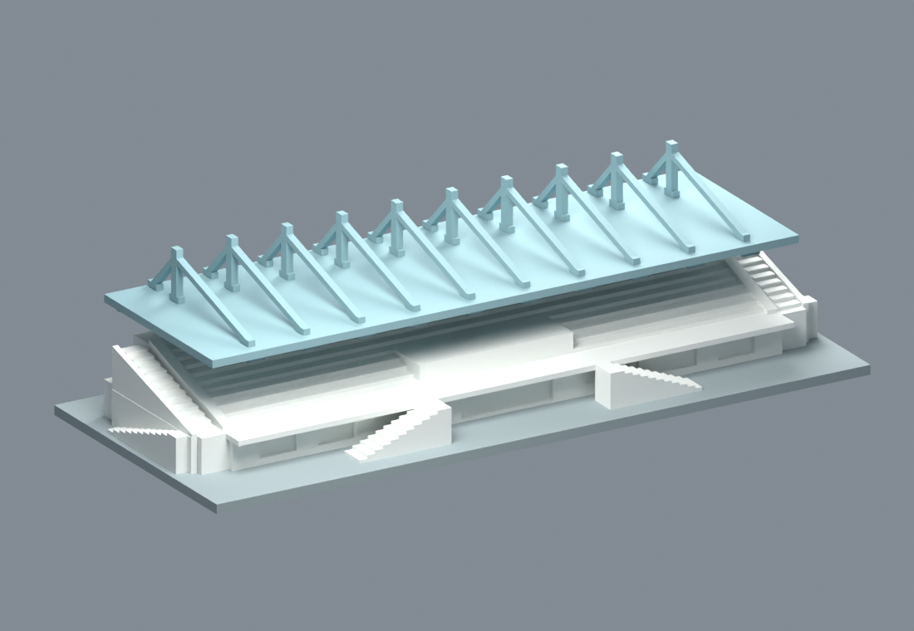
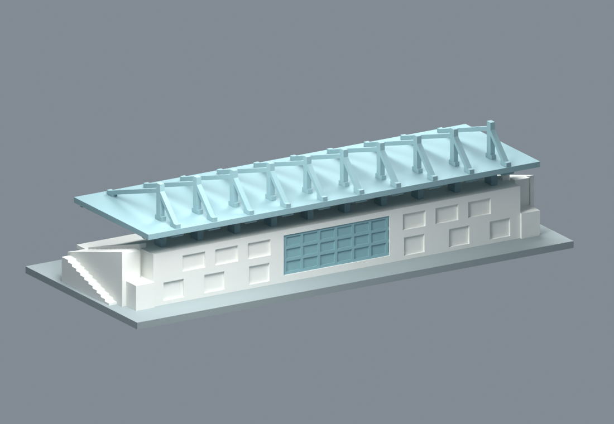
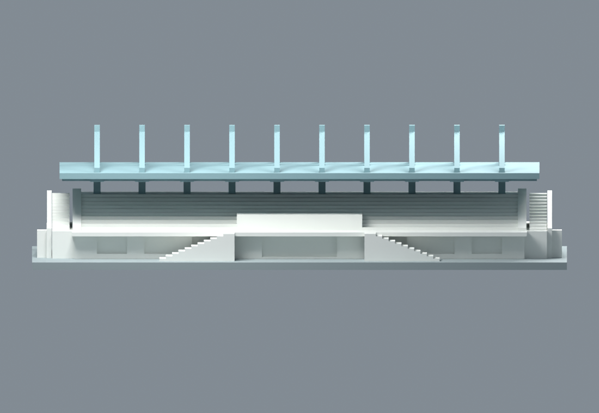
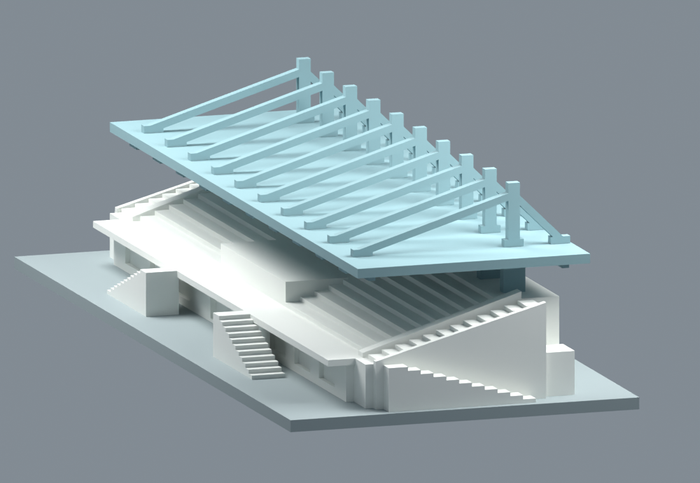
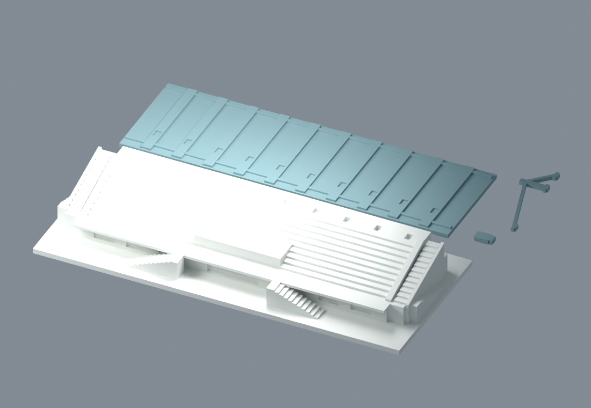

> **發布版說明**：固定候選 `7cf0563` 已完成獨立增量覆核，按下列列印條件放行。本包內「候選未推送／待覆核」是封存時點的歷史記錄；目前發布範圍、覆核及必要限制見 [發布紀錄](../../../publication/cnu-j-grandstand-historical/PUBLICATION.md)。模型幾何未變，原主體自動橋向切片仍不放行。

# 嘉南藥理大學 J 司令台／運動場看台：歷史外觀代表模型

這是一套低細節、可分件膠合的外觀候選，依校方 2006、2010、2012 年照片及拍攝年未知的高視角棚面照片組合。**不是 2026 即時現況、精密測繪或工程模型；尚未試印、拆支撐、試合或測膠強度。** 四個固定列印 STL 經獨立覆核有條件 GO，必須遵守下述橋向、支撐及組裝條件；原主體自動橋向診斷切片不放行。本候選未推送，未更新公開數量。

| 模型預覽 | 模型預覽 | 模型預覽 |
| :---: | :---: | :---: |
| 正面  | 後面  |  |

| 模型預覽 | 模型預覽 | 模型預覽 |
| :---: | :---: | :---: |
| 正面低視角  | 側面  |  |

保留長方薄棚、10 站柱／桅杆與斜撐節奏、棚下開放空間、座階、中央平司令平台、斜側牆、雙前梯、側梯／露台，以及**後側兩層封閉量體與跨層中央玻璃段**。背景高樓、田徑場、球場及 U 紹宗體育館均排除；CN11427 研究對象是 U 棟，未用作本件依據。

整體展示名義外框為 **214 × 90 × 53.4 mm**（含 3 mm 底座）；主體寬 180 mm、屋棚 192 × 60 mm。若膠合肩部自然乾落座，柱、棚及上框分別累計下降約 0.05、0.10、0.15 mm，最高約 **53.25 mm**；這是接口幾何推算，非試合實測。約以每估計公尺 3 mm 安排，但所有長寬高都是依圖估計，至少保留 25% 尺寸不確定性，不能反推精密實尺寸。座階及兩端外梯作代表性配置，遠側精確動線尚未證實。

## 分件與組裝

`model.stl` 是組裝位置總覽，含 22 個相互留膠縫的封閉零件，**勿直接整體列印**。每種唯一幾何各有一份 `*-assembly.stl`（原設計座標）及 `*-print.stl`（已定向、最小座標為零）。

| 列印檔 | 數量 | 已存方向 |
|---|---:|---|
| [主體](parts/main_body-print.stl) | 1 | 底座朝床 |
| [屋棚](parts/roof-print.stl) | 1 | 棚頂面朝床，肋梁向上 |
| [下柱](parts/column-print.stl) | 10 | 側面平放 |
| [桅杆／雙斜撐框](parts/mast_brace_frame-print.stl) | 10 | 平面側放 |

| 模型預覽 | 模型預覽 | 模型預覽 |
| :---: | :---: | :---: |
|  |  |  |

先完成主體的支撐清理及槽口／象腳處理，再乾排主體與十根下柱，利用屋棚底盲槽同時對齊柱列，最後逐一黏上屋棚頂的十組桅杆斜撐框。上框有前、桅杆、後三個腳；前後位置不同，不可反向。所有插接均為**留縫膠合定位，非卡扣**。先在廢料或少量零件試合，再用適合材料的補隙膠及臨時平行治具固化。未驗證材料收縮、象腳、真實黏接、抗彎或運送強度。

主體槽為 3.2 × 4.8 × 2.5 mm；柱腳 2.8 × 4.4 mm，槽底留 0.3 mm 膠縫。棚底槽深 0.8 mm；棚上框腳槽為 2.6 × 3.8 × 0.8 mm，框腳為 2.2 × 3.4 mm。XY 總間隙均為 0.4 mm，棚槽底／鍵端留 0.15 mm，座面膠膜間隔 0.05 mm。下柱腳平面 12.32 mm²；每組上框三腳合計 22.44 mm²。接口座標與配置見 [assembly.json](assembly.json)、[parameters.json](parameters.json) 及製造覆核。

## 列印條件與限制

診斷條件為 **100% 尺寸、PLA、0.4 mm 噴嘴、0.2 mm 層高、名義 0.45 mm 線寬、3 周壁、15% 填充、250 × 210 mm 工作床**。100% 指尺寸，不是實心填充。這些是切片覆核條件，非任意機型通用設定；診斷 profile 沒有有效真機起終碼，須依實際機器重切並逐層核對。柱和上框全形側放；不應為支撐整棚而將棚與看台一體列印。

**主體必須讓前平台沿短向橋接，並保留橋下可拆支撐。** 原 `diagnostic-main-support.ini` 雖 exit 0、無 warning，Z=12.6 mm 平台長向橋仍有約 174.289 mm 連續中心線未承托空段，因此原主體印法不放行。覆核改用 `bridge_angle=90`、`dont_support_bridges=0`，同層最大空段降至約 **1.704001 mm**。角度數字只適用保存的方向；旋轉模型或更換切片器後，仍須確認實際走線沿平台短向、橋下支撐可拆。上述空段是依擠出線及線寬計算的承托抽象，非實測橋接能力。

仍需穩定處理約 8.3 mm 內部橋接：修正後主體其他內填充封頂最大空段約 **8.224913 mm**，屋棚 Z=1.8 mm 的 15% stars 內填充封頂約 **8.036027 mm**。棚頂朝床的 30 個 2.6 × 3.8 mm 盲槽在 Z=1.0 mm 跨孔約 **2.600011 mm**，不是全件最大橋長。若材料、冷卻及流量設定沒有相應能力，增加內填充／實心層後重切，再檢查封頂及槽形。

主體前平台約 5 mm 懸挑及淺門窗上緣仍需支撐。新版實際支撐 30,369 段以 ≤1 mm 間距取得 95,890 個唯一樣點，其中 95,310 點至少一水平向可出，其餘 580 點位於雙前梯背後兩個外開淺窗。這 580 點的三段路徑（先至 Y=−33，再側向 X=±65，最後向前至 Y=−60）未見模型交擋；牆梯間槽寬約 4.5 mm、高約 9.4 mm，淺窗深約 1.2 mm。**須用細工具逐段破碎、側向拆除，不能整塊直向前抽。** 新支撐樣點覆核未見新增封閉區，只是有限點／射線／折線檢查，不保證完整工具、抓住的支撐塊或所有支撐均可通過，也未模擬其他支撐阻擋、黏附及拆除力。若工具無法安全轉入淺窗，須調整支撐配置或採相容的可溶支撐後重切，不能硬拆或封入組裝。

完整條件、原失敗結果及補證見 [獨立覆核](qa/independent-support-review/INDEPENDENT-REVIEW.md) 與 [切片及支撐報告](qa/independent-support-review/slicing-support-audit/SLICING-SUPPORT-REVIEW.md)。製造報告中的實際切片條件與結果優先；未承諾全面免支撐或已完成實拆驗證。

本輪整合的 [短向橋接設定、重切腳本及校驗](manufacturing/reviewed-support/README.md) 以獨立修正 profile 實際重切主體，並核對除生成時間外的完整 G-code 路徑。它仍是診斷參考，須依實際機器重切，不能直接送機。

屋棚板厚 2.4 mm；實際肋梁深 1.2 mm。下柱最窄 2.8 mm；框側厚 2.2 mm、斜撐垂直截面寬 1.8 mm；盲槽在肋梁區的剩餘側壁最薄 1.2 mm，頂槽離一般棚底至少 1.6 mm，對向槽投影重疊處剩餘 2.0 mm。細門窗、欄杆、旗幟、索線、設備省略，玻璃格作閉背淺浮雕；梁柱與斜撐均明示加粗。座階下方與室內填實僅為列印簡化，棚下主要開放空間未加虛構支撐。

192 × 60 mm 長平棚可能翹曲，須控制床附著並完全冷卻後拆床；細框搬動、膠合與運送時可能折斷。本次診斷只有 skirt、沒有 brim；若真機另加 brim，拆除與配合面也須重新核對。較小比例、其他噴嘴或材料須重新評估。原及修正診斷 G-code 僅用於覆核，均非推薦真機列印檔；原失敗結果保留，未提供作真機通用檔。

## 重建及 QA

安裝 [requirements.txt](requirements.txt)，在此資料夾執行 `python build_model.py` 重建所有 STL 和組裝記錄；`python render_preview.py` 以 Blender CPU Cycles 產生預覽和 `scene.blend`。腳本使用相對路徑，不需要原照片或私有工具路徑。

`parameters.json` 是本版尺寸及接口設計紀錄；生成器另含座階、立面及外梯的固定構形常數，並非所有欄位都能單獨改值自動連動。調整尺寸時須同步生成器並重做 QA。完整診斷工具依賴可用 `requirements-qa.txt`。

幾何、連通、自交、零件碰撞、重建及製造結果見 `qa/`。各檢查保存精確 STL SHA、座標與容差，失敗及工具限制不被改門檻掩蓋。`MANIFEST.sha256` 列出本包檔案雜湊（不含自身）；`render-manifest.json` 綁定實際 STL、場景與預覽。`scene.blend` 匯入交付 STL，預覽著色僅用於辨識材質，不影響 STL 幾何。

## 官方來源與年代

來源逐圖記錄、相簿綁定、EXIF、下載大小和 SHA 見 [sources.json](sources.json)。四張原圖已在本機下載並實際觀看，原照片及原始 HTML 不隨模型再散布。

- [J 棟司令台相簿](https://libcvod.cnu.edu.tw/media/1207)：正面座階／雙前梯；2006 後側兩層與中央玻璃。
- [運動場相簿](https://libcvod.cnu.edu.tw/media/1226)：未定年完整棚面；2010 側梯與露台。
- [校方運動及休閒設施](https://www.cnu.edu.tw/content-text.asp?fid=10&id=203)：田徑場在司令台前方；U 棟為紹宗體育館，與 J 分開。

後照 EXIF 2006-11-16；側照 2010-12-17；正面 EXIF 2012-06-30。正面相簿 caption 含 20250308，但 EXIF／createTime 支持 2012，已保留此衝突。高視角無有效拍攝日期，2020 只是上傳年。

本包只含原創代表幾何、生成器、場景、預覽及文字證據；不授予第三方建築／照片／校徽權利。模型用於外觀研究與個人列印參考，非校方授權產品。
