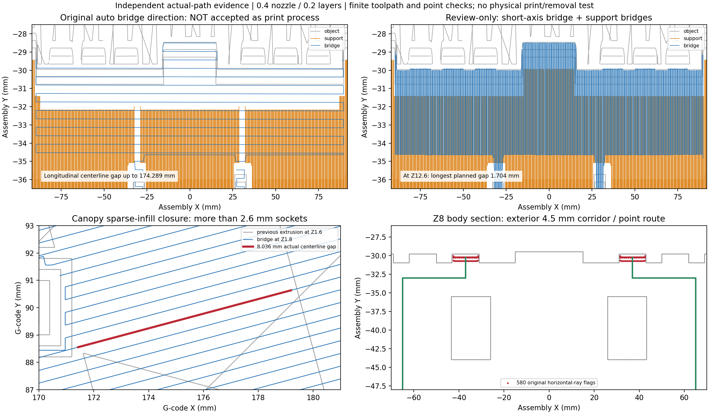

# 嘉南藥理 J 司令台：獨立切片與支撐審查

固定候選 `3a9a6041c5fde9ef2d6e9e96b02f24f025c8be5a`。本節只審四種列印零件、原始診斷 G-code、支撐路徑與橋接。來源、整體幾何、22 件組裝與場景由其他獨立審查項目負責。本審查沒有修改原候選、原 G-code 或遠端，也沒有啟動印表機。

**判定：固定 STL 未在此範圍發現必須改模的阻擋，但主體原診斷切片不能直接作為可用印法放行。** 必須重切主體，將前平台首層的橋向改為跨短邊，且勿略過橋區支撐；完成真機切片的逐層核對後，才符合本節的條件式 GO。這是實質的切片條件，並非把原旗標當成浮點誤差消除。只要提供的診斷 G-code，無論原版或本審查變體，都不能直接送機。

## 固定列印檔與實際重切

| 檔案 | 物理份數 | SHA-256 |
|---|---:|---|
| main_body-print.stl | 1 | `64205a0515ec83e40e56a2f855a256556490a1d759481741cef177d42b0b133c` |
| roof-print.stl | 1 | `dbb9dfc7850219f8d40213cfb6c0cd944c1f30225dec2f6f3ae358370a9166cb` |
| column-print.stl | 10 | `010e3512e0b420d9f40ae1ad7679314cfd841a931aa30a4d6e9ae05a8dd169da` |
| mast_brace_frame-print.stl | 10 | `a0cb933ab1bdf6a26ccc20b573a1ea9a5f8a22df93868f6395885c8be3d80cef` |

本機四個原始診斷 G-code 實際可讀，其 SHA 與包內記錄一致。以 PrusaSlicer 2.9.6、各自全新的設定目錄，對四種固定 STL 各獨立重切一次，全部 exit 0、無 warning/error/repair 訊息；產生檔與原診斷檔僅首行生成時間不同。這是四種幾何的四次重切，並非對 22 件各自切片，也沒有拿總覽 STL 替代列印零件。

實際設定是 0.4 mm 噴嘴、0.2 mm 層高、0.45 mm 指定線寬、3 圈外壁、**15% stars 填充**、PLA 205/60 °C、250 × 210 mm 床。brim_width=0，只有 6 mm 距離的 skirt，不能聲稱已使用 brim。主體 support_material=1；其餘三類為 0。主體有 140 個物件擠出高度及 189 個總層變更記錄，因支撐獨立層交錯；其餘為 18／14／11 個物件高度。四檔的實際擠出路徑（連 skirt）均在床範圍內。

獨立 parser 處理 G90/G91、M82/M83、G20/G21、G92 與 G0/G1 的 modal XYZE，排除純回抽／回填 E 動作。原主體實際有 8,559 條 support material 與 18,027 條 interface 正 E、非零 XY 路徑；其餘三類支撐擠出為零。原設定可重現，只證明切片成功與路徑存在，不證明這些路徑能成功列印。

## 主體：保留原長向橋風險，要求改切片

原主體橋區不是全部僅有短跨距。G-code 第 96526 行在 Z=12.6，從 `(214.638,79.699)` 到 `(35.362,79.727)`，整條約 179.276 mm，對應前平台長向。以實際上一物件層 Z=12.4 的沉積線掃掠圓頭帶，及接近接觸高度的交錯支撐層作精確區間聯集，仍有最長 **174.288719 mm 中心線未被下方路徑覆蓋**。未加支撐的前層比較是 179.276002 mm；兩個原始結果均保留。

這個中心線指標不等於一片 174 mm 寬的空洞：在中央 X=0 附近，支撐頂層實際到 Z=12.0，支撐中心線最靠牆的 Y≈78.836，加半線寬後約 79.061；原牆面在 Y=80，橫向未覆蓋帶約 0.939 mm。但長橋線與該帶平行。第 96526 行與前一同層長線相距約 0.464 mm，而宣告厚橋線徑約 0.413953 mm，故不能僅以「旁邊有同層線」判定足夠支承。厚橋 HEIGHT=0.4，與名義 0.2 mm 層高也不能混用。原圖只顯示最高的某層支撐，沒有證明這條帶已被支撐完整覆蓋。

本審查另做**審查區限定的可行性變體**：只把 profile 改為 `bridge_angle=90`、`dont_support_bridges=0`，STL、尺度、其他設定均不變。重切 exit 0。Z=12.6 首平台層最長未覆蓋中心線段降為 **1.704001 mm**；全主體最長為 Z=13.4、前層 Z=13.2 內填充封頂的 **8.224913 mm**。變體的設定、命令、G-code hash、原始路徑與覆蓋結果另存，未覆寫原結果。它示範無須改 STL 的可行切片方向，仍不是已驗證的真機 profile。

必要印法：主體直立，以跨平台短邊的橋向與完整平台支撐重切；逐層確認沒有長向孤立條帶、支撐接觸距離與移除路徑合適。不能照抄角度數字而忽略實際 XY 方向，因另一台切片器或旋轉零件會改變其含義。

## 棚板：30 個盲槽與其他真橋接分開

倒印棚板的 30 個床側盲槽確在 Z=1.0 封頂，槽口約 2.6 × 3.8 mm。實際橋線與前層實體截面比較的最大跨空中心線長約 **2.600011 mm**。略高於 2.6 的末位是 STL 座標／截面計算，不表示另一個長槽。

但棚板還有其他橋線。其 4,108 條 Bridge infill 中，最長整條標籤線約 181.05 mm，不能當作整段自由跨；以真實前層擠出足跡分析，最大連續空段在 Z=1.8、前層 Z=1.6，為 **8.036027 mm**，屬 15% stars 內填充封頂。主體其餘填充封頂也約有 8.22 mm 真空段。兩者都須實機具相應的 PLA 冷卻、流量與約 8.3 mm 橋接能力；若無把握，應提高局部填充或改實心層後重切檢查，不能把全部橋接概括成 2.6 mm 盲槽。柱與上框原路徑無 Bridge infill。

192 × 60 mm 棚板薄而寬，仍有翹曲、床黏與拔床後變形風險；原診斷沒有 brim。真機可依材料與床面增加外 brim，但要保留盲槽配合面並重新檢查尺寸；未實際拆 brim 或試合。

## 支撐可達與移除：開放不代表整塊可抽

主體支撐座標約 X±93.018、Y−38.224..26.408、Z3.6..23.1。依實際正 E 路徑取端點及每段不超過 1 mm 的樣點，共 83,924 個唯一點，對模型作八個水平點射線。76,439 點可沿前／後直接出去；83,344 點至少一個方向通；**580 點八向均不通的原結果完整保留**。

580 點集中在兩側前淺窗，X=±31.45..42.55、Y−30.7375..−30.045、Z5.6..10.867，沒有點位於主體實體內。正前方被前階梯擋住。它們與外界仍有折線通路：每點先到同 X/Z、Y=−33，再沿 X 到同側 ±65，然後向前到 Y=−60，三段精確有限線段全數無模型碰撞。牆 Y=−31 與梯後緣 Y=−35.5 間是 4.5 mm 外側槽，從底座 Z=3 到平台底 Z=12.4 約 9.4 mm 高；在 Y=−33、Z=8 的左右軸，各 65 條半徑 0.5 mm 圓周樣線亦無碰撞。

因此未見真封閉支撐腔，但必須在組裝前，從側方逐段剪碎／剝離淺窗支撐，使用細的彎鉤、鑷或刀頭，折入約 1.2 mm 深的窗凹。**不能整塊朝前抽，也不能用力撬階梯或細窗框。** 支撐本身可能先占住這條槽，需要逐步清出；1 mm 柄部樣線只核某段直通槽，沒有證明完整彎工具及夾住的碎塊可連續轉彎。

短向橋變體新增支撐，不能套用舊樣點結論。本審查另外對其 **30,369** 條支撐（interface 23,661、material 6,708）重做相同檢查，共 **95,890** 個唯一點；87,480 點可前／後直出，95,310 點至少一個水平向通，仍有 580 點八向不通。這 580 點座標逐項與原版相同；另外對新版旗標重新做三段折線與半徑樣線補證，結果同樣無模型碰撞，未增加此有限檢查可見的封閉區。新版最高支撐 Z=23.4，原版為 23.1。這仍不將新支撐或舊支撐提升為實際可拆保證。

前平台下方支撐可由前／側分段取出；後方門窗及中央格線間的支撐由外側小格逐段清除。所有這些操作仍未實試。若選用支撐的黏附程度／工具可達性不能在不傷主體的情況下處理，應調整支撐位置、接觸設定或採相容可溶支撐流程並重切，不能以模型射線測試保證拆除成功。

## 交付限制與證據

這裡沒有保證實物支撐移除、試合、22 件膠合尺寸、膠強度、棚板平直度或上框搬運強度。需按 1+1+10+10 印向列印，先拆支撐與修邊、乾組，再以合適間隙填補膠組裝；上框應在大部件完成後裝，以免搬動時折斷。列印尺度 100%，縮小或換噴嘴、材料、層高必須重新評估。

原候選製造失敗／較早檢查紀錄未改。本審查的工具失敗也另保存在 `attempt-failures.json`。`slice-audit.json` 保存每檔原 SHA、重切 SHA、設定、modal 指令及各類實際擠出量；`all-bridge-coverage.json` 保存全部原橋線的精確覆蓋間隙；`support-access-and-bridge.json`、`support-route-followup.json` 分別保留初始有限射線失敗與後續折線補證。`REVIEW-ONLY-*` 是補充可行性試切，不能併入原候選的 passed 欄位。

`raw-reslice-private/` 內 G-code 只供本機審查，不建議納入對外證據 ZIP。其雜湊已記錄；可由固定 STL 與 profile 重建。此資料未被送至任何印表機。

