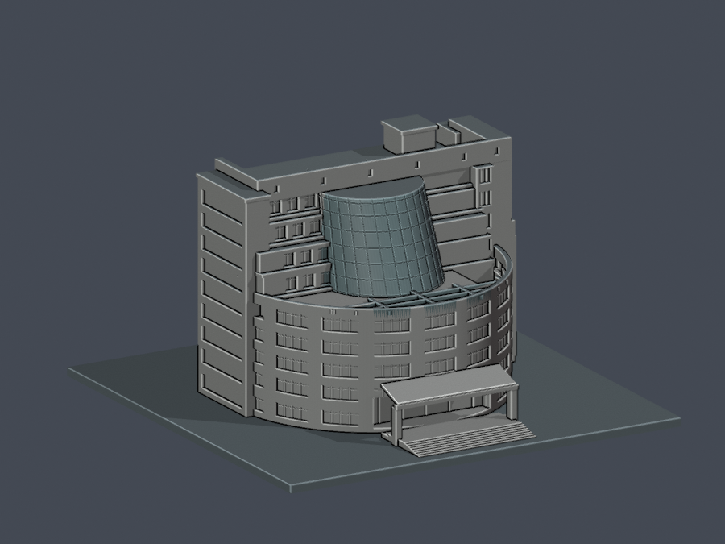
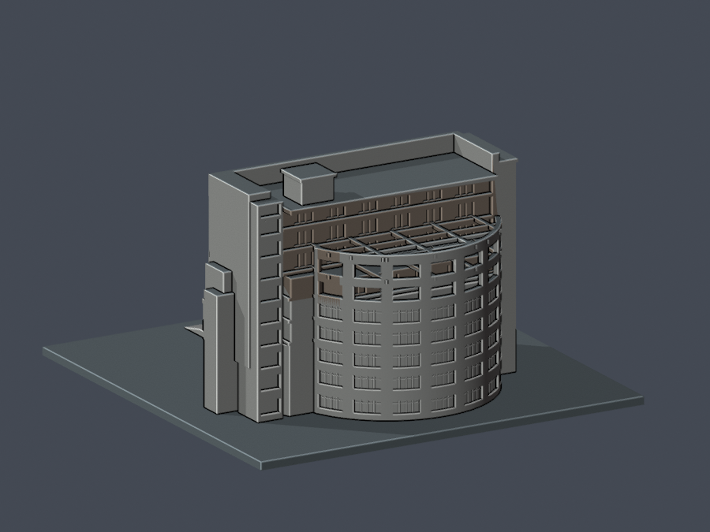
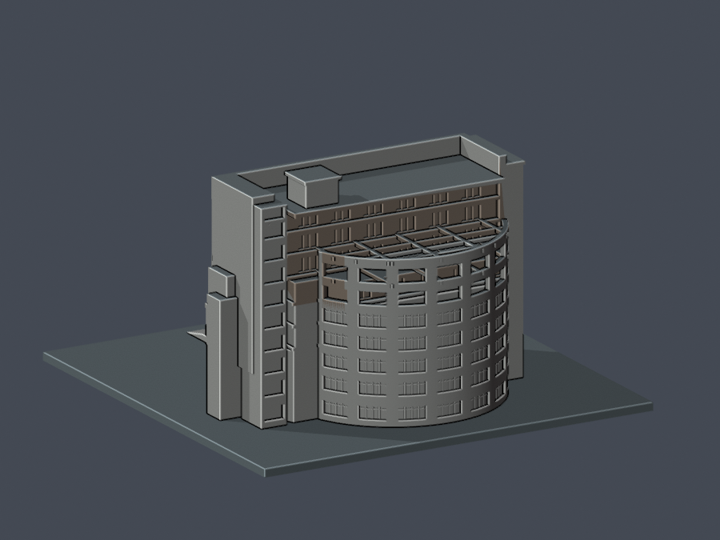

# 王趁紀念圖書館：既有對比材質的 3MF 交換補充

**這不是新增建築、新增真實上色，也不是首次提供可編輯模型。** 原本的 [scene.blend](../scene.blend) 已可編輯；本補充只把同一個 L 棟模型的既有五種「預覽對比材質」和逐面指派帶入 3MF。Q 棟仍不包含，建築數量不增加。沒有根據照片重新分類任何面，真實材質修正的核准面數仍為 **0**。

本目錄應放在既有 `cnu-wang-chen-library/interchange/` 下，不覆寫上層任何檔案。原 [README](../README.md) 的全部模型範圍、v2 限定例外、方向性短弦、薄損、比例與列印警告仍完整有效；原始 Python、STL、Blend 與既有預覽均不改動。

## 實際模型預覽

左欄沿用既有預覽；右欄為**實際 3MF 經 lib3mf 2.5.0 讀入**的網格與逐面材質，再用 Blender 4.3.2 同相機、燈光渲染，並非以 STL 冒充交換檔。沒有照片貼圖。

| 視角 | 原有 Blend／預覽 | 實際 3MF 讀回 |
|---|---|---|
| 南正面 |  |  |
| 北背面 |  |  |

對照中中央曲面、底座、屋頂與北側後退牆的對比位置一致。這些顏色是既有可讀性設定，不是量測色或照片校色。不同軟體的光照、色彩管理、材質支援仍可能不同。

## 保存了什麼，沒有保證什麼

- **幾何不變：** 65,686 個三角面、32,643 個精確共用頂點；逐原 STL 記錄、逐角、繞序和 float32 位元全部一致。單位毫米，原位置、原比例，一個物件；不乘 Blender 的約 0.001 單位設定，不修補、不減面、不重建。
- **座標是精確的非指數十進位展開。** 只寫六位小數會改變原資料；這裡不是以「外包框差不多」或誤差容限當成相同。
- **逐面指派不變：** [face-materials.csv](face-materials.csv) 是實際原 Blend 的已儲存指派。沒有重跑舊重心／位置分類公式。
- **原始 RGBA 精確保存：** [appearance-original.json](appearance-original.json) 保留四個 little-endian IEEE-754 float32 通道的十六進位位元與精確十進位值，並完整內嵌在 3MF 的 `tb:appearance-original` metadata（`preserve="1"`）。RGB 為 scene-linear **Linear Rec.709**，alpha 均為 1，不代表透明玻璃。
- **標準顯示顏色有量化：** 3MF `basematerials` 的顯示色是線性 RGB 經 sRGB 轉換後的 8 位元 RGBA，不能單靠它無損還原原 float32 色值，也不指定列印機實際材料或印出顏色。原 Blend 仍是原生可編輯權威檔；metadata／sidecar 是原始值紀錄，不是假稱一般軟體會自動使用它。
- 本次拓樸核對為 98,529 條邊各有兩個相反方向的鄰面、一個面連通分量、零指定門檻退化面；**沒有重新認證自交、全域最薄壁、支撐、切片或實體試印**。

| 原索引 | 原名稱（保持原文） | 面數 | sRGB8 顯示 RGBA |
|---:|---|---:|---|
| 0 | Neutral building preview | 52,416 | `#EDEDE8FF` |
| 1 | Base contrast preview only | 451 | `#99A8ADFF` |
| 2 | Roof contrast preview only | 4,736 | `#A6B3B6FF` |
| 3 | Glazing contrast preview only | 6,612 | `#9EB8BAFF` |
| 4 | Recessed north wall contrast only | 1,471 | `#CEBAA8FF` |

每面顯式寫入相同的 `p1/p2/p3`，不做三種材料混插；物件預設值為索引 0 中性預覽。若閱讀器忽略逐面屬性，可能只顯示中性預設，不能把那種情況宣稱為五色成功。

## 重現與檢查

在本 `interchange/` 目錄執行。Python 3.12.14 已測試；匯出及 XML 檢查只用標準函式庫。原始 `../model.stl` 與 `../scene.blend` 必須符合固定 SHA256，錯版會直接拒絕。

```bash
python export_3mf.py --model-dir .. --output /tmp/cnu-rebuilt.3mf
python validate_3mf.py --model-dir .. --model /tmp/cnu-rebuilt.3mf
python run_checks.py --model-dir .. --work-dir /tmp/cnu-clean-checks --report /tmp/cnu-checks.json
```

`run_checks.py` 要求新的測試目錄：兩個乾淨重建的整個 ZIP 與每個解包部件均須相同，也須等於交付檔。ZIP 固定成員順序、1980 時戳、權限與無壓縮儲存，不含執行時間、本機路徑或隨機 ID。15 個負向控制刻意破壞面序、繞序、float32、精確十進位、單位、色彩轉換、指派、資源、梯度、隱藏幾何、轉換矩陣、metadata 或 ZIP 部件，均必須被拒絕。

原生程式庫測試另需：

```bash
python -m pip install -r requirements.txt
python test_native_lib3mf.py --model cnu-wang-chen-library.3mf \
  --stl ../model.stl --appearance appearance-original.json --bindings face-materials.csv \
  --work-dir /tmp/cnu-native-tests --report /tmp/cnu-native-report.json
```

### 重要：原生寫檔器的限制

**lib3mf 2.5.0 的讀取通過，但它內建的 3MF writer 在所測小數精度 6–16 都會改變部分座標 float32。** 因此不能把一般「另存新檔」稱為無損往返，這些輸出不作交付模型。提高小數位數也沒有解決該版本的問題。

本目錄的 `native_edit_3mf.py` 提供明確分開的路徑：**lib3mf 讀取與 API 編輯 → 本補充的精確十進位保存器 → lib3mf 重開驗證**。測試會分別更改一面材質和一個材質顯示色，確認只有指定屬性變更、幾何不變，且原始色值紀錄仍保留。這不是宣稱 lib3mf 內建 writer 已修好，也不是對所有切片器／編輯器作無損保證。測試修改檔只在臨時目錄產生，不包含於本補充。

```bash
python native_edit_3mf.py --help
```

若需要原始線性色值，應開啟未改動的 `../scene.blend`。程式使用者也可用 `struct.unpack('<4f', bytes.fromhex(material['rgba_le_f32_hex']))` 讀回四個原值，在**另存的副本**中設為場景線性 `material.diffuse_color`，並逐列套用 CSV。不要用 8 位元顯示色覆寫原 Blend，也不要重跑重心分類。原始值紀錄永遠描述本版原件，不會假裝描述使用者另行修改後的新色。

### 重做視覺比較

先執行上述原生測試，產生 `native-mesh.json`，再執行：

```bash
blender --background --factory-startup --disable-autoexec -t 4 \
  --python render_comparison.py -- --blend ../scene.blend \
  --model cnu-wang-chen-library.3mf --native-mesh /tmp/cnu-native-tests/native-mesh.json \
  --output /tmp/cnu-visual
python compare_previews.py --images /tmp/cnu-visual --report /tmp/cnu-pixels.json
```

渲染不保存 Blend。已測兩組 900×675 影像，南面最大每通道差 2/255、北面 1/255；原線性值與量化顯示值本來就不應承諾逐像素相等。這是本次環境的比較結果，不是跨顯示器色準承諾。

## 檔案與版本

- `cnu-wang-chen-library.3mf`：本版標準 3MF 顯示交換檔。
- `appearance-original.json`、`face-materials.csv`：精確原值與原逐面指派。
- Python、`requirements.txt`：可重現匯出、獨立檢查、編輯適配與視覺對照。
- `validation.json`、`SHA256SUMS`：此版本的公開結果與檔案校驗。
- `preview-3mf-*.png`：實際交換檔讀回的兩個對照視角。

原 STL SHA256：`353a5ce7fcd15a798f8bbf932e73d67b95ef856c60623cc3d7831f46dd609897`  
原 Blend SHA256：`d63ad8d2dcf1c896dda145966e4bad84e9475634c3080755fe60251e0cd0189a`

建築來源沿用 [原來源表](../sources.json)；本補充不包含第三方照片、剪裁圖、照片中繼資料或原始網站內容。格式依據：[3MF Consortium Core specification](https://github.com/3MFConsortium/spec_core/blob/master/3MF%20Core%20Specification.md)。
