# 國家衛生研究院竹南院區：公開外觀近似模型

本資料庫包含 9 件列印包，並不代表 9 棟已核實、彼此獨立的建築，也不代表竹南全院區建築已完成。範圍僅限竹南院區。R1／R2 合為一件；station 48 僅為可見外觀量體；機電中心為身分信心中等的初步近似量體。

## 使用限制

- 依公開歷史照片、院區圖與公開資料推估，非測繪成果、BIM 或精確比例復刻。主要環景為 2017 春景，不能當成最新現況普查。
- 每件採獨立展示尺寸，最長邊約 150 mm；各模型沒有共同院區比例尺。
- 未經實體試印或切片驗證。幾何檢查不等於列印保證；列印前請自行檢查薄壁、懸挑、支撐與機器限制。
- front／rear 為預覽相對方向，並非實測地理方位；預覽色彩為顯示材質，STL 無色。
- 只提供公開外觀概念模型，不含室內、設備、管線、運作或保全配置；不附第三方原始照片。

[補充模型範圍與待補證據](docs/scope-and-evidence-gaps.zh-TW.md) 保留原交付時的來源與未知事項；其中「六份」是補充批次範圍，不是本資料庫總數。

## 建築模型圖鑑

點選圖片或名稱開啟模型說明；下方各建築區塊可展開查看正反面預覽與原有資訊。

| 建築模型 | 建築模型 | 建築模型 |
| :---: | :---: | :---: |
| [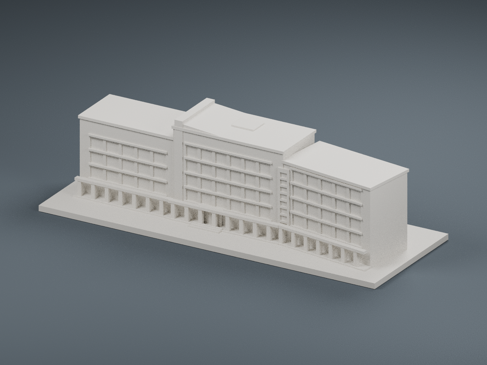](buildings/zhunan-administration/README.zh-TW.md) **[國家衛生研究院竹南院區行政大樓](buildings/zhunan-administration/README.zh-TW.md)** |  **[國家衛生研究院竹南院區圖書資訊大樓](buildings/zhunan-library-information/README.zh-TW.md)** |  **[國家衛生研究院竹南院區研究大樓 R1／R2](buildings/zhunan-r1-r2-research-complex/README.zh-TW.md)** |
| [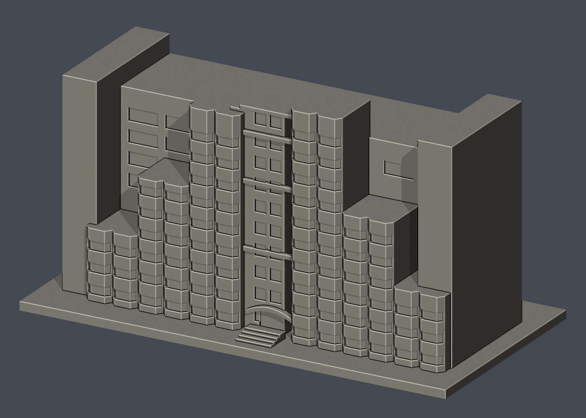](buildings/zhunan-dorm-phase2/README.zh-TW.md) **[國家衛生研究院竹南院區二期單人宿舍](buildings/zhunan-dorm-phase2/README.zh-TW.md)** | [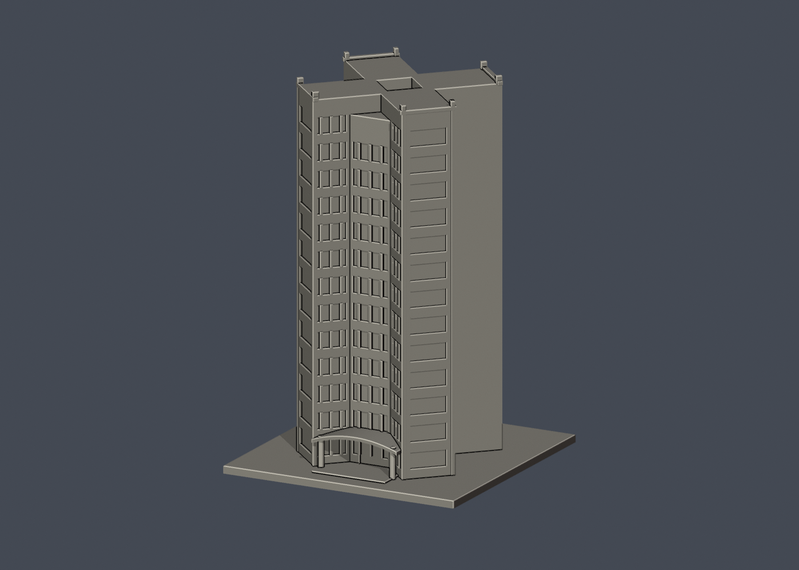](buildings/zhunan-family-dorm/README.zh-TW.md) **[國衛院竹南院區有眷宿舍](buildings/zhunan-family-dorm/README.zh-TW.md)** | [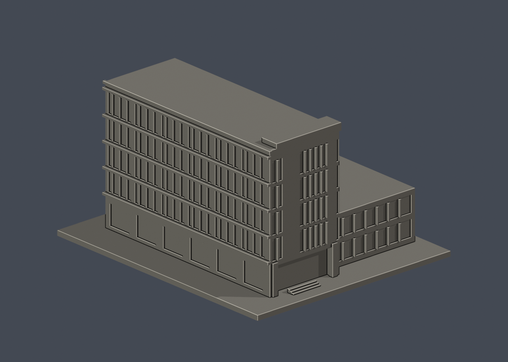](buildings/zhunan-biologics-pilot-main/README.zh-TW.md) **[國衛院竹南院區既有生物製劑先導工廠：主量體與附接低翼](buildings/zhunan-biologics-pilot-main/README.zh-TW.md)** |
| [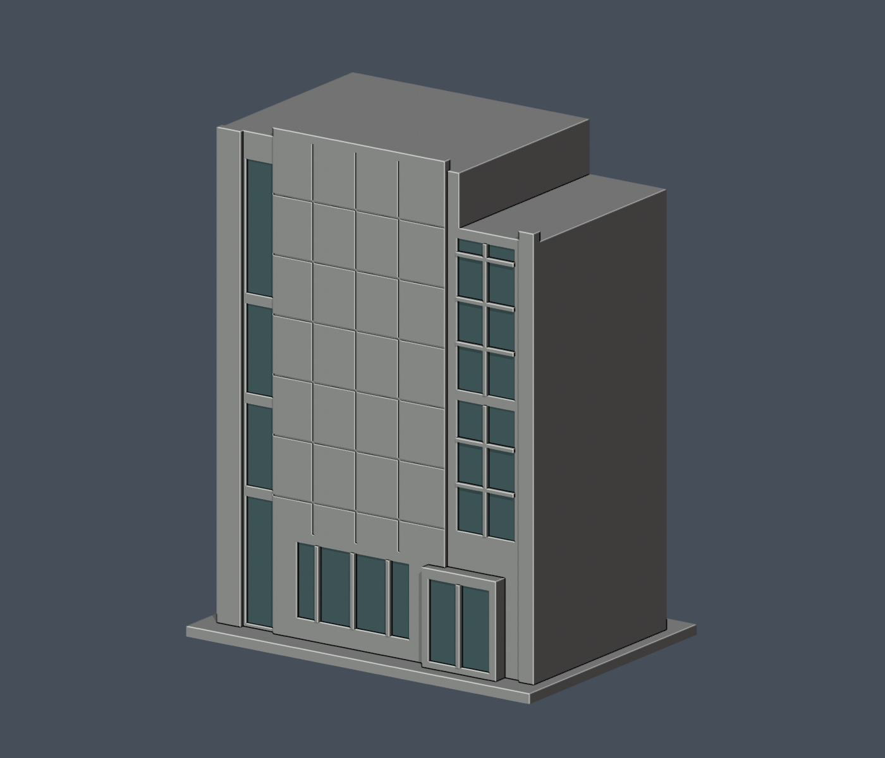](buildings/zhunan-station48-exterior-mass/README.zh-TW.md) **[國衛院竹南院區 station 48 白色塔狀外觀量體](buildings/zhunan-station48-exterior-mass/README.zh-TW.md)** | [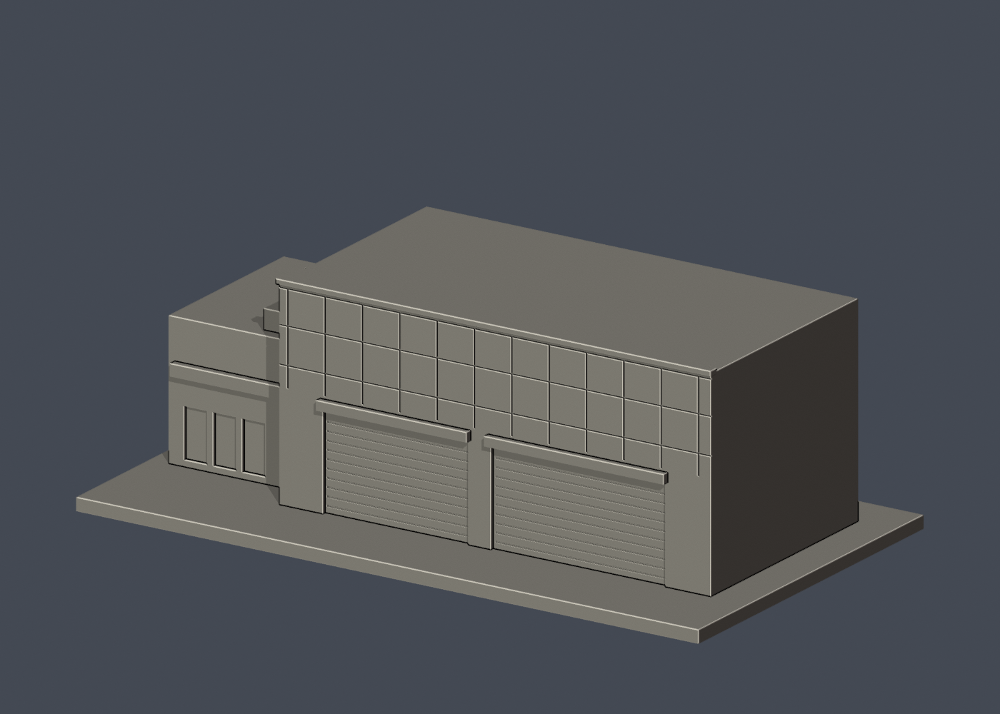](buildings/zhunan-waste-treatment-center/README.zh-TW.md) **[國衛院竹南院區廢棄物處理中心：公開外殼](buildings/zhunan-waste-treatment-center/README.zh-TW.md)** | [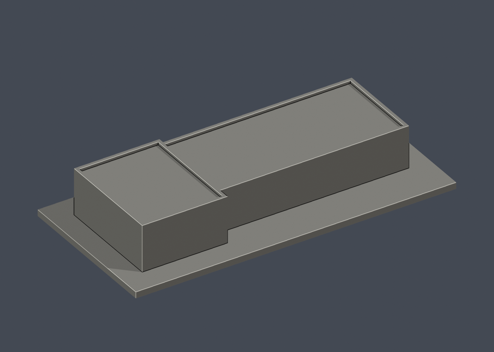](buildings/zhunan-mep-center-preliminary/README.zh-TW.md) **[國衛院竹南院區機電中心：初步近似外觀量體](buildings/zhunan-mep-center-preliminary/README.zh-TW.md)** |

## 9 件列印包

### 國家衛生研究院竹南院區行政大樓

查看模型說明、檔案與各角度預覽

[模型原始檔、驗證報告與說明](buildings/zhunan-administration/README.zh-TW.md)

模型外框（毫米；X × Y × Z）：150 × 56 × 42.75。尺寸依原交付 validation.json。

行政大樓公開外觀推估；背面未核實，比例未實測。

| 正面預覽 | 背面預覽 |
| :---: | :---: |
|  | [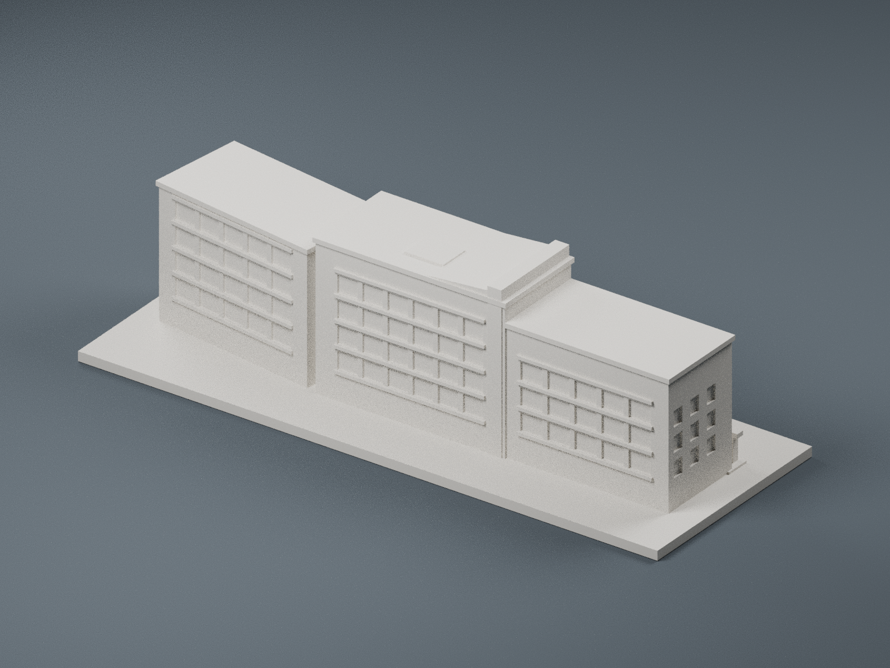](buildings/zhunan-administration/previews/rear.png) |

來源與證據：請見本件 README 及 manifest.json；未經實體試印。

### 國家衛生研究院竹南院區圖書資訊大樓

查看模型說明、檔案與各角度預覽

[模型原始檔、驗證報告與說明](buildings/zhunan-library-information/README.zh-TW.md)

模型外框（毫米；X × Y × Z）：150 × 104 × 63.8。尺寸依原交付 validation.json。

圖書資訊大樓含附接低翼與柱廊；未見立面、屋頂及翼部深度簡化。

| 正面預覽 | 背面預覽 |
| :---: | :---: |
|  |  |

來源與證據：請見本件 README 及 model-info.json；未經實體試印。

### 國家衛生研究院竹南院區研究大樓 R1／R2

查看模型說明、檔案與各角度預覽

[模型原始檔、驗證報告與說明](buildings/zhunan-r1-r2-research-complex/README.zh-TW.md)

模型外框（毫米；X × Y × Z）：144 × 150 × 60.4。尺寸依原交付 validation.json。

R1／R2 與中間可見中央量體合為一件列印包；中央量體不另增棟數。背側及屋頂細節推估。

| 正面預覽 | 背面預覽 |
| :---: | :---: |
|  |  |

來源與證據：請見本件 README 及 model-info.json；未經實體試印。

### 國家衛生研究院竹南院區二期單人宿舍

查看模型說明、檔案與各角度預覽

[模型原始檔、驗證報告與說明](buildings/zhunan-dorm-phase2/README.zh-TW.md)

模型外框（毫米；X × Y × Z）：150 × 76 × 80。尺寸依原交付 validation.json。

主立面參照竣工實景；精確深度、背面窗戶與隱藏側面未核實。不能據此判定一期／二期宿舍完整界線。

| 正面預覽 | 背面預覽 |
| :---: | :---: |
|  | [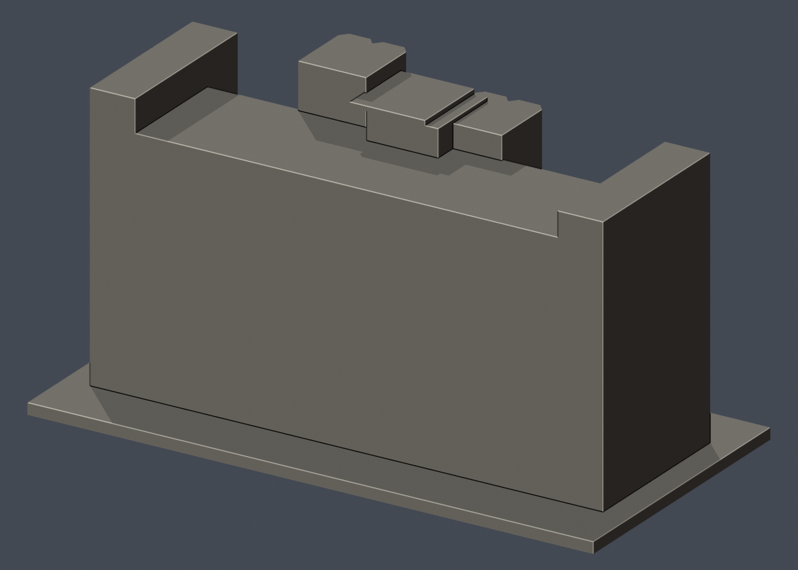](buildings/zhunan-dorm-phase2/previews/rear.png) |

來源與證據：請見本件 README 及 model-info.json；未經實體試印。

### 國衛院竹南院區有眷宿舍

查看模型說明、檔案與各角度預覽

[模型原始檔、驗證報告與說明](buildings/zhunan-family-dorm/README.zh-TW.md)

模型外框（毫米；X × Y × Z）：98 × 98 × 150。尺寸依原交付 validation.json。

四翼足跡、翼長、角度、深度、側後面及屋頂為粗略估計。

| 正面預覽 | 背面預覽 |
| :---: | :---: |
|  | [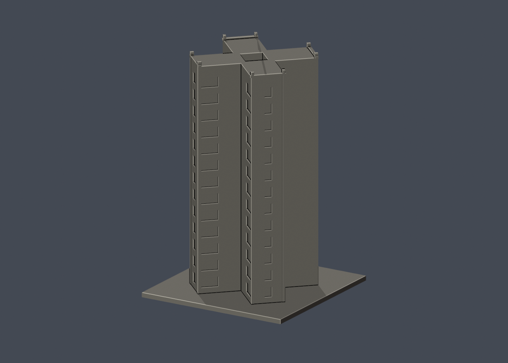](buildings/zhunan-family-dorm/previews/rear.png) |

來源與證據：請見本件 README 及 model-info.json；未經實體試印。

### 國衛院竹南院區既有生物製劑先導工廠：主量體與附接低翼

查看模型說明、檔案與各角度預覽

[模型原始檔、驗證報告與說明](buildings/zhunan-biologics-pilot-main/README.zh-TW.md)

模型外框（毫米；X × Y × Z）：128 × 150 × 84.4。尺寸依原交付 validation.json。

僅含照片清楚顯示相接的主量體與低翼，不含遠處塔狀量體與空橋；不能把整個設施群視為一棟。

| 正面預覽 | 背面預覽 |
| :---: | :---: |
|  | [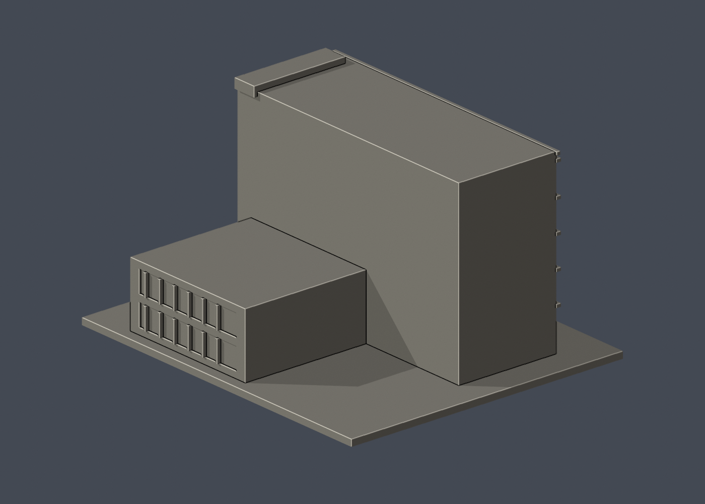](buildings/zhunan-biologics-pilot-main/previews/rear.png) |

來源與證據：請見本件 README 及 model-info.json；未經實體試印。

### 國衛院竹南院區 station 48 白色塔狀外觀量體

查看模型說明、檔案與各角度預覽

[模型原始檔、驗證報告與說明](buildings/zhunan-station48-exterior-mass/README.zh-TW.md)

模型外框（毫米；X × Y × Z）：116 × 82 × 150。尺寸依原交付 validation.json。

僅重現公開環景 station 48 可見白色塔狀外殼；站點公開標籤為「ABSL3實驗大樓」，但本件不代表已核實完整設施身分、所屬界線或獨立建築棟數。空橋省略，未見深度及背側推估。

| 正面預覽 | 背面預覽 |
| :---: | :---: |
|  | [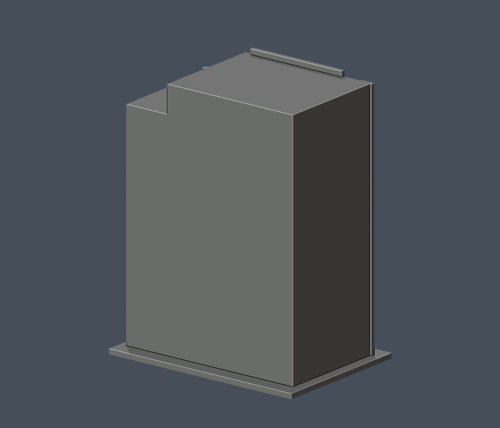](buildings/zhunan-station48-exterior-mass/rear.png) |

來源與證據：請見本件 README 及 model-info.json；未經實體試印。

### 國衛院竹南院區廢棄物處理中心：公開外殼

查看模型說明、檔案與各角度預覽

[模型原始檔、驗證報告與說明](buildings/zhunan-waste-treatment-center/README.zh-TW.md)

模型外框（毫米；X × Y × Z）：150 × 84 × 51.6。尺寸依原交付 validation.json。

僅表達公開建築外殼；左端遮擋、總深度與背面推估。未包含設備、管線及內部配置。

| 正面預覽 | 背面預覽 |
| :---: | :---: |
|  | [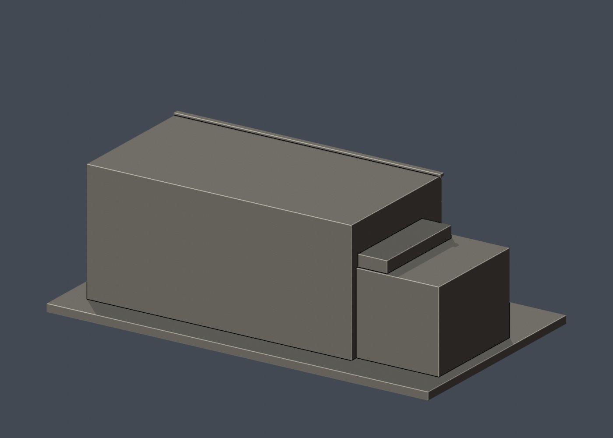](buildings/zhunan-waste-treatment-center/previews/rear.png) |

來源與證據：請見本件 README 及 model-info.json；未經實體試印。

### 國衛院竹南院區機電中心：初步近似外觀量體

查看模型說明、檔案與各角度預覽

[模型原始檔、驗證報告與說明](buildings/zhunan-mep-center-preliminary/README.zh-TW.md)

模型外框（毫米；X × Y × Z）：150 × 72 × 24.8。尺寸依原交付 validation.json。

初步近似量體，身分信心中等：依 2009 具名院區圖與 2017 空拍位置比對，尚缺直接附名地面近照。無可靠門窗證據，不添加門窗或設備。

| 正面預覽 | 背面預覽 |
| :---: | :---: |
|  | [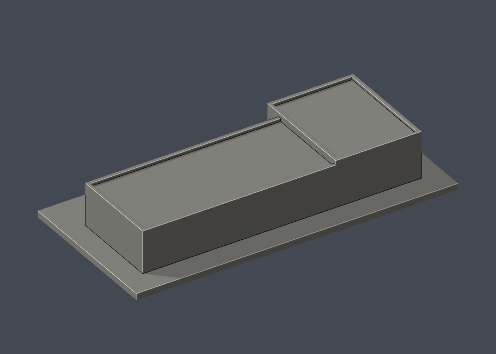](buildings/zhunan-mep-center-preliminary/previews/rear.png) |

來源與證據：請見本件 README 及 model-info.json；未經實體試印。

