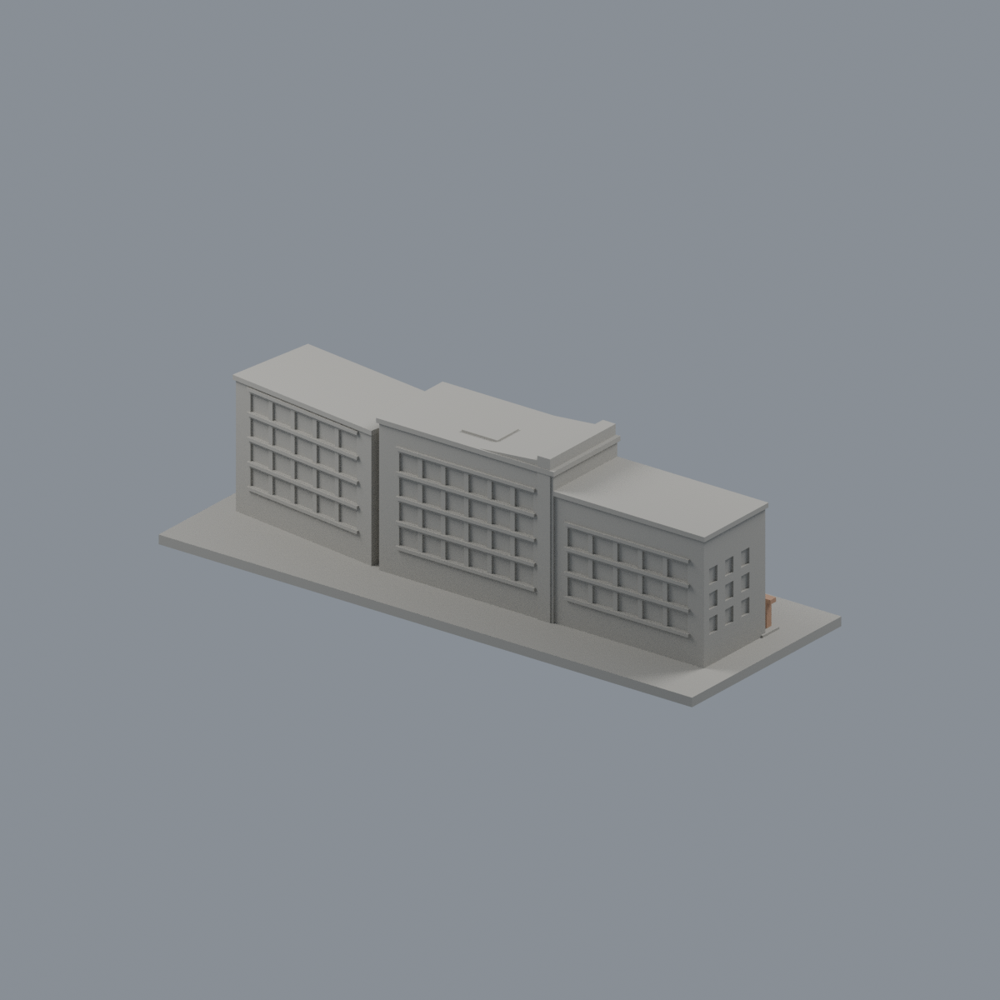
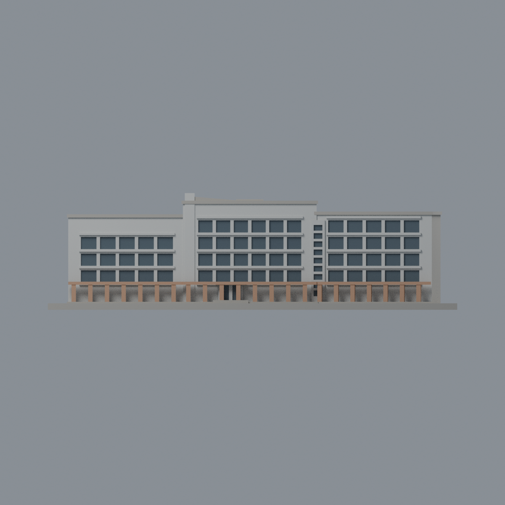
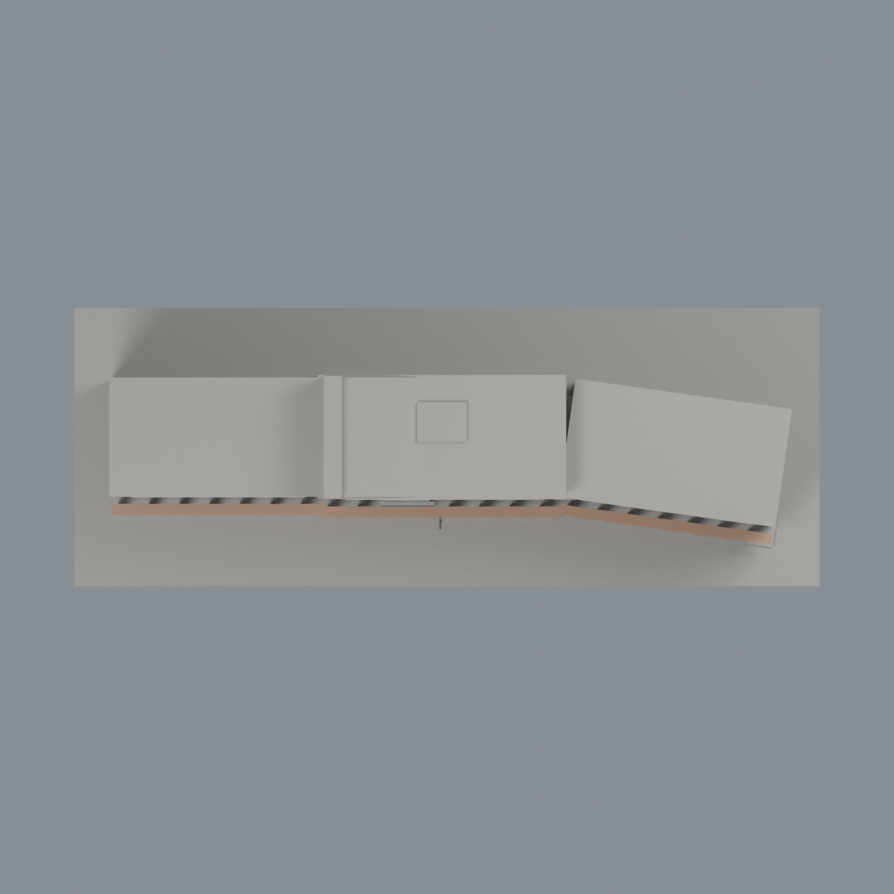

# 國衛院竹南行政大樓：四材質外觀版

沿用原 **3,622 三角面／1,767 頂點**，不改原 STL 位元、座標、面序或幾何；這是既有模型外觀改版，不增加模型包數。

| 模型預覽 | 模型預覽 | 模型預覽 |
| :---: | :---: | :---: |
| 正面  | 背面保持中性  |  |
|  |  |  |

[表面色 3MF](nhriadmin-appearance.3mf) · [可編輯 Blender](scene.blend) · [材質色表](palette.json) · [逐面指派與依據](face-materials.json) · [原 STL](../model.stl)

## 來源與配色邊界

親自核對臺灣綠建築發展協會[案例文章](https://www.taiwangbc.org.tw/tw/modules/news/article.php?storyid=206)與其命名附件[行政大樓北側](https://www.taiwangbc.org.tw/tw/modules/news/visit.php?fileid=753)，對應三段折線量體、較高中央牆邊與前側低柱廊。這是協會網站，不是國衛院官網照片。文章發布於 2014-05-02，影像拍攝日不詳、無 EXIF 日期，不代表 2026 現況。影像 SHA256 與覆核見[來源覆核](qa/source-review.json)，第三方原照不隨包散布。

- 北側淺灰包板牆與原水平肋，原離散窗凹背採暗灰玻璃代理色；照片受深凹陰影影響，沒有逐格量測顏色，不將整片牆塗黑。
- 暖砂岩色僅用在原低柱廊柱與橫梁；背後底層牆、鋪面不是整片砂岩，不模擬無分面的彩石拼貼。
- 三翼採各自原座標及旋轉遮罩，未改間距、彎折、窗口節奏或精度；原入口與連接縫為近似，僅既有窗面用暗色代理，不補招牌與室內。
- 原照片左邊裁切的高塔不屬這個行政模型，不拿來新增量體或借用其他建築材質。
- 未見背面、端牆、屋頂與底座中性，不新增 PV、機電、保全或實驗室資訊。
- 原 STL、OBJ、建模腳本、場景與歷史 QA 不變，這是外觀版而不是新增模型，也沒有物理列印成功宣稱。

[原幾何與歷史來源限制](../README.zh-TW.md)

## 重建與核驗

安裝 [依賴](source/requirements.txt)，Blender 使用 4.3.2。由本資料夾上層提供原 model.stl：

1. `python appearance/source/build_appearance.py`
2. `python appearance/source/verify_exchange.py`
3. `blender -b -t 3 --python-exit-code 1 -P appearance/source/render_appearance.py`
4. `blender -b -t 3 --python-exit-code 1 -P appearance/source/verify_scene.py`

[獨立重建 ZIP](rebuild-source.zip)含原 STL、四支程式及依賴，不含第三方照片；不取代原建模腳本。[逐檔 SHA256](SHA256SUMS)

[交換／拓撲 QA](qa/exchange-validation.json)核對原座標與面序、全部面材質、單連通、有向水密邊、頂點 link 單環、正體積與零退化／重複面；lib3mf 嚴格讀取零警告，實際編輯單材質再存讀，其他材質及面指派不變。SDK 六位小數量化誤差另列。

[Blender 存讀與編輯](qa/scene-validation.json) · [渲染記錄](qa/render-manifest.json) · [獨立重建](qa/rebuild-validation.json)

## 製造限制照舊

尺寸仍為 150 × 56 × 42.75 mm；原 STL、建模程式、場景及歷史 QA 保留。原層檢與薄特徵檢查本次未重跑，不能由材質 QA 代替。

3MF 是同一網格的表面色，不是各材質各自封閉的分色實體、切片專案、噴頭映射或 G-code。切片 GUI、多材料路徑與實體列印未測；柱頭、屋簷、窗框及薄邊仍須評估材料、支撐及拆除風險，沒有保證可印或免支撐。
