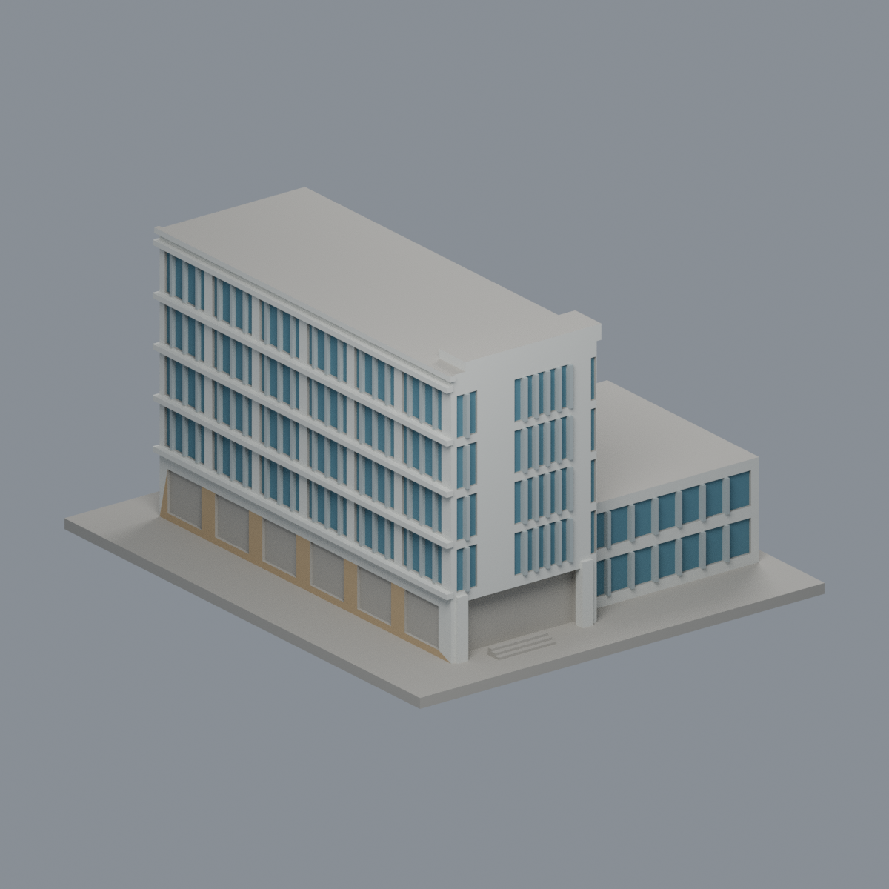
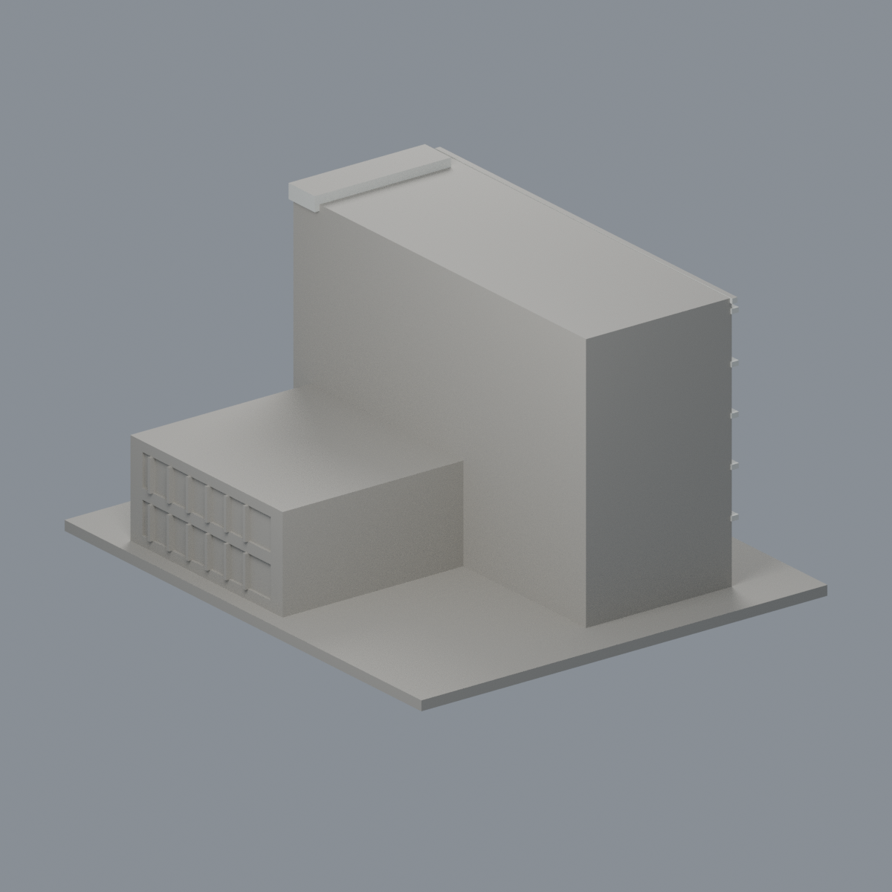
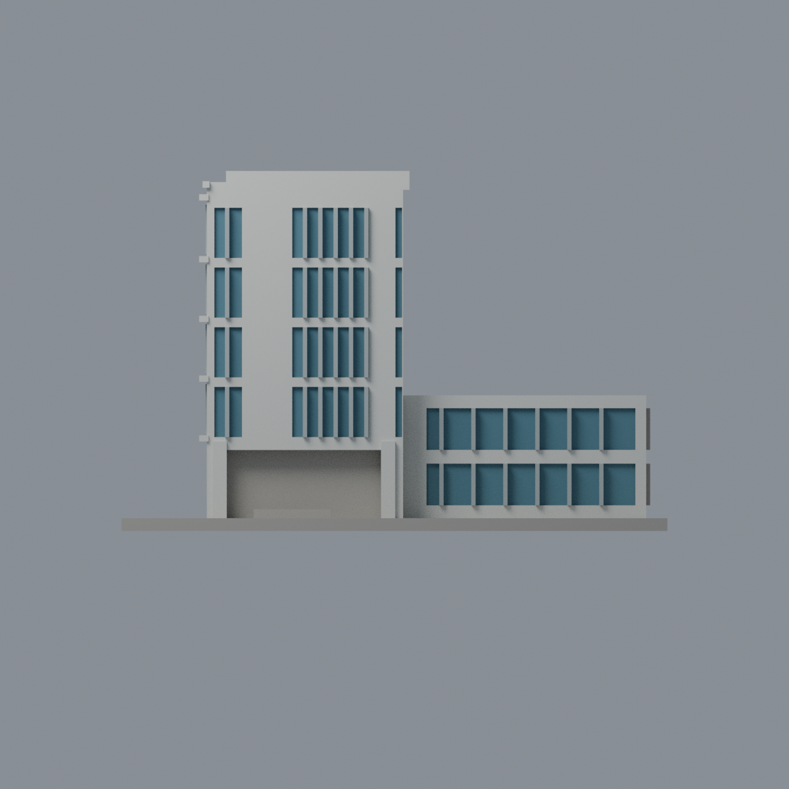
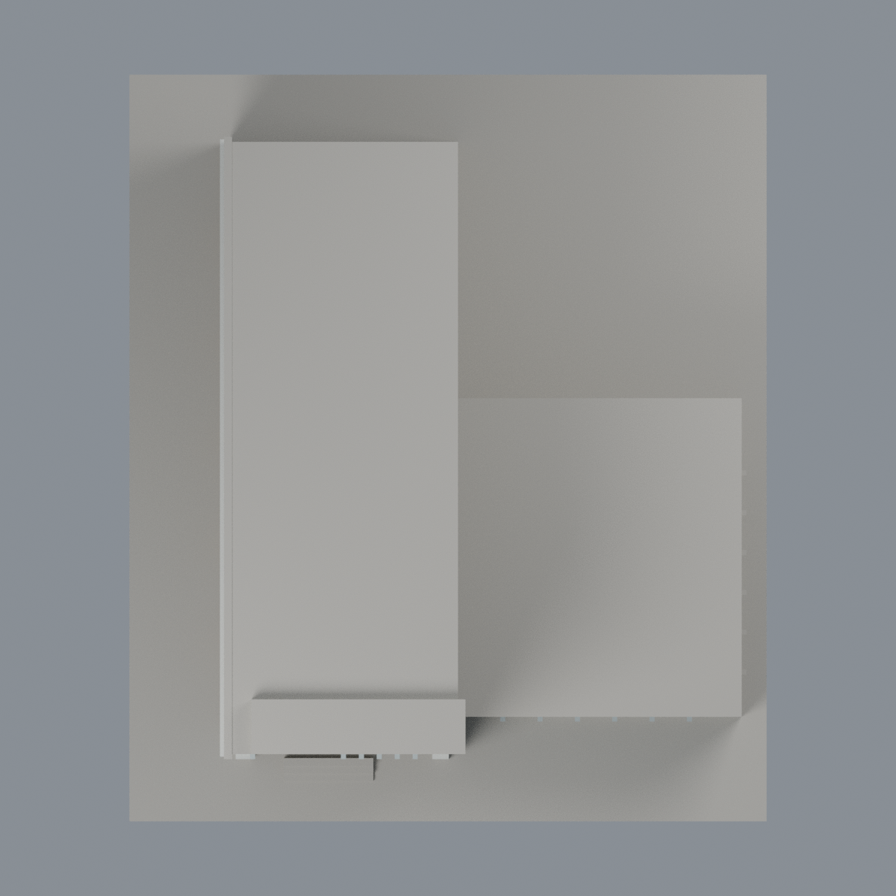

# 國衛院生物製劑先導工廠主量體與低翼：五材質外觀版

沿用原 **4,074 三角面／1,991 頂點**，不改原 STL 位元、座標、面序或幾何；這是既有模型外觀改版，不增加模型包數。

| 正面 | 背面保持中性 |
|---|---|
|  |  |
|  |  |

[表面色 3MF](nhribio-appearance.3mf) · [可編輯 Blender](scene.blend) · [材質色表](palette.json) · [逐面指派與依據](face-materials.json) · [原 STL](../model.stl)

## 來源與配色邊界

親自核對疾管署《[台灣百年公立疫苗製造史](https://www.cdc.gov.tw/uploads/files/201501/938b60e5-81d9-446d-a7c6-c288fbeeb8fc.pdf#page=78)》印刷頁 152／PDF 第 78 頁圖 64，圖像署名國家衛生研究院感染症與疫苗研究所提供；出版為 **2014 年 12 月，不是拍攝日**。另核對[國衛院環景](https://campus.nhri.org.tw/)第 49 點[外觀縮圖](https://campus.nhri.org.tw/3dspace/thumb/050.jpg)，原環景標示 2017 春景，縮圖僅 240 × 160 像素，不可據此還原細節。兩者均屬歷史證據，不代表 2026 現況。[來源覆核與 SHA256](qa/source-review.json)，不散布 PDF 或參考影像。

- 來源可對應端部高白框、左長側窗帶與附接低翼；可見前／左結構白灰，既有窗梃銀灰，只有離散凹窗背採低飽和藍青。
- 長側底層砂岩柱面採暖石色；原底層淺凹口混合真實牆／開口，保持中性，不將整排當玻璃。
- 原正面入口大凹背也是門牆混合簡化，保持中性；前柱白灰，不把陰影烘焙成黑牆。
- 低翼只配來源可見正面窗帶；未見右外側、後面、屋頂與底座中性。既有窗距、水平帶厚度與長寬是近似，不切面、不增加玻璃格、文字、路燈或設備。
- 僅公開可見建築外觀，不包含室內、實驗室、製程或保全配置。原 STL、建模腳本、歷史場景與 QA 保持；配色不是新增幾何，亦無實體列印成功宣稱。

[原幾何與歷史來源限制](../README.zh-TW.md)

## 重建與核驗

安裝 [依賴](source/requirements.txt)，Blender 使用 4.3.2。由本資料夾上層提供原 model.stl：

1. `python appearance/source/build_appearance.py`
2. `python appearance/source/verify_exchange.py`
3. `blender -b -t 3 --python-exit-code 1 -P appearance/source/render_appearance.py`
4. `blender -b -t 3 --python-exit-code 1 -P appearance/source/verify_scene.py`

[獨立重建 ZIP](rebuild-source.zip)含原 STL、四支程式及依賴，不含第三方照片；不取代原建模腳本。[逐檔 SHA256](SHA256SUMS)

[交換／拓撲 QA](qa/exchange-validation.json)核對原座標與面序、全部面材質、單連通、有向水密邊、頂點 link 單環、正體積與零退化／重複面；lib3mf 嚴格讀取零警告，實際編輯單材質再存讀，其他材質及面指派不變。SDK 六位小數量化誤差另列。

[Blender 存讀與編輯](qa/scene-validation.json) · [渲染記錄](qa/render-manifest.json) · [獨立重建](qa/rebuild-validation.json)

## 製造限制照舊

尺寸仍為 128 × 150 × 84.4 mm；原 STL、建模程式、場景及歷史 QA 保留。原層檢與薄特徵檢查本次未重跑，不能由材質 QA 代替。

3MF 是同一網格的表面色，不是各材質各自封閉的分色實體、切片專案、噴頭映射或 G-code。切片 GUI、多材料路徑與實體列印未測；柱頭、屋簷、窗框及薄邊仍須評估材料、支撐及拆除風險，沒有保證可印或免支撐。
