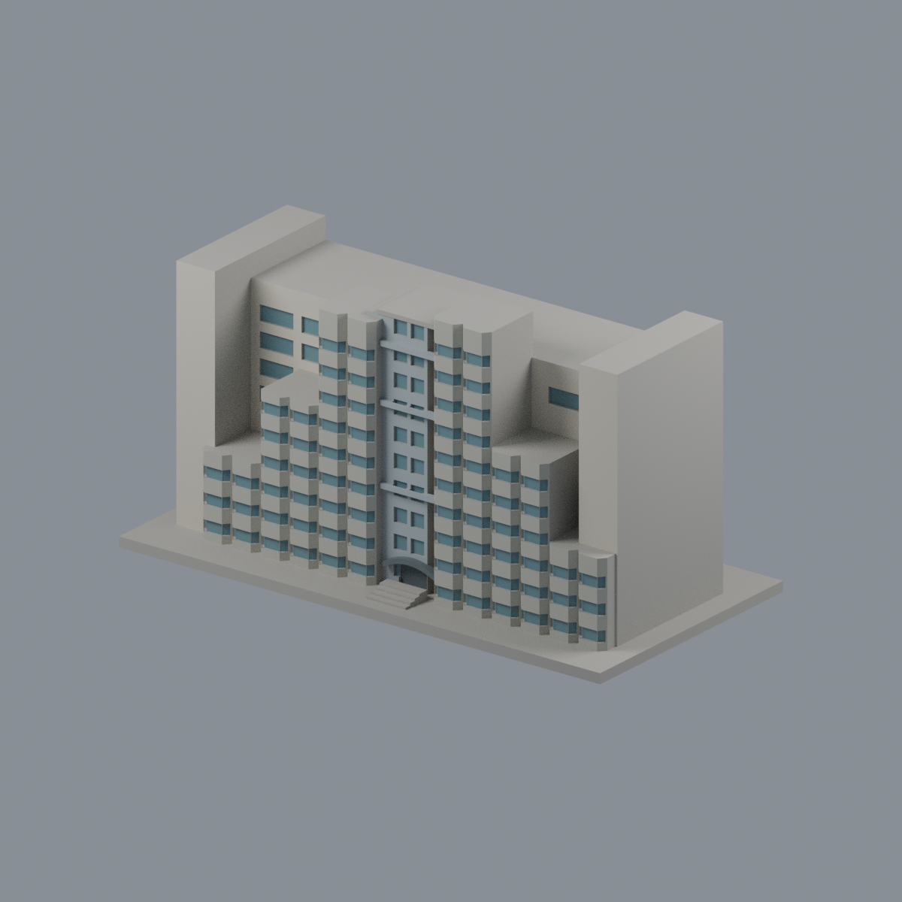
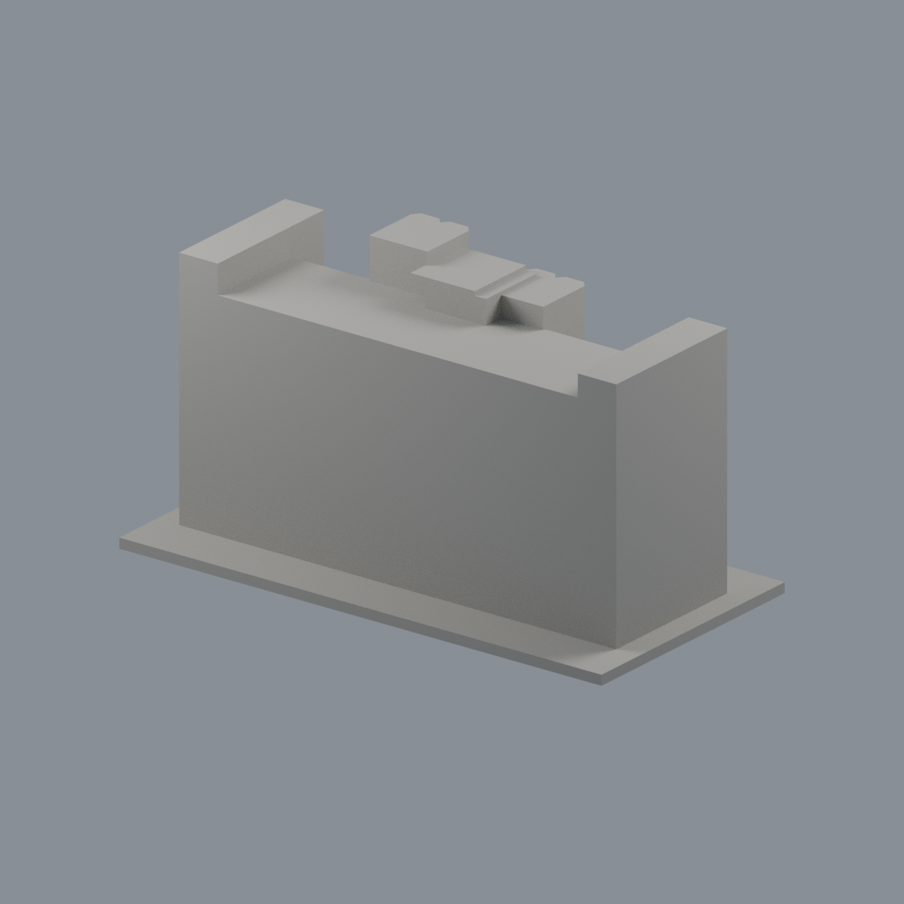
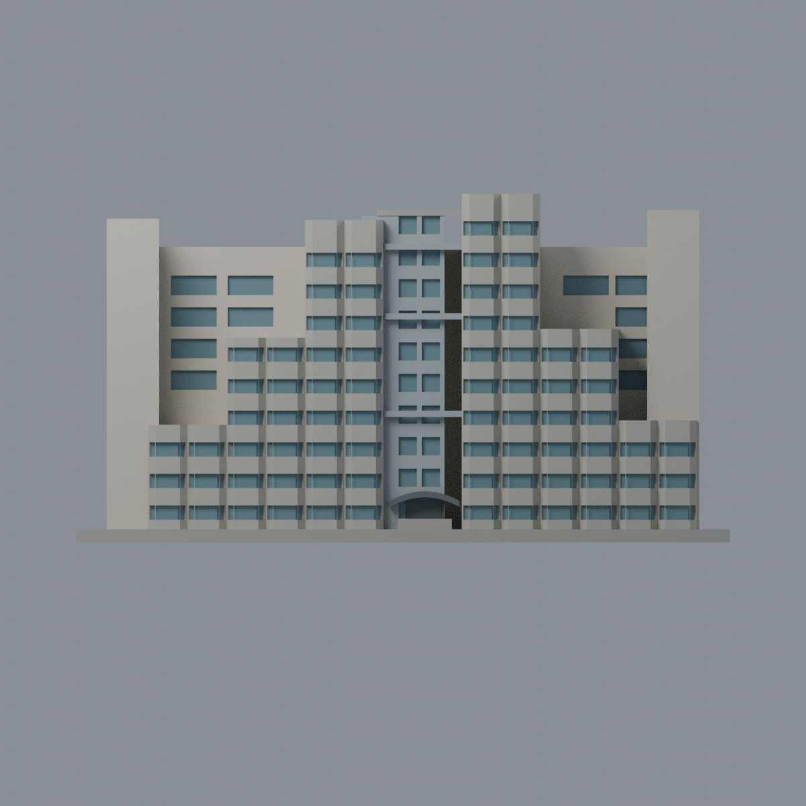
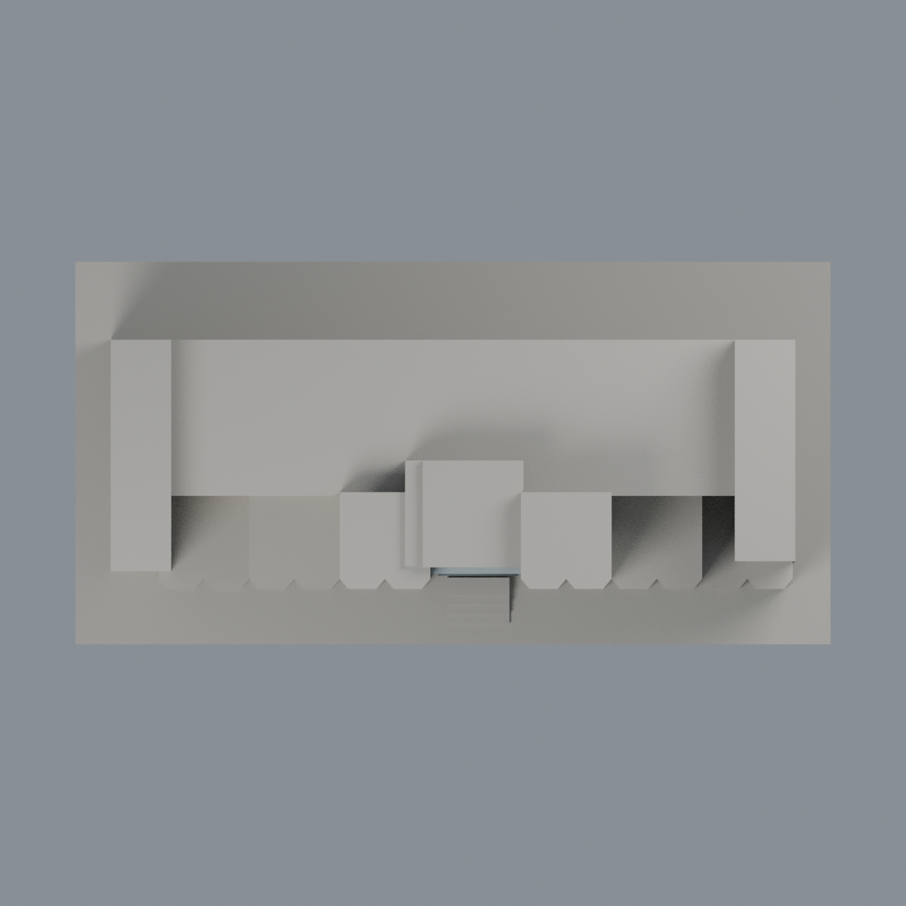

# 國衛院竹南二期單人宿舍：六材質外觀版

沿用原 **6,088 三角面／2,734 頂點**，不改原 STL 位元、座標、面序或幾何；這是既有模型外觀改版，不增加模型包數。

| 正面 | 背面保持中性 |
|---|---|
|  |  |
|  |  |

[表面色 3MF](nhridorm2-appearance.3mf) · [可編輯 Blender](scene.blend) · [材質色表](palette.json) · [逐面指派與依據](face-materials.json) · [原 STL](../model.stl)

## 來源與配色邊界

親自核對瑞助營造[二期單人宿舍工程頁](https://www.reiju.com.tw/product/detail/08013)及其[完整正面外觀照](https://www.reiju.com.tw/files/Project/08-Public%20Project/13-%E5%9C%8B%E8%A1%9B%E9%99%A2/%E5%9C%8B%E8%A1%9B%E9%99%A2%E5%AE%8C.JPG)，對應成對內升凸窗、右側最高雙塔及中央入口。承包商資料列 2011-08-31 完工，但**完工日期不等於拍攝日**；影像拍攝日不詳，不代表 2026 現況。這不是國衛院官網照片。[來源 SHA256 與覆核](qa/source-review.json)，不散布原照。

- 背景前牆與兩端正面暖象牙色，原凸窗窗間牆灰米色；只有原平窗背和局部斜窗凹背灰藍綠，不整面凸窗塗玻璃。
- 斜窗按原各自旋轉切口背平面指派；保留既有粗窗距與輪廓，不新增細框、窗簾圖樣或住戶細節。
- 中央原實牆格為銀灰代理，離散窗背玻璃色；實景中央較大玻璃格與原簡化網格不同，沒有把未分面的實牆假稱連續帷幕。
- 原中央橫帶銀灰、入口凹背與弧雨棚深灰；不新增路燈、植栽、水景、標字或室內。
- 未見側深、背牆、屋面與底座中性，亦不延伸鏡像配色。原尺寸與進深只是展示近似，不是測繪。
- 原 STL、OBJ、建模腳本、場景與歷史 QA 不變；配色不是新增模型，無實體列印成功宣稱。

[原幾何與歷史來源限制](../README.zh-TW.md)

## 重建與核驗

安裝 [依賴](source/requirements.txt)，Blender 使用 4.3.2。由本資料夾上層提供原 model.stl：

1. `python appearance/source/build_appearance.py`
2. `python appearance/source/verify_exchange.py`
3. `blender -b -t 3 --python-exit-code 1 -P appearance/source/render_appearance.py`
4. `blender -b -t 3 --python-exit-code 1 -P appearance/source/verify_scene.py`

[獨立重建 ZIP](rebuild-source.zip)含原 STL、四支程式及依賴，不含第三方照片；不取代原建模腳本。[逐檔 SHA256](SHA256SUMS)

[交換／拓撲 QA](qa/exchange-validation.json)核對原座標與面序、全部面材質、單連通、有向水密邊、頂點 link 單環、正體積與零退化／重複面；lib3mf 嚴格讀取零警告，實際編輯單材質再存讀，其他材質及面指派不變。SDK 六位小數量化誤差另列。

[Blender 存讀與編輯](qa/scene-validation.json) · [渲染記錄](qa/render-manifest.json) · [獨立重建](qa/rebuild-validation.json)

## 製造限制照舊

尺寸仍為 150 × 76 × 80 mm；原 STL、建模程式、場景及歷史 QA 保留。原層檢與薄特徵檢查本次未重跑，不能由材質 QA 代替。

3MF 是同一網格的表面色，不是各材質各自封閉的分色實體、切片專案、噴頭映射或 G-code。切片 GUI、多材料路徑與實體列印未測；柱頭、屋簷、窗框及薄邊仍須評估材料、支撐及拆除風險，沒有保證可印或免支撐。
