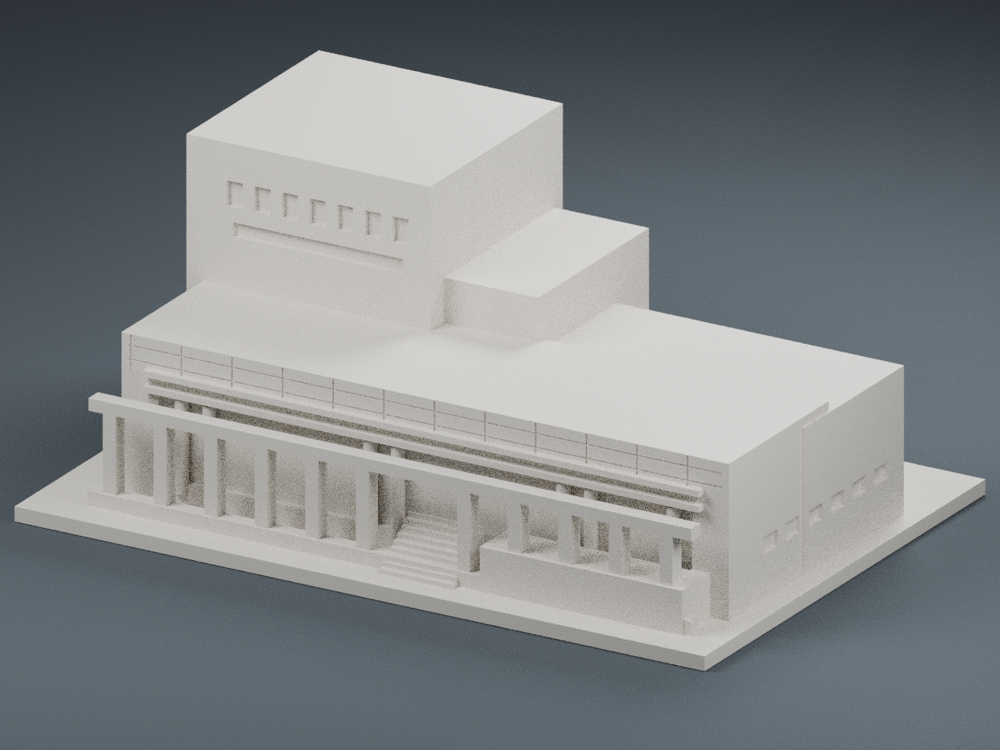
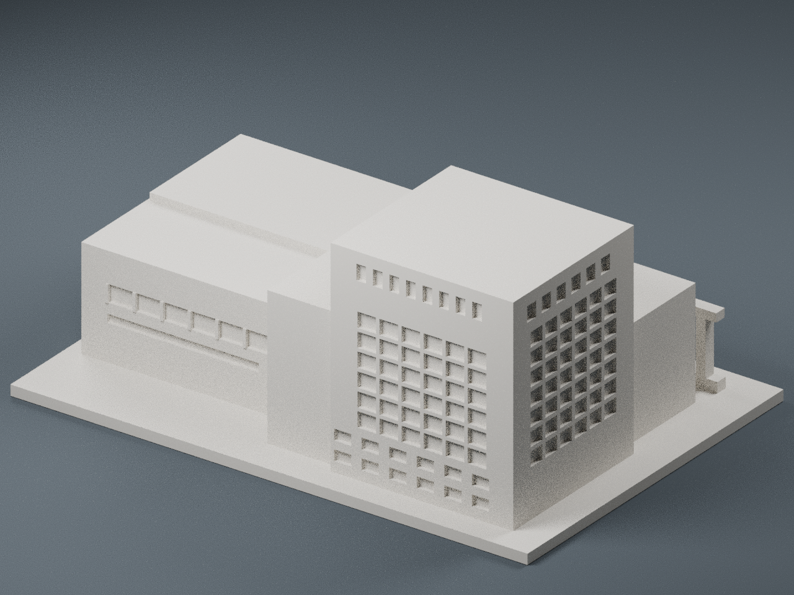

# 國家衛生研究院竹南院區｜圖書資訊大樓

依公開院區配置與外觀照片製作的單體 FDM 微縮模型，包含相連低矮翼與前方柱廊。圖書館、資訊中心與會議空間不重複計為三棟。核對日期：2026-10-11。

## 模型與辨識依據

- 方形高層量體、頂部狹長開口、大面格狀玻璃立面、相連低翼與水平窗帶。
- 近景中的低翼實牆飾帶、圓柱、前方石色方柱廊、階梯與平台以單色浮雕幾何表現。
- 官方配置圖用於確認圖書館／資訊中心建築組合。與行政大樓折線長翼分開，不把廣角照片中相鄰樓棟混入。
- 窗格為凹槽，所有柱、梁、平台與主體都聯集為同一可列印實體。預覽直接渲染交付 STL，未添加不列印的裝飾立面。

## 尺寸與限制

- 150 × 104 × 63.8 mm，底座厚 3 mm。150 mm 是獨立展示模型的最長邊，非現場測量比例，也不是與其他院區模型共同比例尺。
- 本作為「照片參考的概念外觀模型」，不是竣工圖、測繪模型或精確復刻。
- 兩張外觀照片能確認可見立面，無法確認所有背面、屋頂、翼部深度與高低量體間距；未充分可見部分採保守簡化與估計，不應當成真實尺寸資料。
- 只建公開外殼，無室內、設備、門禁與安全配置。景觀地形簡化為平底座。

## 列印建議

- STL 單位 mm，底座朝下。建議 0.4 mm 噴嘴、0.16–0.20 mm 層高、3 道外牆、10–15% 填充。
- 前柱廊一般梁有約 8 mm 跨距，中央階梯入口加寬處約 19 mm；建議對中央入口橫梁底部局部加支撐。先檢查切片預覽，不保證免支撐。
- 方柱約 2.8 mm、圓柱直徑 2.7 mm、水平梁 1.25 mm；少數表面窗格約 0.9 mm，裝飾刻線寬約 0.35 mm 可能因噴嘴設定弱化或不顯示。
- 數位網格驗證通過：封閉、法線一致、單連通實體、每邊兩面、頂點鄰域正常、正體積、平整接觸底面、最長邊 150 mm。未實體試印；數位檢查不等於所有列印風險已排除。

## 檔案

- `model.stl`：主要列印檔；`model.obj`：通用網格。
- `scene.blend`：可檢视實際模型與相機／燈光。場景地板是預覽背景，不是列印模型。
- `build_model.py`：可修改建模原始碼；`requirements.txt`：依賴版本。
- `render_preview.py`：由實際 STL 重新渲染。
- `validate_model.py`、`validation.json`：網格檢查工具與結果。
- `model-info.json`：建物辨識依據、估計範圍與公開參考連結。

重建：Python 3.12 安裝 requirements.txt 後，執行 `python build_model.py`。驗證：`python validate_model.py model.stl --output validation.json`。預覽：Blender 4.3.2 執行 `blender -b -t 6 -P render_preview.py`。

## 公開來源

1. [國衛院官方竹南院區配置圖](https://iben.nhri.edu.tw/tw_us/tw_us_map/)：圖書館及資訊中心的外部量體配置。圖的上傳年份不等於配置圖繪製年份。
2. [臺灣綠建築發展協會：國家衛生研究行政、圖資、研究大樓](https://www.taiwangbc.org.tw/tw/modules/news/article.php?storyid=206)：[圖資大樓一隅照片](https://www.taiwangbc.org.tw/tw/modules/news/visit.php?fileid=754)。
3. [互助營造竹南院區工程實績](https://www.futsu.com.tw/p_public.html)：[院區廣角外觀](https://www.futsu.com.tw/images/images/portfolio/public/public_04.jpg)。

原始第三方照片僅用作辨識參考，不包含在此交付與公開儲存庫。照片及建築設計權利仍屬各權利人；未在此作商用或再散布授權聲明。
