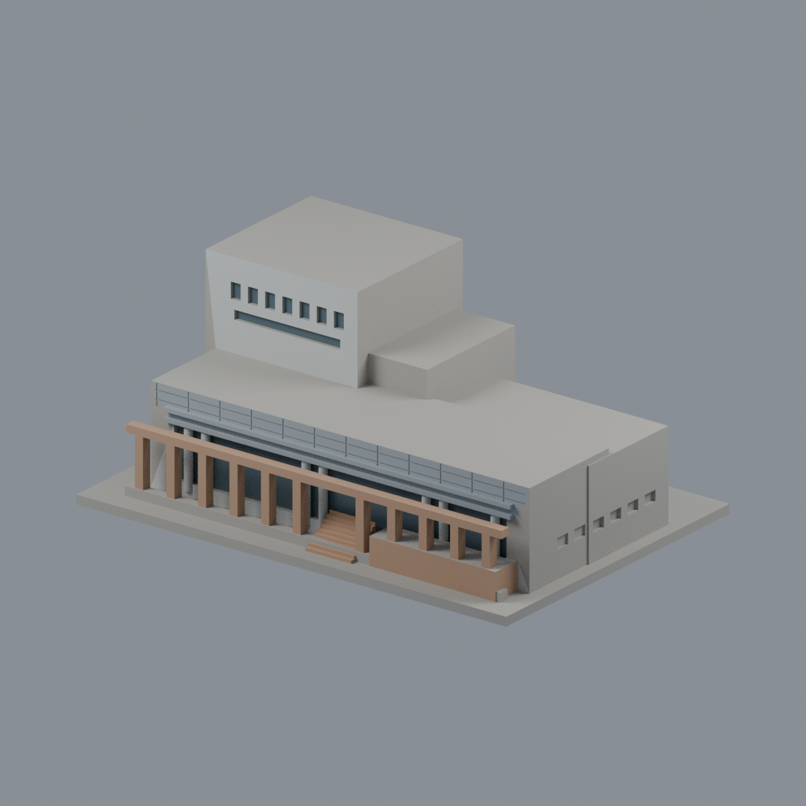
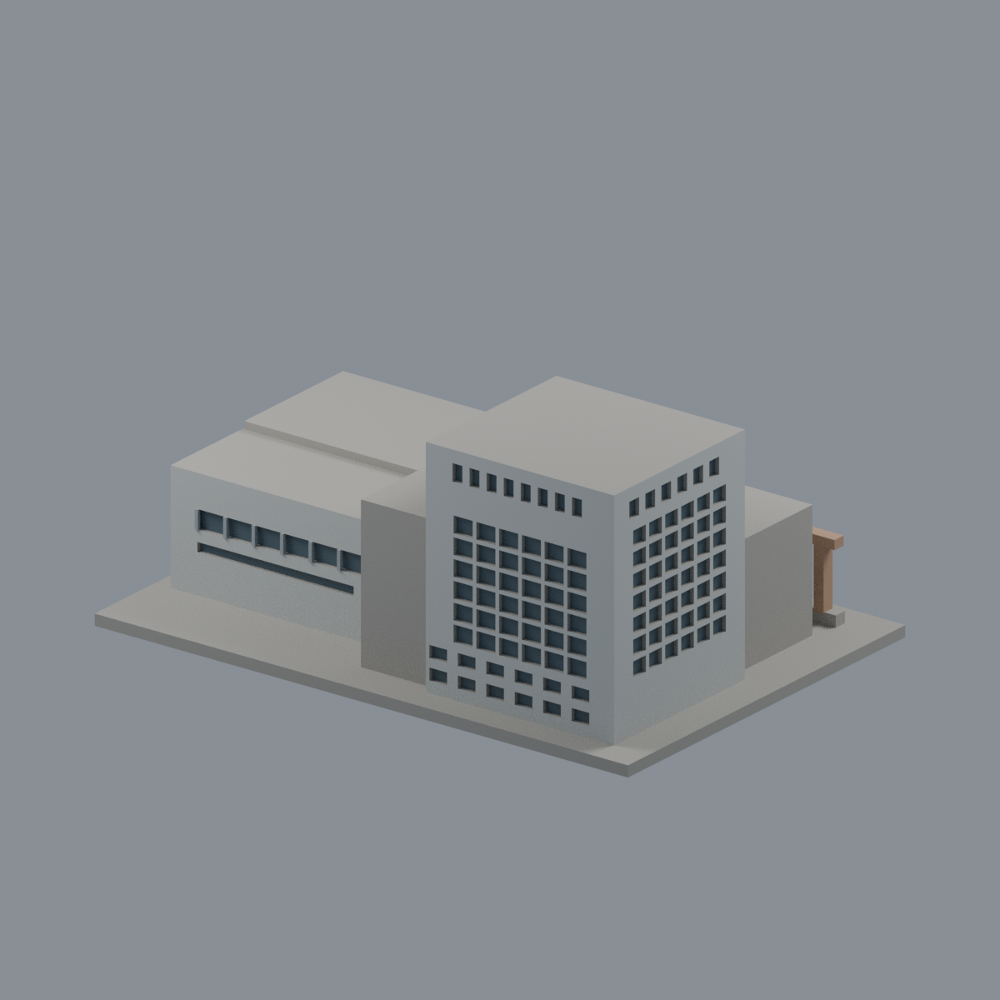
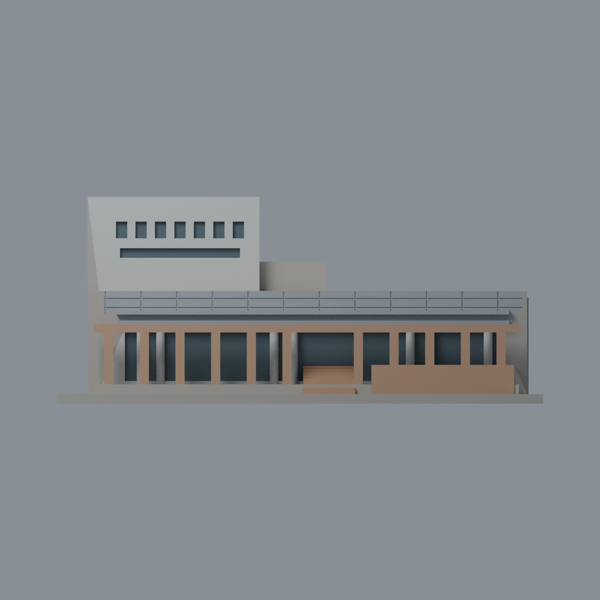
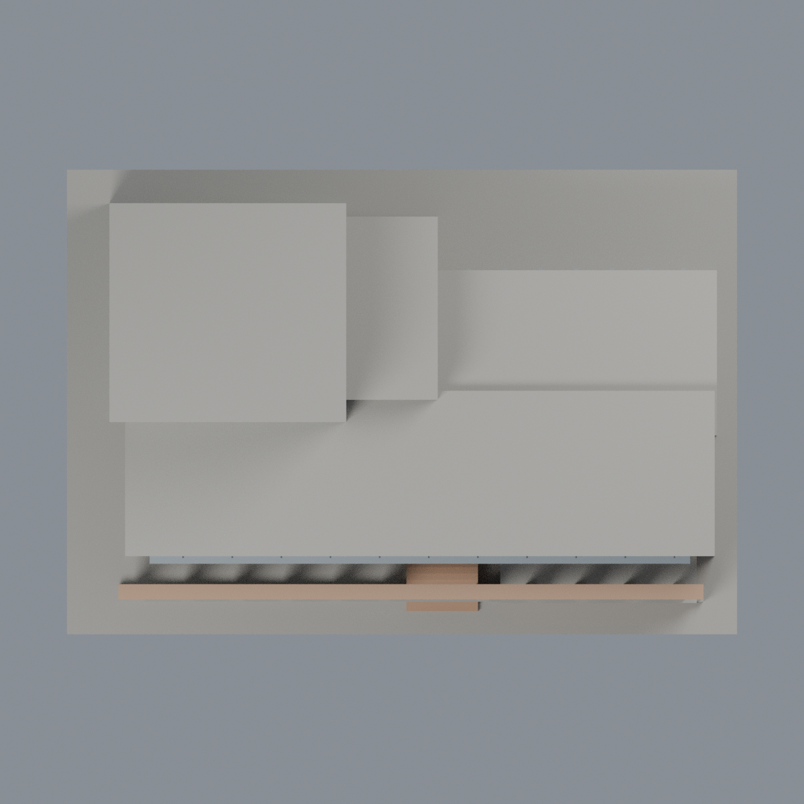

# 國衛院竹南圖書資訊大樓：五材質外觀版

沿用原 **4,294 三角面／2,079 頂點**，不改原 STL 位元、座標、面序或幾何；這是既有模型外觀改版，不增加模型包數。

| 模型預覽 | 模型預覽 | 模型預覽 |
| :---: | :---: | :---: |
| 正面  | 來源支持的後側窗格  |  |
|  |  |  |

[表面色 3MF](nhrilib-appearance.3mf) · [可編輯 Blender](scene.blend) · [材質色表](palette.json) · [逐面指派與依據](face-materials.json) · [原 STL](../model.stl)

## 來源與配色邊界

親自核對臺灣綠建築發展協會[案例文章](https://www.taiwangbc.org.tw/tw/modules/news/article.php?storyid=206)的[圖資大樓一隅](https://www.taiwangbc.org.tw/tw/modules/news/visit.php?fileid=754)與[園區中軸透視](https://www.taiwangbc.org.tw/tw/modules/news/visit.php?fileid=751)，以及互助營造[公共建築作品](https://www.futsu.com.tw/p_public.html)中的[國衛院竹南院外觀照](https://www.futsu.com.tw/images/images/portfolio/public/public_04.jpg)。這些是協會／承包商網站，不稱為國衛院官網影像。協會文章發布 2014-05-02；工程完工年份不是拍攝日，三張拍攝日都不詳，不代表 2026 現況。[影像 SHA256 與覆核](qa/source-review.json)，不附原照。

- 前側長條淺冷灰包板與水平肋、淡灰圓柱；暗玻璃僅原門廳凹背，不染圓柱與實牆。
- 前景石柱、橫梁、階梯和露臺垂直壁採暖砂岩代理；原面沒有彩石拼貼分界，不造紋理，不把整片地坪染砂岩。
- 協會近景支持高塔正面上部窄窗；承包商全景支持後側大窗格、左側格窗及右低翼橫窗，只既有凹背灰藍，格間牆保持淡色。
- 兩來源角度互補，但不是精密配準測繪；原窗數、比例與平整化露臺維持既有近似。後視圖含有來源支持的窗面，並非全部背面未知。
- 未充分註冊右側稀疏窗面、其他隱藏側牆、屋頂與底座中性；不添加水景、草地、文字、室內或機電保全資訊。
- 原 STL、OBJ、建模腳本、場景與歷史 QA 不變；配色不是新增模型，也不宣稱實體列印成功。

[原幾何與歷史來源限制](../README.zh-TW.md)

## 重建與核驗

安裝 [依賴](source/requirements.txt)，Blender 使用 4.3.2。由本資料夾上層提供原 model.stl：

1. `python appearance/source/build_appearance.py`
2. `python appearance/source/verify_exchange.py`
3. `blender -b -t 3 --python-exit-code 1 -P appearance/source/render_appearance.py`
4. `blender -b -t 3 --python-exit-code 1 -P appearance/source/verify_scene.py`

[獨立重建 ZIP](rebuild-source.zip)含原 STL、四支程式及依賴，不含第三方照片；不取代原建模腳本。[逐檔 SHA256](SHA256SUMS)

[交換／拓撲 QA](qa/exchange-validation.json)核對原座標與面序、全部面材質、單連通、有向水密邊、頂點 link 單環、正體積與零退化／重複面；lib3mf 嚴格讀取零警告，實際編輯單材質再存讀，其他材質及面指派不變。SDK 六位小數量化誤差另列。

[Blender 存讀與編輯](qa/scene-validation.json) · [渲染記錄](qa/render-manifest.json) · [獨立重建](qa/rebuild-validation.json)

## 製造限制照舊

尺寸仍為 150 × 104 × 63.8 mm；原 STL、建模程式、場景及歷史 QA 保留。原層檢與薄特徵檢查本次未重跑，不能由材質 QA 代替。

3MF 是同一網格的表面色，不是各材質各自封閉的分色實體、切片專案、噴頭映射或 G-code。切片 GUI、多材料路徑與實體列印未測；柱頭、屋簷、窗框及薄邊仍須評估材料、支撐及拆除風險，沒有保證可印或免支撐。
