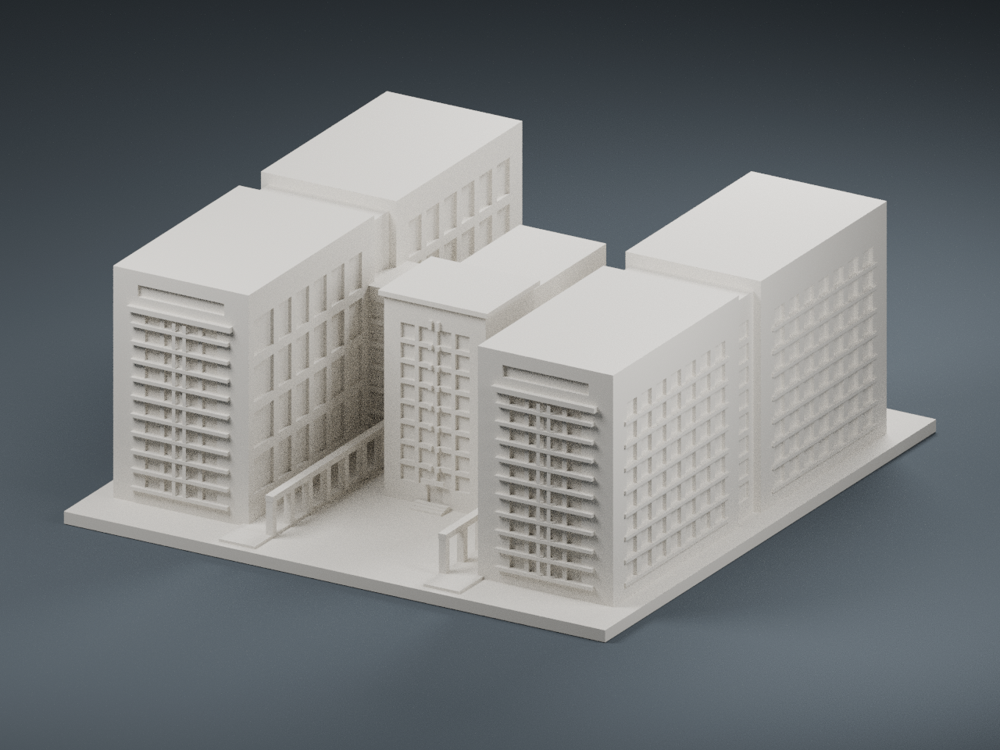
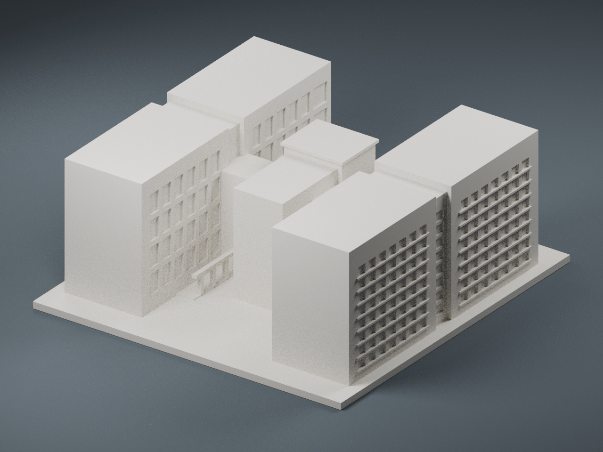

# 國家衛生研究院竹南院區｜研究大樓 R1／R2

依官方院區外部配置圖與公開建築外觀照片製作的 FDM 微縮模型。R1、R2 與兩者之間可見的中央量體合成一件列印；中央量體不另算一棟，也未把行政大樓、圖資大樓混入。資料核對日期：2026-10-11。




## 外觀依據與可信度

- **高：建物身分與雙長翼關係。** 官方 R1 藍色配置圖與 2009 年報的 R1／R2 標示互相核對。模型的正面是主要庭院開口，面向中央量體時右側 R1、左側 R2；模型座標不等於方位座標。
- **中高：主要辨識特徵。** 研究樓實照可見兩側長翼、前端大型直立玻璃面與水平遮陽格、頂部窄橫窗、庭院側大窗格、退縮中央玻璃量體及低矮柱廊。營造商廣角照補充長翼外側兩大片格狀窗面與中央凹縫。
- **中：配置比例。** 每個長翼分成兩個主要量體，中間略內縮；中央橫向連接部位位於中段，中央頭部向前突出。這些是公開圖面與照片的外觀判讀，未使用工程平面或測量尺寸。
- **低：未能充分確認的部分。** 長翼背端、中央量體背面、部分屋頂高度、連接段深度與 R1 外側完整窗格未有完整照片佐證。背端採素面，重複格狀立面採保守概括；不宣稱這些就是現況。
- 窗格層數是單色微縮辨識用的外觀節奏，不能據此推算實際使用樓層或室內布局。

## 尺寸與適用範圍

- **144 × 150 × 60.4 mm**，底座厚 3 mm，STL 單位為 mm。
- 150 mm 是本組獨立展示模型的最長邊，**不是測繪比例，也不是與其他院區模型共同比例尺**。
- 本作為「公開照片參考的概念外觀模型」，不作精確復刻、竣工紀錄或現況測繪用途。照片年代與公開配置圖均可能早於 2026 年，不代表全部最新改建。
- 只建公開建築外殼與可見柱廊，沒有室內、實驗室、設備、管線、門禁或安全配置。地形與植栽簡化為平底座。
- 所有外觀細節都在實際 STL 中。預覽沒有額外添加不列印的窗格或裝飾。

## 列印建議

- 底座朝下，建議 0.4 mm 噴嘴、0.16–0.20 mm 層高、3 道外牆、10–15% 填充。STL 為封閉實體邊界，填充率交由切片軟體決定；並非要求 100% 材料填滿。
- 柱廊柱約 1.8 mm、梁高 1.5 mm，一般淨跨約 6.4 mm。末端梁可有約 3.2 mm 短懸挑；支撐需求依機器橋接能力及切片預覽決定，不能保證免支撐。
- 外牆窗格／水平遮陽紋理最細約 0.85 mm，凹槽約 0.75–0.9 mm 深；是附著於實牆的淺浮雕。部分細紋可能受擠出寬與層高影響而弱化。
- 屋頂實心平面可能產生較大面積頂層；注意頂層厚度、底座翹曲與平台附著，必要時加裙邊或邊緣。請先檢查切片每層，再正式列印。
- 這是數位檢查通過的模型，**尚未實體試印**。

## 網格檢查與重現

`validation.json` 記錄：封閉、水密、法線繞序一致、單一連通表面／實體、每條邊恰兩面、每個頂點連結為單環、無退化／重複面、正體積、底面位於 Z=0、最大邊 150 mm。單一封閉表面也排除了另立的封閉內部空腔殼；庭院和柱廊開口是外部空氣。

由 Manifold 布林聯集／差集生成外殼；此檢查不等於物理試印，也不是獨立的完整自交證明。`rebuild-validation.json` 比對乾淨暫存目錄重新生成的 STL／OBJ SHA-256；`scene-validation.json` 比對 .blend 與 STL 的每個三角面；`SHA256SUMS` 供檔案完整性核對。

檔案：

- `model.stl`：主要列印檔；`model.obj`：同一實體的通用網格。
- `scene.blend`：實際 STL 網格、相機與燈光。名為 Studio floor 的物件只是背景，請勿當建築匯出。
- `build_model.py`、`requirements.txt`：可修改的完整建模原始碼與依賴版本。
- `render_preview.py`：直接載入 STL 產生正／後側預覽，使用 Blender 4.3.2。
- `validate_model.py`、`rebuild_check.py`、`verify_scene.py`：數位驗證、重建及 Blender／STL 幾何一致性工具。
- `model-info.json`：範圍、尺寸、來源、可信度與交付內容。

重建（Python 3.12，套件版本見 requirements.txt）：

```sh
python -m pip install -r requirements.txt
python build_model.py
python validate_model.py model.stl --output validation.json
python rebuild_check.py
blender -b -t 6 -P render_preview.py
blender -b -t 6 -P verify_scene.py
sha256sum -c SHA256SUMS
```

重新產生報告／預覽後，檔案校驗碼可能改變；套件所附 SHA256SUMS 對應交付版本。

## 公開來源

1. [國衛院官方 R1 位置與院區配置圖](https://iben.nhri.edu.tw/tw_us/tw_us_map/)；[公開圖檔](https://iben.nhri.edu.tw/wp-content/uploads/2024/11/map_cht.jpg)。2024 是上傳路徑，不等同底圖繪製年份。
2. [國衛院 2009 年報](https://vod.nhri.org.tw/seminar/AR_2009_CH.pdf)，印刷頁碼 95 的外部院區圖，用於 R1／R2 身分辨識；非現況完整棟數清冊。
3. [臺灣綠建築發展協會：國家衛生研究行政、圖資、研究大樓](https://www.taiwangbc.org.tw/tw/modules/news/article.php?storyid=206)，2014-05-02；[研究大樓照片](https://www.taiwangbc.org.tw/tw/modules/news/visit.php?fileid=755)、[園區中軸照片](https://www.taiwangbc.org.tw/tw/modules/news/visit.php?fileid=751)。
4. [互助營造公開工程實績](https://www.futsu.com.tw/p_public.html)；[院區外觀廣角照](https://www.futsu.com.tw/images/images/portfolio/public/public_04.jpg)。

原始第三方照片僅用作建模參考，未包含在交付套件中。照片、建築設計等權利仍屬各權利人；本文件不授予第三方素材或建築設計的商用、再散布權利。
