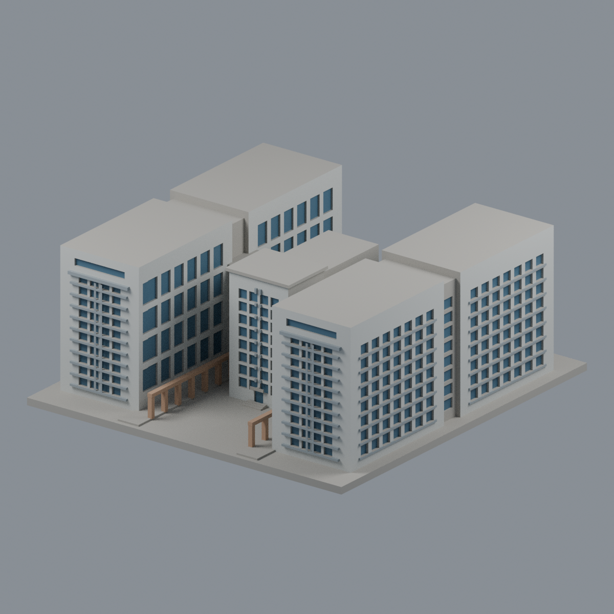
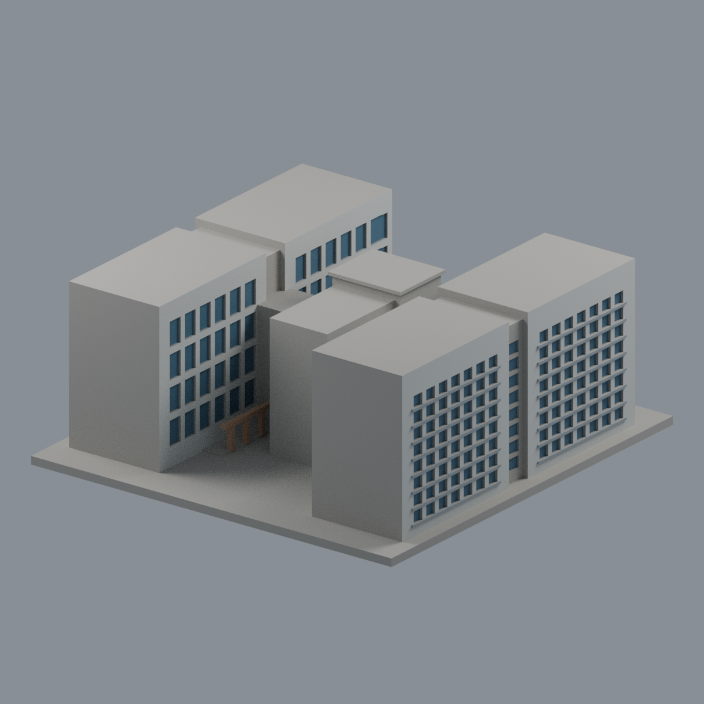
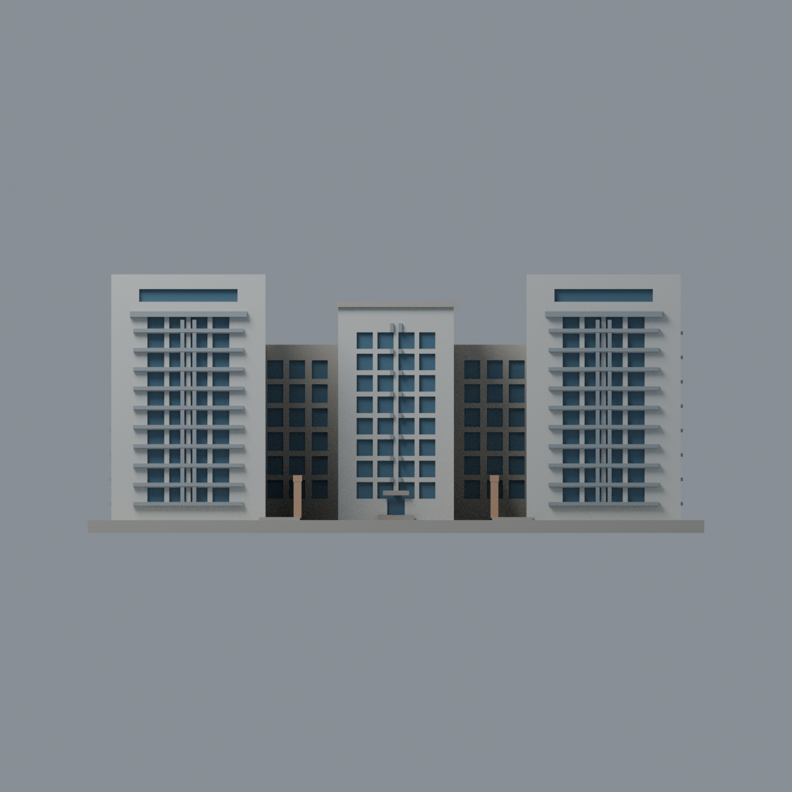
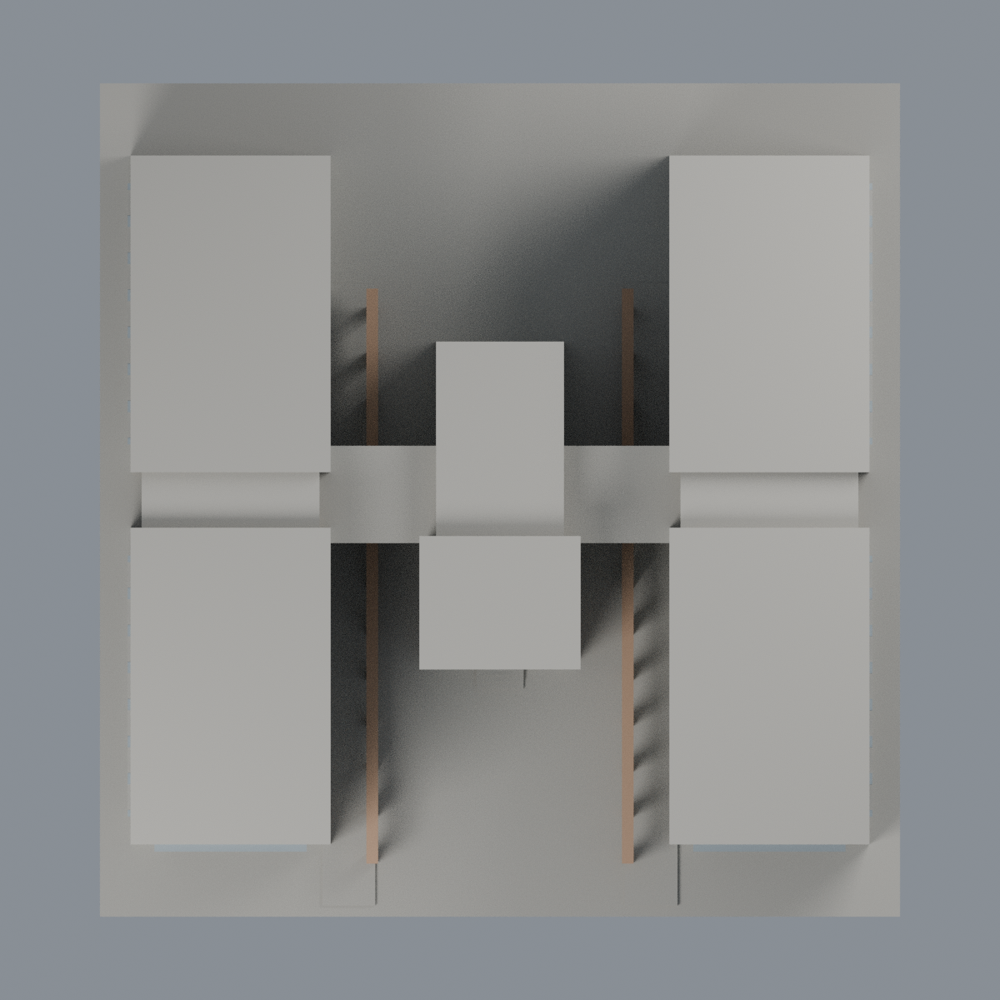

# 國衛院竹南研究大樓 R1／R2：五材質外觀版

沿用原 **13,778 三角面／6,779 頂點**，不改原 STL 位元、座標、面序或幾何；這是既有模型外觀改版，不增加模型包數。

| 模型預覽 | 模型預覽 | 模型預覽 |
| :---: | :---: | :---: |
| 正面  | 側向窗格／未知遠端中性  |  |
|  |  |  |

[表面色 3MF](nhrir12-appearance.3mf) · [可編輯 Blender](scene.blend) · [材質色表](palette.json) · [逐面指派與依據](face-materials.json) · [原 STL](../model.stl)

## 來源與配色邊界

親自核對臺灣綠建築發展協會[案例文章](https://www.taiwangbc.org.tw/tw/modules/news/article.php?storyid=206)中的[研究大樓](https://www.taiwangbc.org.tw/tw/modules/news/visit.php?fileid=755)與[園區中軸透視](https://www.taiwangbc.org.tw/tw/modules/news/visit.php?fileid=751)，並以互助營造[國衛院竹南院工程照](https://www.futsu.com.tw/images/images/portfolio/public/public_04.jpg)核對外長側格窗。來源為協會／承包商網站，不是國衛院官網影像。2014-05-02 是協會文章發布日，拍攝日不詳；承包商完工年不是照片日期。所有影像均不作 2026 現況證明。[影像 SHA256 與覆核](qa/source-review.json)，不附原照。

- 雙翼近端淺灰白包板、原離散藍窗凹背；水平遮陽條與細直框灰色，不將整個窗塔含框塗藍。
- 院內高窗、外長側格窗及中央頭部玻璃都有來源支持，但既有窗數與切分為簡化，僅原可分離凹背玻璃代理色；窗間實牆不塗玻璃。
- 低柱廊僅既有柱／梁暖砂岩，地坪中性。原群體比例、H 形連接及水平厚化不改，圖片投影不烘焙。
- 未充分見到的遠端牆、屋頂、中央後側與底座中性。後視畫面也可能看見有來源支持的外長側，不代表整個後向立面都已證實。
- 不新增實驗室、機電、保全、室內、植栽、招牌或人員資訊。
- 原 STL、OBJ、建模腳本、場景與歷史 QA 不變；配色不是新增模型，無實體列印成功宣稱。

[原幾何與歷史來源限制](../README.zh-TW.md)

## 重建與核驗

安裝 [依賴](source/requirements.txt)，Blender 使用 4.3.2。由本資料夾上層提供原 model.stl：

1. `python appearance/source/build_appearance.py`
2. `python appearance/source/verify_exchange.py`
3. `blender -b -t 3 --python-exit-code 1 -P appearance/source/render_appearance.py`
4. `blender -b -t 3 --python-exit-code 1 -P appearance/source/verify_scene.py`

[獨立重建 ZIP](rebuild-source.zip)含原 STL、四支程式及依賴，不含第三方照片；不取代原建模腳本。[逐檔 SHA256](SHA256SUMS)

[交換／拓撲 QA](qa/exchange-validation.json)核對原座標與面序、全部面材質、單連通、有向水密邊、頂點 link 單環、正體積與零退化／重複面；lib3mf 嚴格讀取零警告，實際編輯單材質再存讀，其他材質及面指派不變。SDK 六位小數量化誤差另列。

[Blender 存讀與編輯](qa/scene-validation.json) · [渲染記錄](qa/render-manifest.json) · [獨立重建](qa/rebuild-validation.json)

## 製造限制照舊

尺寸仍為 144 × 150 × 60.4 mm；原 STL、建模程式、場景及歷史 QA 保留。原層檢與薄特徵檢查本次未重跑，不能由材質 QA 代替。

3MF 是同一網格的表面色，不是各材質各自封閉的分色實體、切片專案、噴頭映射或 G-code。切片 GUI、多材料路徑與實體列印未測；柱頭、屋簷、窗框及薄邊仍須評估材料、支撐及拆除風險，沒有保證可印或免支撐。
