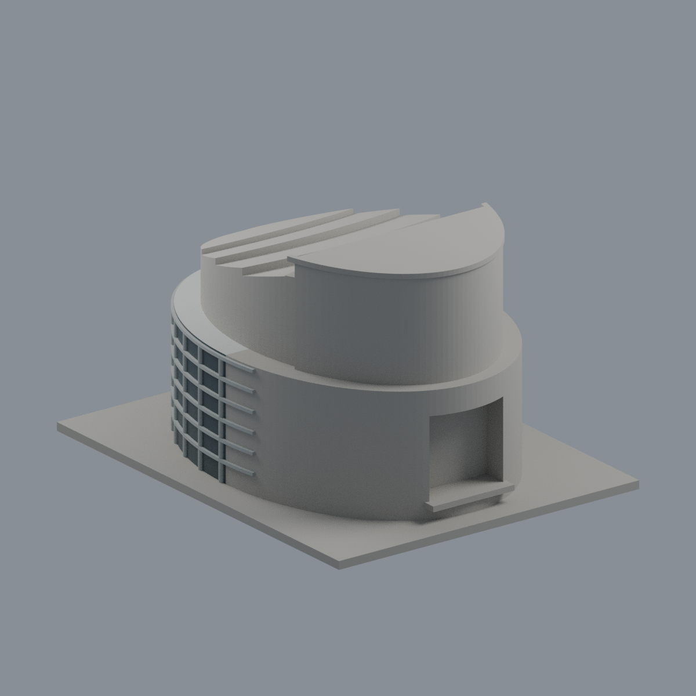
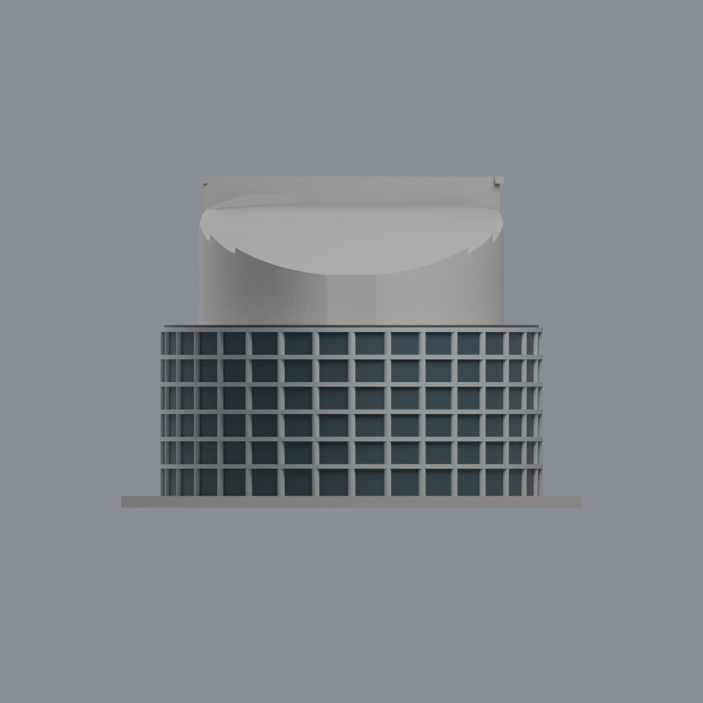
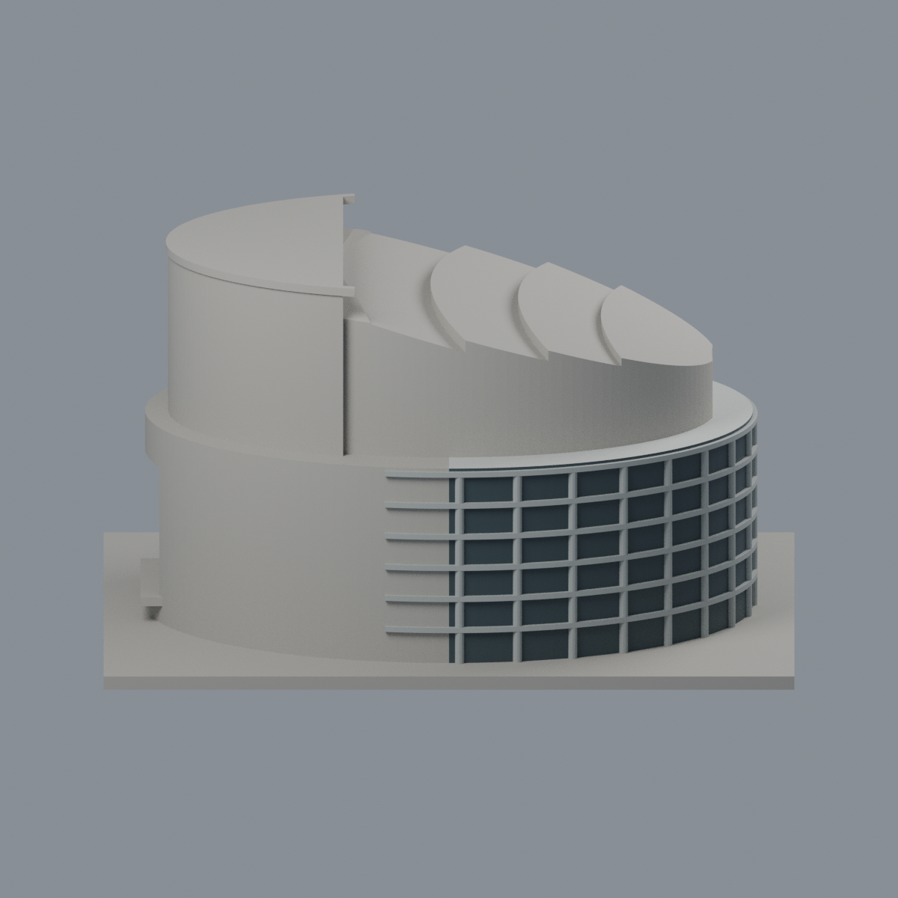
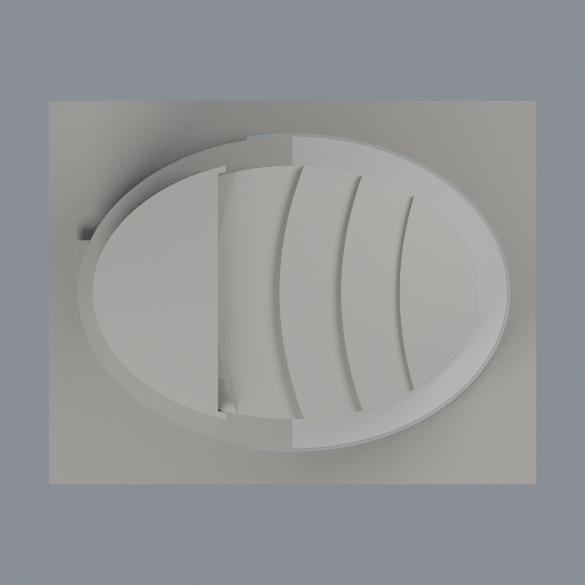

# 國立中央大學大禮堂｜前廳玻璃與框體有限配色

同一既有模型的外觀附加層，不是新增棟數或整棟精準彩色。尺寸約150 × 118 × 84.8 mm，所有9,614個三角面完整沿用，原STL bytes與面序不變。不修改原歷史模型，不替換首頁代表圖。

[表面色3MF](ncu-auditorium-appearance.3mf) · [可編輯Blender](scene.blend) · [逐面指派](face-materials.json) · [色表](palette.json) · [來源](SOURCES.md)

## 有界配色與中性範圍
- 入口x正向的原橢圓直立前廳玻璃：暗灰藍不透明展示代理，不把夜間黃光、藍天或樹影固化成材料，不聲稱校準RGB或真玻璃透明。
- 原水平框與垂直支柱：銀灰色，僅選原浮雕完整三角面；水平框原範圍x≥-14，不向背後延伸。
- 明確獨立的前廳上表面z=46.8、x≥0：淡灰屋面；跨前後邊界的三角形保持中性。
- 上部彩色鋁板未建立拼片材料邊界，全部中性，沒有隨機棋盤染色；後高牆與下方彩板凸段混界保持中性，不整面塗白。底座、背側及其他未確認面中性。中性色不是實景色還原。
- 完整面平面成員檢查，不以三角面重心染色、不切面。模型窗格數與厚框為原有可印代理，並非精確實測。室內、機電、跨棟空橋、精細鋁板紋仍省略。

## 五個實際網格視角
相機名稱不是地理方位。影像由同一交付3MF精確座標與逐面材質建立，不是AI效果圖。

| 前廳斜視 | 後舞台斜視 | 前廳立面 |
|---|---|---|
|  |  |  |

| 模型預覽 | 模型預覽 | 模型預覽 |
| :---: | :---: | :---: |
| 側視<br> | 頂視<br> |  |

## 重建與驗證
Python依賴見source/requirements.txt，Blender 4.3.2。原model.stl須置於appearance上層，sha256為50964d7b2b33cb1489a01b8b3198e272d1a1a03c2d537dd9c7fb4030053e9d4b。

```
python appearance/source/build_appearance.py
python appearance/source/verify_exchange.py
blender -b -t 2 --python-exit-code 1 -P appearance/source/render_appearance.py
blender -b -t 2 --python-exit-code 1 -P appearance/source/verify_scene.py
```

交換QA驗證有向水密、單連通、頂點鏈單環、正體積、無重複/退化面、全部材質範圍合法、原座標/面序完全一致。lib3mf嚴格讀取零警告，實際單材質edit-save-reopen保持其他材質及面指派；SDK六位小數回存誤差單獨列示，不把該暫存檔交付。Blender同樣執行實編回存重開，無外部資產/嵌入腳本。

## 原限制原樣保留
原資料詳見母包README及歷史QA；本次不重跑製造層檢、薄篩或物理試印。原0.2mm幾何截面共424層閉合/有效性檢查，薄篩是1mm間距0.8mm XY形態開運算，非全域壁厚保證。底座平放；後舞台凹口頂部、幕牆橫框及屋頂局部小簷口仍須切片檢查支撐。小窗框、曲面尖端與薄簷口可能不能完整列印。

3MF為單一網格表面色，不是各色封閉實體、切片專案、噴頭映射或G-code。FFF GUI、多材料路徑、支撐可移除性及實體列印未測，不保證可印或免支撐。照片年代不同，非完整2026現況。模型仍是公開外觀估計，非測繪、施工或BIM。

[交換QA](qa/exchange-validation.json) · [Blender實編回讀](qa/scene-validation.json) · [獨立重建](qa/rebuild-validation.json) · [材料邊界](qa/material-boundary-audit.json) · [渲染記錄](qa/render-manifest.json)

[逐檔雜湊](SHA256SUMS) · [權利說明](LICENSE-NOTICE.md)
