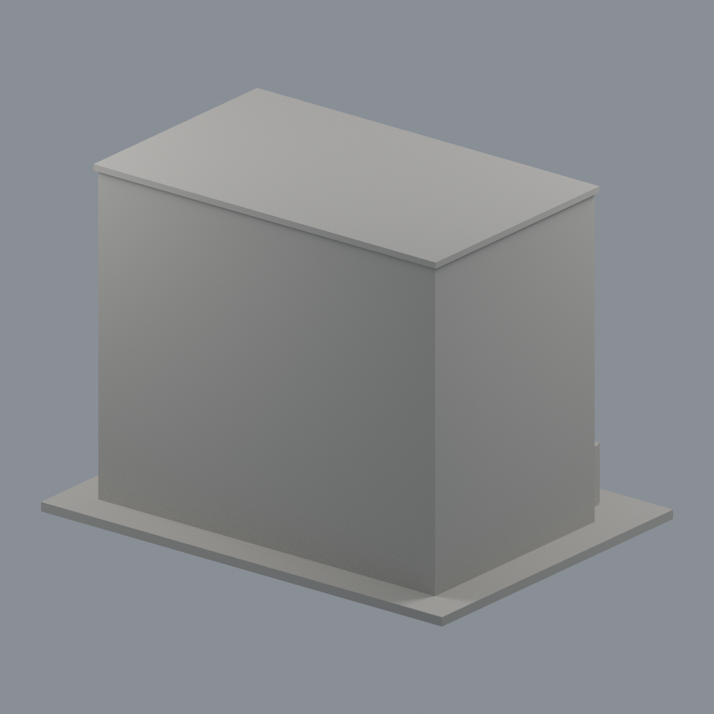
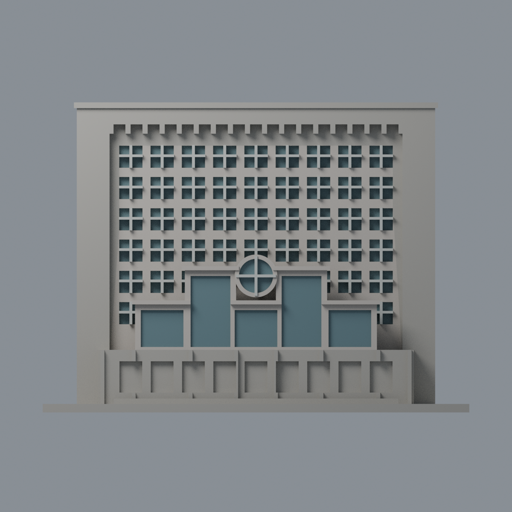
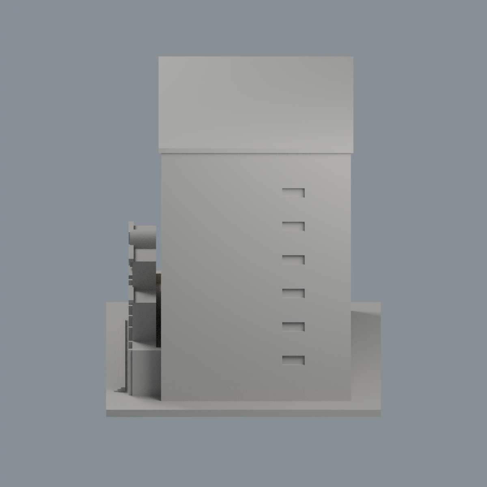
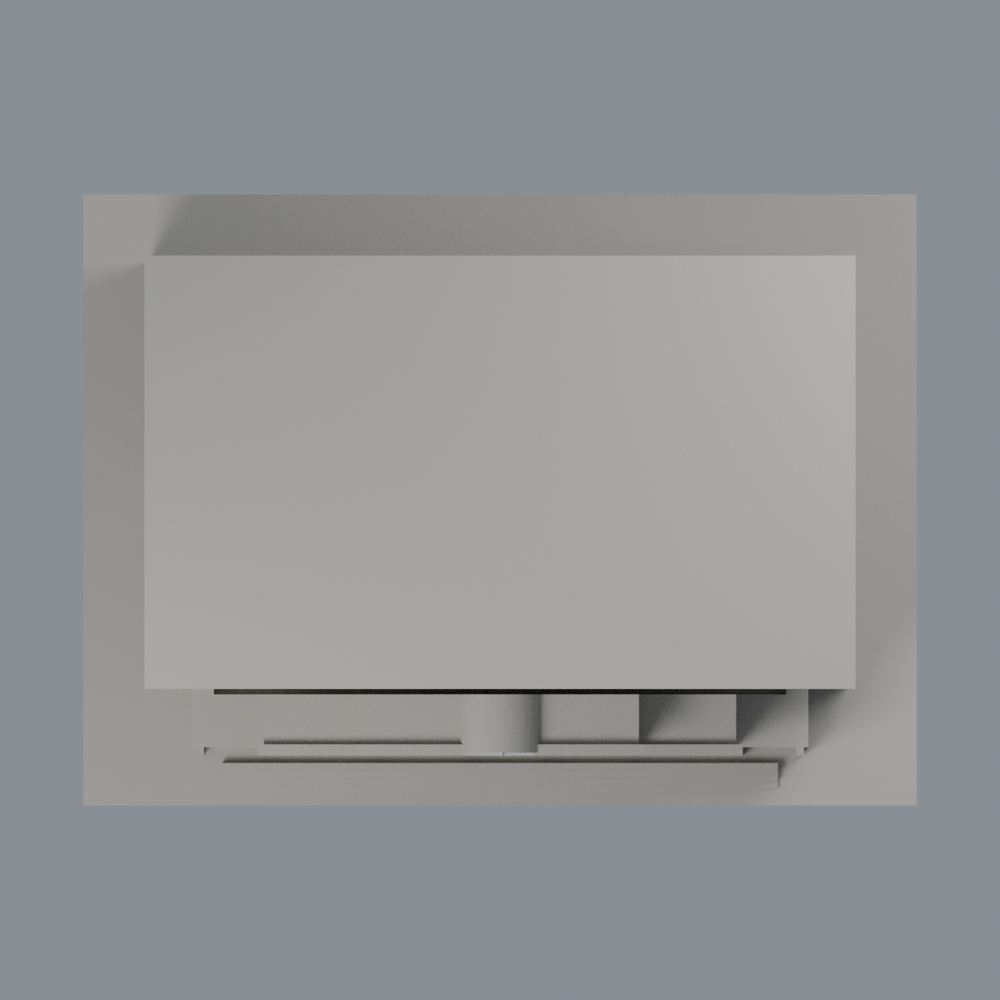

# 國立中央大學總圖書館｜正面有限配色

同一既有模型的附加外觀層，不增加棟數，不替換固定首頁代表圖。150 × 110 × 109 mm；6,688個完整三角面及其面序、全部原STL bytes保持不變，不切面或增加幾何。

[表面色3MF](ncu-main-library-appearance.3mf) · [可編輯Blender](scene.blend) · [逐面指派](face-materials.json) · [色表](palette.json) · [來源](SOURCES.md)

## 配色界線
- 正面可限域完整面使用淡暖灰磁磚代理，不添加磁磚紋或招牌文字。不是校準RGB。
- 僅實際離散窗背、上層入口矩形窗背與圓窗凹入圓盤灰藍；原十字框淡銀灰。外圓環不是玻璃，正面整片內凹牆不是玻璃。
- 六排重複網格的高處超出近照範圍；沿用相同窗背材質屬**有界重複材料推論**，不是逐窗現況查證。格數與框厚仍是原模型可印代理。
- 底層左右窗在實景有不透明裙板，但原網格缺那些邊界，故底層全部留中性，不把九個整凹面塗成藍玻璃。未能獨立定位之頂端細窗帶、屋頂、背面、側面與底座中性；中性不代表實景顏色。
- 全頂點/完整三角面限域，跨界面保持中性；不使用重心色帶、不切面，不新增玻璃厚度、室內、文字、植栽或倒影。

## 五個實際網格視角
相機名稱不是地理方位；影像由交付3MF及逐面材質渲染，不是AI效果圖。

| 前斜視 | 後斜視 | 正立面 |
|---|---|---|
|  |  |  |

| 側視 | 頂視 |
|---|---|
|  |  |

## 可攜重建及QA
原model.stl放於appearance上層；依賴見source/requirements.txt，Blender 4.3.2。

```
python appearance/source/build_appearance.py
python appearance/source/verify_exchange.py
python appearance/source/verify_material_boundaries.py
blender -b -t 2 --python-exit-code 1 -P appearance/source/render_appearance.py
blender -b -t 2 --python-exit-code 1 -P appearance/source/verify_scene.py
```

lib3mf嚴格讀取零警告，單材質實編回存重開保持其他色與指派。SDK六位小數回存誤差單獨記錄；該暫存編輯檔不交付。Blender實編回存重開保持幾何/面序與其他材質。乾淨重建3MF、逐面表、色表、五PNG須byte一致；不宣稱Blend二進位確定性。

## 原製造限制保留
原模型目測深度、素面背側及近照年代限制保留。歷史0.2mm截面545層閉合與有效性檢查、1mm間距0.8mm XY開運算薄篩0層損失超1%，不是全域壁厚保證。本次只增配色，不重跑製造層檢或物理試印。底座平放；入口前框、圓窗上緣、簷口可能需支撐，小窗框與曲面尖端可能不完整列印。

3MF是單網格表面色，不是分色封閉實體、噴頭映射、切片專案或G-code。FFF GUI、多材料路徑、支撐移除及實印未測，不保證可印或免支撐。不是測繪、施工、BIM或完整2026現況。

[逐檔雜湊](SHA256SUMS) · [權利說明](LICENSE-NOTICE.md)

原STL SHA256：c100700000dfb445be70dab4615a2654875ba3de9ae63e0f0c1c096bec2f6d74
