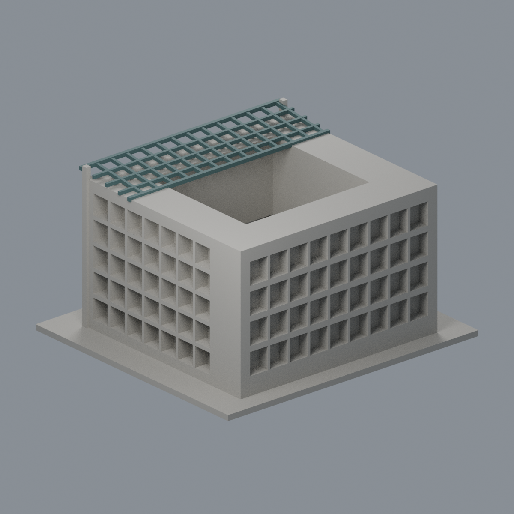
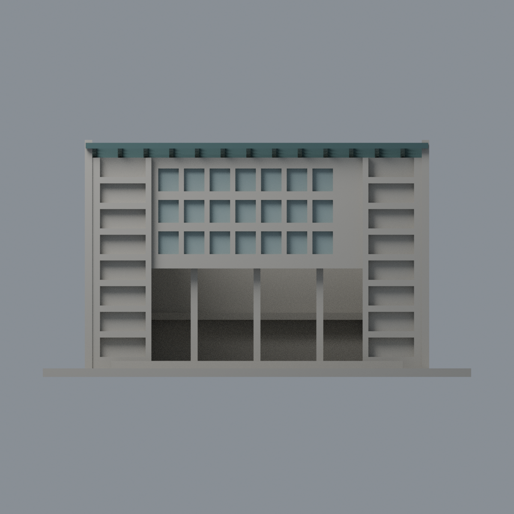
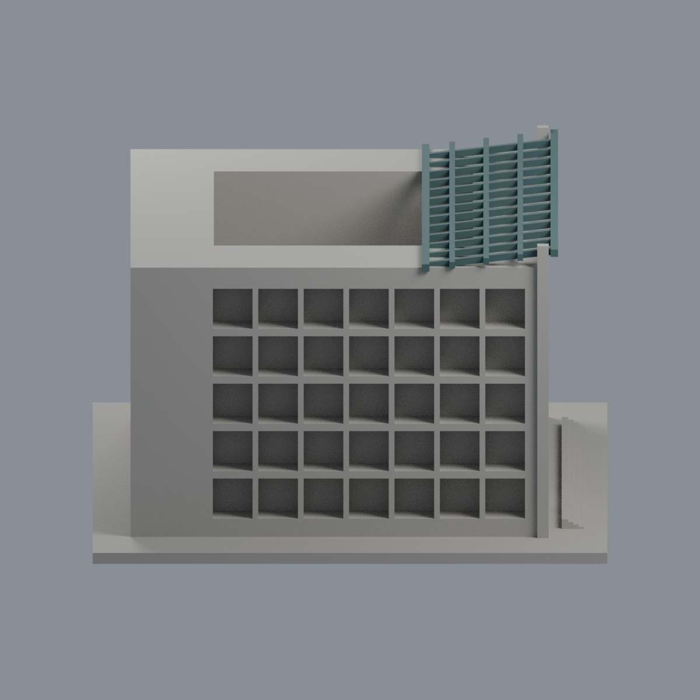
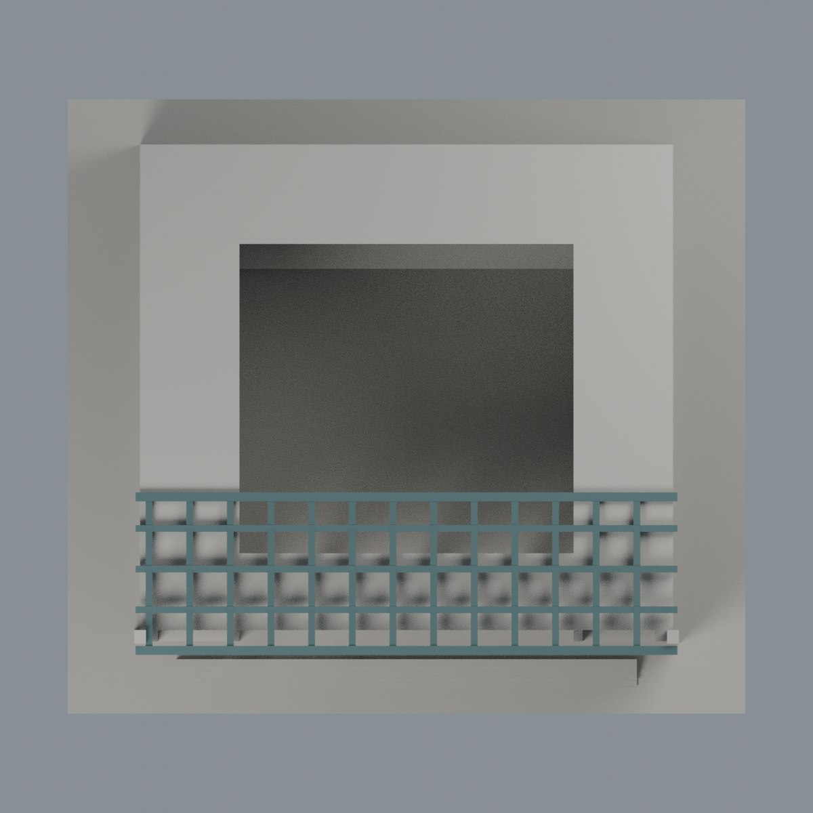

# 國立中央大學國鼎光電大樓｜限域外觀配色

這是**國鼎光電大樓，不是國鼎圖書資料館**。本版只為原150 × 136 × 83 mm模型增加可編輯外觀層，不新增模型套數，不修改原STL、座標、4138三角面序或拓撲。

## 配色範圍
- 深灰綠 `#456161`：斜格棚13縱梁、3橫梁及前後header完整原梁表面，共1494面。保留孔洞，不加玻璃頂板。
- 淡灰藍 `#8C9E9E`：正面中央7×3共21個凹格的背平面，每窗2面、合42面。這是玻璃的**不透明實體背襯代理**，不是真透明幕牆、室內或反射。
- 中性 `#AAA79F`：其餘2602面。側後深凹遮陽格不當成整片玻璃；側窗、凹槽側頰、不透明框、未知內院、屋頂、後立面與底座不擴色。中性不代表實際外牆顏色。

色票是歷史實景參考的低飽和展示近似，非色差校準或實測。承造商照片EXIF為2010-11-04與2011-02-09；官方2025文件內照片攝影日期未知，均不冒稱2026現況。保留原五層判定；合案七層不是本棟樓層。

## 下載與重建
[彩色3MF](ncu-optoelectronics-appearance.3mf) · [可編輯Blender](scene.blend) · [面材質映射](face-materials.json) · [色票](palette.json) · [可攜來源包](rebuild-source.zip) · [來源](SOURCES.md) · [權利](LICENSE-NOTICE.md)

在含原 `model.stl` 的父目錄使用 Python 3.12、requirements.txt依賴及Blender 4.3.2：

    python appearance/source/build_appearance.py
    python appearance/source/verify_material_boundaries.py
    python appearance/source/verify_exchange.py
    blender -b -t 2 --python-exit-code 1 -P appearance/source/render_appearance.py
    blender -b -t 2 --python-exit-code 1 -P appearance/source/verify_scene.py

3MF與Blend皆為完整原網格，不是局部色片。只使用完整三角面，不切面、不重網格；獨立半空間＋表面平面核對排除相鄰屋面誤收，兩材質區無交疊。lib3mf strict零警告，真實改色/保存/重開保留其他材質與面指派；Blender同樣實際編輯/保存/重開。乾淨重建比較3MF、maps、palette與5張PNG的bytes；Blend比語義而非主張binary可重現。

| 正向 | 背向 | 立面 |
|---|---|---|
|  |  |  |

| 模型預覽 | 模型預覽 | 模型預覽 |
| :---: | :---: | :---: |
| 側向  | 頂向  |  |

五圖由本次實際3MF完整網格渲染；相機名稱不是精確地理方位，背側/頂部中性不代表有同向實景佐證。

## 原模型與製造限制保留
原模型量體、院落比例為照片目測，非測繪/BIM/施工檔；後立面完整孔數及未見內院簡化，頂棚、柱、格條加厚。原415層0.2 mm閉環有效性檢查與1 mm採樣0.8 mm XY開運算薄篩是歷史幾何QA，本次未重算。保留z=82.071 mm兩根2.6×3 mm門框頂端開運算損失1.77%警示；不是發現小於0.8 mm薄壁，也非全域壁厚保證。大入口跨量體、格棚與內廊仍需切片支撐/橋接及移除性檢查；未正式切片或實體試印，不保證免支撐或可印。3MF材質不保證特定切片器自動多色列印。
