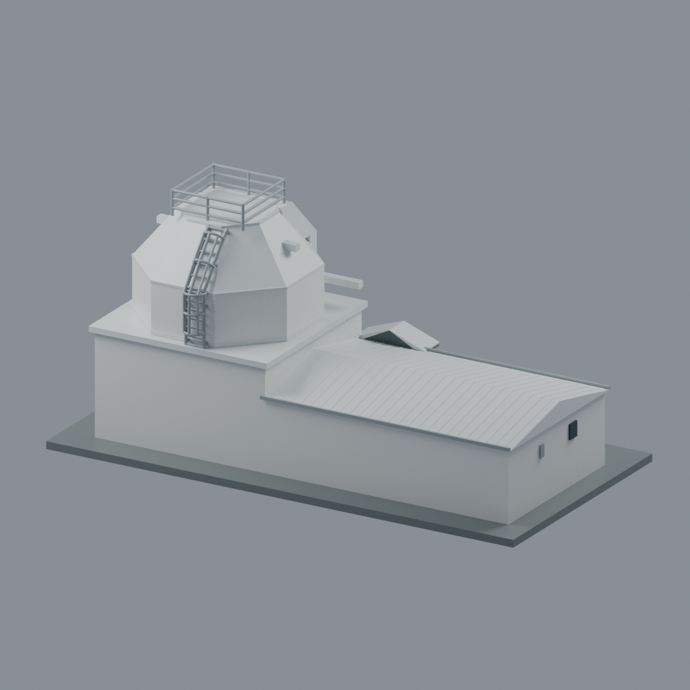
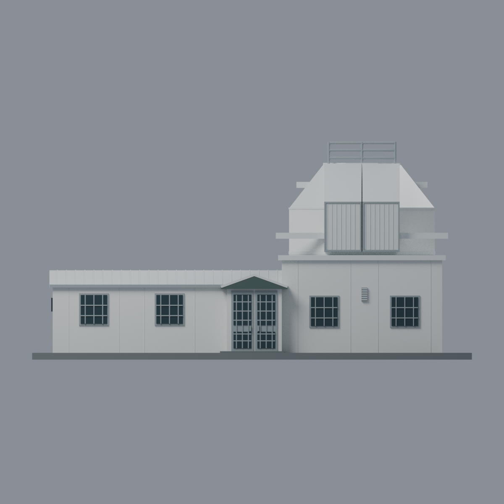
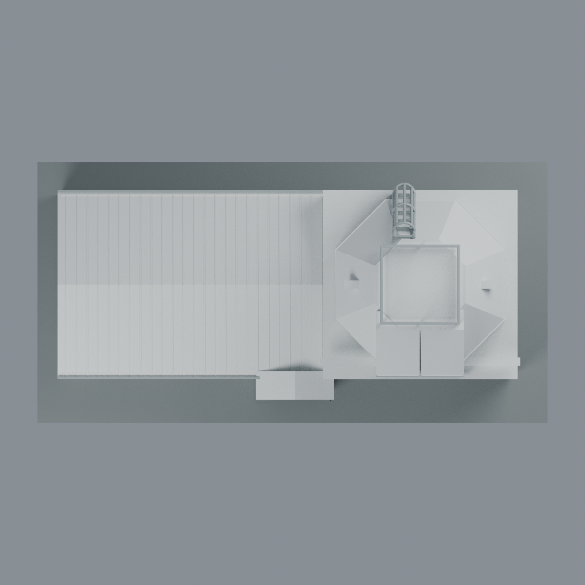
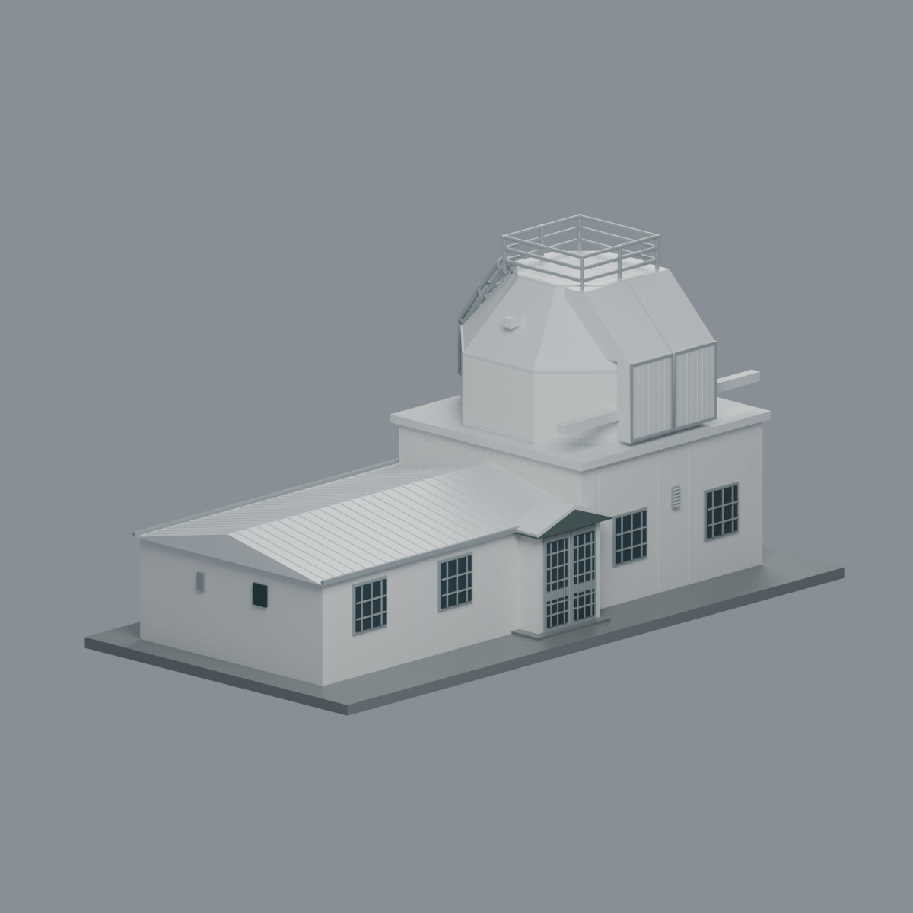

# 中央大學｜鹿林天文台 SLT 主建築（1999）

| 模型預覽 | 模型預覽 | 模型預覽 |
| :---: | :---: | :---: |
|  |  |  |

**校外「鹿林天文台觀測基地」的白色 SLT 單棟完整外觀近似，不是桃園校本部、粉紅色 LOT 控制中心或整座天文台。** 建築於1999年1月完工啟用；本模型以2022正面及2023反側照片可見的白色狀態為主要依據，**不宣稱2026現況**。不是測繪、BIM、施工圖或可操作觀測機構。

## 保留的辨識形體

- 低矮長翼與淺雙坡屋頂，接一端較高的方形平頂觀測基座；不是一個均高長盒。
- **八角直筒、向內收的八角斜頂、狹窄頂部**，不是半球圓頂。
- 前凸的**兩片閉合觀測窗／頂蓋板**，上部延續斜面；兩側橫伸梁端。沒有虛構黑色開槽或內部望遠鏡。
- 開放的頂部欄杆與後方先直後斜的護籠梯，欄杆、踏階及護籠之間保留真實幾何空隙；杆件加粗、數量簡化。
- 翼／基座交界的**封閉雙坡門廊、兩扇門、四個主要前窗**（低翼與高座各二）；不把門廊改成敞開柱亭，也不把四前窗複製到每一側。
- 反面完整長翼、山牆端、小通風口與屋頂交接；白色外皮、灰金屬窗框與灰綠門廊邊。

## 尺寸、顏色與可編輯性

模型外包尺寸 **192 × 98 × 約95.15 mm**，含3mm新增展示底板。所有毫米數值、長寬高比例、坡度、板縫與後側小細節均為照片推估，不是實測尺寸。官方2003年報稱「六公尺的八角頂」，但沒有說明對邊／對角量法，更不足以校準整棟，故不宣稱精確1:100比例。

`scene.blend`與`model.3mf`含**6種不透明材質**，可修改幾何與逐面材質區。兩者使用與STL相同的最終三角網格；一個融合網格，不是預分件組裝套件。牆體／屋頂採封閉實體外觀量體，門窗為附面浮雕，**不含房間、空心牆、真玻璃或光學內部**。`model.stl`不保存顏色，單色列印不會自動得到預覽配色。

頂欄柱徑1.2mm、橫杆1.1mm、梯側杆1.3mm、踏杆1.04mm、護籠杆1.0mm是強化模型尺寸。細窗格、屋脊／板縫、門廊唇邊仍有更薄部分；實物杆數、護籠數、窗格花樣與窗機運動沒有精密重建。新增底板／門前顯示踏板不是現場鋪面測量。

省略其他小觀測棚、水箱、LOT、臨時梯、天線、細纜、樹木、人物與地形；這些不是SLT本棟而且無法用鄰棟外觀補足。

## 列印風險

**未實印，不保證免支撐。** 梁端、簷口、欄杆、梯階與護籠有懸挑／橋接；圓杆近切線截面及細浮雕存在0.8mm核心侵蝕警告。全局切層有大型連通塊不等於所有細節都可印，因此另測局部薄件與應空區。完整真實數據見[QA](QA.md)，沒有刪除失敗切片或豁免薄件。

請依設備、耗材、縮放、擺向另做切片、支撐及實印測試。下向面積不是支撐材料用量或免支撐證明，源照片外觀審查也不是結構認證。

## 交付檔案

| 檔案 | 用途 |
|---|---|
| `model.stl` | 毫米、單閉合連通網格，無顏色 |
| `model.3mf` | 相同三角、6個逐面材質，strict格式與實際材質寫回驗證 |
| `scene.blend` | 可編輯幾何、材質、前視相機及燈光；其餘視角設定在render_model.py；無原照片貼圖或內嵌腳本 |
| `build_model.py`、`render_model.py` | 原始參數生成與實際最終mesh五圖渲染 |
| `mesh.json`、`palette.json` | 精確幾何與材質對照 |
| `qa_model.py`、`check_features.py`、`verify_*.py` | 原始拓樸、全局切層、局部／空氣、格式／hash驗證 |
| `rebuild.py` | 新隔離目錄重建核心與五PNG，逐檔bytes比對 |
| `QA.md`、`qa/`、`qa-*.json` | 可追溯數值、限制及獨立來源視覺終審 |
| `SOURCES.md`、`sources.json` | 來源、日期界線、作者、引用用途；無第三方原圖 |
| `SHA256SUMS` | 全包檔案hash |

## 五個最終網格視圖

[正面斜視](previews/front.png) · [後斜視](previews/rear.png) · [正立面](previews/elevation.png) · [俯視](previews/top.png) · [左前斜視](previews/left_oblique.png)

| 模型預覽 | 模型預覽 | 模型預覽 |
| :---: | :---: | :---: |
| 後斜視<br> | 正立面<br> | 俯視<br> |
| 左前斜視<br> |  |  |

五圖均由同一最終網格渲染，非原照片拼貼或生成的概念圖；不代表實印成品。

## 重建與驗證

Python 3.12、Blender 4.3.2驗證；Python依賴列在`requirements.txt`，Blender另裝。於模型目錄執行：

```bash
python build_model.py
python qa_model.py
python check_features.py
python verify_exchange.py
blender -b -t 8 --python-exit-code 1 --python render_model.py
blender -b -t 8 --python-exit-code 1 --python verify_scene.py
blender -b -t 8 --python-exit-code 1 --python verify_render.py
python rebuild.py --output ../independent-new --threads 8
python verify_package.py
```

`verify_exchange.py`重建核心並核bytes；`rebuild.py`須指定全新目錄。CPU Cycles seed0、128 samples、無降噪；PNG僅去除文字／日期metadata，不改像素。同一驗證環境下核心4檔與5PNG bytes一致；不同Blender／計算環境不保證渲染bytes相同。Blend檔案本體不宣稱跨路徑bytes一致，其幾何及材質另有精確往返驗證。更改模型後須重跑QA與來源審查，不沿用舊hash。

[來源](SOURCES.md) · [QA](QA.md) · [原創產生物授權](LICENSE)。來源照片、年報頁與建築本身權利不因模型授權轉移。
