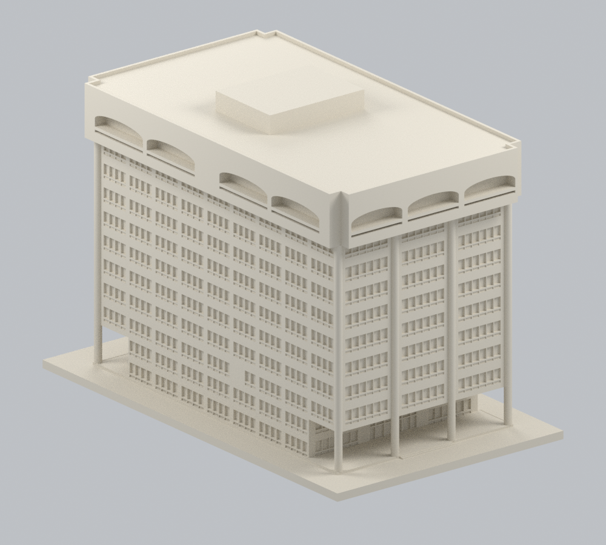
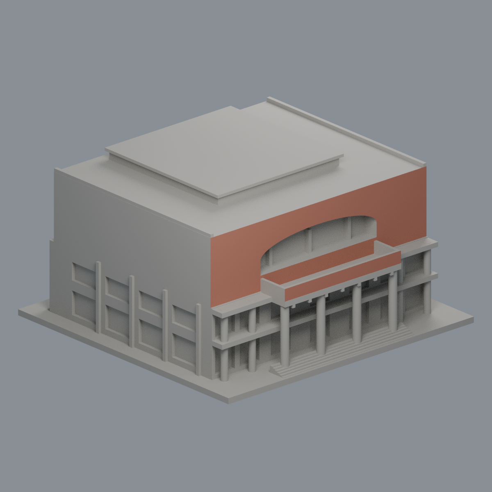
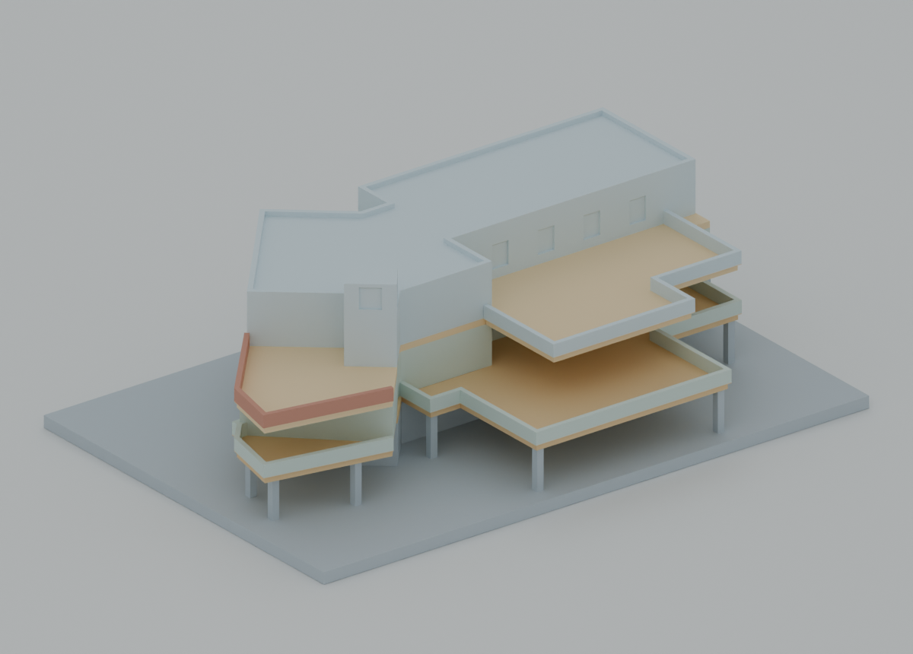
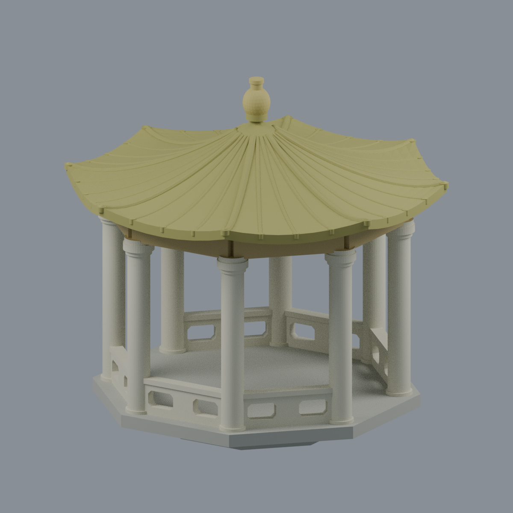

# 國立中山大學

目前5套公開外觀近似模型；全校各校區尚未逐棟完成。只依公開資料自建，沒有擷取他人mesh，各套含底座最長150mm且獨立縮放。學校及校區的建物數仍待去重確認，不能由49個安全圖文件推成49棟。

| 建築模型 | 建築模型 | 建築模型 |
| :---: | :---: | :---: |
| [行政大樓](西子灣校區/buildings/nsysu-administration/README.md)  | [圖資大樓・主棟幾何修正版 v2](西子灣校區/buildings/nsysu-library-information/geometry/v2/README.md)  | [逸仙館](西子灣校區/buildings/nsysu-yatsen-hall/README.md)  |
| [西子樓校友會館・推薦六件製造方案](西子灣校區/buildings/nsysu-xizi-alumni-hall/manufacturing/v2/README.md)  |  **[國立中山大學橋上涼亭](西子灣校區/buildings/nsysu-bridge-pavilion/README.md)** |  |

西子樓不是逸仙館別名；[原單件](西子灣校區/buildings/nsysu-xizi-alumni-hall/README.md)仍保留且需要支撐。六件變體與原單件合計只算一套。推薦方案須保留供應印向，使用0.4mm噴嘴、0.15mm層高與100% rectilinear逐件列印；指定條件下已實際切片，支撐擠出為0，01件仍有19條短橋、最大未覆蓋段約0.225001mm。尚未試印、拆brim、乾組或膠合；generic G-code僅為覆核證據，請依真機重切。來源照片拍攝日期未知，PDF metadata不是測繪或刊登日期，不宣稱已驗證2026現況。

每件附STL、可編輯Blend、參數腳本、實際STL正背/俯視、來源、0.2mm閉合有效截面及薄篩。未做實體試印，不保證免支撐。攝影日期大多未提供，查閱日2026-10-13不是實拍日期。

[西子灣校區](西子灣校區/README.md) · [校區、別名及逐項續接](inventory/README.md) · [精確來源佇列](inventory/continuation.json)

原照片和PDF不隨公開包散布，所有本地圖鑑圖均由交付STL渲染。

[圖資大樓幾何修正版 v2](西子灣校區/buildings/nsysu-library-information/geometry/v2/README.md)與[原版歷史模型](西子灣校區/buildings/nsysu-library-information/README.md)合計仍只算一套。修正主棟比例、冠部與窗群、完整圓柱和範圍切口；中性材質不是實際色彩復原，並非測繪或經確認的 2026 現況，屋頂／鄰棟接點與列印限制仍須保留。
