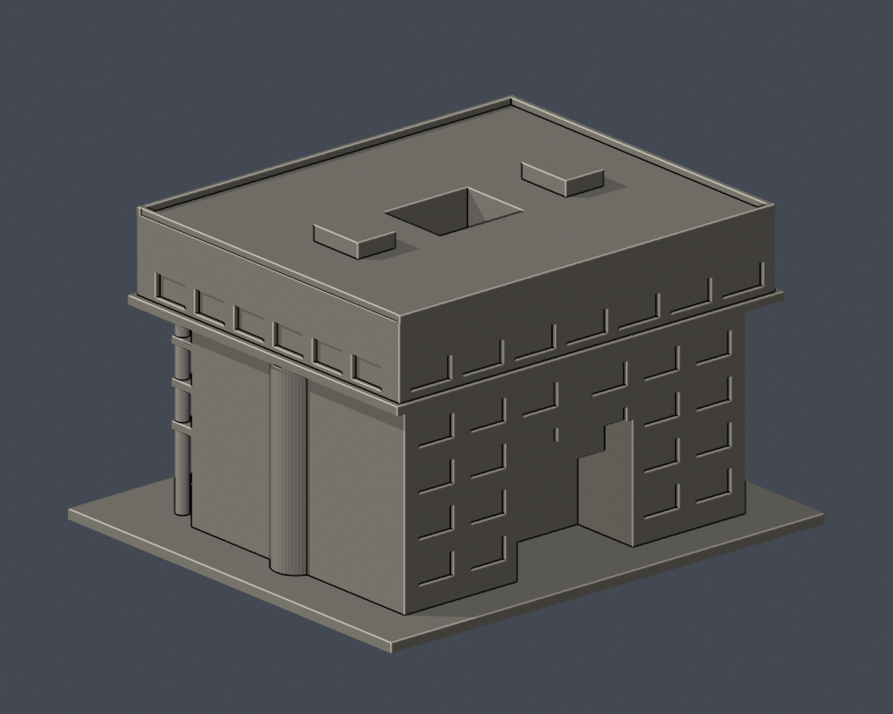
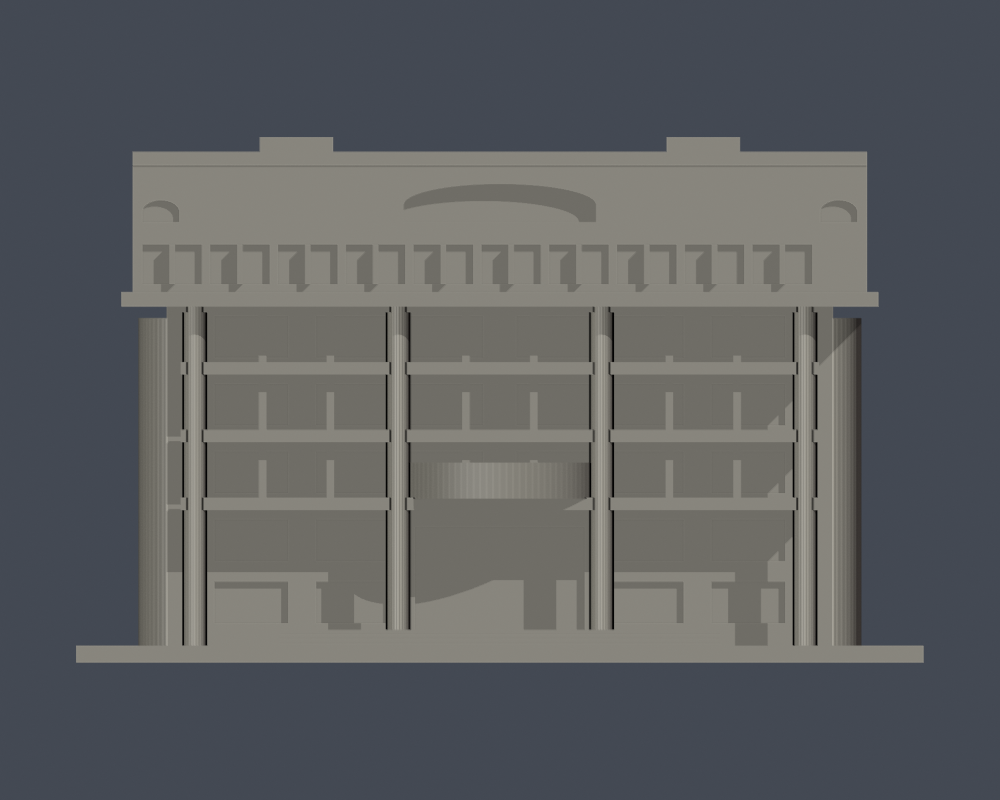
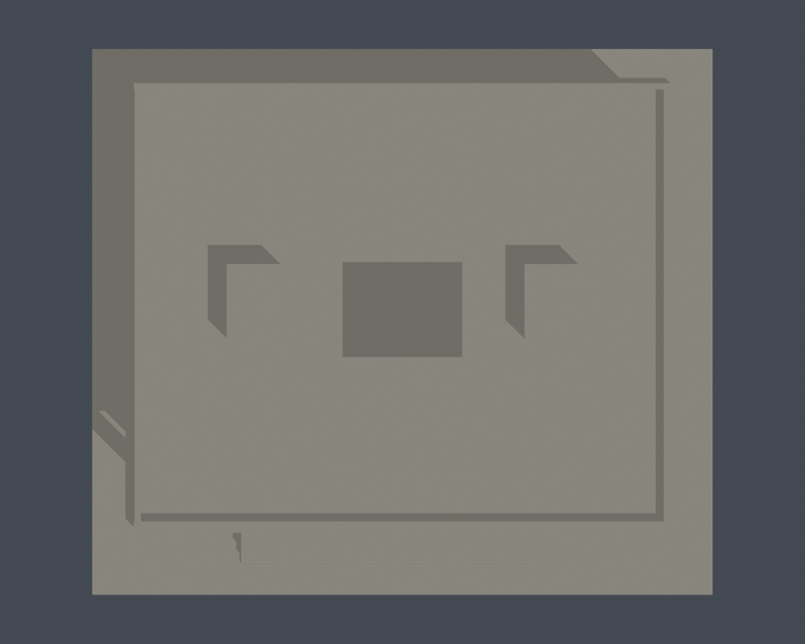

# 國立中山大學 行政大樓

## 模型預覽

| 模型預覽 | 模型預覽 | 模型預覽 |
| :---: | :---: | :---: |
| 實際 STL 正面  | 實際 STL 背面  |  |

[返回西子灣校區](../../README.md) · [返回全校圖鑑](../../../README.md)

[下載 STL](model.stl) · [可編輯 Blender](scene.blend) · [參數重建](build_model.py) · [幾何驗證](validation.json) · [全部來源](sources.json)

## 範圍與外觀
行政大樓主棟；相接的理學院、社會科學院與東西綜合大樓不在此件，不把整個院落群棟當作本棟完成。

尺寸（含底座）：150 × 132 × 93 mm，最長150mm，各館獨立縮放，不能拼成同比例校園。尺寸是模型尺寸，非現地測繪。

- 前部深柱廊、四支主圓柱、較細分格與水平梁
- 中央弧形陽台保留中空上緣及板下空間
- 上部寬出挑盒體、連續窗帶和中央扁弧凹口
- 官方1F–3F圖的背面中央深退縮；3F至RF中央井口及兩側樓梯頭位置

## 未知與簡化
- 背面完整照片本次未成功取得，後側窗孔及側面留白為低細節示意，不表示與現況逐窗一致。
- 屋頂中央井口由3F以上貫通，背面下層依官方平面保留退縮；各層高度、高層出挑深度及樓梯頭高度以目視比例估算，未還原內部房間。
- 主樓與東西相鄰低層群棟連接處截斷；柱身為列印加粗。

[正立面](previews/elevation.png) · [俯視／屋頂](previews/top.png)。照片年代未提供，2026-10-13為查閱日，不代表拍攝日或全校現況確認。

| 模型預覽 | 模型預覽 | 模型預覽 |
| :---: | :---: | :---: |
| 正立面  | 俯視／屋頂  |  |

## 列印與數位檢查
單位為毫米，底座朝下。可先用0.4mm噴嘴、0.2mm層高試切片，依材料和機器調整。主柱直徑4.1mm，次框1.35mm，陽台邊1.6mm，屋頂緣1.5mm；柱廊跨距、上層出挑、弧形陽台板與中央井口均需檢查支撐及移除路徑。

原始STL水密、每邊兩面、頂點link單環、原法向／繞序、正體積、單一連通表面、150mm、獨立重建SHA一致及儲存Blend幾何一致均通過。465個0.2mm逐層輪廓有效閉合（固定z起點0.071mm，無Polygon修補）；0.8mm參考寬度形態opening以1mm間距抽樣，最大面積損失0.0590%，超過1%層數為0。[逐層資料](valid-sections.json) · [薄特徵篩檢](thin-feature-check.json)。

數位幾何檢查不等於全面最小壁厚量測、Cura/Prusa實際工具路徑或實體試印；未做實體試印，不保證免支撐或任何機器均可印。

## 重建與驗證
Python 3.12安裝requirements.txt，執行python build_model.py。Blender 4.3.2+執行blender -b -t 2 -P render_preview.py，會匯入實際STL並儲存可編輯網格場景與四視圖。python validate_model.py、python check_valid_sections.py、python thin_canonical_v2.py各自必須成功，validate_model.py會獨立暫存重建並驗證SHA和Blend。SHA256SUMS提供逐檔完整性。

## 公開證據
- [官方校園景觀實拍相簿](https://www.nsysu.edu.tw/p/405-1000-15781,c1505.php?Lang=zh-tw)
- [官方各樓層安全平面圖目錄](https://rpa121.nsysu.edu.tw/p/405-1296-286323,c18978.php)
- [行政大樓1（官方實拍）](https://www.nsysu.edu.tw/static/file/0/1000/pictures/561/m/mczh-tw1920x1200_large98795_450676533548.jpg)
- [行政大樓3（官方實拍）](https://www.nsysu.edu.tw/static/file/0/1000/pictures/561/m/mczh-tw1920x1200_large98797_917106733548.jpg)
- [行政大樓4（官方實拍）](https://www.nsysu.edu.tw/static/file/0/1000/pictures/561/m/mczh-tw1920x1200_large98847_108720033549.jpg)
- [行政大樓5（官方實拍）](https://www.nsysu.edu.tw/static/file/0/1000/pictures/561/m/mczh-tw1920x1200_large98848_806833833549.jpg)
- [教學行政區--行政大樓 PDF](https://rpa121.nsysu.edu.tw/static/file/296/1296/attach/76/pta_174542_9100967_04268.pdf)

只自建幾何，未擷取第三方mesh。原照片和PDF不隨本包散布，預覽只含實際STL渲染。
