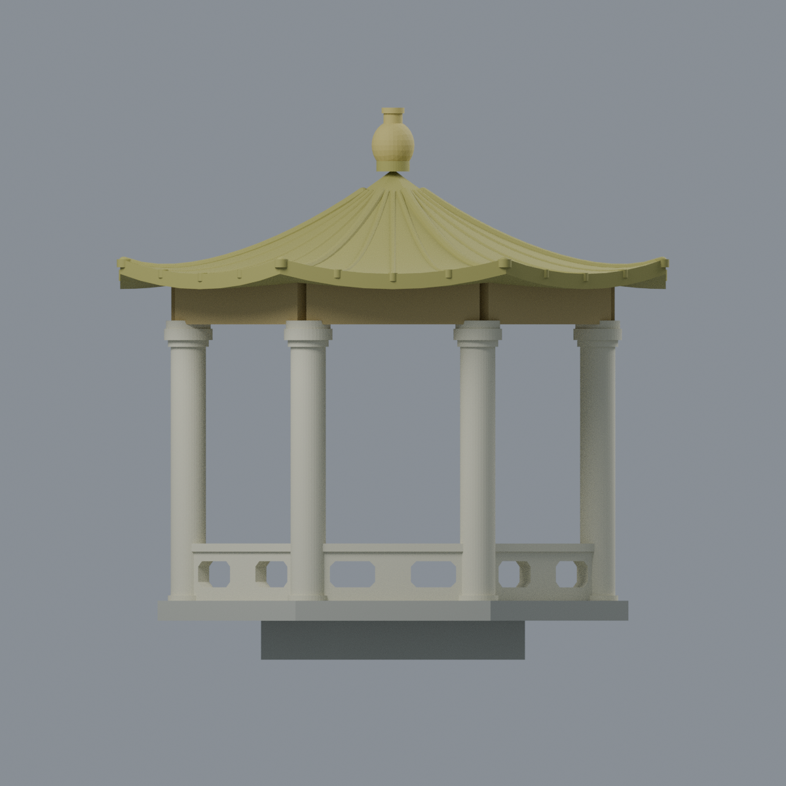
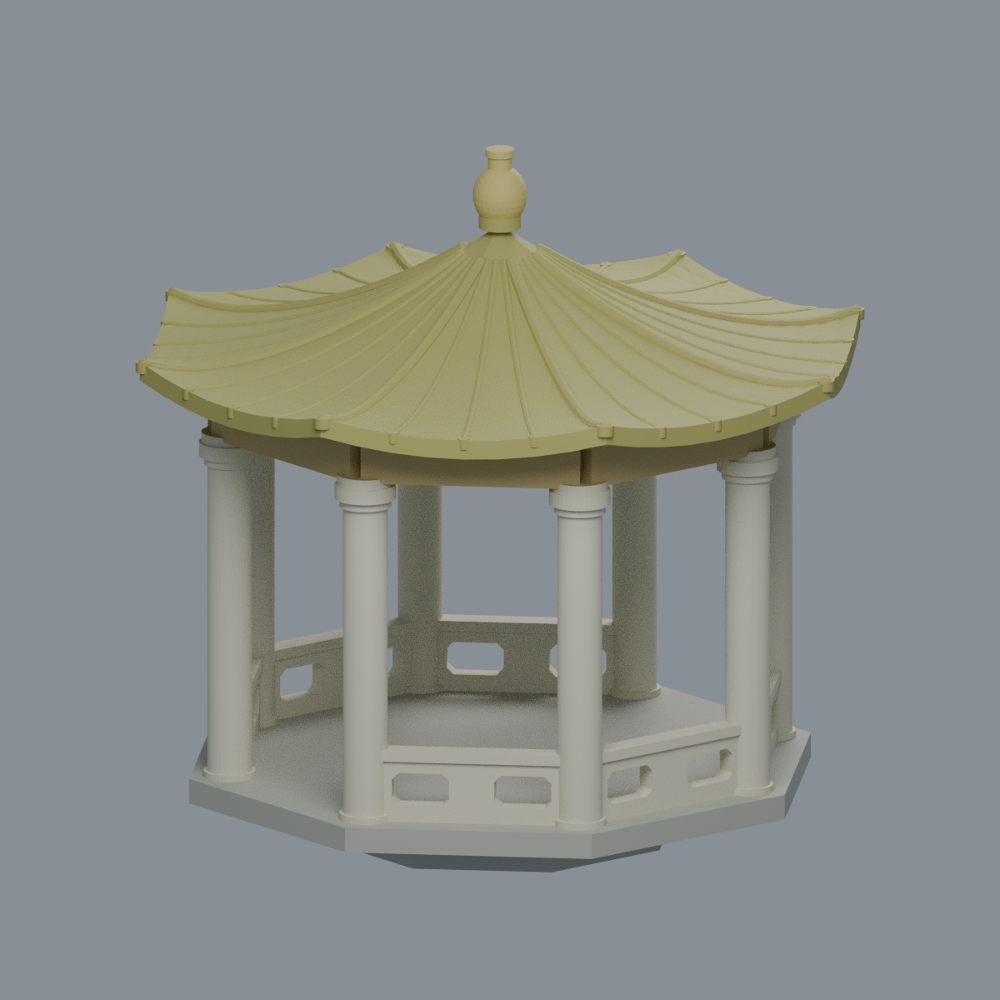
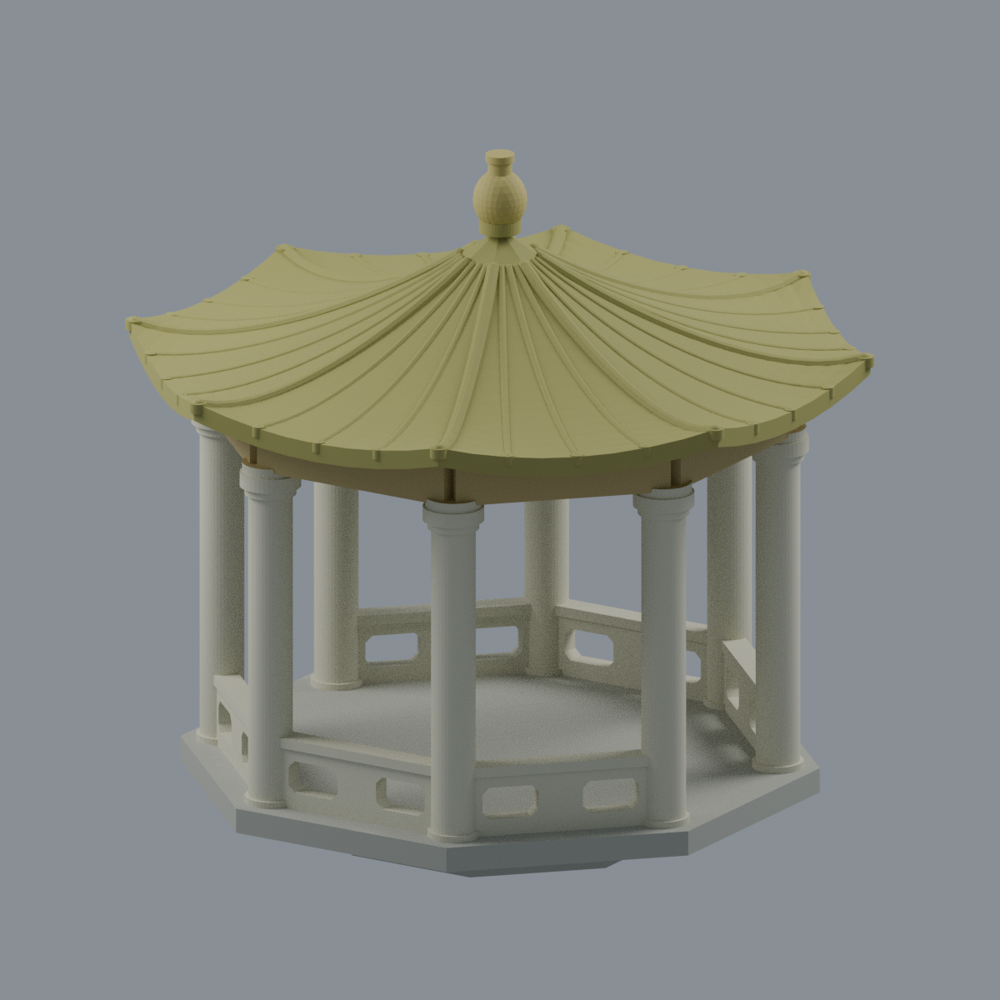
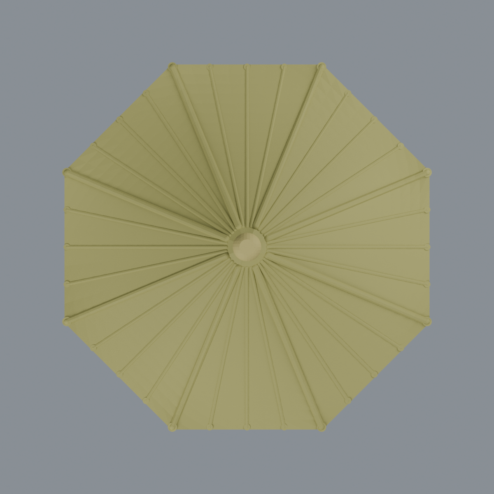

# 國立中山大學橋上涼亭

**官方多角度照片的全亭外觀近似；八柱／八面為推定，不是測繪復原。** 照片 3、4 各可辨約七根真柱；第八柱與隱藏面依遮擋及規則環圈推估，並非八根都逐一可見。照片中的棕櫚樹幹沒有當成柱子。

| 模型預覽 | 模型預覽 | 模型預覽 |
| :---: | :---: | :---: |
|  |  |  |

- [可編輯彩色 Blender](scene.blend) · [彩色 3MF](model.3mf) · [單色 STL](model.stl)
- [正立面](previews/elevation.png) · [左前斜視](previews/left_oblique.png) · [推定背側](previews/rear.png) · [推定頂面](previews/top.png)
- [來源及界線](SOURCES.md) · [QA 與列印限制](QA.md) · [參數生成器](build_model.py)

| 模型預覽 | 模型預覽 | 模型預覽 |
| :---: | :---: | :---: |
| 正立面<br> | 左前斜視<br> | 推定背側<br> |
| 推定頂面<br> |  |  |

## 範圍與尺度
完整亭體及直接承載平台：粗圓柱、環形梁、黃綠曲面屋頂、附著式瓦脊、加粗頂飾、六段真正穿孔欄板，保留相對的兩個橋側入口。**不包含長橋、池塘、園林及被遮擋的桌椅。** 下方短實心八角支撐為展示用的近似延續，不代表量測過的水下基礎。

外包尺寸約 **115.97 × 115.97 × 115.90 mm**；這是自訂展示毫米，不是實體建物比例尺。圓柱直徑 7.4 mm、欄板厚 3.3 mm、屋頂垂直殼厚 3.2 mm。屋頂角對角名義寬 124 mm，與沿 X/Y 的包圍盒不同。

四張官方照片均親自檢視，**拍攝與發布日期未明**；2026-10-21 只是下載／製作日期，不代表已確認 2026 建物現況。未觀測後柱、屋面細節及內部梁架採規則簡化。屋瓦數、曲率、柱距、欄孔尺寸與位置均為照片近似。原有回紋以赭色帶簡化，未重製題字、符號與微小紋飾；頂飾、瓦端、柱頭均作粗化連接，並非雕塑複製。

## 使用
Blender 是可直接改頂點與逐面材質的單一連通網格。3MF 保留展示色，不是多噴頭列印設定；STL 不含色。五張圖均由交付模型實際渲染，並非生成式照片。

```sh
python -m pip install -r requirements.txt
python build_model.py
python qa_model.py
PYTHONDONTWRITEBYTECODE=1 python check_features.py
blender -b --threads 6 --python-exit-code 1 --python render_model.py
```

**未實際列印，也不宣稱免支撐或可直接量產。** 大屋頂下表面、跨柱梁、欄孔上緣、曲簷及頂飾仍須切片支撐／方向評估。頂點拓樸通過不等於無薄件或結構強度保證。
