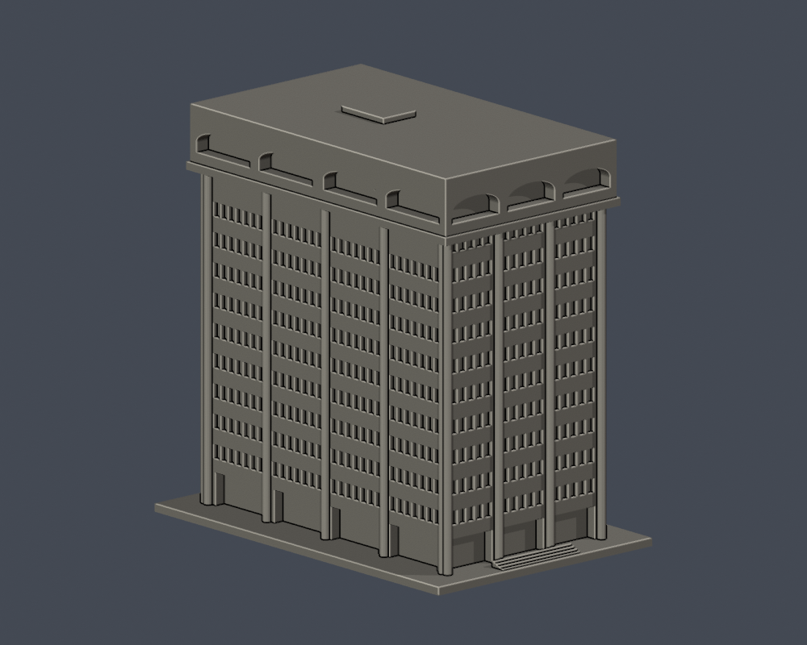
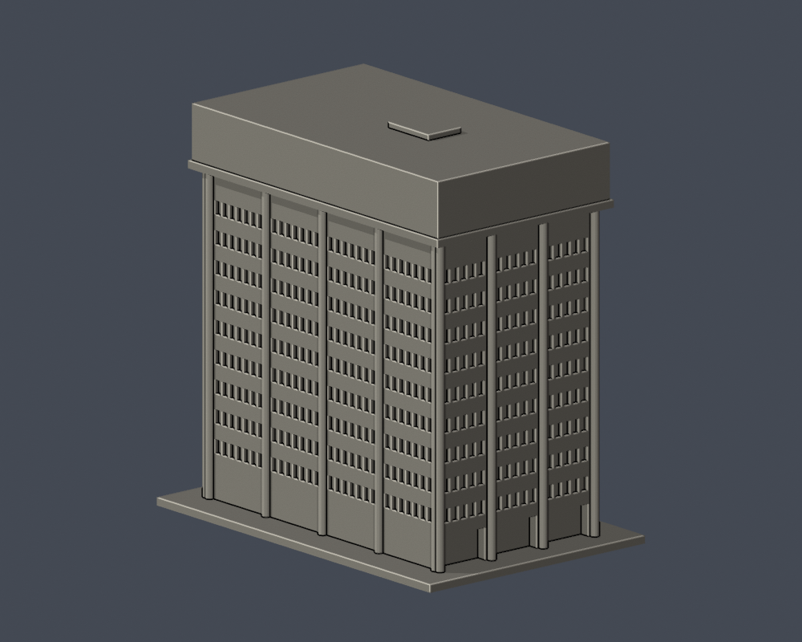
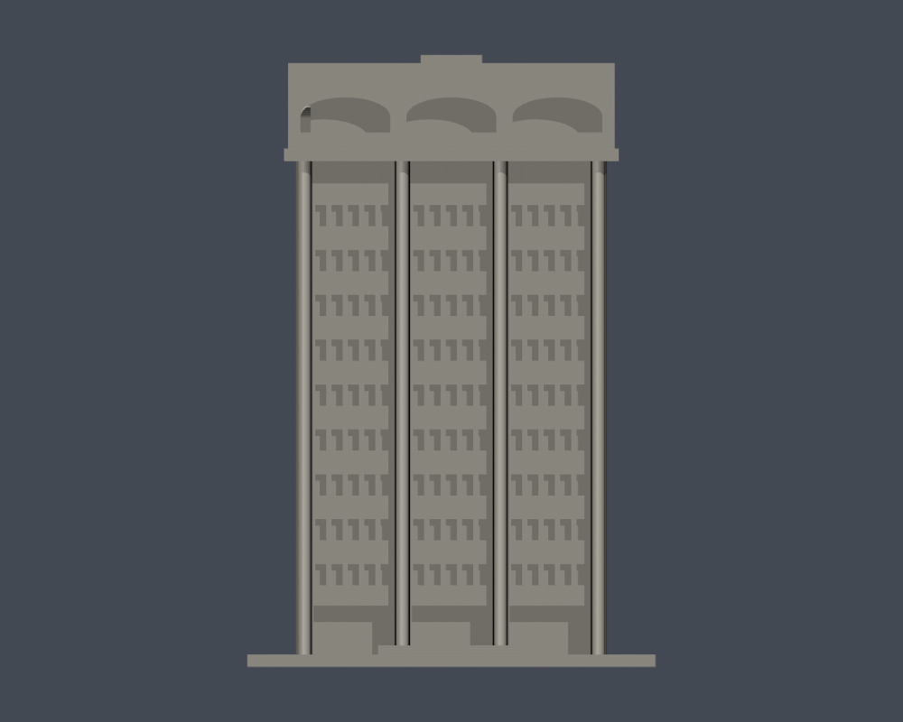

# 國立中山大學 圖資大樓

[返回西子灣校區](../../README.md) · [返回全校圖鑑](../../../README.md)

| 模型預覽 | 模型預覽 | 模型預覽 |
| :---: | :---: | :---: |
| 實際 STL 正面  | 實際 STL 背面  |  |

[下載 STL](model.stl) · [可編輯 Blender](scene.blend) · [參數重建](build_model.py) · [幾何驗證](validation.json) · [全部來源](sources.json)

## 範圍與外觀
圖書與資訊大樓單一主棟外觀；圖書館、西灣學院、醫學院等使用單位不重複計棟。照片前方圓形亭與相接低層院館不在此件。

尺寸（含底座）：100 × 150 × 150 mm，最長150mm，各館獨立縮放，不能拼成同比例校園。尺寸是模型尺寸，非現地測繪。

- 三開間短立面，長側約為短側1.8倍的主量體
- 通高圓柱、下層深退縮入口、九排主要窗帶和頂層細窗
- 頂部出挑冠框及正面三個扁弧凹口
- 官方後門照片的深門廊和圓柱；RF平面中的中央屋頂機房輪廓

## 未知與簡化
- 無完整後方高層照片；後面九排窗及另一長面窗節奏由可見面與官方典型平面推定，不是逐窗測繪。
- 背面冠頂沒有足夠實拍，保留簡化平面，不能把前方三弧照搬成已確認的後側。
- 實際高度與立面深度未有測量，樓層形態依照片比例估算；屋頂細部機電省略。

[正立面](previews/elevation.png) · [俯視／屋頂](previews/top.png)。照片年代未提供，2026-10-13為查閱日，不代表拍攝日或全校現況確認。

| 模型預覽 | 模型預覽 | 模型預覽 |
| :---: | :---: | :---: |
| 正立面  | 俯視／屋頂  |  |

## 列印與數位檢查
單位為毫米，底座朝下。可先用0.4mm噴嘴、0.2mm層高試切片，依材料和機器調整。柱直徑3.4mm，窗間實心分隔约1.3mm，頂冠凹深约5.5mm；頂冠出挑、門廊及扁弧凹口有懸垂，需切片檢查支撐。

原始STL水密、每邊兩面、頂點link單環、原法向／繞序、正體積、單一連通表面、150mm、獨立重建SHA一致及儲存Blend幾何一致均通過。750個0.2mm逐層輪廓有效閉合（固定z起點0.071mm，無Polygon修補）；0.8mm參考寬度形態opening以1mm間距抽樣，最大面積損失0.0681%，超過1%層數為0。[逐層資料](valid-sections.json) · [薄特徵篩檢](thin-feature-check.json)。

數位幾何檢查不等於全面最小壁厚量測、Cura/Prusa實際工具路徑或實體試印；未做實體試印，不保證免支撐或任何機器均可印。

## 重建與驗證
Python 3.12安裝requirements.txt，執行python build_model.py。Blender 4.3.2+執行blender -b -t 2 -P render_preview.py，會匯入實際STL並儲存可編輯網格場景與四視圖。python validate_model.py、python check_valid_sections.py、python thin_canonical_v2.py各自必須成功，validate_model.py會獨立暫存重建並驗證SHA和Blend。SHA256SUMS提供逐檔完整性。

## 公開證據
- [官方校園景觀實拍相簿](https://www.nsysu.edu.tw/p/405-1000-15781,c1505.php?Lang=zh-tw)
- [官方各樓層安全平面圖目錄](https://rpa121.nsysu.edu.tw/p/405-1296-286323,c18978.php)
- [圖資大樓1（官方實拍）](https://www.nsysu.edu.tw/static/file/0/1000/pictures/561/m/mczh-tw1920x1200_large98856_852303433549.jpg)
- [圖資大樓2（官方實拍）](https://www.nsysu.edu.tw/static/file/0/1000/pictures/561/m/mczh-tw1920x1200_large98857_489665533549.jpg)
- [教學行政區--圖資大樓 PDF](https://rpa121.nsysu.edu.tw/static/file/296/1296/attach/76/pta_174559_8196417_04270.pdf)
- [圖資大樓無障礙設施（官方後門實拍）](https://ccd-osa.nsysu.edu.tw/p/406-1091-299983,r5235.php?Lang=zh-tw)
- [後門入口處斜坡實拍](https://ccd-osa.nsysu.edu.tw/static/file/91/1091/pictures/863/m/mczh-tw700x700_large174353_533496252848.jpg)

只自建幾何，未擷取第三方mesh。原照片和PDF不隨本包散布，預覽只含實際STL渲染。
