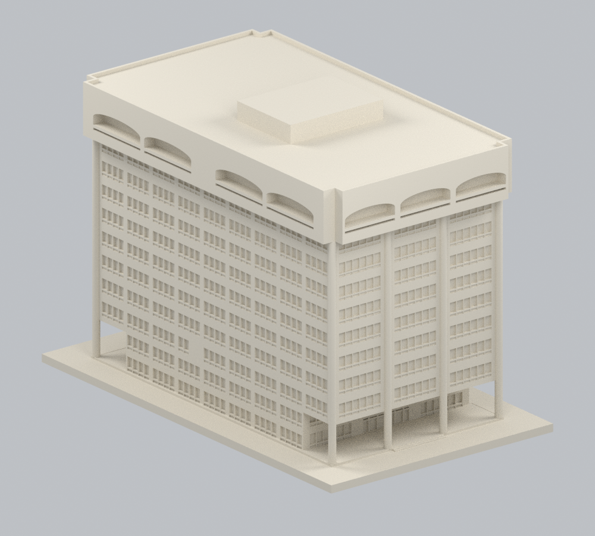
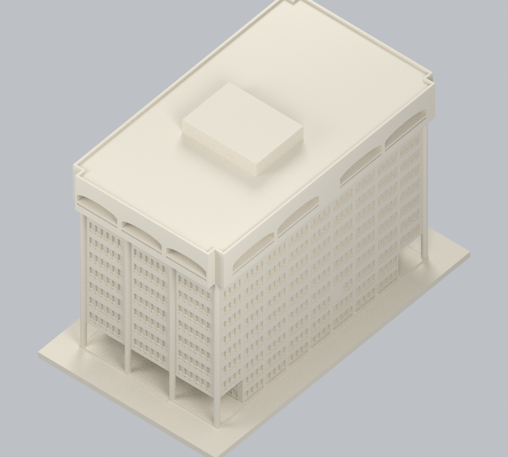
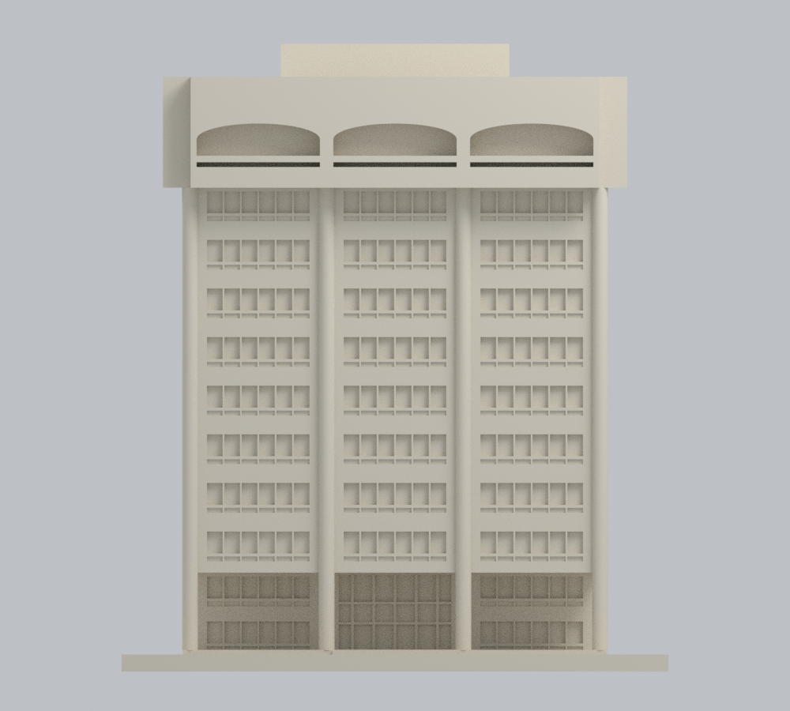
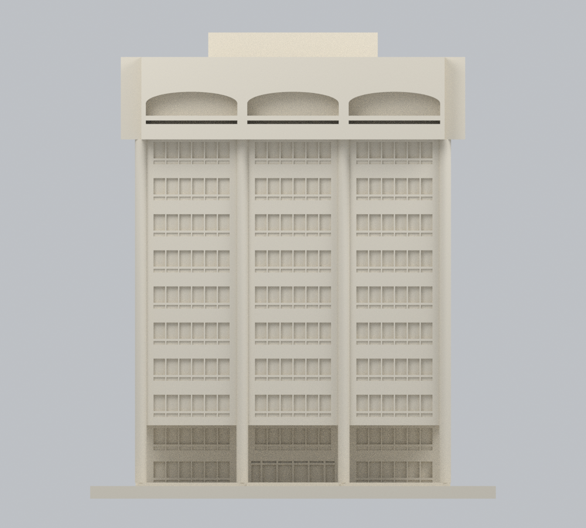
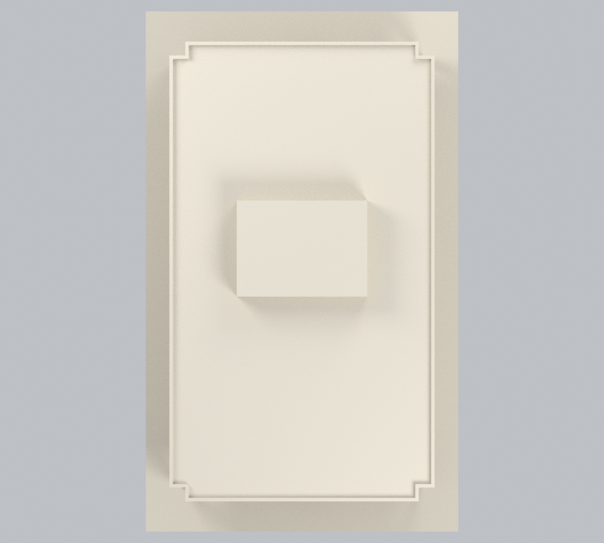
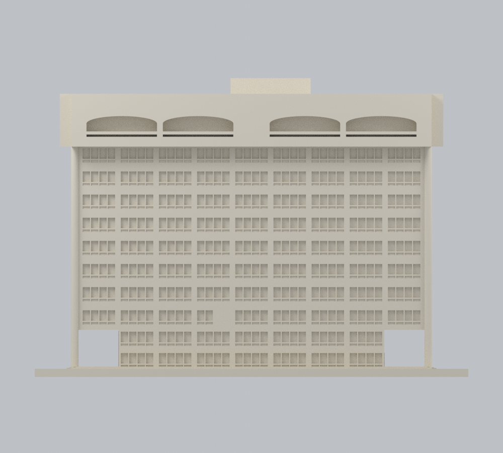
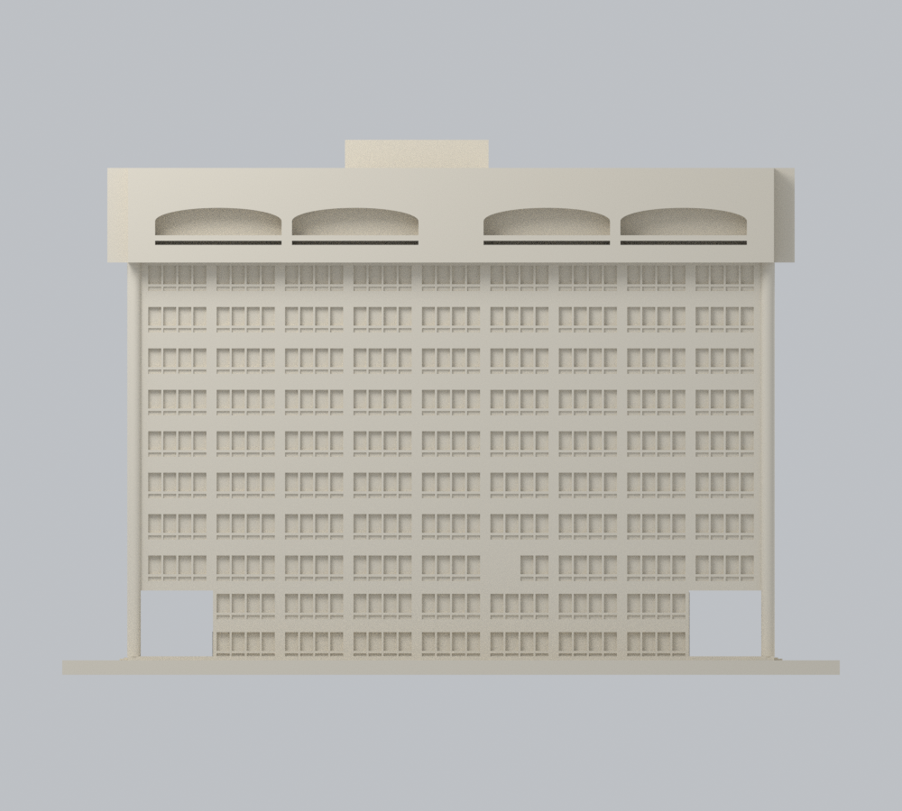
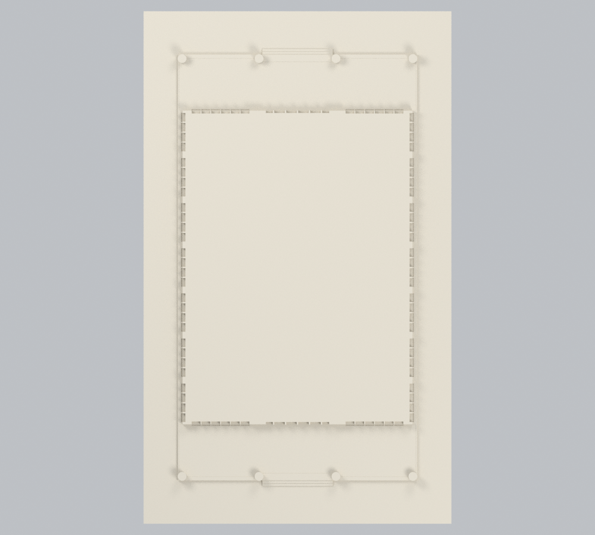

# 圖資大樓主棟｜幾何修正版 v2

[返回原模型與歷史說明](../../README.md) · [原 STL](../../model.stl) · [原 Blender](../../scene.blend)

**這是既有圖資大樓主棟的幾何修正，不是新增建築；套件數增加 0。** 原模型、原始碼和歷史驗證保留。本版是有來源約束的整棟主體外觀近似，不是測繪、BIM、竣工模型或經確認的 2026 現況。

[修正版 STL](model.stl) · [3MF](model.3mf) · [可編輯 Blender](scene.blend) · [參數](params.json) · [重建程式](build_model.py) · [來源與權利](sources.json) · [證據／參數與省略項](evidence-map.json)

## 實際模型九視圖

下圖全部由交付網格產生，沒有來源照片貼圖。暖石色僅沿用原模型的中性預覽設定；**不是實際外牆色彩復原，未確認面的配色亦未冒充真實。** STL 本身不含顏色；3MF 只有一個同樣的預覽材質，不是多色列印／AMS 設定檔。

| 正面斜視 | 後面斜視 | 屋頂斜視 |
| :---: | :---: | :---: |
|  |  |  |
| 南向短立面 | 北向短立面 | 屋頂 |
|  |  |  |
| 東向長立面 | 西向長立面 | 實際網格地面層截面 |
|  |  |  |

`plan.png` 是同一實際實心模型以 z ≤ 6 mm 裁切後的俯視，不是室內平面圖、另一棟建築或額外列印件。Blender 中的這個輔助網格預設隱藏；主模型可直接進入 Edit Mode 編輯。

## 修正了什麼

- 依圖面重新約束主體、冠框與高度比例；不再維持原先偏高的 150 mm 塔身假設。模型含展示底座為 **90 × 150 × 103.29 mm**，是獨立展示比例，不能直接拼成同比例校園。
- 南、北兩短面**各 3 個扁弧凹口**；東、西兩長面**各 4 個、分成 2＋2 組**。補上原版缺少的後面與另一長面冠部，保留弧口下方細縫與實心背襯。
- 短面各跨 6 窗；長面典型樓層 9 組、每組 4 窗，組間寬柱帶與組內窄間隔分開。地面兩層的端部退縮，不套用典型層整排窗。
- 兩短端是雙層門廊與完整圓柱；南面保留挑高中央入口，北面採修訂後較低的中央門口，不照抄變更前窗帶。
- 官方 3F 平面指出兩側通往理工／管理學院的接點。本件在塔身長面、長軸相對中心向南約 5.3 m 的區間停止：略去跨接縫的整扇窗及窗下凹槽，保留**中性封閉的模型範圍切口**，不延伸鄰棟或橋梁，也不把封口稱為實際獨立外牆。寬度、接頭與高度只是有界近似。
- 屋頂採階狀外輪廓與**一個偏心機房**；圖面左方的「機房屋頂平面」是移位詳圖，不被誤建成第二個屋頂量體。

圖面米制數值按 2 mm／圖面 m 轉成模型尺度；33.63 × 61.03 m 主體、50.26 m 頂部等是**圖面數值／解讀，不是現地實測**。47.55／46.95 m 冠頂與屋面層、窗凹深等則是為外觀模型採用的圖面相對解讀。南北東西採圖面與入口關係命名；沒有測量世界座標，官方 1F／RF 頁也未見北向箭頭。

## 年代、界線與未知

博物館資料是建築／設備圖，主要編目年代為 1984，部分帶後續修訂。寫有「76.6 變更前圖」的早期圖只作比較，**不是竣工圖證明**。官方設備平面 PDF 的匯出時間為 2022-07-29，不等於拍攝、測繪或 2026 竣工現況。2024-06-18 後角實拍與 2026-02-09 正面實拍核對外觀大關係；舊校方後門照片為 2015-02-03，不能跨年宣稱同一材質狀態。

本版不包括前方圓亭、鄰接低層院館、延伸連橋、地下室或室內。省略未核實的現況坡道、完整花台／採光井、屋頂設備與天線、屋面分區、女兒牆小凹齒、細部坡度與機房屋脊；冠框倒角、欄杆、窗扇與字樣亦簡化。機房及屋頂沒有實際俯拍像素，不能稱完整屋頂細節復原。所有面保持同一中性展示材質；**全棟真實配色尚未成立**。

## 數位幾何與列印限制

本版獨立重讀 STL 檢查單一連通殼、水密、正體積、面繞序、每邊兩面、頂點單環、退化／重複三角形與自交；517 個 0.2 mm 間距截面有效。0.8 mm 形態開運算是薄特徵篩檢，不是完整最小壁厚證明。詳見 [網格](qa/mesh-validation.json)、[截面](qa/section-screen.json)、[射線／占位對照](qa/ray-controls.json)、[完整圓柱截面](qa/column-section-controls.json)、[自交](qa/self-intersection-validation.json) 與 [自交測試對照](qa/self-intersection-controls.json)。

**未完成實體試印，不保證免支撐。** 雙層門廊頂、冠框出挑與扁弧凹口需檢查橋跨和支撐；窗間細凸稜約 0.3–0.4 mm、入口附著分格約 0.44 mm，粗噴嘴可能無法保留。這些是有實心背襯的細節，不是獨立薄牆。約 1.0 mm 屋頂邊框、底座附著、支撐可拆性及材料強度仍須真機重新切片和試印；不附可直接上機的 G-code。

## 可重現與可編輯

測試環境為 Python 3.12、Blender 4.3.2，Python 套件固定於 `requirements.txt`；3MF 使用 `requirements-3mf.txt` 的 lib3mf 2.5.0，可裝在同一環境或另一個 Python。重建不需要任何來源照片、私人資料、原版模型或網路。

```bash
python -m pip install -r requirements.txt -r requirements-3mf.txt
python reproduce.py --blender blender --lib3mf-python python
python validate_self_intersections.py --out .
python intersection_controls.py --out .
python verify_reproducibility.py --blender blender --lib3mf-python python
```

也可分別執行 `build_model.py`、`export_3mf.py` 與 Blender `render_model.py`。修改 `params.json` 後重建會改變實際幾何；Blender 的主網格和材質亦可直接編輯。3MF 是毫米單位的可編輯網格與單一預覽材質。公開重建檢查比對 STL／3MF／兩份幾何陣列和**九張 PNG 的完整位元組與解碼像素**，不是只比較檔名或圖片尺寸；見 [重建結果](qa/reproducibility.json)。Blender 與 3MF 另外實際修改網格／材質、另存並重開，驗證改動留存；見[原生與 3MF 格式檢查](qa/native-format-validation.json)。

## 來源與權利致謝

- 建築師／事務所：**陳其寛／陳其寬建築師事務所**；收藏與展示：**國立臺灣博物館「臺灣現代建築圖說」**。主要依 [修訂南北立面 CCCK26123024](https://docomomo.ntm.gov.tw/collection.aspx?GID=MLMAMRMXMD)、[東立面 CCCK26123022](https://docomomo.ntm.gov.tw/collection.aspx?GID=MKMSM6MLMD)、[西立面 CCCK26103023](https://docomomo.ntm.gov.tw/collection.aspx?GID=M8MAMRMXMD)、[修訂 1F CCCK26123011](https://docomomo.ntm.gov.tw/collection.aspx?GID=MPMRM6MLMD)、[RF CCCK26123020](https://docomomo.ntm.gov.tw/collection.aspx?GID=MQMSM6MLMD)、[機房 CCCK26123039](https://docomomo.ntm.gov.tw/collection.aspx?GID=MHM6MRMXMD)。館方影像標示 **CC BY-NC，所見頁面未註版本號**；不可擅改成無限制商用授權。
- **阿道**，[2024-06-18 圖資大樓實拍](https://commons.wikimedia.org/wiki/File:National_Sun_Yat-sen_University_Library_20240618.jpg)；**Yu tptw**，[2026-02-09 實拍](https://commons.wikimedia.org/wiki/File:NSYSU_Library_%26_Information_Building_20260209.jpg)，兩者均為自行拍攝、[CC BY-SA 4.0 International](https://creativecommons.org/licenses/by-sa/4.0/)。本包不重發原照或照片貼圖，只記錄幾何觀察與自建模型；未對原照作公開改作。
- 國立中山大學[官方設備平面](https://rpa121.nsysu.edu.tw/static/file/296/1296/attach/76/pta_174559_8196417_04270.pdf)、[校園景觀](https://www.nsysu.edu.tw/p/405-1000-15781,c1505.php?Lang=zh-tw)及[後門無障礙設施](https://ccd-osa.nsysu.edu.tw/p/406-1091-299983,r5235.php?Lang=zh-tw)作對照；未查得逐件明確再散布授權，不能把官方網站可見誤當授權。

全部 11 張圖面紀錄、另列實拍署名與限制見 [sources.json](sources.json)。本包不包含第三方原圖、照片、紋理或 mesh。來源的 BY-NC、BY-SA 4.0 與校方未明示條件各自保留；模型公開不自動清除原建築／圖說／影像權利，也不宣告不同授權已可合併或可任意商用。
