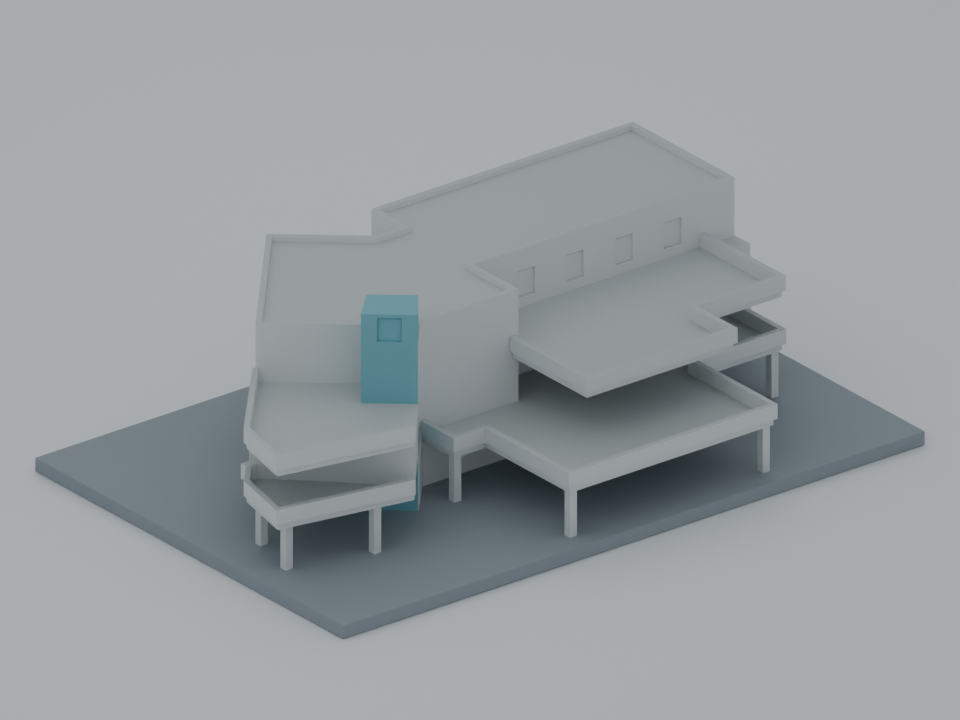

# 國立中山大學西子樓校友會館

已完成獨立來源、幾何與六件製造方案覆核。**列印請優先使用[六件分體方案](manufacturing/v2/README.md)**；原單件 v4 仍需支撐，不能套用分件零結構支撐結論。兩種交付方式合計一套模型，西子樓不是逸仙館別名。

| 模型預覽 | 模型預覽 | 模型預覽 |
| :---: | :---: | :---: |
|  |  |  |

[推薦六件 STL 與印向](manufacturing/v2/README.md) · [原單件 STL（需支撐）](models/v4/model.stl) · [原單件 Blender 場景](models/v4/scene.blend) · [參數](parameters.json) · [原單件生成器](source/build_model.py) · [來源逐圖覆核](evidence/SOURCE-REVIEW.md) · [固定 SHA 獨立摘要](INDEPENDENT-REVIEW.md)

六件已用 PrusaSlicer 2.9.6 實際切片並獨立重切，限定供應印向、100% 尺寸、單噴頭 0.4 mm、0.15 mm 首層與正常層 Z 增量、一般線寬 0.45 mm、100% rectilinear、3 壁、上下各 4 層、3 mm 外側 brim、結構支撐與 raft 關閉。六件支撐擠出皆為零；01 仍有 19 條短 Bridge，依前層宣告線寬量得最大連續缺口約 0.225001 mm。外側 brim 在組裝前逐件處理，不須穿過約 7.2 mm 通道移除結構支撐。

尚未實體試印、拆 brim、乾組、膠合或測黏著強度。generic G-code 僅存於明確標記的覆核證據區，使用者須依真機及材料重切。[公開版本與歷史證據說明](PUBLICATION.md)區分固定候選、去私人路徑副本及目前檔案校驗。

此件為依官方公開資料自建的低細節外觀代表模型，含底座 **150 × 101.4614 × 47 mm**。各層高度與塔高為照片比例估計；模型毫米不是現地公尺，也沒有精密測繪比例。保留三個地上層、相接的矩形與斜向翼、二三樓退縮露台、平屋頂與較高玻璃彎角量體。二樓露台外伸較多，三樓斜翼房間沿露台退回；露台未被填成封閉房間。

## 來源與年代

- [官方四頁平面及屋頂圖](https://safety-oga.nsysu.edu.tw/static/file/296/1296/attach/76/pta_174574_6135545_07096.pdf)：四頁均正式下載及實看，SHA-256 `d1682b5c6bf7daac87ab5ec0988c8dd77890365db1dd491307684265c377e559`。2022-07-29 為 PDF metadata，不能稱測繪或刊登日期。
- [官方三張外觀照片拼圖](https://asc.nsysu.edu.tw/static/file/10/1010/img/3678/518684187.png)：三張均實看，SHA-256 `2fa592b004b519357f40fc6ebf45033849d9cde3d727ae9488db1e4eb9bc3e9e`。拍攝日期未知。
- [官方身分及沿革](https://asc.nsysu.edu.tw/p/404-1010-236412.php?Lang=zh-tw)：記述 2011 年拆至主要梁柱後重建、2012-11-10 設招牌，以及白色三層樓和二、三樓露台。沒有據此宣稱已核實 2026 現況。

圖面以每頁 1800 × 1274 像素影像描繪輪廓；以樓梯核心對位 P2→P3 約 x+44、y+0，P1→P3 約 x+118。主棟邊緣尚有 10–44 像素差異，1F 玻璃塔約另差 8 像素；這是來源不一致與手繪近似的公開紀錄，不能推成精密量測。完整座標、逐張照片支持範圍及圖面差異見 [source-evidence.json](evidence/source-evidence.json)。

## 簡化與明示省略

- 各房間為外觀實心量體，沒有內部分間、地下室、設備或細地形擋土牆。第一頁另外畫的廁所棟未納入。第四頁 RF 和 B1 為不同樓層，沒有拼成相鄰建物。
- 第一頁右上經川堂連接的額外廳／平台本次不納入，照片對應與外觀界線尚不足；沒有宣稱它不存在，也沒有憑空補後翼或鄰棟。
- 窗框、玻璃磚、金屬玻璃欄杆與外階細節以低細節表面和加厚欄牆代替。沒有重建招牌、商標、詩牆文字或室內裝飾。後立面未證實細節留白；部分窗列為可見節奏的代表性重複，並非逐窗還原。
- 二樓斜翼欄牆尖角接點加為 2.4 mm 局部接塊，屬列印適應。一般欄牆 1.2 mm、樓板 1.6 mm、柱 1.8 mm、底座 3 mm；高度以每層 12 mm、角塔底座以上 44 mm 估算。
- 預覽色彩僅為辨識量體；STL 為單一實體，不含透明玻璃或色彩。Blender 場景直接匯入交付 STL，另有標明不列印的地面與照明。

## 重建與檢查

Python 3.13.9 安裝 requirements.txt 後，在模型根目錄執行：

```sh
python -B source/build_model.py --output-dir output/rebuilt
python -B qa/verify_reproducibility.py --json output/reproducibility.json
python -B qa/independent_geometry_qa.py models/v4/model.stl --json output/qa-report.json --negative-controls
```

生成器拒絕覆寫既有 STL。重建不需下載照片或圖面。預覽及場景以 Blender 5.2.2 LTS 執行 `blender -b --python source/render_preview.py`，或安裝相同 bpy 模組後執行該腳本。該步會更新 v4 的場景與預覽，不修改 STL。

數位檢查詳細結果見 [QA-RESULTS.md](qa/QA-RESULTS.md)；失敗版與修正因果見 [CHANGELOG.md](qa/CHANGELOG.md)。固定嚴格門檻與原旗標均保留；不得把整體 gate 的失敗改稱通過。

## 列印限制

以下為**原單件 v4** 的限制：以底座 z=0 平放，單位毫米。開放露台樓板、上層退縮與大跨距板底有四層明確懸垂，需支撐或另經驗證的橋接方案，並確認支撐移除路徑。約 7.2 mm 的通道不保證支撐可移除。不能僅因網格封閉就宣稱免支撐；推薦改用保留外形與露台開放區的[六件方案](manufacturing/v2/README.md)。

原單件沒有實際切片與工具路徑驗證；本包的實際切片及獨立重切僅適用於固定六件方案。所有版本均未實體試印。原單件的切層分析是幾何診斷，不能改稱單件切片或列印成功。

全部網格自建，未擷取第三方 mesh。原始第三方照片、PDF、頁面及其渲染均不隨候選或 Library 備份散布；來源 URL 和雜湊供追溯。建築、攝影與商標等相關權利不因模型交付而自動取得。
