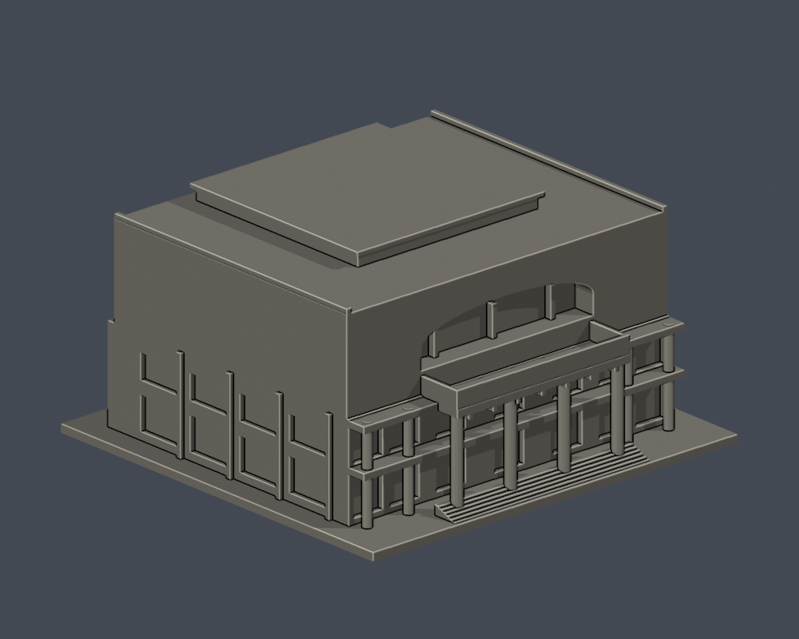
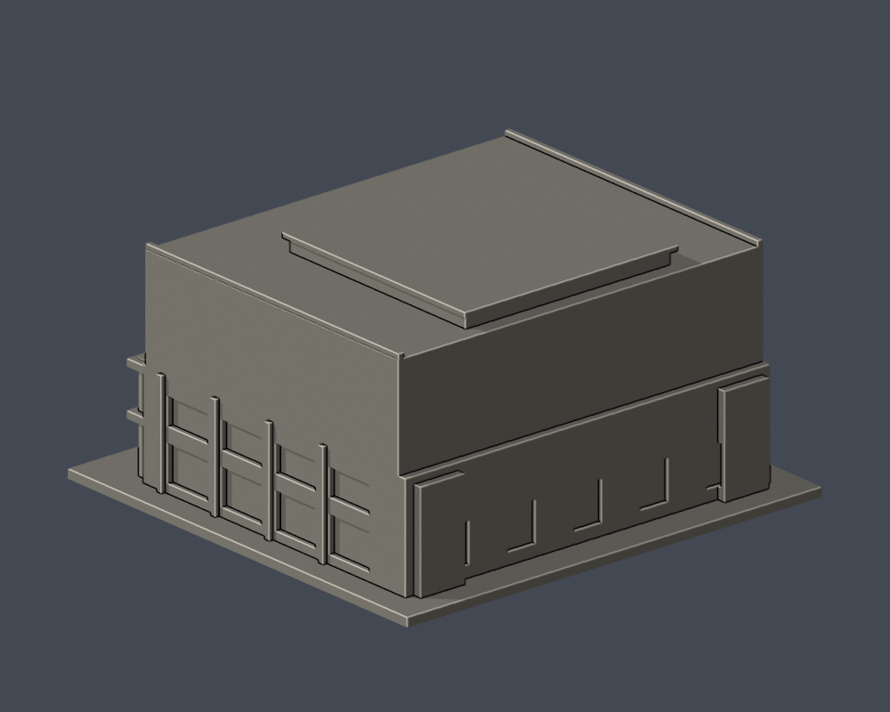
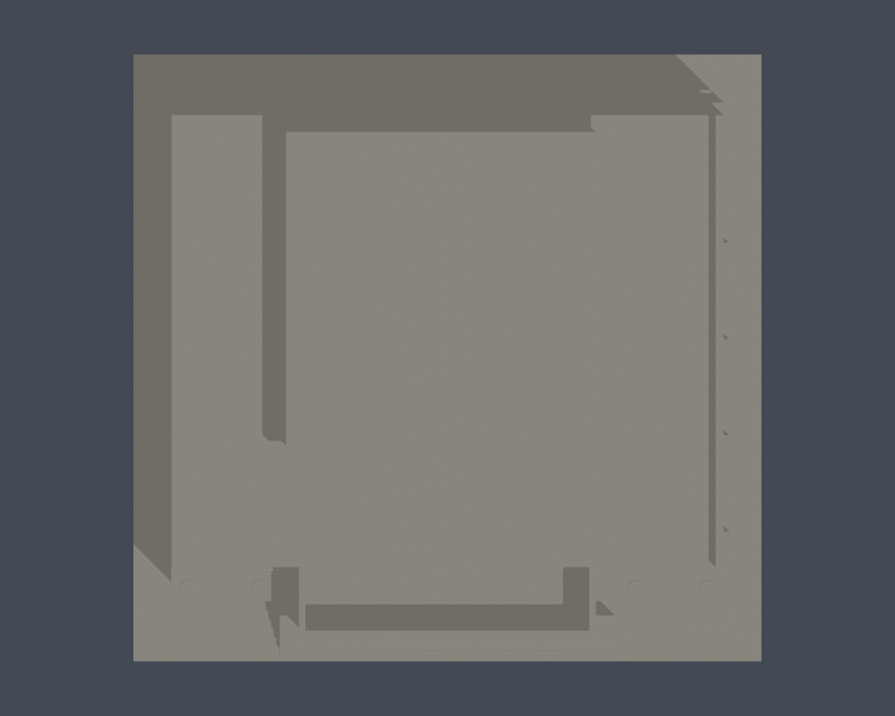

# 國立中山大學 逸仙館

## 模型預覽

| 模型預覽 | 模型預覽 | 模型預覽 |
| :---: | :---: | :---: |
|  |  |  |

## 前上磚牆與門廊前欄板限域配色（2026-10-22）

[五視角、來源與限制](appearance/README.md) · [彩色3MF](appearance/nsysu-yatsen-hall-appearance.3mf) · [可編輯Blender](appearance/scene.blend)

僅51前上牆＋2門廊前欄板，合計53個原完整三角採磚紅proxy；其餘3057面中性。這是主磚平面粗外觀代理，非細外皮還原：窄灰壓頂、字樣、磚縫未建，不切面造色條。弧內、側背、白梁柱、屋頂和底座不擴染；中性不代表實物灰色。完整官方照片2/3日期未知，不稱2026現況或確切成分；截斷圖1未用。原STL/3110面座標/面序/歷史QA不變，不增套；非分色封閉體/G-code，未實體試印，第三方照片不分發。

[返回西子灣校區](../../README.md) · [返回全校圖鑑](../../../README.md)

| 模型預覽 | 模型預覽 | 模型預覽 |
| :---: | :---: | :---: |
| 實際 STL 正面  | 實際 STL 背面  |  |

[下載 STL](model.stl) · [可編輯 Blender](scene.blend) · [參數重建](build_model.py) · [幾何驗證](validation.json) · [全部來源](sources.json)

## 範圍與外觀
逸仙館主體外觀；同棟逸仙美術館等使用空間不另計，旁邊體育館是不同建物。未建劇場內部。

尺寸（含底座）：150 × 145 × 78.5 mm，最長150mm，各館獨立縮放，不能拼成同比例校園。尺寸是模型尺寸，非現地測繪。

- 前廳雙層窗帶與深柱廊
- 向前凸出的四柱門廊、頂部厚邊露台與格狀梁底
- 上層大片磚牆及中央大型扁弧凹口
- 官方1F/RF圖主要近方形本體、後侧服务端位置

## 未知與簡化
- 沒有完整後立面及屋頂實拍，後門、邊角量體及中部屋頂高差作低細節近似。
- 上部凹口保留深度，但內部立柱等細部加粗／合併；未將未知劇場內部挖空。
- 實拍相簿年代未提供；2020整建啟用新聞確認館舍啟用，不能替代2026各面外觀證據。

[正立面](previews/elevation.png) · [俯視／屋頂](previews/top.png)。照片年代未提供，2026-10-13為查閱日，不代表拍攝日或全校現況確認。

| 模型預覽 | 模型預覽 | 模型預覽 |
| :---: | :---: | :---: |
| 正立面  | 俯視／屋頂  |  |

## 列印與數位檢查
單位為毫米，底座朝下。可先用0.4mm噴嘴、0.2mm層高試切片，依材料和機器調整。主門廊柱直徑4.2mm、兩旁3.5mm，露台邊1.6mm，梁底1.6mm；門廊跨距、露台與上層扁弧凹口需支撐/橋接評估。

原始STL水密、每邊兩面、頂點link單環、原法向／繞序、正體積、單一連通表面、150mm、獨立重建SHA一致及儲存Blend幾何一致均通過。393個0.2mm逐層輪廓有效閉合（固定z起點0.071mm，無Polygon修補）；0.8mm參考寬度形態opening以1mm間距抽樣，最大面積損失0.0155%，超過1%層數為0。[逐層資料](valid-sections.json) · [薄特徵篩檢](thin-feature-check.json)。

數位幾何檢查不等於全面最小壁厚量測、Cura/Prusa實際工具路徑或實體試印；未做實體試印，不保證免支撐或任何機器均可印。

## 重建與驗證
Python 3.12安裝requirements.txt，執行python build_model.py。Blender 4.3.2+執行blender -b -t 2 -P render_preview.py，會匯入實際STL並儲存可編輯網格場景與四視圖。python validate_model.py、python check_valid_sections.py、python thin_canonical_v2.py各自必須成功，validate_model.py會獨立暫存重建並驗證SHA和Blend。SHA256SUMS提供逐檔完整性。

## 公開證據
- [官方校園景觀實拍相簿](https://www.nsysu.edu.tw/p/405-1000-15781,c1505.php?Lang=zh-tw)
- [官方各樓層安全平面圖目錄](https://rpa121.nsysu.edu.tw/p/405-1296-286323,c18978.php)
- [逸仙館1（官方實拍）](https://www.nsysu.edu.tw/static/file/0/1000/pictures/561/m/mczh-tw1920x1200_large98819_948909333548.jpg)
- [逸仙館2（官方實拍）](https://www.nsysu.edu.tw/static/file/0/1000/pictures/561/m/mczh-tw1920x1200_large98820_749570333548.jpg)
- [逸仙館3（官方實拍）](https://www.nsysu.edu.tw/static/file/0/1000/pictures/561/m/mczh-tw1920x1200_large98855_929364033549.jpg)
- [教學行政區--逸仙館 PDF](https://rpa121.nsysu.edu.tw/static/file/296/1296/attach/76/pta_174572_2849704_06488.pdf)
- [2020逸仙館整建啟用](https://news.nsysu.edu.tw/p/16-1120-241100.php?Lang=zh-tw)

只自建幾何，未擷取第三方mesh。原照片和PDF不隨本包散布，預覽只含實際STL渲染。
