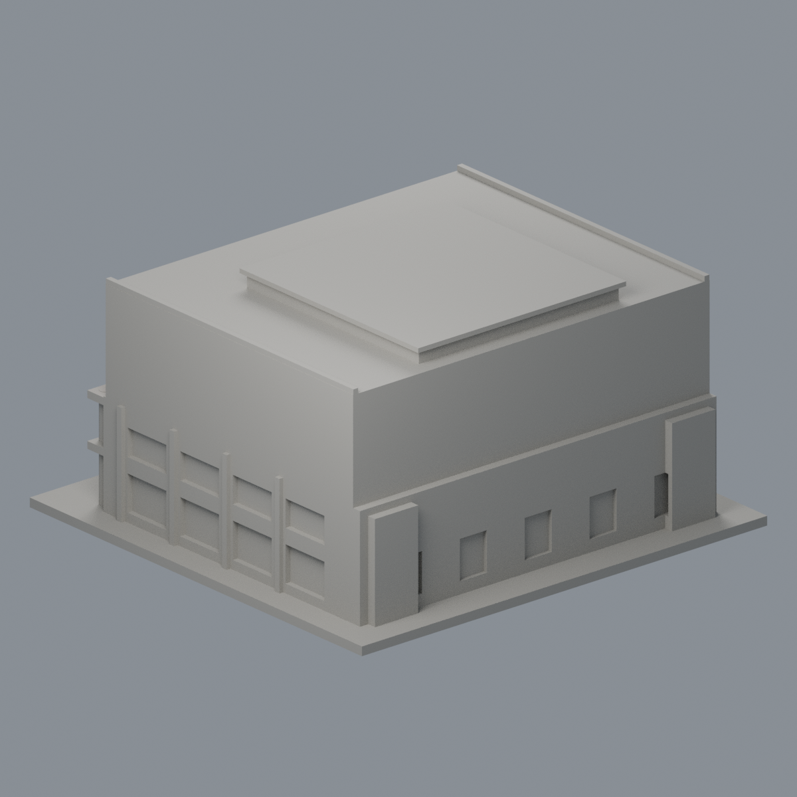

# 國立中山大學逸仙館：來源限域磚紅外觀代理

[彩色3MF](nsysu-yatsen-hall-appearance.3mf) · [可編輯Blend](scene.blend) · [面材質對照](face-materials.json) · [色盤](palette.json) · [來源](SOURCES.md) · [重建原始碼包](rebuild-source.zip)

| 正面 | 背面 |
|---|---|
|  |  |

[正立面](previews/elevation.png) · [側面](previews/side.png) · [俯視](previews/top.png)

## 範圍與限制
官方未標年的完整實拍2、3支持正面上部磚牆51面與門廊前磚欄板2面，合計53個原完整三角採低飽和磚紅 #AE6C58；其餘3057面保持中性 #AAA79F。此為模型既有**磚牆主平面粗外觀代理**，不是細外皮精密還原。窄灰壓頂、字樣、磚縫及污漬未建，沒有切面造色條；屋頂水平面仍為中性。弧洞內表面、側背、白梁柱、玻璃陰影、底座均不擴染；側牆灰裙基界面不清，整片不選。

照片不標日期，2020整建新聞不能證明照片屬整建後，亦不代表2026現況。顏色為未校準視覺proxy，不推定確切建材成分。非相鄰體育館，不另計同棟逸仙美術館。原幾何粗近似與未知後立面/屋頂限制均保留。

原STL 3110三角、1533頂點、150 × 145 × 78.5 mm；STL bytes、每三角座標/繞序/面序不變，無切面、重拓撲、外加幾何。53面總面積約3980.3316 mm²。完整三頂點平面與範圍檢查見 [邊界QA](qa/material-boundaries.json)。不承諾最小壁厚、免支撐或實體可印；此包未做實際切片/試印，歷史列印QA未重算。

## 重建
Python安裝 source/requirements.txt，同層上級放原model.stl。執行 python source/build_appearance.py、python source/verify_material_boundaries.py、python source/verify_exchange.py；Blender 4.3.2 執行 blender -b -t 2 -P source/render_appearance.py，再 blender -b -t 2 -P source/verify_scene.py。交換strict零warning並真edit-save-reopen；Blend可編輯材質。乾淨第二目錄3MF/maps/palette/五PNG逐bytes一致，Blend以語義一致驗證，不宣稱二進位一致。

[交換QA](qa/exchange-validation.json) · [Blend QA](qa/scene-validation.json) · [獨立重建QA](qa/rebuild-validation.json) · [校驗碼](SHA256SUMS) · [權利說明](LICENSE-NOTICE.md)
