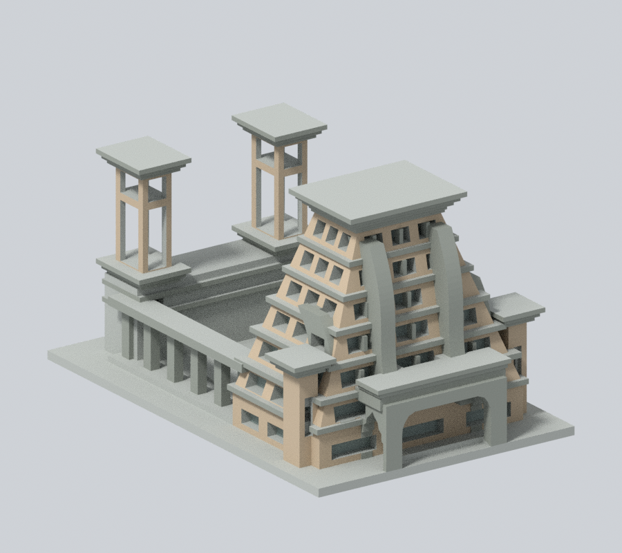
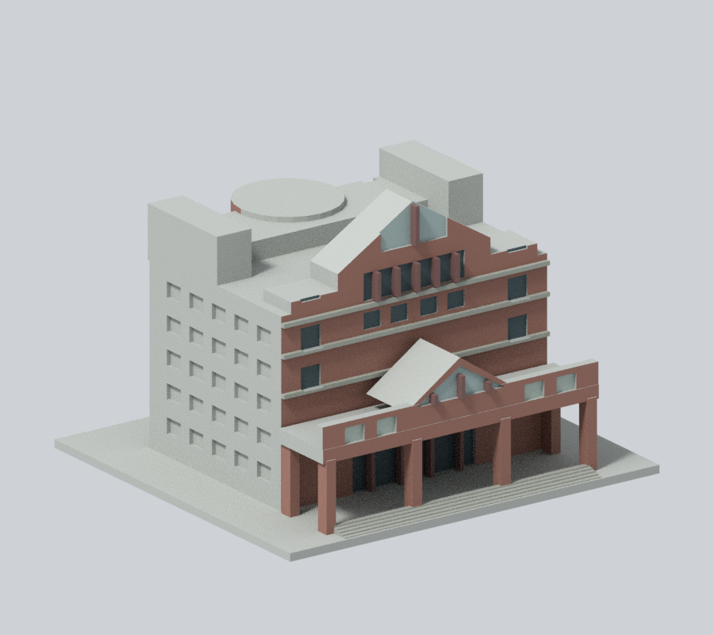
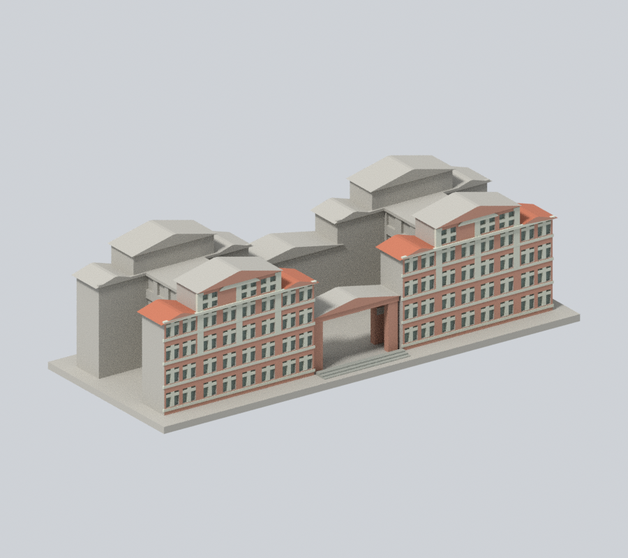
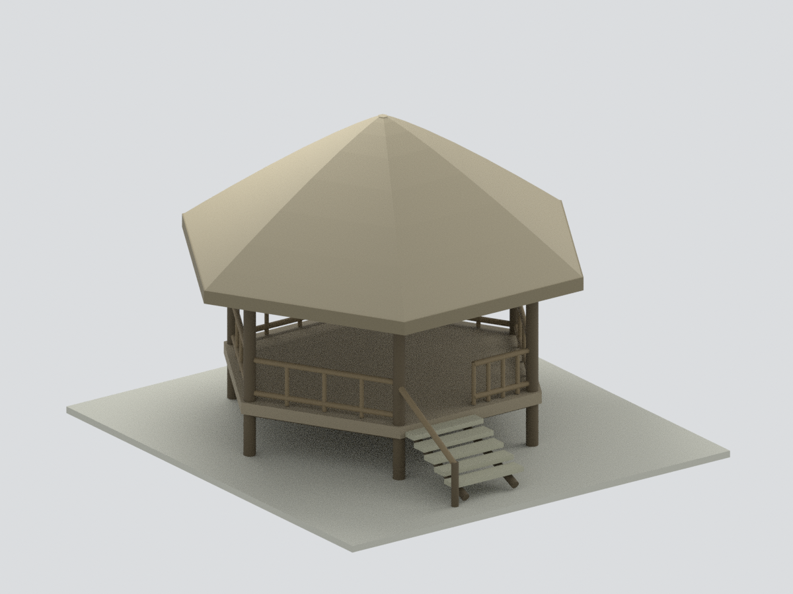

# 民雄校本部建築模型

現行收錄 **5 套模型包**；數量不等於完整建築棟數，亦非全校／校區完成。新件與既有件的年代、截段範圍及未試印限制請閱各模型頁。

### 既有批次來源與列印限制（數量為各批歷史範圍，非現行總數）

依公開實拍自建的毫米制可3D列印建築外觀近似模型，含底座最大尺寸150mm、各件獨立比例。不是精密測繪或施工模型。

當批收錄4件：行政大樓連體群、共同教室大樓完整量體近似，以及圖資中央塔樓與門廊段、大禮堂前門廊段。後兩件為局部；尚未完成全校，也不能當成已完成完整圖書資訊大樓或完整大禮堂。

| 行政大樓 | 大禮堂前門廊段 | 圖資中央塔樓與門廊段 |
|---|---|---|
|  [行政大樓連體群](buildings/ccu-administration-complex/README.md) |  [大禮堂前門廊段](buildings/ccu-auditorium-front-section/README.md) |  [圖書資訊大樓中央塔樓與門廊段](buildings/ccu-library-central-tower-section/README.md) |
|  [共同教室大樓：完整量體近似](buildings/ccu-shared-classroom-complex/README.md) |  |  |

| 建築模型 | 建築模型 | 建築模型 |
| :---: | :---: | :---: |
|  **[國立中正大學 高師亭｜六邊原木茅草亭簡化模型](buildings/ccu-gao-gazebo/README.md)** |  |  |

## 校區與完成範圍

- [學校總覽](../README.md)：4件外觀模型，其中2件是局部段。
- 世賢分部：清江推廣教育大樓，尚未建模。
- 台北校區：壽德大樓10樓之2，為共用大樓部分樓層，尚未建模，不能把整幢視為專屬校舍。

圖書館、視聽中心、資訊處屬圖書資訊大樓的三個單元；不重複計棟。行政主體、兩側連廊與鐘鼓樓為同一連體群。

## 使用限制

每件目錄都有 STL、可編輯 Blend、可獨立重建的參數腳本、實際 STL 正背預覽、來源網址與數位驗證結果。第三方原照片與 PDF 不再散布。

行政及圖書館2026年有丹娜絲災損修繕公告，這一批是官方照片所示修繕前形態的近似，不能當作2026年10月施工現況。

共同教室依既有官方照片及114防災圖面近似；後立面細節未知。2026年8月11日至12月31日部分教室整修中，不代表整修後竣工現況。

底座朝下、以毫米匯入。深門廊、長梁、挑簷及塔樓開口需在切片器檢查支撐；未實體試印、未驗證實際工具路徑。數位幾何檢查不等於保證可印或保證免支撐。

[覆蓋狀態](../coverage.json) · [模型索引](../model-index.json) · [檔案 SHA](../SHA256SUMS)
