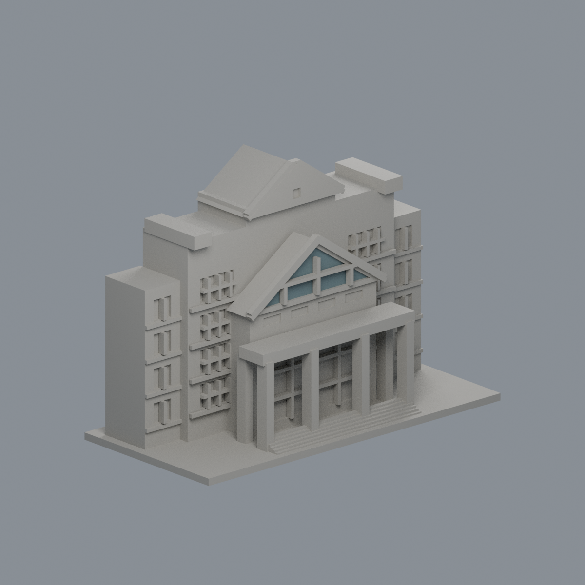
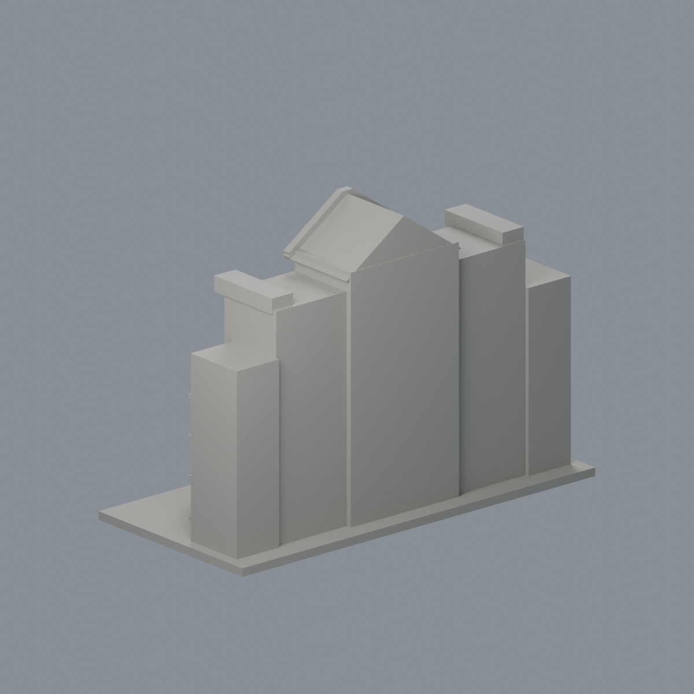

# 國立中正大學大禮堂前門廊段：三角玻璃限域外觀代理

[彩色3MF](ccu-auditorium-front-section-appearance.3mf) · [可編輯Blend](scene.blend) · [面材質對照](face-materials.json) · [色盤](palette.json) · [來源](SOURCES.md) · [重建原始碼包](rebuild-source.zip)

| 正面 | 背面 |
|---|---|
|  |  |

[正立面](previews/elevation.png) · [側面](previews/side.png) · [俯視](previews/top.png)

## 範圍與限制
這是大禮堂**前門廊段**，不是完整大禮堂。官方頁未標攝影日期的正前照支持中心下層山牆的灰藍分格玻璃。本次只將既有三角背板一個完整大三角（STL face725、532 mm²）指定灰藍 #687C80 不透明代理，其餘3521面中性 #AAA79F。三根竪框與橫框在前方另有幾何，全部中性，不染玻璃色。白亮反光不另造白材料。磚牆與灰色帶未有可安全分隔的完整面，因此不擴塗；其他窗、石框、柱廊、屋頂與背部截面皆中性。

斜側官方照只見柱廊、磚牆及窗，**不含所選三角玻璃，不是該玻璃側背補證**。官方頁未標日期；正前原JPEG EXIF DateTimeOriginal/Digitized列2003:08:09 17:18:21，側照列2003:10:25 12:17:24。兩者無時區offset，未獨立核對相機時鐘，不轉UTC。2026-10-22僅存取日，不宣稱2026現況。色值為未校準目視近似，非真實玻璃成分、透色或精確測色；使用不透明表面不犧牲列印實體。原截面/粗近似、未知後立面限制保留。

原STL 3522三角、1603頂點、150 × 72 × 約106.2 mm；原bytes、三角座標/繞序/面序不變，不切面、不新增面、不重拓撲。所有三頂點須位於 y=-12.15 mm 與 xz三角(-28,55),(28,55),(0,74)邊界內（0.0002 mm容差），不是只測bbox或中心。[完整面邊界QA](qa/material-boundaries.json)。未做實際切片/試印，不承諾最小壁厚或免支撐，歷史製造QA未重算。

## 重建
Python安裝 source/requirements.txt，同層上級放原model.stl。執行 python source/build_appearance.py、python source/verify_material_boundaries.py、python source/verify_exchange.py；Blender執行 blender -b -t 2 -P source/render_appearance.py，再 blender -b -t 2 -P source/verify_scene.py。交換strict零warning並真edit-save-reopen；Blend可編輯材質。乾淨第二目錄3MF/maps/palette/五PNG逐bytes一致，Blend語義一致，不宣稱二進位一致。

[交換QA](qa/exchange-validation.json) · [Blend QA](qa/scene-validation.json) · [獨立重建QA](qa/rebuild-validation.json) · [校驗碼](SHA256SUMS) · [權利說明](LICENSE-NOTICE.md)
