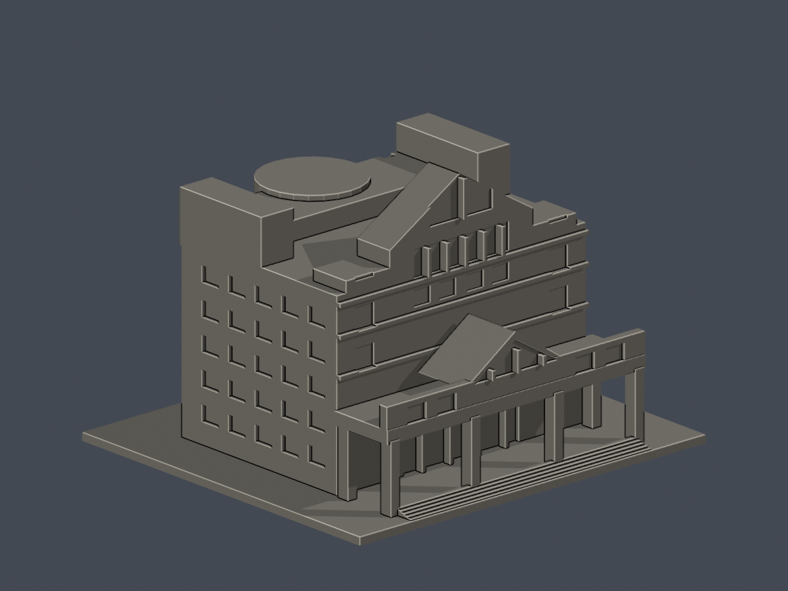
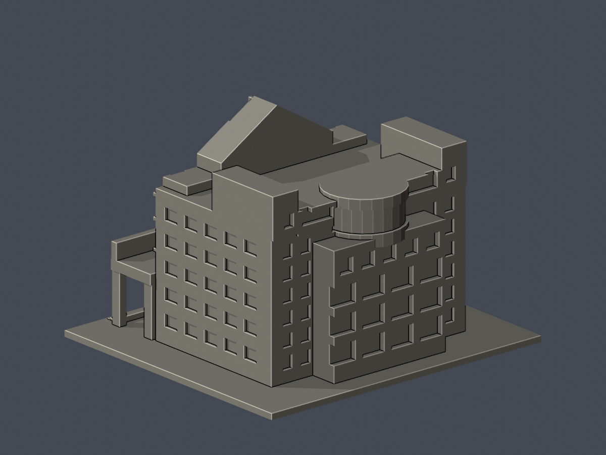
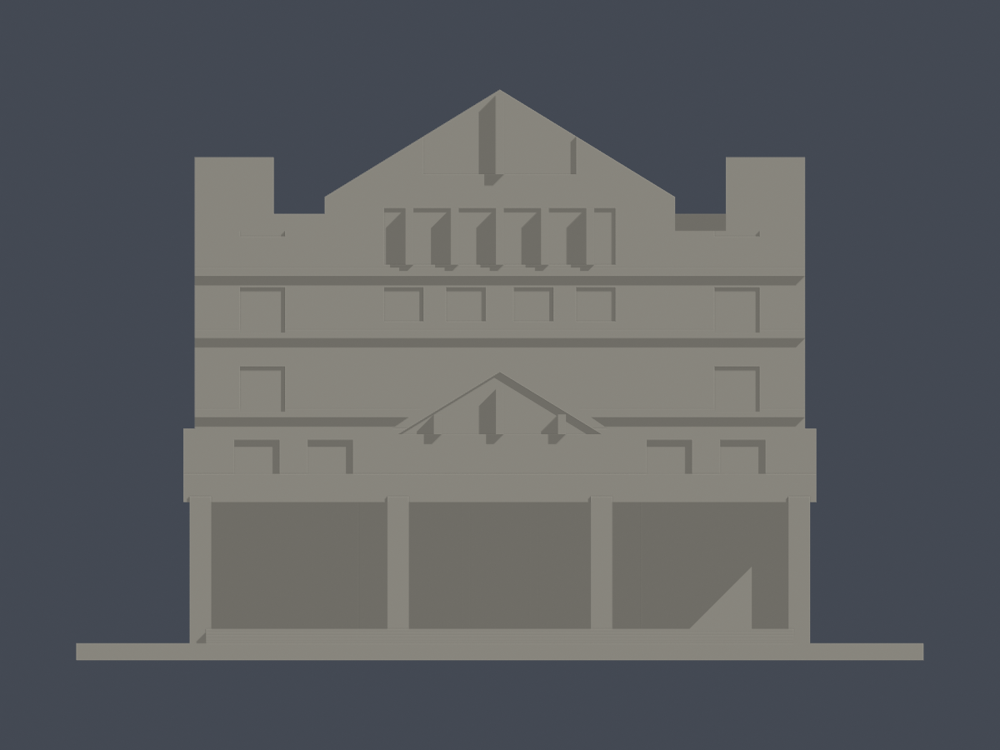
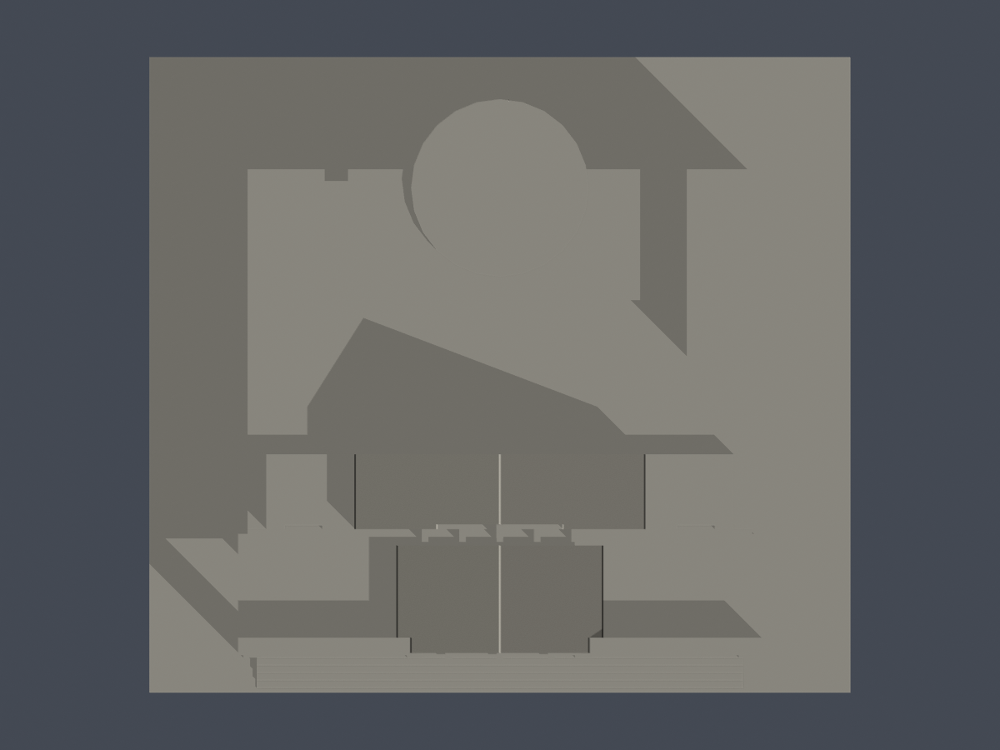

# 圖書資訊大樓中央塔樓與門廊段

國立中正大學・民雄校本部｜公開實拍外觀近似模型｜單位：毫米（mm）。

| 模型預覽 | 模型預覽 | 模型預覽 |
| :---: | :---: | :---: |
| 前斜視（實際 STL）  | 後斜視（實際 STL）  |  |

[正立面](previews/elevation.png) · [上視圖](previews/top.png)

| 模型預覽 | 模型預覽 | 模型預覽 |
| :---: | :---: | :---: |
| 正立面  | 上視圖  |  |

## 模型範圍

圖書資訊大樓中的中央高層圖書館塔樓和前方門廊段；整棟的東西三層翼、視聽／資訊相關空間尚未覆蓋。

保留前方架高門廊與實際開口、兩級山牆、頂部玻璃面內凹、後側圓弧閱讀空間與下方突出量體。

塔樓深度、頂部平台、側面窗格配置部分為視覺估計；沒有完整樓層平面或全棟測繪。東西低翼與其院落尚未建模，不另把視聽中心或資訊處計為完成獨立建物；前景景觀柱群不屬塔樓。

## 來源年代與限制

官方三張實拍未標攝影日期。2026-07-23修繕公告含圖書館災損修繕，本件仍是公開照片所示形態近似，修繕後完整外觀待確認。

[官方建物介紹](https://ccu-navigation.ccu.edu.tw/p/426-1253-17.php?Lang=zh-tw)。完整原始網址、實際查看的照片及支持特徵請見 [sources.json](sources.json)。第三方原照片和 PDF 不隨模型再散布。

## 下載與重建

- [model.stl](model.stl)：含底座 150.00 × 136.00 × 101.00 mm，最大尺寸 150 mm，各建物獨立比例，不是校園統一比例尺。
- [scene.blend](scene.blend)：匯入實際交付 STL 的可編修三角網格；場景單位毫米。
- [build_model.py](build_model.py)：獨立參數與布林幾何建構來源，無外部網格或照片依賴。
- [requirements.txt](requirements.txt)：Python 3.12 套件版本；另需 Blender 4.3.2+。
- [SHA256SUMS](SHA256SUMS)：逐檔雜湊。

重建：先安裝 requirements.txt，執行 python build_model.py，再執行 blender -b -t 2 -P render_preview.py。渲染器讀取 model.stl，預覽不是另一份外觀替身。

## 列印與數位檢查

底座朝下、毫米匯入切片器。入口挑空上方樓板、屋簷與後側弧形窗頂可能需要支撐；曲面窗分隔經粗化，非原尺寸門窗。 請自行在 Cura／PrusaSlicer 等確認支撐、跨橋與工具路徑；沒有實體試印，也沒有實際切片器驗證，不能保證無支撐列印或保證成功。

- [validation.json](validation.json)：原始二進位 STL 面法向／繞序、每邊兩面、頂點 link 單環、單一連通表面、正體積、底座與尺寸；獨立重建 STL SHA 及 saved Blend 幾何一致。
- [contour-validity-check.json](contour-validity-check.json)：起點 z=0.071 mm、間距 0.2 mm，共 505 層；每節點 degree 2、個別閉合輪廓及組合 Polygon valid，失敗即中止、不修補吞錯。
- [layer-check.json](layer-check.json)：同間距閉合及向下表面篩檢。
- [thin-feature-check.json](thin-feature-check.json)：canonical shared-edge thin-v2，z=0.071 mm 起、1 mm 間距、0.8 mm參考寬度 morphology opening；最大面積損失 0.304%，高於1%為 0 層。此值也包含尖角，不是全模型最小壁厚或實際擠出測試。

重跑 python validate_model.py、python check_layers.py、python check_contour_validity.py、python check_thin_features.py。每支程序均需 exit 0；輪廓檢查禁止使用 buffer(0) 修補輸入問題。

模型為建物外觀研究縮景，並非施工、結構、無障礙或防災分析模型。
