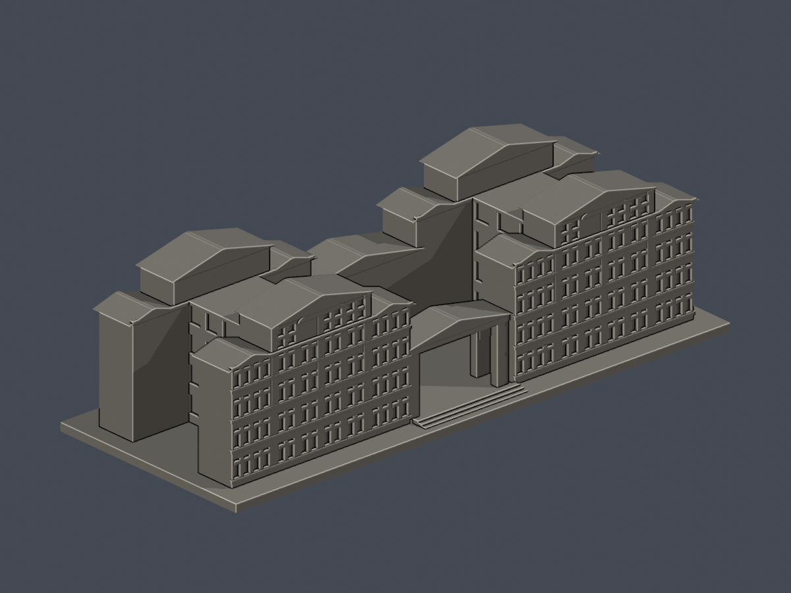
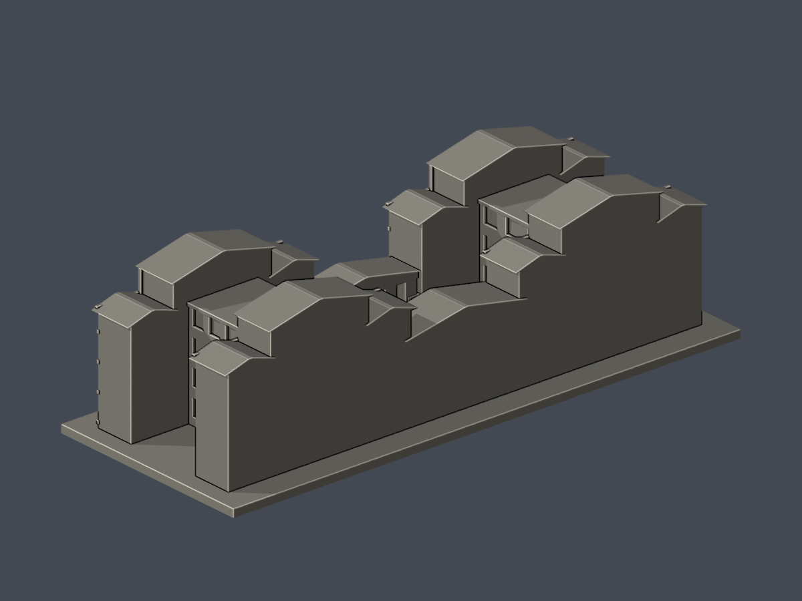

# 國立中正大學｜共同教室大樓

民雄校本部。完整地上量體的自建近似模型，並非測繪複製品。依官方既有實照與114年度防災平面重建双翼進深、前後橫翼、側向連接體、中央開放空間、低入口柱廊及高低屋面。後立面沒有清楚資料，僅保留量體與屋頂，不虛構窗陣。

2026年8月11日至12月31日部分教室仍在整修。本件不代表整修後竣工現況，也不代表全校建築已完成。

## 預覽

| 正面 | 背面 |
|---|---|
|  |  |

[正立面](previews/elevation.png) · [俯視](previews/top.png)

所有預覽由交付的同一份STL匯入後渲染；非來源照片、效果圖或另做的展示幾何。

## 檔案與尺寸

- [model.stl](model.stl)：毫米，含底座150 × 60.16 × 42.45 mm，底座厚2.25 mm，最長邊150 mm。
- [scene.blend](scene.blend)：可編輯實際STL網格；Blender單位毫米。
- [build_model.py](build_model.py)：參數化自建來源。主要原始量體建成後依平面長寬與照片立面比例縮放，非校方實際尺寸。
- [requirements.txt](requirements.txt)：重建環境；Python 3.12、Blender 4.3.2+。
- [sources.json](sources.json)：可查來源、年代、不確定部分與特徵決策。
- [qa-summary.json](qa-summary.json)、[validation.json](validation.json)、[layer-opening-check.json](layer-opening-check.json)、[layer-component-check.json](layer-component-check.json)、[thin-feature-check.json](thin-feature-check.json)、[open-space-check.json](open-space-check.json)：數位驗證。
- [SHA256SUMS](SHA256SUMS)：逐檔校驗。

## 重要特徵與限制

最高五層與較低四層肩部區別建模。前面最高層四跨中的磚面與三組窗依實照分開處理；主柱、窗中框、樓帶、弧形上帽與三角山牆均為真實幾何。中央及兩側凹處未用實心平台塞滿；門廊保留通行空間。後面、部分遮蔽低層與屋頂背坡仍有簡化。沒有地下室、室內、招牌小字、設備或景觀。

## 列印與重建

底座朝下。0.4 mm噴嘴／0.2 mm層高僅為參考；門廊梁底、凹口與屋簷可能需要支撐，請在自己的切片器檢查。窗框和屋脊為縮尺細節，不宜再大幅縮小。屋脊採1.1 mm寬平頂避免零厚尖端。0.8 mm opening篩查每層損失均低於1%，這仍不是完整最小壁厚量測。

依requirements安裝後，執行python build_model.py，再執行blender -b -t 4 -P render_preview.py。執行python run_all_checks.py可重做全部驗證。請在可写入的工作副本重建，不覆寫已凍結檔案。

原STL單一連通表面、每邊兩面、vertex-link單一環、正體積、原法向、獨立重建SHA以及Blend幾何一致均檢查。每0.2 mm、起始Z=0.071 mm的原網格截面，逐個與合成Polygon均直接驗證有效，遇錯非零退出，沒有輪廓修補回退。另逐0.2 mm檢查每個原Polygon在0.8 mm erosion及opening後皆保留且不分裂；附逐1 mm canonical v3 opening與真院落／凹入口射線檢查。前簷帶下緣避開上排窗洞，防止薄跨窗連接。

數位QA不等於Cura／Prusa實際工具路徑或實體試印，不保證無支撐或任何材質都可列印。第三方照片/PDF沒有放進公開包。
