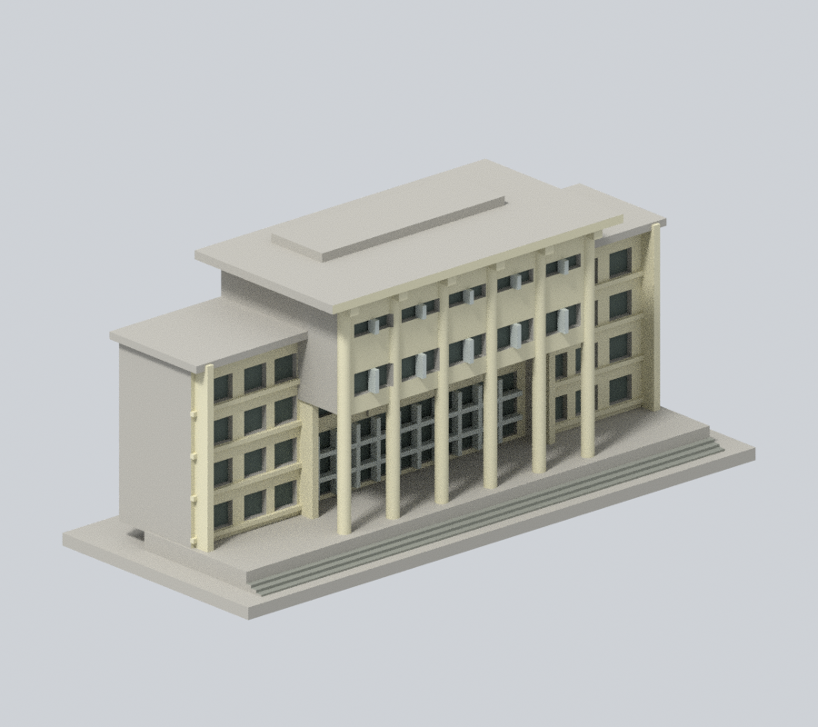
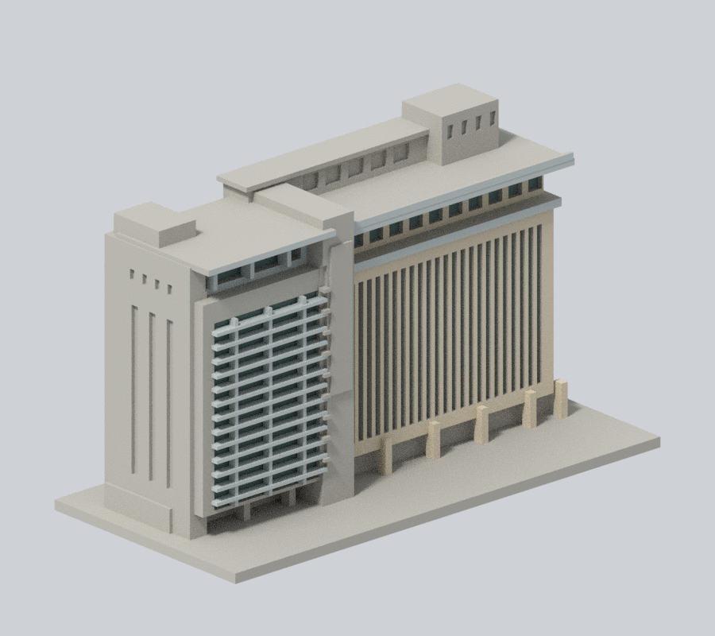
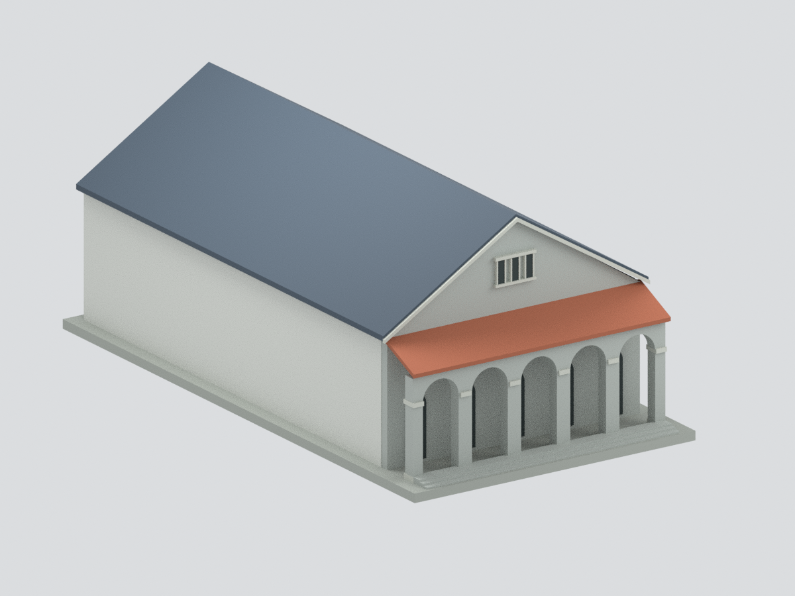
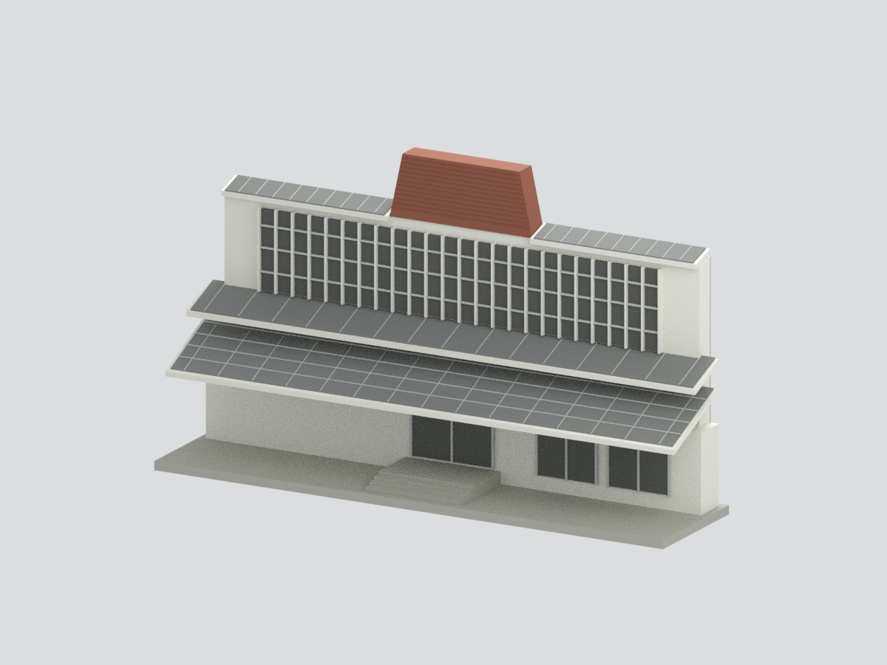

# 校本部｜國立中興大學

現行收錄 **5 套模型包**；數量不等於完整建築棟數，亦非全校／校區完成。新件與既有件的年代、截段範圍及未試印限制請閱各模型頁。

### 既有批次來源與列印限制（數量為各批歷史範圍，非現行總數）

當批3座建物各完成一個公開外觀局部段，尚未完成任何全館測繪式重建，也未完成整校。所有模型底座最長150mm、各件獨立比例。

| 建築模型 | 建築模型 | 建築模型 |
| :---: | :---: | :---: |
| [行政大樓前棟與柱廊段](buildings/nchu-administration-front/)  | [惠蓀堂西向前棟段](buildings/nchu-huisun-front/)  | [圖書館臨湖前翼與轉角段](buildings/nchu-library-lakeside/)  |
|  **[國立中興大學小禮堂：重建後主廳外觀研究](buildings/nchu-small-hall-rebuilt-main-hall/README.md)** |  **[國立中興大學雲平樓｜2024中央正立面截段](buildings/nchu-yunping-central-front-2024/README.md)** |  |

[學校入口](../README.md) / [逐項續接與来源](../continuation.json)
