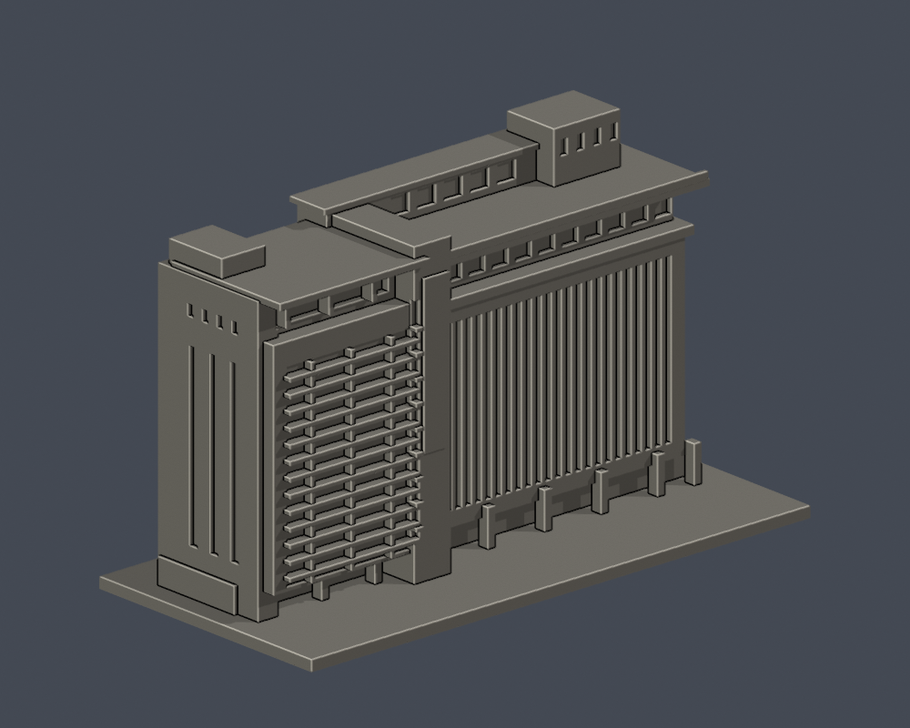

# 校本部｜國立中興大學

目前3座建物各完成一個公開外觀局部段，尚未完成任何全館測繪式重建，也未完成整校。所有模型底座最長150mm、各件獨立比例。

| [行政大樓前棟與柱廊段](buildings/nchu-administration-front/) | [惠蓀堂西向前棟段](buildings/nchu-huisun-front/) | [圖書館臨湖前翼與轉角段](buildings/nchu-library-lakeside/) |
|---|---|---|
|  |  |  |

[學校入口](../README.md) / [逐項續接與来源](../continuation.json)
